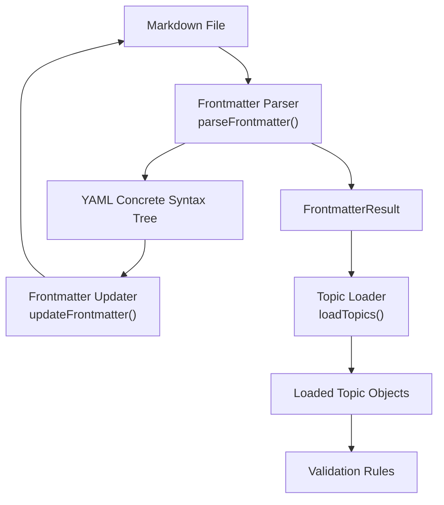
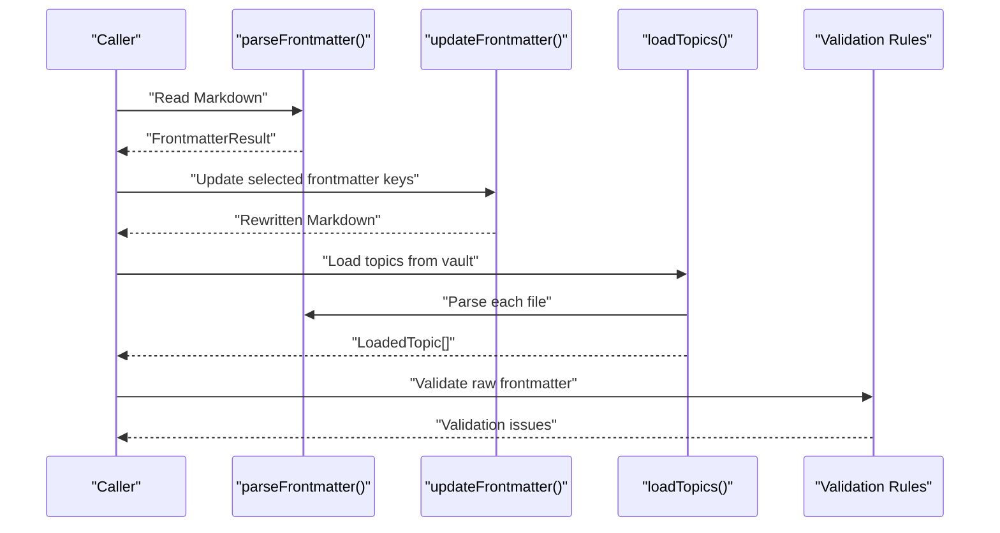
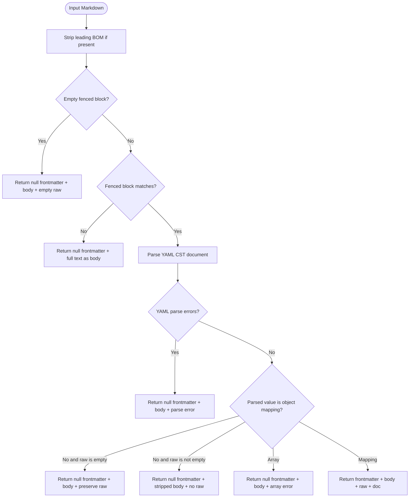
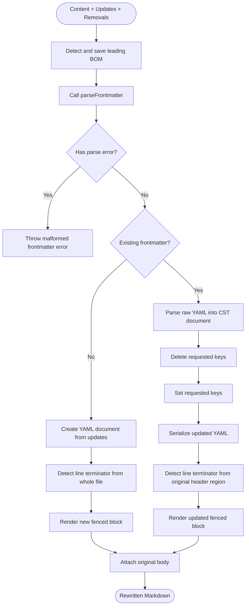
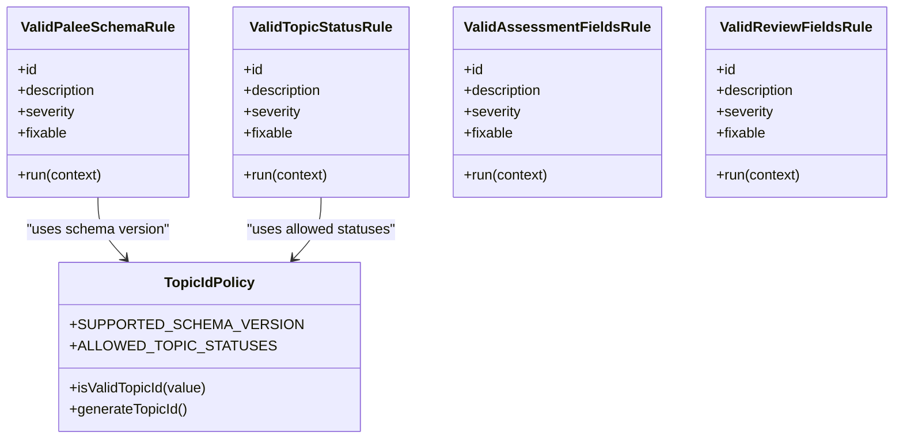
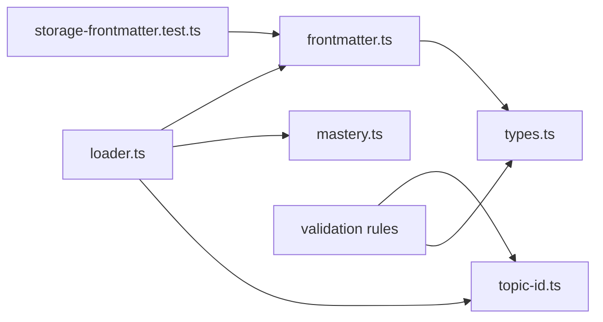

# Frontmatter Parser and Updater

<cite>
**Referenced Files in This Document**
- [frontmatter.ts](https://github.com/Kuldeep2822k/cli/blob/main/src/storage/frontmatter.ts)
- [types.ts](https://github.com/Kuldeep2822k/cli/blob/main/src/types.ts)
- [loader.ts](https://github.com/Kuldeep2822k/cli/blob/main/src/storage/loader.ts)
- [topic-id.ts](https://github.com/Kuldeep2822k/cli/blob/main/src/engine/topic-id.ts)
- [mastery.ts](https://github.com/Kuldeep2822k/cli/blob/main/src/engine/mastery.ts)
- [valid-palee-schema.ts](https://github.com/Kuldeep2822k/cli/blob/main/src/validation/rules/valid-palee-schema.ts)
- [valid-topic-status.ts](https://github.com/Kuldeep2822k/cli/blob/main/src/validation/rules/valid-topic-status.ts)
- [valid-assessment-fields.ts](https://github.com/Kuldeep2822k/cli/blob/main/src/validation/rules/valid-assessment-fields.ts)
- [valid-review-fields.ts](https://github.com/Kuldeep2822k/cli/blob/main/src/validation/rules/valid-review-fields.ts)
- [storage-frontmatter.test.ts](https://github.com/Kuldeep2822k/cli/blob/main/test/storage-frontmatter.test.ts)
</cite>

## Table of Contents
1. [Introduction](#introduction)
2. [Project Structure](#project-structure)
3. [Core Components](#core-components)
4. [Architecture Overview](#architecture-overview)
5. [Detailed Component Analysis](#detailed-component-analysis)
6. [Dependency Analysis](#dependency-analysis)
7. [Performance Considerations](#performance-considerations)
8. [Troubleshooting Guide](#troubleshooting-guide)
9. [Conclusion](#conclusion)
10. [Appendices](#appendices)

## Introduction
This document explains the PALEE frontmatter parser and updater subsystem that turns raw Markdown topic files into structured topic data and back again. It covers:

- The YAML frontmatter schema used by PALEE topics, including fields such as `palee_id`, `title`, `status`, `topic_mastery`, assessment pillars, and SM-2 review state.
- Validation rules for each field type.
- Serialization formats and identity-preserving behaviors.
- The parsing flow from raw Markdown to structured topic objects.
- The update mechanism that modifies specific frontmatter keys while preserving comments, unknown keys, body text, line endings, and leading BOMs.
- Practical operations such as setting assessment scores, updating review timestamps, and managing prerequisite relationships.
- Performance considerations for large vaults and best practices for safe frontmatter manipulation.

The subsystem intentionally separates low-level file I/O concerns (the YAML CST parser and writer) from domain validation and loading, so that malformed notes do not break vault scans and updates remain non-destructive.

## Project Structure
The frontmatter subsystem spans several layers:

| Layer | Responsibility | Key File |
|---|---|---|
| Low-level serialization | Parse and update raw YAML frontmatter without destroying formatting | `src/storage/frontmatter.ts` |
| Result and scan types | Typed contracts for parse outcomes and scanned notes | `src/types.ts` |
| Topic loading | Extract PALEE-managed topics from parsed frontmatter | `src/storage/loader.ts` |
| Domain policies | Topic ID policy, allowed statuses, mastery computation | `src/engine/topic-id.ts`, `src/engine/mastery.ts` |
| Validation rules | Per-field schema enforcement on raw frontmatter values | `src/validation/rules/*` |
| Tests | Byte-level fidelity, error handling, and edge cases | `test/storage-frontmatter.test.ts` |

**Diagram sources**
- [frontmatter.ts:1-220](https://github.com/Kuldeep2822k/cli/blob/main/src/storage/frontmatter.ts#L1-L220)
- [types.ts:444-493](https://github.com/Kuldeep2822k/cli/blob/main/src/types.ts#L444-L493)
- [loader.ts:350-417](https://github.com/Kuldeep2822k/cli/blob/main/src/storage/loader.ts#L350-L417)

**Section sources**
- [frontmatter.ts:1-220](https://github.com/Kuldeep2822k/cli/blob/main/src/storage/frontmatter.ts#L1-L220)
- [types.ts:444-493](https://github.com/Kuldeep2822k/cli/blob/main/src/types.ts#L444-L493)
- [loader.ts:350-417](https://github.com/Kuldeep2822k/cli/blob/main/src/storage/loader.ts#L350-L417)

## Core Components
The core runtime components are:

| Component | Purpose | Important Behavior |
|---|---|---|
| `parseFrontmatter` | Reads a Markdown string, extracts YAML frontmatter and body, and returns a typed result | Handles empty fences, missing frontmatter, malformed YAML, arrays between fences, and leading BOMs |
| `updateFrontmatter` | Sets or removes frontmatter keys while preserving existing YAML structure | Uses a YAML CST document; preserves comments, unknown keys, body text, line terminators, and leading BOMs |
| `computeFingerprint` | Computes a SHA-256 hex digest of file content | Used by caching and OCC layers to detect out-of-band changes |
| `FrontmatterResult` | Typed return value for parsing | Includes optional parsed frontmatter, body, raw YAML, CST document, and error message |
| `ScannedNote` | One entry per scanned Markdown file | Carries path, parsed frontmatter, parse errors, read errors, and optional raw content |

**Section sources**
- [frontmatter.ts:1-220](https://github.com/Kuldeep2822k/cli/blob/main/src/storage/frontmatter.ts#L1-L220)
- [types.ts:444-493](https://github.com/Kuldeep2822k/cli/blob/main/src/types.ts#L444-L493)

## Architecture Overview
The architecture is layered:

1. **Raw Markdown input** enters the parser.
2. **Frontmatter parsing** uses the `yaml` library’s CST-aware document model.
3. **Parsing results** are either passed directly to writers through `updateFrontmatter`, or normalized into topic records by `loadTopics`.
4. **Validation rules** inspect raw frontmatter values independently of loader normalization, exposing vault corruption rather than silently repairing it.
5. **Domain policies** constrain IDs, statuses, difficulty, and mastery calculations.

**Diagram sources**
- [frontmatter.ts:1-220](https://github.com/Kuldeep2822k/cli/blob/main/src/storage/frontmatter.ts#L1-L220)
- [loader.ts:350-417](https://github.com/Kuldeep2822k/cli/blob/main/src/storage/loader.ts#L350-L417)

## Detailed Component Analysis

### Frontmatter Parsing Flow
`parseFrontmatter` implements a strict but forgiving pipeline:

1. Strip a single leading BOM (`U+FEFF`) so Windows-generated files can be parsed.
2. Match an empty fenced block with no intermediate content.
3. Match a populated fenced block with mandatory newlines around the closing fence.
4. If no fenced block matches, return no frontmatter and treat the entire text as body.
5. Parse the YAML block through the `yaml` CST parser.
6. Treat scalars and arrays between fences as non-mapping frontmatter; arrays explicitly report an error because they are malformed rather than thematic breaks.
7. Return the parsed mapping, body, raw YAML, CST document, and any parse error.

**Diagram sources**
- [frontmatter.ts:1-120](https://github.com/Kuldeep2822k/cli/blob/main/src/storage/frontmatter.ts#L1-L120)

**Section sources**
- [frontmatter.ts:1-120](https://github.com/Kuldeep2822k/cli/blob/main/src/storage/frontmatter.ts#L1-L120)
- [storage-frontmatter.test.ts:1-200](https://github.com/Kuldeep2822k/cli/blob/main/test/storage-frontmatter.test.ts#L1-L200)

### Frontmatter Update Mechanism
`updateFrontmatter` performs targeted mutations:

- If the file has no frontmatter, it creates one using the supplied updates.
- If the file has malformed frontmatter, it throws an error instead of guessing.
- If the file already has frontmatter, it parses the raw YAML into a CST document, applies removals before updates, serializes only the head, and reattaches the original body.
- Line terminator detection reads the note’s own bytes rather than relying on platform defaults.
- Leading BOMs are preserved byte-for-byte.
- Unknown keys and YAML comments are preserved because the CST layer writes back the updated document rather than rebuilding it from scratch.

**Diagram sources**
- [frontmatter.ts:120-220](https://github.com/Kuldeep2822k/cli/blob/main/src/storage/frontmatter.ts#L120-L220)

**Section sources**
- [frontmatter.ts:120-220](https://github.com/Kuldeep2822k/cli/blob/main/src/storage/frontmatter.ts#L120-L220)
- [storage-frontmatter.test.ts:1-200](https://github.com/Kuldeep2822k/cli/blob/main/test/storage-frontmatter.test.ts#L1-L200)

### YAML Frontmatter Schema for PALEE Topics
The stored frontmatter is flat. The higher-level `Topic` interface is reserved for future AI assessment integration and is explicitly documented as not the runtime storage shape. The runtime contract is what loaders and validators consume from actual YAML frontmatter.

| Field | Type | Default or Allowed Values | Meaning |
|---|---|---|---|
| `palee_schema` | integer | `1` | PALEE frontmatter schema version supported in Phase 1 |
| `palee_id` | string | Must match the topic ID policy | Unique topic identifier |
| `title` | string | Derived from filename stem when absent | Human-readable topic title |
| `difficulty` | string or number | Normalized to `beginner`, `intermediate`, or `advanced` | Curriculum difficulty level |
| `status` | string | `not_started`, `learning`, `paused`, `archived` | Learning lifecycle status |
| `depends_on` | array of strings | Optional | Prerequisite topic IDs declared by this note |
| `dependencies` | array of strings | Optional | Alias for `depends_on` |
| `depends_on_source` | string | Optional | Origin of the dependency list |
| `conceptual` | number | Missing means `0.0` after loading | Conceptual understanding score |
| `practical` | number | Missing means `0.0` after loading | Practical application score |
| `debug` | number | Missing means `0.0` after loading | Debugging skill score |
| `feynman` | number | Missing means `0.0` after loading | Feynman articulation score |
| `topic_mastery` | number | Normalized and clamped to `[0.0, 1.0]` | Overall weighted mastery score |
| `assessed_at` | ISO date or null | Optional | Timestamp of last assessment |
| `ease_factor` | number | Defaults to `2.5` | SM-2 easiness factor |
| `interval_days` | integer | Defaults to `1` | Current review interval in days |
| `repetition` | integer | Defaults to `0` | Consecutive successful repetitions |
| `lapses` | integer | Defaults to `0` | Cumulative failed reviews |
| `last_quality` | integer or null | `0`–`5` when present | Quality rating from last review |
| `last_reviewed_at` | string or null | Optional | ISO timestamp of last completed review |
| `due_at` | string or null | Optional | Next due timestamp |

Important distinctions:

- Assessment pillar fields are stored as flat numeric keys.
- Review state is stored as flat SM-2 fields.
- `topic_mastery` is derived from assessment pillars, but its stored value may be preserved depending on precedence mode.
- `assessed_at` is normalized through loader logic; `last_reviewed_at` and `due_at` are coerced to strings when present.

**Section sources**
- [types.ts:1-120](https://github.com/Kuldeep2822k/cli/blob/main/src/types.ts#L1-L120)
- [types.ts:444-493](https://github.com/Kuldeep2822k/cli/blob/main/src/types.ts#L444-L493)
- [loader.ts:350-417](https://github.com/Kuldeep2822k/cli/blob/main/src/storage/loader.ts#L350-L417)

### Validation Rules
Validation rules operate on raw frontmatter values and expose real vault defects. They are separate from loader normalization, which may coerce or default values.

| Rule | Field(s) | Validation Policy |
|---|---|---|
| `valid-palee-schema` | `palee_schema` | Managed notes must declare the supported integer schema version |
| `valid-topic-status` | `status` | Present values must be one of the four lifecycle strings |
| `valid-assessment-fields` | `conceptual`, `practical`, `debug`, `feynman`, `assessed_at` | Scores must be finite numbers in `[0.0, 1.0]`; `assessed_at` must be null or a valid date |
| `valid-review-fields` | `ease_factor`, `interval_days`, `repetition`, `lapses`, `last_quality` | Enforces SM-2 engine bounds and integer constraints |

Additional policy sources:

- Topic ID format is enforced by the topic ID module.
- Mastery thresholds and weighted formulas live in the mastery engine.
- Status allowlist comes from the topic ID policy constants.

**Diagram sources**
- [valid-palee-schema.ts:1-79](https://github.com/Kuldeep2822k/cli/blob/main/src/validation/rules/valid-palee-schema.ts#L1-L79)
- [valid-topic-status.ts:1-62](https://github.com/Kuldeep2822k/cli/blob/main/src/validation/rules/valid-topic-status.ts#L1-L62)
- [valid-assessment-fields.ts:1-79](https://github.com/Kuldeep2822k/cli/blob/main/src/validation/rules/valid-assessment-fields.ts#L1-L79)
- [valid-review-fields.ts:1-166](https://github.com/Kuldeep2822k/cli/blob/main/src/validation/rules/valid-review-fields.ts#L1-L166)
- [topic-id.ts:1-81](https://github.com/Kuldeep2822k/cli/blob/main/src/engine/topic-id.ts#L1-L81)

**Section sources**
- [valid-palee-schema.ts:1-79](https://github.com/Kuldeep2822k/cli/blob/main/src/validation/rules/valid-palee-schema.ts#L1-L79)
- [valid-topic-status.ts:1-62](https://github.com/Kuldeep2822k/cli/blob/main/src/validation/rules/valid-topic-status.ts#L1-L62)
- [valid-assessment-fields.ts:1-79](https://github.com/Kuldeep2822k/cli/blob/main/src/validation/rules/valid-assessment-fields.ts#L1-L79)
- [valid-review-fields.ts:1-166](https://github.com/Kuldeep2822k/cli/blob/main/src/validation/rules/valid-review-fields.ts#L1-L166)
- [topic-id.ts:1-81](https://github.com/Kuldeep2822k/cli/blob/main/src/engine/topic-id.ts#L1-L81)

### Example Operations

#### Setting Assessment Scores
To set assessment scores for a topic:

1. Use `updateFrontmatter` to write `conceptual`, `practical`, `debug`, and `feynman`.
2. The loader normalizes missing scores to `0.0`.
3. Validation rejects non-finite or out-of-range numeric scores.
4. Mastery may be recomputed by upstream logic using the weighted formula, but the stored `topic_mastery` depends on the caller’s chosen precedence mode.

Best practice: avoid writing a pillar value when the user did not supply one. The mastery helper distinguishes absent pillars from explicit zeros to prevent inventing assessment data.

#### Updating Review Timestamps
To update review state:

1. Write SM-2 fields such as `ease_factor`, `interval_days`, `repetition`, `lapses`, `last_quality`, `last_reviewed_at`, and `due_at`.
2. Validation enforces SM-2 boundaries: ease factor at least `1.3`, positive intervals, non-negative counters, and quality as null or integer `0`–`5`.
3. Missing review fields follow adopt-default semantics during loading and validation reporting.
4. Date-like fields are carried as strings when present.

Best practice: reset only invalid fields rather than rewriting the entire SM-2 block. The review validation rule exposes a repair map for this purpose.

#### Managing Prerequisite Relationships
To manage prerequisites:

1. Set `depends_on` or `dependencies` as an array of topic ID strings.
2. The loader normalizes both aliases into a single dependency list.
3. Topic IDs must satisfy the centralized topic ID policy unless they are legacy adopt-generated identifiers.
4. Validation rules elsewhere can detect missing dependencies or cycles; the parser itself does not validate graph integrity.

Best practice: prefer `depends_on` as the canonical alias and keep `dependencies` only where compatibility matters. Keep topic IDs kebab-case and lowercase after the `T-` prefix.

**Section sources**
- [mastery.ts:1-200](https://github.com/Kuldeep2822k/cli/blob/main/src/engine/mastery.ts#L1-L200)
- [loader.ts:350-417](https://github.com/Kuldeep2822k/cli/blob/main/src/storage/loader.ts#L350-L417)
- [valid-review-fields.ts:1-166](https://github.com/Kuldeep2822k/cli/blob/main/src/validation/rules/valid-review-fields.ts#L1-L166)
- [topic-id.ts:1-81](https://github.com/Kuldeep2822k/cli/blob/main/src/engine/topic-id.ts#L1-L81)

## Dependency Analysis
The frontmatter subsystem has clear boundaries:

- `parseFrontmatter` and `updateFrontmatter` depend only on `yaml`, Node’s `crypto`, and shared result types.
- `loadTopics` depends on the parser, fingerprinter, path utilities, and domain normalization helpers.
- Validation rules depend on raw frontmatter shapes and domain constants, not on the CST writer.
- Tests assert byte-level behavior, especially around BOMs, CRLF/LF preservation, comment preservation, and unknown key preservation.

**Diagram sources**
- [frontmatter.ts:1-220](https://github.com/Kuldeep2822k/cli/blob/main/src/storage/frontmatter.ts#L1-L220)
- [types.ts:444-493](https://github.com/Kuldeep2822k/cli/blob/main/src/types.ts#L444-L493)
- [loader.ts:350-417](https://github.com/Kuldeep2822k/cli/blob/main/src/storage/loader.ts#L350-L417)
- [mastery.ts:1-200](https://github.com/Kuldeep2822k/cli/blob/main/src/engine/mastery.ts#L1-L200)
- [topic-id.ts:1-81](https://github.com/Kuldeep2822k/cli/blob/main/src/engine/topic-id.ts#L1-L81)
- [storage-frontmatter.test.ts:1-200](https://github.com/Kuldeep2822k/cli/blob/main/test/storage-frontmatter.test.ts#L1-L200)

**Section sources**
- [frontmatter.ts:1-220](https://github.com/Kuldeep2822k/cli/blob/main/src/storage/frontmatter.ts#L1-L220)
- [loader.ts:350-417](https://github.com/Kuldeep2822k/cli/blob/main/src/storage/loader.ts#L350-L417)
- [storage-frontmatter.test.ts:1-200](https://github.com/Kuldeep2822k/cli/blob/main/test/storage-frontmatter.test.ts#L1-L200)

## Performance Considerations
For large vaults, the most important performance characteristics are:

| Concern | Behavior | Recommendation |
|---|---|---|
| Full-file parsing | Every scanned file is parsed by `parseFrontmatter` | Avoid unnecessary rescans; reuse cached snapshots where possible |
| CST parsing | Only YAML frontmatter blocks are parsed, not the entire Markdown body | Keep frontmatter small and well-formed |
| Body preservation | The parser splits and preserves the body verbatim | Do not assume the body is re-serialized through YAML |
| Update cost | `updateFrontmatter` serializes only the YAML head | Prefer targeted updates over reconstructing whole documents |
| Fingerprinting | SHA-256 hashing runs over full file content | Use fingerprints for cache invalidation and OCC, not as topic metadata |
| Validation scope | Rules iterate over scanned topics and raw frontmatter | Run validation in bounded passes and focus fixes on reported fields |

The design deliberately avoids parsing the entire Markdown body as YAML. Malformed frontmatter is surfaced as a parse outcome rather than aborting vault traversal. This keeps large vault scanning resilient even when some notes have bad YAML.

[No sources needed since this section provides general guidance]

## Troubleshooting Guide

### Common Errors and Causes

| Symptom | Likely Cause | Resolution |
|---|---|---|
| Frontmatter is null and body contains the whole file | No fenced block was found | Add `---` delimiters around YAML frontmatter |
| Frontmatter is null with an error message | YAML syntax inside the fenced block is invalid | Fix the malformed YAML and rerun parsing |
| Frontmatter is null with an array error | The fenced block contains a sequence instead of a mapping | Convert the top-level value to a mapping |
| Update throws “Malformed frontmatter” | Existing frontmatter has unparseable YAML | Repair the YAML before calling the updater |
| Comments disappear after update | Frontmatter was rebuilt instead of mutated through the CST layer | Use `updateFrontmatter` rather than replacing the entire YAML block |
| Body changes unexpectedly | Wrong EOL convention or wrong split point | Ensure the updater detects the note’s own line terminator |
| BOM disappears or duplicates | BOM handling bypassed the parser/updater contract | Let `parseFrontmatter` and `updateFrontmatter` handle the leading BOM |
| Validation reports invalid status | `status` is present but not one of the four lifecycle values | Set it to `not_started`, `learning`, `paused`, or `archived` |
| Validation reports invalid assessment field | A pillar score is not a finite number in `[0.0, 1.0]` or `assessed_at` is invalid | Correct the numeric range or date value |
| Validation reports invalid review field | SM-2 values violate engine bounds | Reset offending fields to adopt defaults or correct them manually |

**Section sources**
- [frontmatter.ts:1-220](https://github.com/Kuldeep2822k/cli/blob/main/src/storage/frontmatter.ts#L1-L220)
- [valid-topic-status.ts:1-62](https://github.com/Kuldeep2822k/cli/blob/main/src/validation/rules/valid-topic-status.ts#L1-L62)
- [valid-assessment-fields.ts:1-79](https://github.com/Kuldeep2822k/cli/blob/main/src/validation/rules/valid-assessment-fields.ts#L1-L79)
- [valid-review-fields.ts:1-166](https://github.com/Kuldeep2822k/cli/blob/main/src/validation/rules/valid-review-fields.ts#L1-L166)

## Conclusion
PALEE’s frontmatter subsystem is designed around two complementary goals:

1. **Robust parsing**: Raw Markdown is converted into structured results with clear diagnostics for malformed frontmatter, missing frontmatter, and non-mapping YAML blocks.
2. **Fidelity-preserving updates**: Targeted modifications rewrite only the YAML frontmatter while keeping comments, unknown keys, body content, line endings, and BOMs intact.

The schema separates storage-level flat keys from higher-level domain models. Validation rules enforce raw data integrity, while loader normalization provides safe defaults for consumers. For large vaults, the approach favors resilience, bounded mutation, and deterministic error reporting over aggressive automatic repair.

[No sources needed since this section summarizes without analyzing specific files]

## Appendices

### API Summary

| Function | Input | Output | Notes |
|---|---|---|---|
| `parseFrontmatter(content)` | Markdown string | `FrontmatterResult` | Returns null frontmatter for missing or malformed YAML |
| `updateFrontmatter(content, updates, removals)` | Markdown string, key-value map, optional removal list | Rewritten Markdown string | Throws on malformed existing frontmatter |
| `computeFingerprint(content)` | String | SHA-256 hex string | Used for caching and concurrency checks |

**Section sources**
- [frontmatter.ts:1-220](https://github.com/Kuldeep2822k/cli/blob/main/src/storage/frontmatter.ts#L1-L220)
- [types.ts:444-493](https://github.com/Kuldeep2822k/cli/blob/main/src/types.ts#L444-L493)