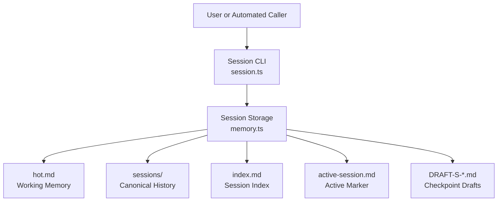
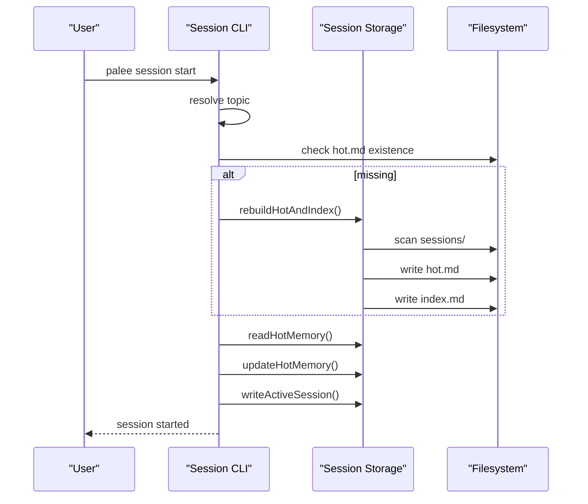
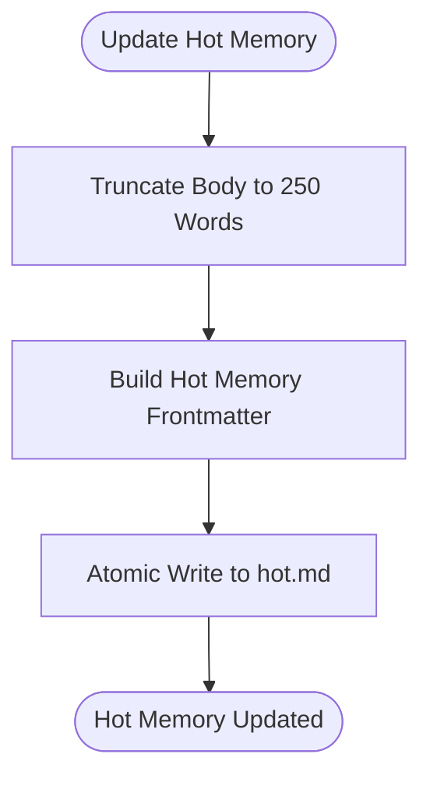
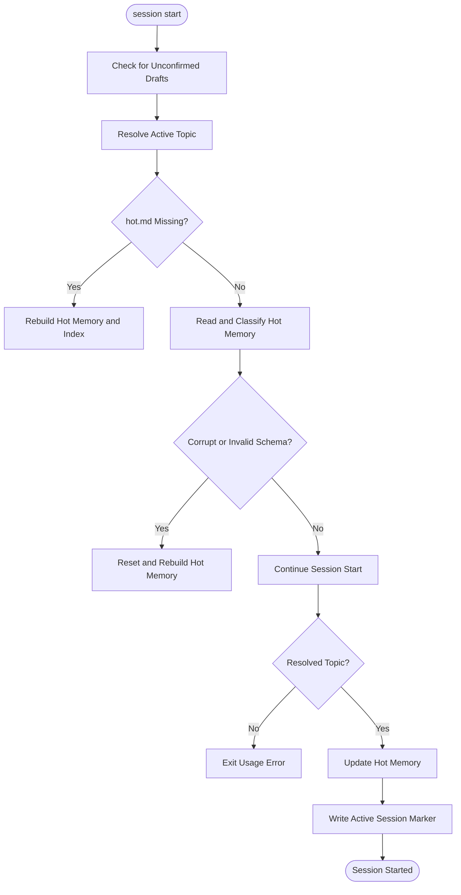
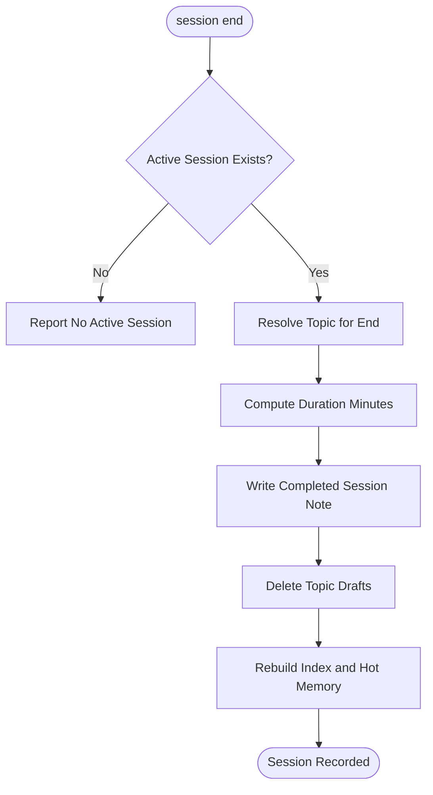
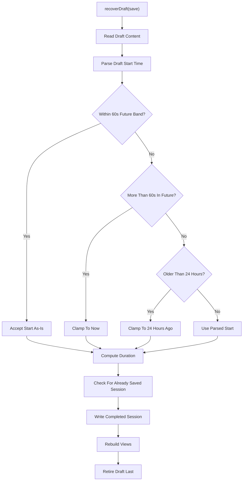
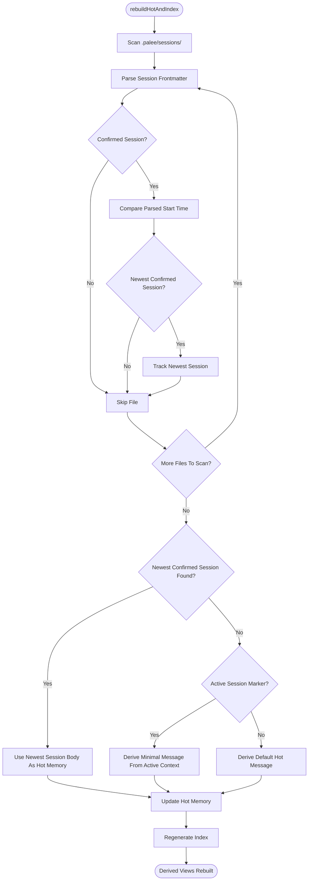
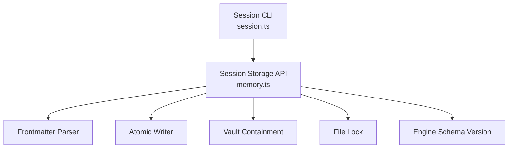

# Session Memory and Storage

## Table of Contents
1. [Introduction](#introduction)
2. [Project Structure](#project-structure)
3. [Core Components](#core-components)
4. [Architecture Overview](#architecture-overview)
5. [Detailed Component Analysis](#detailed-component-analysis)
6. [Dependency Analysis](#dependency-analysis)
7. [Performance Considerations](#performance-considerations)
8. [Troubleshooting Guide](#troubleshooting-guide)
9. [Conclusion](#conclusion)
10. [References](#references)

## Introduction
This document explains how PALEE manages session memory and durable storage. The system provides fast access to active learning state through a hot working-memory view, while preserving a durable, human-readable history of completed sessions. It also supports draft checkpoints for crash recovery and rebuilds derived views from canonical session records.

The key design is a dual-layer approach:
- **Hot memory**: `.palee/hot.md` is a compact working-memory view that fits into the 250-word body limit.
- **Durable history**: `.palee/sessions/S-*.md` contains confirmed session notes.
- **Derived index**: `.palee/index.md` lists confirmed sessions.
- **Draft recovery**: `.palee/sessions/DRAFT-S-*.md` captures intermediate progress during an active session.
- **Active session marker**: `.palee/active-session.md` tracks the current in-progress session context.

The implementation combines in-memory operations with filesystem persistence using atomic writes and optimistic concurrency control where applicable.

## Project Structure
The session memory subsystem spans two main layers:
- **CLI layer** (`src/cli/session.ts`): user-facing commands `start`, `end`, `draft`, and `list`.
- **Storage layer** (`src/storage/memory.ts`): file I/O, ID generation, hot-memory derivation, draft handling, and recovery logic.

## Core Components

### Hot Memory Working State
Hot memory is the primary interface between the AI prompt context and the learner’s recent study activity. Its constraints are:
- Maximum 250 words in the Markdown body below the frontmatter.
- Frontmatter carries schema version, memory identifier, last session ID, active topic, start timestamp, and update date.
- Reads classify the file into five states: `ok`, `missing`, `no-frontmatter`, `corrupt`, `schema-invalid`.
- Writes truncate the body to the word cap before persisting.

The constant defining the cap is exported for validation rules. Word truncation splits on whitespace and appends an ellipsis when the cap is exceeded.

### Durable Session Notes
Completed sessions are stored as individual Markdown notes under `.palee/sessions/`. Each note includes:
- Schema version and stable session ID.
- Topic ID.
- Start and end timestamps.
- Status set to `completed`.
- Optional duration in minutes.

Writes use optimistic concurrency control by computing a fingerprint of the target file when present. If another process creates or modifies the file concurrently, the write fails as a conflict rather than silently overwriting it.

### Derived Index
The session index is regenerated from all confirmed sessions. It:
- Scans `.palee/sessions/` in sorted filename order.
- Skips zero-byte files.
- Parses frontmatter and rejects drafts and unsupported schemas.
- Sorts confirmed sessions newest-first.
- Emits a human-readable list with wikilinks.
- Reports skipped unreadable or unsupported sessions so totals remain truthful.

### Draft Checkpoints and Recovery
During a session, intermediate progress is persisted as draft checkpoints with IDs prefixed by `DRAFT-S-`. Drafts are not treated as confirmed history. Recovery supports four actions:
- **Resume**: keep the draft for continued work.
- **Save**: convert the draft into a completed session.
- **Discard**: permanently delete the draft.
- **Ignore**: leave the draft untouched.

When saving, the system:
1. Validates and clamps the draft’s start timestamp.
2. Computes duration from the clamped start to the current time.
3. Checks idempotence against existing completed sessions.
4. Writes the canonical session note.
5. Rebuilds derived views.
6. Retires the draft last.

### Active Session Marker
An active session marker tracks which session is currently in progress. It is written when starting a session and cleared after successful completion. Clearing is lock-aware: if another writer holds the same target lock, the clear yields instead of failing, because a live writer is recreating the marker at that moment.

## Architecture Overview
The architecture separates concerns between user interaction and persistent state management.

## Detailed Component Analysis

### Hot Memory Lifecycle and Eviction Policy
Hot memory does not implement a traditional eviction queue. Instead, its “eviction” is controlled by:
- A hard 250-word body cap enforced by `truncateWords`.
- Regeneration from the newest confirmed session via `rebuildHotAndIndex`.
- Replacement through `updateHotMemory`, which rewrites the entire hot file atomically.

The 250-word limit applies only to the Markdown body; YAML frontmatter is excluded from the count. When rebuilding, the newest confirmed session’s body becomes the new hot memory summary. If no confirmed session exists but an active session marker is present, a minimal message is generated. If neither exists, a default message indicates no recorded history.

### Session Creation Flow
`palee session start` performs several responsibilities:
1. Detect unconfirmed drafts and handle them interactively unless JSON mode requests a non-interactive response.
2. Resolve the active topic explicitly via `--topic`, then fall back to hot memory’s `active_topic`.
3. Rebuild hot memory if missing, corrupt, or schema-invalid.
4. Refuse to start without a resolvable topic.
5. Preserve an existing `started_at` when continuing the same active topic within a 60-second clock-skew band.
6. Update hot memory and write the active session marker.

### Session Completion Flow
`palee session end` converts an active session into a durable record:
1. Verify an active session exists.
2. Resolve the topic using the same precedence as start.
3. Compute duration from the active session’s start time to now.
4. Write the completed session note.
5. Delete associated draft checkpoints.
6. Rebuild the index and hot memory.

### Draft Recovery and Timestamp Clamping
Draft recovery enforces strict timestamp policy:
- A start timestamp within 60 seconds of the current time is accepted as-is.
- A start more than 60 seconds in the future is clamped to the current time.
- A start older than 24 hours is clamped to 24 hours ago.
- Duration is computed from the clamped start to the end time and rounded to minutes.

Idempotent save detection prevents duplicate sessions when recovery runs multiple times. The system checks whether a completed session already contains the draft heading or equivalent notes within a narrow time window.

### Derived View Rebuild
`rebuildHotAndIndex` scans confirmed sessions and chooses the newest one by parsing `started_at`. Both derived views share the same eligibility predicate:
- Must have a session ID.
- Must not be a draft.
- Must not have status `draft`.
- Must carry the supported schema version.

If no confirmed session exists, hot memory falls back to the active session marker’s context. The index is rebuilt afterward so both views stay consistent.

## Dependency Analysis
The session subsystem depends on several lower-level storage primitives:
- Frontmatter parsing and updating.
- Atomic writes with optimistic concurrency control.
- Directory containment validation.
- Lock acquisition for coordinated deletion and reset operations.
- Engine schema constants for supported versions.

## Performance Considerations
- **Hot memory reads** are O(1) relative to session count because they read a single file.
- **Hot memory writes** are O(1) plus the cost of atomic write contention handling.
- **Index rebuild** is O(N) over session files, including parse and sort overhead.
- **Hot memory rebuild** is O(N) over session files to find the newest confirmed session.
- **Draft checkpoint retries** use bounded retries with jitter to avoid livelock under contention.
- **Word truncation** is O(W) where W is the number of words in the hot-memory body.

The 250-word cap keeps prompts small and predictable. The design intentionally avoids an ever-growing single log file; individual session notes are easier to search, migrate, inspect, and recover with Git.

## Troubleshooting Guide

### Hot Memory Is Missing or Corrupt
Symptoms:
- `session start` reports building working memory.
- Hot memory is classified as `missing`, `corrupt`, or `schema-invalid`.

Resolution:
- The CLI rebuilds hot memory from the newest confirmed session.
- If no confirmed session exists, it uses the active session marker or a default message.
- Do not manually edit hot memory; treat it as derived.

### Draft Recovery Prompts Appear
Symptoms:
- `session start` detects unconfirmed draft checkpoints.
- Interactive mode offers Resume, Save as session, Discard, or Ignore.
- Non-interactive mode refuses to proceed and suggests interactive resolution.

Resolution:
- Choose an action based on whether the draft represents useful unfinished work.
- Save converts the draft into a completed session with clamped timestamps.
- Discard permanently removes the draft.
- Ignore leaves it for later.
- Resume retains the draft for continued study.

### Duration Appears Incorrect After Crash Recovery
Symptoms:
- A recovered session shows a capped duration rather than the original abandoned time span.

Cause:
- Draft recovery clamps stale starts older than 24 hours to 24 hours ago.
- Starts more than 60 seconds in the future are clamped to now.

Resolution:
- This is intentional policy to avoid fabricated learning signals.
- The clamp prioritizes accurate scheduling data over potentially inflated durations.

### Concurrent Writes Cause Conflicts
Symptoms:
- OCC conflict errors during session or hot-memory writes.
- Draft checkpoint retries occur under contention.

Resolution:
- Avoid running multiple concurrent writers for the same vault.
- Draft checkpoint writes retry up to a bounded limit with jitter.
- Hot memory and session writes use optimistic concurrency control to detect conflicts.

### Derived Views Become Out of Sync
Symptoms:
- `hot.md` references a session not listed in `index.md`.
- `index.md` total differs from visible session files.

Resolution:
- Run a rebuild to regenerate both views from canonical session files.
- Rebuild never deletes canonical session files; unreadable or unsupported sessions are counted and reported.

## Conclusion
PALEE’s session memory system balances speed, durability, and consistency:
- Hot memory provides fast, bounded working context for active sessions.
- Durable session notes preserve complete, searchable history.
- Draft checkpoints support crash recovery with strict timestamp clamping.
- Derived views are regenerated from canonical data, ensuring consistency even after failures.
- Atomic writes and optimistic concurrency control protect against concurrent modifications.
- Rebuilds are safe, deterministic, and never delete canonical history.

This design makes session continuity reliable across interruptions, crashes, and manual edits, while keeping performance predictable for typical learning workflows.

## References

- [ADR-0019: Session-Memory Lifecycle and Staleness Clamps](https://github.com/Kuldeep2822k/cli/blob/main/docs/adr/0019-session-memory-lifecycle.md)
- [ADR-0007: Hot-Memory Read-State Contract](https://github.com/Kuldeep2822k/cli/blob/main/docs/adr/0007-hot-memory-read-state-contract.md)
- [Session Memory Design](https://github.com/Kuldeep2822k/cli/blob/main/planning/memory_design.md)
- [Session Memory Storage Documentation](https://github.com/Kuldeep2822k/cli/blob/main/docs/04-4-session-memory-storage.md)
- [Memory Manager Implementation](https://github.com/Kuldeep2822k/cli/blob/main/src/storage/memory.ts)
- [Session CLI Command Handler](https://github.com/Kuldeep2822k/cli/blob/main/src/cli/session.ts)
- [Session CLI Command Handler:1-150](https://github.com/Kuldeep2822k/cli/blob/main/src/cli/session.ts#L1-L150)
- [Memory Manager Implementation:1-200](https://github.com/Kuldeep2822k/cli/blob/main/src/storage/memory.ts#L1-L200)
- [Session Memory Design:1-118](https://github.com/Kuldeep2822k/cli/blob/main/planning/memory_design.md#L1-L118)
- [Session Memory Storage Documentation:1-146](https://github.com/Kuldeep2822k/cli/blob/main/docs/04-4-session-memory-storage.md#L1-L146)
- [Memory Manager Implementation:24-43](https://github.com/Kuldeep2822k/cli/blob/main/src/storage/memory.ts#L24-L43)
- [Memory Manager Implementation:102-168](https://github.com/Kuldeep2822k/cli/blob/main/src/storage/memory.ts#L102-L168)
- [Memory Manager Implementation:448-506](https://github.com/Kuldeep2822k/cli/blob/main/src/storage/memory.ts#L448-L506)
- [ADR-0007: Hot-Memory Read-State Contract:14-54](https://github.com/Kuldeep2822k/cli/blob/main/docs/adr/0007-hot-memory-read-state-contract.md#L14-L54)
- [Memory Manager Implementation:200-285](https://github.com/Kuldeep2822k/cli/blob/main/src/storage/memory.ts#L200-L285)
- [Session Memory Design:67-118](https://github.com/Kuldeep2822k/cli/blob/main/planning/memory_design.md#L67-L118)
- [Memory Manager Implementation:628-749](https://github.com/Kuldeep2822k/cli/blob/main/src/storage/memory.ts#L628-L749)
- [ADR-0019: Session-Memory Lifecycle and Staleness Clamps:40-53](https://github.com/Kuldeep2822k/cli/blob/main/docs/adr/0019-session-memory-lifecycle.md#L40-L53)
- [Memory Manager Implementation:885-1006](https://github.com/Kuldeep2822k/cli/blob/main/src/storage/memory.ts#L885-L1006)
- [Memory Manager Implementation:1006-1208](https://github.com/Kuldeep2822k/cli/blob/main/src/storage/memory.ts#L1006-L1208)
- [ADR-0019: Session-Memory Lifecycle and Staleness Clamps:14-39](https://github.com/Kuldeep2822k/cli/blob/main/docs/adr/0019-session-memory-lifecycle.md#L14-L39)
- [Memory Manager Implementation:508-626](https://github.com/Kuldeep2822k/cli/blob/main/src/storage/memory.ts#L508-L626)
- [Session CLI Command Handler:200-480](https://github.com/Kuldeep2822k/cli/blob/main/src/cli/session.ts#L200-L480)
- [Memory Manager Implementation:750-884](https://github.com/Kuldeep2822k/cli/blob/main/src/storage/memory.ts#L750-L884)
- [Memory Manager Implementation:336-383](https://github.com/Kuldeep2822k/cli/blob/main/src/storage/memory.ts#L336-L383)
- [Session Memory Design:33-66](https://github.com/Kuldeep2822k/cli/blob/main/planning/memory_design.md#L33-L66)
- [Session CLI Command Handler:147-174](https://github.com/Kuldeep2822k/cli/blob/main/src/cli/session.ts#L147-L174)
- [Memory Manager Implementation:1-23](https://github.com/Kuldeep2822k/cli/blob/main/src/storage/memory.ts#L1-L23)
- [Session CLI Command Handler:1-25](https://github.com/Kuldeep2822k/cli/blob/main/src/cli/session.ts#L1-L25)
- [Memory Manager Implementation:1006-L1080](https://github.com/Kuldeep2822k/cli/blob/main/src/storage/memory.ts#L1006-L1080)
- [Memory Manager Implementation:885-984](https://github.com/Kuldeep2822k/cli/blob/main/src/storage/memory.ts#L885-L984)
