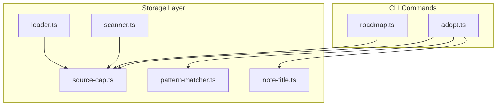
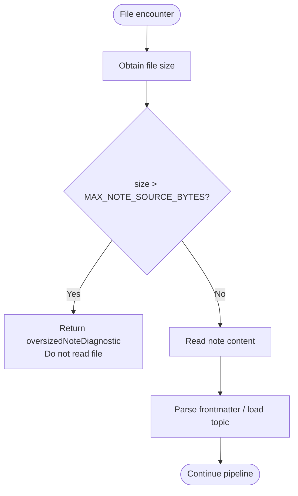
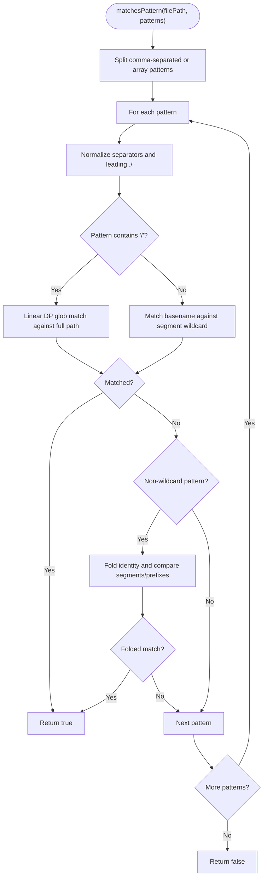
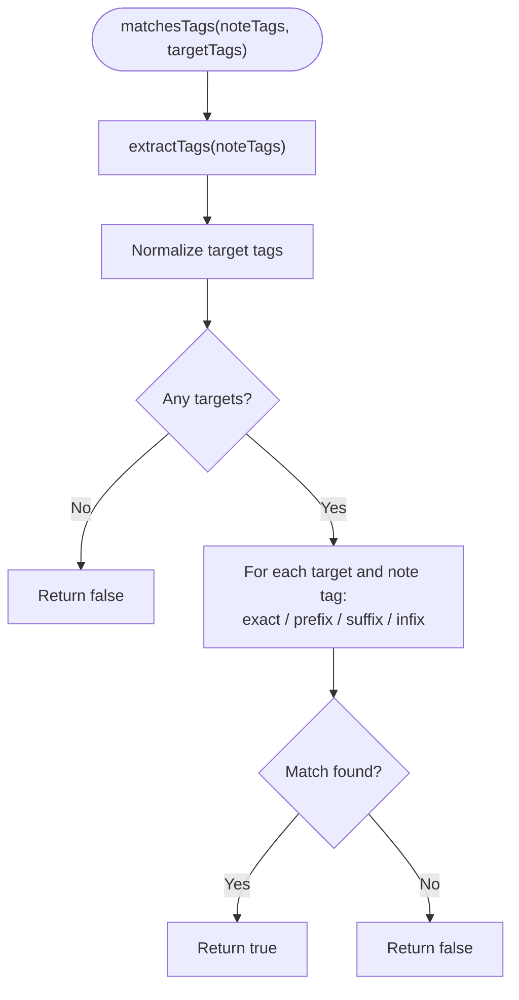
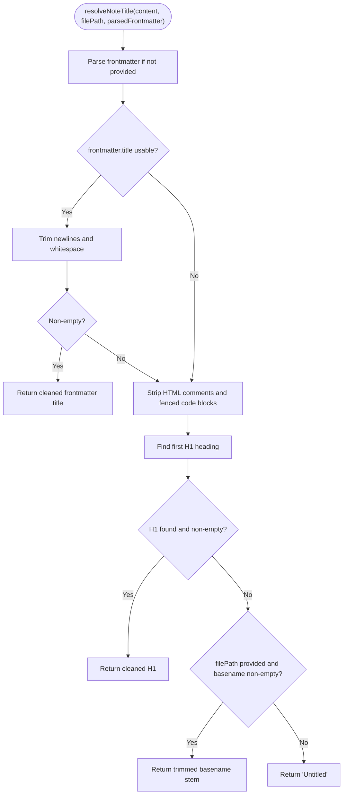
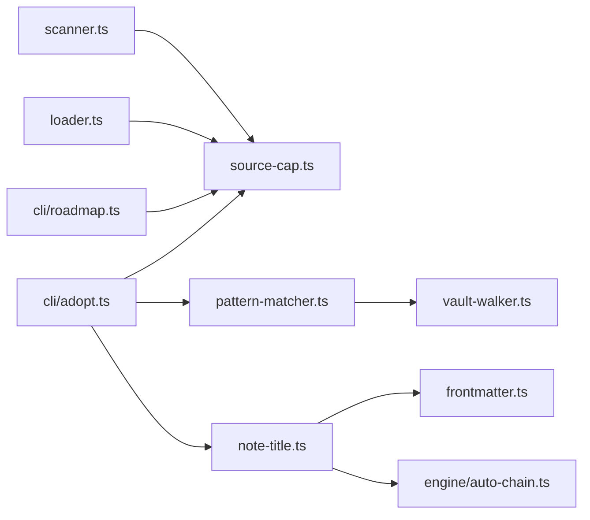

# Source Cap and Pattern Matching

::: details Referenced Files in This Document

- [source-cap.ts](https://github.com/Kuldeep2822k/cli/blob/main/src/storage/source-cap.ts)
- [pattern-matcher.ts](https://github.com/Kuldeep2822k/cli/blob/main/src/storage/pattern-matcher.ts)
- [note-title.ts](https://github.com/Kuldeep2822k/cli/blob/main/src/storage/note-title.ts)
- [scanner.ts](https://github.com/Kuldeep2822k/cli/blob/main/src/storage/scanner.ts)
- [loader.ts](https://github.com/Kuldeep2822k/cli/blob/main/src/storage/loader.ts)
- [adopt.ts](https://github.com/Kuldeep2822k/cli/blob/main/src/cli/adopt.ts)
- [roadmap.ts](https://github.com/Kuldeep2822k/cli/blob/main/src/cli/roadmap.ts)
- [storage-source-cap.test.ts](https://github.com/Kuldeep2822k/cli/blob/main/test/storage-source-cap.test.ts)
- [storage-pattern-matcher.test.ts](https://github.com/Kuldeep2822k/cli/blob/main/test/storage-pattern-matcher.test.ts)
- [storage-note-title.test.ts](https://github.com/Kuldeep2822k/cli/blob/main/test/storage-note-title.test.ts)

:::

## Table of Contents
1. [Introduction](#introduction)
2. [Project Structure](#project-structure)
3. [Core Components](#core-components)
4. [Architecture Overview](#architecture-overview)
5. [Detailed Component Analysis](#detailed-component-analysis)
6. [Dependency Analysis](#dependency-analysis)
7. [Performance Considerations](#performance-considerations)
8. [Troubleshooting Guide](#troubleshooting-guide)
9. [Conclusion](#conclusion)

## Introduction
This document explains the source capacity limiting and pattern matching subsystems that protect PALEE’s storage and CLI pipelines from resource exhaustion, unsafe writes, and expensive or incorrect file selection. It focuses on three tightly coupled areas:

- **Source cap mechanism**: A fixed byte ceiling for reading notes, plus a write-side check ensuring newly written content remains readable by all readers.
- **Pattern matching engine**: A glob-style matcher with anchored-path semantics, case-insensitive matching, Unicode normalization, hierarchical tag filtering, and per-pattern tallying.
- **Note title resolution**: A deterministic fallback pipeline for deriving a display title from frontmatter, Markdown headings, code-fence-aware parsing, and filename stem normalization.

The goal is to help operators configure safe caps, define robust include/exclude/tag filters, and understand how titles are derived and normalized across adoption, scanning, loading, and roadmap workflows.

## Project Structure
The relevant implementation lives under `src/storage`, with CLI entry points importing these utilities:



**Diagram sources**
- [adopt.ts:1-100](https://github.com/Kuldeep2822k/cli/blob/main/src/cli/adopt.ts#L1-L100)
- [roadmap.ts:1-100](https://github.com/Kuldeep2822k/cli/blob/main/src/cli/roadmap.ts#L1-L100)
- [scanner.ts:1-40](https://github.com/Kuldeep2822k/cli/blob/main/src/storage/scanner.ts#L1-L40)
- [loader.ts:1-60](https://github.com/Kuldeep2822k/cli/blob/main/src/storage/loader.ts#L1-L60)
- [source-cap.ts:1-109](https://github.com/Kuldeep2822k/cli/blob/main/src/storage/source-cap.ts#L1-L109)
- [pattern-matcher.ts:1-40](https://github.com/Kuldeep2822k/cli/blob/main/src/storage/pattern-matcher.ts#L1-L40)
- [note-title.ts:1-30](https://github.com/Kuldeep2822k/cli/blob/main/src/storage/note-title.ts#L1-L30)

**Section sources**
- [source-cap.ts:1-109](https://github.com/Kuldeep2822k/cli/blob/main/src/storage/source-cap.ts#L1-L109)
- [pattern-matcher.ts:1-628](https://github.com/Kuldeep2822k/cli/blob/main/src/storage/pattern-matcher.ts#L1-L628)
- [note-title.ts:1-91](https://github.com/Kuldeep2822k/cli/blob/main/src/storage/note-title.ts#L1-L91)

## Core Components
- **Source cap module** defines a 512 KiB read ceiling, diagnostics for oversized files, and two-sided checks for both disk size and UTF-8 write result size.
- **Pattern matcher module** provides glob compilation for validation, linear dynamic-programming path matching, inclusion/exclusion evaluation, tag extraction, hierarchical tag matching, and per-pattern match tallies.
- **Note title resolver** extracts a display title using frontmatter, first H1 heading after removing comments and fenced code blocks, filename stem, or an `Untitled` fallback.

These components are consumed by scanners, loaders, and adopt/roadmap commands to prevent memory pressure, avoid writing unreadable notes, select files predictably, and mint stable titles.

**Section sources**
- [source-cap.ts:1-109](https://github.com/Kuldeep2822k/cli/blob/main/src/storage/source-cap.ts#L1-L109)
- [pattern-matcher.ts:1-628](https://github.com/Kuldeep2822k/cli/blob/main/src/storage/pattern-matcher.ts#L1-L628)
- [note-title.ts:1-91](https://github.com/Kuldeep2822k/cli/blob/main/src/storage/note-title.ts#L1-L91)

## Architecture Overview
The subsystems form a defensive boundary around vault I/O and CLI operations.

```mermaid
sequenceDiagram
  participant CLI as "CLI Command"
  participant Scanner as "Scanner"
  participant Loader as "Loader"
  participant SourceCap as "Source Cap"
  participant Pattern as "Pattern Matcher"
  participant Title as "Note Title Resolver"

  CLI->>Pattern: "matchesPattern(include, exclude)"
  Pattern-->>CLI: "selected paths"
  CLI->>Scanner: "scanNotes(files)"
  Scanner->>SourceCap: "noteExceedsReadCap(size)"
  SourceCap-->>Scanner: "allow / reject"
  Scanner-->>CLI: "ScannedNote[]"
  CLI->>Loader: "loadTopics(files)"
  Loader->>SourceCap: "noteExceedsReadCap(size)"
  SourceCap-->>Loader: "allow / reject"
  CLI->>Title: "resolveNoteTitle(content, filePath)"
  Title-->>CLI: "display title"
  CLI->>SourceCap: "noteContentExceedsReadCap(writtenContent)"
  SourceCap-->>CLI: "write-safe / oversized-write diagnostic"
```

**Diagram sources**
- [scanner.ts:1-40](https://github.com/Kuldeep2822k/cli/blob/main/src/storage/scanner.ts#L1-L40)
- [loader.ts:1-60](https://github.com/Kuldeep2822k/cli/blob/main/src/storage/loader.ts#L1-L60)
- [source-cap.ts:1-109](https://github.com/Kuldeep2822k/cli/blob/main/src/storage/source-cap.ts#L1-L109)
- [pattern-matcher.ts:1-628](https://github.com/Kuldeep2822k/cli/blob/main/src/storage/pattern-matcher.ts#L1-L628)
- [note-title.ts:1-91](https://github.com/Kuldeep2822k/cli/blob/main/src/storage/note-title.ts#L1-L91)
- [adopt.ts:1-100](https://github.com/Kuldeep2822k/cli/blob/main/src/cli/adopt.ts#L1-L100)
- [roadmap.ts:1-100](https://github.com/Kuldeep2822k/cli/blob/main/src/cli/roadmap.ts#L1-L100)

## Detailed Component Analysis

### Source Capacity Limiting
The source cap module centralizes the maximum note size and the logic used by read and write paths.

#### Key Concepts
- **Fixed read ceiling**: 512 KiB. The constant is intentionally separate from the TOC reader’s ceiling but pinned equal to it for parity.
- **Stat-first rejection**: Notes larger than the ceiling are declined before being read, avoiding unbounded memory allocation.
- **Write-side safety**: Adding managed frontmatter can push a note over the ceiling; the write path checks UTF-8 byte length of the final content.
- **Diagnostics**: Oversized read and oversized write messages name both the observed/result size and the ceiling, making failures distinguishable.

#### API Surface
| Export | Purpose | Input | Output |
|---|---|---|---|
| `MAX_NOTE_SOURCE_BYTES` | Shared ceiling constant | None | Positive integer byte count |
| `noteExceedsReadCap(sizeInBytes)` | Read-side guard | File size in bytes | Boolean |
| `oversizedNoteDiagnostic(sizeInBytes)` | Read-side error message | Observed size | Stable diagnostic string |
| `noteContentExceedsReadCap(content)` | Write-side guard | Final text content | Boolean |
| `oversizedWriteDiagnostic(sizeInBytes)` | Write-side error message | Resulting UTF-8 size | Diagnostic string |

#### Behavior Details
- `noteExceedsReadCap` uses strict greater-than comparison: exactly at the ceiling is allowed.
- `noteContentExceedsReadCap` measures UTF-8 bytes with `Buffer.byteLength`, not JavaScript string length, so multi-byte characters cannot bypass the limit.
- Diagnostics are deterministic: repeated calls with the same size produce identical strings without timestamps or counters.



**Diagram sources**
- [source-cap.ts:40-85](https://github.com/Kuldeep2822k/cli/blob/main/src/storage/source-cap.ts#L40-L85)
- [scanner.ts:1-40](https://github.com/Kuldeep2822k/cli/blob/main/src/storage/scanner.ts#L1-L40)
- [loader.ts:1-60](https://github.com/Kuldeep2822k/cli/blob/main/src/storage/loader.ts#L1-L60)

#### Integration Points
- **Scanner**: Uses the shared ceiling and diagnostic when scanning vault notes.
- **Loader**: Imports the ceiling constant and participates in bounded topic loading.
- **Adopt command**: Applies both read-side and write-side guards, including pre-write checks for managed frontmatter growth.
- **Roadmap import**: Reuses the same cap functions for imported roadmap topics.

**Section sources**
- [source-cap.ts:1-109](https://github.com/Kuldeep2822k/cli/blob/main/src/storage/source-cap.ts#L1-L109)
- [scanner.ts:1-40](https://github.com/Kuldeep2822k/cli/blob/main/src/storage/scanner.ts#L1-L40)
- [loader.ts:1-60](https://github.com/Kuldeep2822k/cli/blob/main/src/storage/loader.ts#L1-L60)
- [adopt.ts:1-100](https://github.com/Kuldeep2822k/cli/blob/main/src/cli/adopt.ts#L1-L100)
- [roadmap.ts:1-100](https://github.com/Kuldeep2822k/cli/blob/main/src/cli/roadmap.ts#L1-L100)
- [storage-source-cap.test.ts:1-96](https://github.com/Kuldeep2822k/cli/blob/main/test/storage-source-cap.test.ts#L1-L96)

### Pattern Matching Engine
The pattern matcher supports CLI include/exclude/tag filters with a documented glob dialect and safe performance guarantees.

#### Supported Glob Constructs
| Construct | Meaning |
|---|---|
| `*` | Matches any characters within one path segment; does not cross `/` |
| `?` | Matches one non-slash character |
| `[abc]`, `[a-z]` | Character set |
| `[!...]`, `[^...]` | Negated character class |
| `**/*.md` | Matches root-level and nested `.md` files |
| `dir/**/file.md` | Matches zero or more intermediate directories |
| `MODULES/**` | Matches directory descendants and the directory itself |
| Comma-separated patterns | OR behavior across multiple patterns |
| Array patterns | Same OR behavior, preserving each entry |

#### Path Dialect Rules
- A pattern containing `/` is **anchored at the vault root** and must name the whole relative path.
- A pattern without `/` matches the **filename in any directory**.
- Matching is **case-insensitive**.
- Literal non-wildcard paths also support prefix/subtree semantics (for example, a literal directory still selects its subtree).
- Unicode identity folding is applied so decomposed and composed spellings such as `café` match consistently.



**Diagram sources**
- [pattern-matcher.ts:201-420](https://github.com/Kuldeep2822k/cli/blob/main/src/storage/pattern-matcher.ts#L201-L420)

#### Tag Matching
- Tags are extracted from arrays, comma/space-delimited strings, or null/undefined values.
- Leading `#` markers are stripped and tags are lowercased.
- Hierarchical matching supports exact, prefix, suffix, and infix segment matches, allowing filters like `type`, `concept`, `cloud`, or `domain/cloud`.



**Diagram sources**
- [pattern-matcher.ts:420-628](https://github.com/Kuldeep2822k/cli/blob/main/src/storage/pattern-matcher.ts#L420-L628)

#### Validation and Accounting
- `validatePattern` compiles patterns through a validation regex builder and throws descriptive errors for invalid expressions.
- `tallyPatterns` counts matches per distinct normalized pattern, enabling diagnostic reporting rather than only aggregate pass/fail results.

**Section sources**
- [pattern-matcher.ts:1-628](https://github.com/Kuldeep2822k/cli/blob/main/src/storage/pattern-matcher.ts#L1-L628)
- [storage-pattern-matcher.test.ts:1-184](https://github.com/Kuldeep2822k/cli/blob/main/test/storage-pattern-matcher.test.ts#L1-L184)

### Note Title Resolution and Normalization
Title resolution follows a deterministic priority order.

#### Priority Order
1. Frontmatter `title` field if present, non-empty, and coercible to a trimmed string.
2. First level-1 Markdown heading in the body after removing HTML comments and fenced code blocks.
3. Filename stem without extension.
4. Fallback value `Untitled`.

#### Code-Fence Awareness
- Both backtick fences (`` ``` ``) and tilde fences (`~~~`) are handled through shared fenced-block stripping.
- An unclosed fence consumes the rest of the document; headings inside such a block do not become the title.
- A heading after a properly closed fence is valid.

#### Filename Normalization
- The stem is taken via standard path utilities, stripping extension and trimming whitespace.
- If no useful stem exists, the process falls back to `Untitled`.



**Diagram sources**
- [note-title.ts:1-91](https://github.com/Kuldeep2822k/cli/blob/main/src/storage/note-title.ts#L1-L91)

**Section sources**
- [note-title.ts:1-91](https://github.com/Kuldeep2822k/cli/blob/main/src/storage/note-title.ts#L1-L91)
- [storage-note-title.test.ts:1-31](https://github.com/Kuldeep2822k/cli/blob/main/test/storage-note-title.test.ts#L1-L31)

## Dependency Analysis
The subsystems have clear boundaries and limited coupling.



**Diagram sources**
- [scanner.ts:1-40](https://github.com/Kuldeep2822k/cli/blob/main/src/storage/scanner.ts#L1-L40)
- [loader.ts:1-60](https://github.com/Kuldeep2822k/cli/blob/main/src/storage/loader.ts#L1-L60)
- [adopt.ts:1-100](https://github.com/Kuldeep2822k/cli/blob/main/src/cli/adopt.ts#L1-L100)
- [roadmap.ts:1-100](https://github.com/Kuldeep2822k/cli/blob/main/src/cli/roadmap.ts#L1-L100)
- [pattern-matcher.ts:1-40](https://github.com/Kuldeep2822k/cli/blob/main/src/storage/pattern-matcher.ts#L1-L40)
- [note-title.ts:1-30](https://github.com/Kuldeep2822k/cli/blob/main/src/storage/note-title.ts#L1-L30)

### Coupling and Cohesion
- **Source cap** is a leaf utility with no internal dependencies beyond Node.js buffers and exported constants.
- **Pattern matcher** depends on vault walker identity folding and exports public matching APIs.
- **Note title resolver** depends on frontmatter parsing and fenced-code-block stripping.
- CLI commands depend on all three modules but do not introduce circular imports among them.

### External Dependencies
- File system reads and sizes flow through scanner/loader into the source cap.
- Pattern matching operates on already-scoped paths returned by higher-level walk logic.
- Title resolution may be called during single-file adoption and batch adoption when minting titles.

**Section sources**
- [pattern-matcher.ts:1-40](https://github.com/Kuldeep2822k/cli/blob/main/src/storage/pattern-matcher.ts#L1-L40)
- [note-title.ts:1-30](https://github.com/Kuldeep2822k/cli/blob/main/src/storage/note-title.ts#L1-L30)
- [adopt.ts:1-100](https://github.com/Kuldeep2822k/cli/blob/main/src/cli/adopt.ts#L1-L100)
- [roadmap.ts:1-100](https://github.com/Kuldeep2822k/cli/blob/main/src/cli/roadmap.ts#L1-L100)

## Performance Considerations

### Source Caps
- **Stat-before-read** prevents loading oversized files into memory.
- **UTF-8 byte measurement** avoids undercounting multi-byte content while keeping the cap consistent with on-disk size.
- The ceiling is fixed at 512 KiB, which is large enough for hand-authored notes but small enough to reject generated logs, diffs, or indexes.

### Pattern Matching
- The path matcher uses **linear dynamic programming** instead of naive regular-expression backtracking, preventing catastrophic exponential backtracking across multiple `**/` bands.
- Segment patterns are compiled once and reused across dynamic-programming cells.
- The validation-only regex builder is explicitly documented as unsafe for `.test()` on complex patterns; callers should use `matchPathGlob` or `matchesPattern`.
- Case-insensitive matching and Unicode identity folding reduce mismatches caused by platform-specific encoding differences.

### Title Resolution
- Frontmatter parsing occurs once unless pre-parsed frontmatter is supplied.
- Fenced code blocks and HTML comments are stripped before heading detection, avoiding accidental title extraction from examples.
- Fallback to filename stem is O(1) after path utilities run.

### Large-Scale Operations
- Prefer pre-scanned file lists where possible to avoid duplicate vault walks.
- Use `tallyPatterns` for diagnostic reporting when investigating slow or broad include/exclude filters.
- Keep glob patterns specific to reduce unnecessary comparisons across thousands of vault paths.

## Troubleshooting Guide

### Notes Are Skipped During Scanning
**Symptoms**: Notes appear absent from loaded topics despite existing in the vault.  
**Likely cause**: The note exceeds the 512 KiB read ceiling.  
**What to check**:
- Confirm the file size reported by the filesystem.
- Inspect the scan diagnostic for “Oversized source” and the stated ceiling.
- Reduce the note size or split it into smaller notes.

**Section sources**
- [source-cap.ts:1-109](https://github.com/Kuldeep2822k/cli/blob/main/src/storage/source-cap.ts#L1-L109)
- [storage-source-cap.test.ts:1-96](https://github.com/Kuldeep2822k/cli/blob/main/test/storage-source-cap.test.ts#L1-L96)

### Adoption Succeeds but the Topic Disappears Later
**Symptoms**: Adoption reports success, but subsequent scans do not load the topic.  
**Likely cause**: Managed frontmatter increased the note past the read ceiling.  
**What to check**:
- Use the oversized write diagnostic to confirm the resulting UTF-8 size would exceed the ceiling.
- Avoid adding excessive metadata that pushes the final note over 512 KiB.

**Section sources**
- [source-cap.ts:60-109](https://github.com/Kuldeep2822k/cli/blob/main/src/storage/source-cap.ts#L60-L109)
- [storage-source-cap.test.ts:1-96](https://github.com/Kuldeep2822k/cli/blob/main/test/storage-source-cap.test.ts#L1-L96)

### Include or Exclude Filters Do Not Match Expected Files
**Symptoms**: Files are unexpectedly included or excluded.  
**Likely causes**:
- A pattern containing `/` is anchored at the vault root.
- A pattern without `/` matches the filename in any directory.
- Case differences or Unicode spelling differences were not folded correctly in older configurations.
- A literal directory pattern behaves differently from a wildcard pattern.

**What to check**:
- Verify whether the pattern contains `/`.
- Test with simple basenames and recursive globs separately.
- Use `tallyPatterns` to see how many paths each pattern matched.
- Ensure accents and Unicode forms are consistent across the vault and configuration.

**Section sources**
- [pattern-matcher.ts:201-420](https://github.com/Kuldeep2822k/cli/blob/main/src/storage/pattern-matcher.ts#L201-L420)
- [storage-pattern-matcher.test.ts:1-184](https://github.com/Kuldeep2822k/cli/blob/main/test/storage-pattern-matcher.test.ts#L1-L184)

### Tag Filters Do Not Match Hierarchical Tags
**Symptoms**: A tag filter like `cloud` or `domain/cloud` does not select expected notes.  
**Likely causes**:
- Tags were not normalized correctly.
- The target tag was specified with or without a leading `#`.
- The hierarchical segment does not exist in the note’s tags.

**What to check**:
- Normalize tags by removing leading `#` and lowercasing.
- Use exact, prefix, suffix, or infix segment matches intentionally.
- Validate the note’s frontmatter tags shape.

**Section sources**
- [pattern-matcher.ts:420-628](https://github.com/Kuldeep2822k/cli/blob/main/src/storage/pattern-matcher.ts#L420-L628)
- [storage-pattern-matcher.test.ts:1-184](https://github.com/Kuldeep2822k/cli/blob/main/test/storage-pattern-matcher.test.ts#L1-L184)

### Minted Titles Are Unexpected
**Symptoms**: A note’s displayed title comes from a code example, filename, or `Untitled`.  
**Likely causes**:
- No usable frontmatter `title`.
- No valid first H1 heading after fenced code blocks.
- Unclosed fence consuming the document.
- Missing or empty filename stem.

**What to check**:
- Add a frontmatter `title` if you need explicit control.
- Ensure the first visible H1 heading appears outside fenced blocks.
- Close all code fences.
- Provide a meaningful filename stem as a reliable fallback.

**Section sources**
- [note-title.ts:1-91](https://github.com/Kuldeep2822k/cli/blob/main/src/storage/note-title.ts#L1-L91)
- [storage-note-title.test.ts:1-31](https://github.com/Kuldeep2822k/cli/blob/main/test/storage-note-title.test.ts#L1-L31)

## Conclusion
PALEE’s source cap, pattern matching, and note title resolution subsystems work together to keep vault processing safe, predictable, and efficient:

- The source cap enforces a fixed read ceiling and prevents writes that would make notes unreadable.
- The pattern matcher provides a documented, case-insensitive glob dialect with anchored-path semantics, Unicode normalization, hierarchical tag filtering, and ReDoS-resistant path matching.
- Note title resolution delivers deterministic fallbacks while respecting frontmatter, code fences, and filename stems.

For large vaults, prefer precise patterns, pre-scanned file lists, and explicit frontmatter titles. When diagnosing problems, consult the size diagnostics, per-pattern tallies, and title-resolution fallback order.

