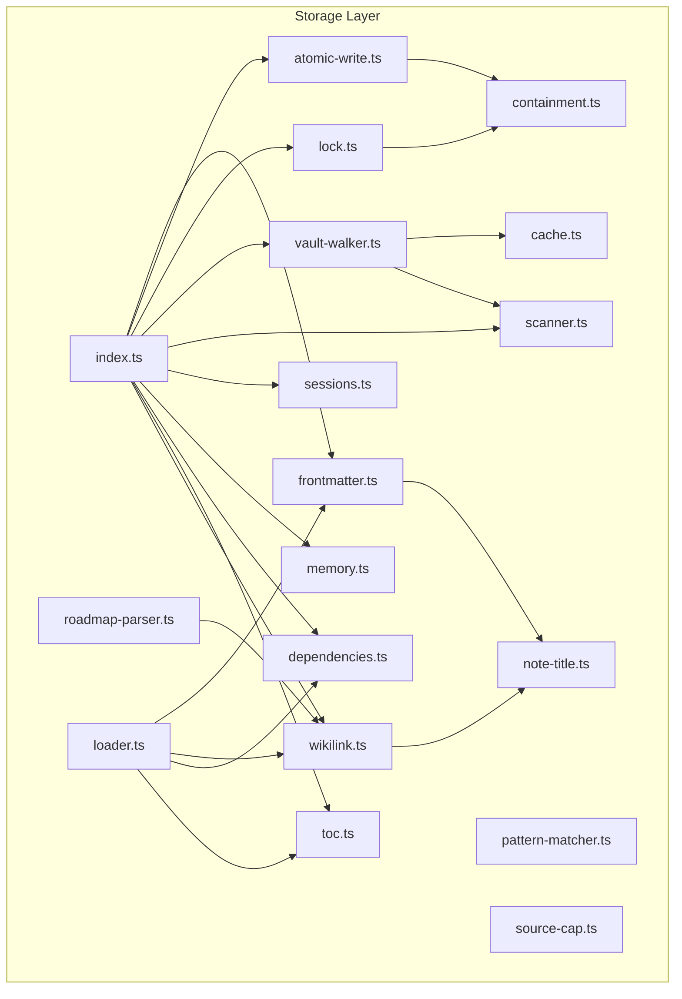
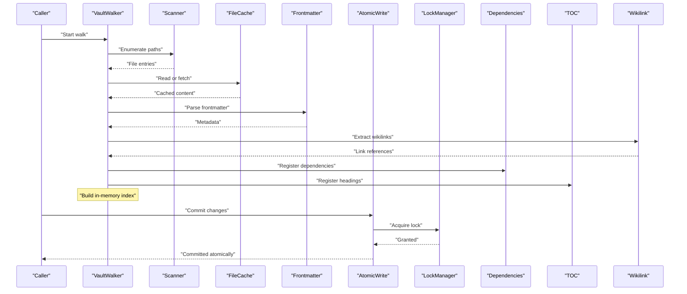
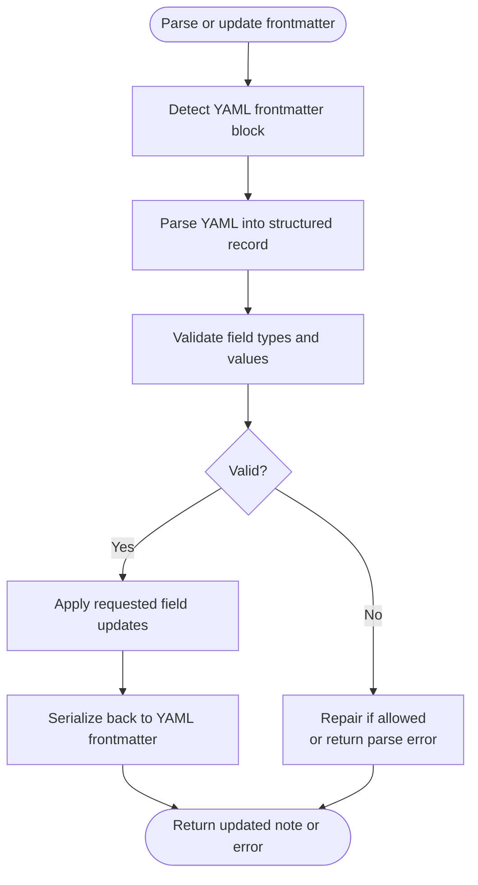
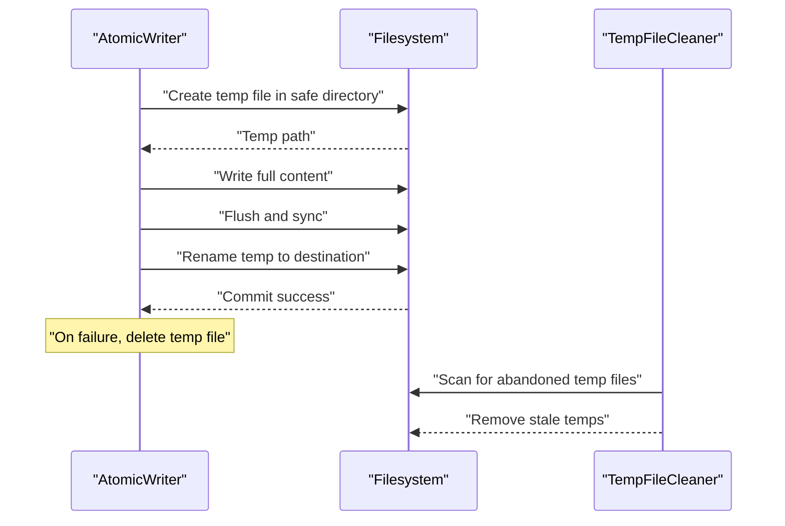
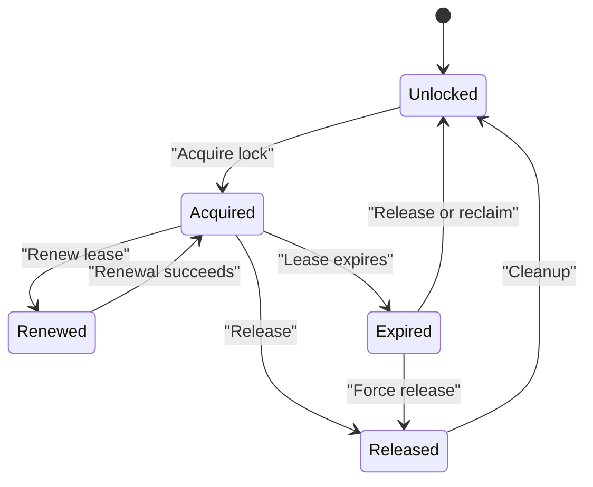
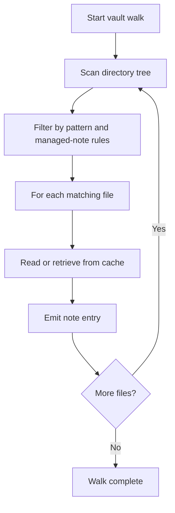
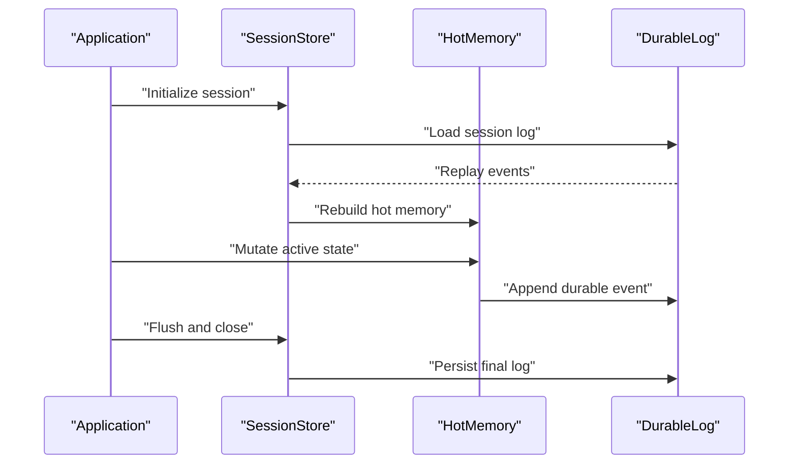
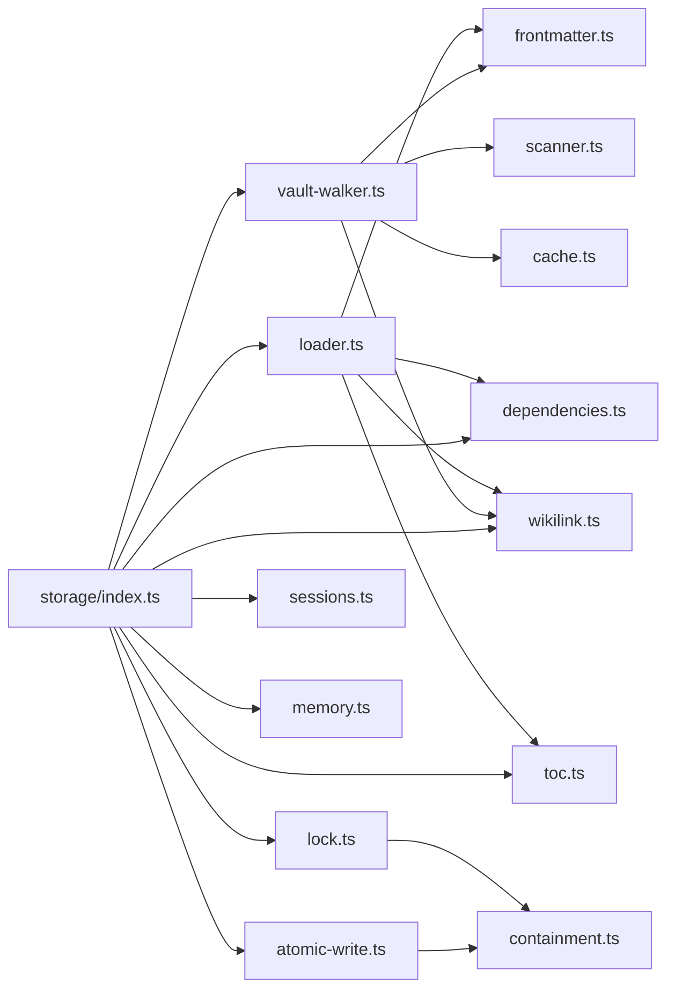

# Storage System

<cite>
**Referenced Files in This Document**   
- [frontmatter.ts](https://github.com/Kuldeep2822k/cli/blob/main/src/storage/src/storage/frontmatter.ts)
- [atomic-write.ts](https://github.com/Kuldeep2822k/cli/blob/main/src/storage/src/storage/atomic-write.ts)
- [lock.ts](https://github.com/Kuldeep2822k/cli/blob/main/src/storage/src/storage/lock.ts)
- [vault-walker.ts](https://github.com/Kuldeep2822k/cli/blob/main/src/storage/src/storage/vault-walker.ts)
- [scanner.ts](https://github.com/Kuldeep2822k/cli/blob/main/src/storage/src/storage/scanner.ts)
- [sessions.ts](https://github.com/Kuldeep2822k/cli/blob/main/src/storage/src/storage/sessions.ts)
- [memory.ts](https://github.com/Kuldeep2822k/cli/blob/main/src/storage/src/storage/memory.ts)
- [dependencies.ts](https://github.com/Kuldeep2822k/cli/blob/main/src/storage/src/storage/dependencies.ts)
- [toc.ts](https://github.com/Kuldeep2822k/cli/blob/main/src/storage/src/storage/toc.ts)
- [wikilink.ts](https://github.com/Kuldeep2822k/cli/blob/main/src/storage/src/storage/wikilink.ts)
- [cache.ts](https://github.com/Kuldeep2822k/cli/blob/main/src/storage/src/storage/cache.ts)
- [containment.ts](https://github.com/Kuldeep2822k/cli/blob/main/src/storage/src/storage/containment.ts)
- [loader.ts](https://github.com/Kuldeep2822k/cli/blob/main/src/storage/src/storage/loader.ts)
- [note-title.ts](https://github.com/Kuldeep2822k/cli/blob/main/src/storage/src/storage/note-title.ts)
- [pattern-matcher.ts](https://github.com/Kuldeep2822k/cli/blob/main/src/storage/src/storage/pattern-matcher.ts)
- [roadmap-parser.ts](https://github.com/Kuldeep2822k/cli/blob/main/src/storage/src/storage/roadmap-parser.ts)
- [source-cap.ts](https://github.com/Kuldeep2822k/cli/blob/main/src/storage/src/storage/source-cap.ts)
- [index.ts](https://github.com/Kuldeep2822k/cli/blob/main/src/storage/src/storage/index.ts)
- [04-storage-layer.md](https://github.com/Kuldeep2822k/cli/blob/main/docs/docs/04-0-storage-layer.md)
- [04-1-frontmatter-parser-and-atomic-writes.md](https://github.com/Kuldeep2822k/cli/blob/main/docs/docs/04-1-frontmatter-parser-and-atomic-writes.md)
- [04-2-file-locking.md](https://github.com/Kuldeep2822k/cli/blob/main/docs/docs/04-2-file-locking.md)
- [04-3-vault-walker-and-file-cache.md](https://github.com/Kuldeep2822k/cli/blob/main/docs/docs/04-3-vault-walker-and-file-cache.md)
- [04-4-session-memory-storage.md](https://github.com/Kuldeep2822k/cli/blob/main/docs/docs/04-4-session-memory-storage.md)
</cite>

## Table of Contents
1. [Introduction](#introduction)
2. [Project Structure](#project-structure)
3. [Core Components](#core-components)
4. [Architecture Overview](#architecture-overview)
5. [Detailed Component Analysis](#detailed-component-analysis)
6. [Dependency Analysis](#dependency-analysis)
7. [Performance Considerations](#performance-considerations)
8. [Troubleshooting Guide](#troubleshooting-guide)
9. [Conclusion](#conclusion)

## Introduction
This document explains the PALEE storage subsystem responsible for vault operations. It covers YAML frontmatter parsing and updating, atomic writes for crash-safe durability, file locking for concurrent access control, vault walking and scanning with caching, session memory management, dependency storage, table-of-contents management, and wikilink processing. The goal is to make the storage layer understandable for both implementers and users while preserving accuracy about field types, validation rules, serialization formats, error handling, and consistency guarantees.

## Project Structure
The storage subsystem lives under `src/storage/src/storage`. Its modules are organized by responsibility:

**Diagram sources**
- [index.ts](https://github.com/Kuldeep2822k/cli/blob/main/src/storage/src/storage/index.ts)
- [frontmatter.ts](https://github.com/Kuldeep2822k/cli/blob/main/src/storage/src/storage/frontmatter.ts)
- [atomic-write.ts](https://github.com/Kuldeep2822k/cli/blob/main/src/storage/src/storage/atomic-write.ts)
- [lock.ts](https://github.com/Kuldeep2822k/cli/blob/main/src/storage/src/storage/lock.ts)
- [vault-walker.ts](https://github.com/Kuldeep2822k/cli/blob/main/src/storage/src/storage/vault-walker.ts)
- [scanner.ts](https://github.com/Kuldeep2822k/cli/blob/main/src/storage/src/storage/scanner.ts)
- [sessions.ts](https://github.com/Kuldeep2822k/cli/blob/main/src/storage/src/storage/sessions.ts)
- [memory.ts](https://github.com/Kuldeep2822k/cli/blob/main/src/storage/src/storage/memory.ts)
- [dependencies.ts](https://github.com/Kuldeep2822k/cli/blob/main/src/storage/src/storage/dependencies.ts)
- [toc.ts](https://github.com/Kuldeep2822k/cli/blob/main/src/storage/src/storage/toc.ts)
- [wikilink.ts](https://github.com/Kuldeep2822k/cli/blob/main/src/storage/src/storage/wikilink.ts)
- [cache.ts](https://github.com/Kuldeep2822k/cli/blob/main/src/storage/src/storage/cache.ts)
- [containment.ts](https://github.com/Kuldeep2822k/cli/blob/main/src/storage/src/storage/containment.ts)
- [loader.ts](https://github.com/Kuldeep2822k/cli/blob/main/src/storage/src/storage/loader.ts)
- [note-title.ts](https://github.com/Kuldeep2822k/cli/blob/main/src/storage/src/storage/note-title.ts)
- [pattern-matcher.ts](https://github.com/Kuldeep2822k/cli/blob/main/src/storage/src/storage/pattern-matcher.ts)
- [roadmap-parser.ts](https://github.com/Kuldeep2822k/cli/blob/main/src/storage/src/storage/roadmap-parser.ts)
- [source-cap.ts](https://github.com/Kuldeep2822k/cli/blob/main/src/storage/src/storage/source-cap.ts)

**Section sources**
- [index.ts](https://github.com/Kuldeep2822k/cli/blob/main/src/storage/src/storage/index.ts)

## Core Components
The storage subsystem provides:

- Frontmatter parser/updater for YAML metadata.
- Atomic write system using temporary files and transaction-like commit semantics.
- File locking with concurrency control and deadlock prevention.
- Vault walker and scanner for efficient directory traversal with caching.
- Session memory management combining hot memory and durable logs.
- Dependency storage, TOC management, and wikilink processing.

These components work together to provide safe, efficient, and consistent access to a PALEE vault.

**Section sources**
- [frontmatter.ts](https://github.com/Kuldeep2822k/cli/blob/main/src/storage/src/storage/frontmatter.ts)
- [atomic-write.ts](https://github.com/Kuldeep2822k/cli/blob/main/src/storage/src/storage/atomic-write.ts)
- [lock.ts](https://github.com/Kuldeep2822k/cli/blob/main/src/storage/src/storage/lock.ts)
- [vault-walker.ts](https://github.com/Kuldeep2822k/cli/blob/main/src/storage/src/storage/vault-walker.ts)
- [scanner.ts](https://github.com/Kuldeep2822k/cli/blob/main/src/storage/src/storage/scanner.ts)
- [sessions.ts](https://github.com/Kuldeep2822k/cli/blob/main/src/storage/src/storage/sessions.ts)
- [memory.ts](https://github.com/Kuldeep2822k/cli/blob/main/src/storage/src/storage/memory.ts)
- [dependencies.ts](https://github.com/Kuldeep2822k/cli/blob/main/src/storage/src/storage/dependencies.ts)
- [toc.ts](https://github.com/Kuldeep2822k/cli/blob/main/src/storage/src/storage/toc.ts)
- [wikilink.ts](https://github.com/Kuldeep2822k/cli/blob/main/src/storage/src/storage/wikilink.ts)

## Architecture Overview
The vault storage architecture separates concerns into layers:

- Data access: vault walker and scanner enumerate notes and manage cached entries.
- Metadata manipulation: frontmatter parser/updater reads and writes YAML metadata safely.
- Persistence safety: atomic writes ensure crash-safe updates; file locks prevent unsafe concurrent modification.
- State persistence: sessions store active state and durable logs.
- Graph construction: dependencies, TOCs, and wikilinks build the knowledge graph used by higher layers.

**Diagram sources**
- [vault-walker.ts](https://github.com/Kuldeep2822k/cli/blob/main/src/storage/src/storage/vault-walker.ts)
- [scanner.ts](https://github.com/Kuldeep2822k/cli/blob/main/src/storage/src/storage/scanner.ts)
- [cache.ts](https://github.com/Kuldeep2822k/cli/blob/main/src/storage/src/storage/cache.ts)
- [frontmatter.ts](https://github.com/Kuldeep2822k/cli/blob/main/src/storage/src/storage/frontmatter.ts)
- [wikilink.ts](https://github.com/Kuldeep2822k/cli/blob/main/src/storage/src/storage/wikilink.ts)
- [dependencies.ts](https://github.com/Kuldeep2822k/cli/blob/main/src/storage/src/storage/dependencies.ts)
- [toc.ts](https://github.com/Kuldeep2822k/cli/blob/main/src/storage/src/storage/toc.ts)
- [atomic-write.ts](https://github.com/Kuldeep2822k/cli/blob/main/src/storage/src/storage/atomic-write.ts)
- [lock.ts](https://github.com/Kuldeep2822k/cli/blob/main/src/storage/src/storage/lock.ts)

## Detailed Component Analysis

### Frontmatter Parser and Updater
The frontmatter module parses YAML metadata at the top of notes and supports updating selected fields while preserving formatting fidelity. It handles common metadata shapes such as topic identifiers, statuses, mastery values, assessment timestamps, review dates, and dependency lists.

Key aspects:

- Field types: string identifiers, arrays of strings for dependencies, numeric or typed values for mastery and difficulty, date/time fields for review and assessment timestamps, and boolean or enum-like flags for status and other controls.
- Validation rules:
  - Required identifier presence when applicable.
  - Dependency list membership constraints enforced elsewhere.
  - Review and assessment dates must be valid ISO-style date-time values where present.
  - Status and mastery values must belong to allowed sets defined by the application schema.
- Serialization format:
  - YAML frontmatter delimited by standard triple-dash markers.
  - Round-trip preservation of comments and structure is supported where the implementation permits.
  - Updates replace only requested fields, leaving unrelated metadata intact.

Error handling includes parse failures for malformed YAML, missing required keys, invalid date formats, and unsupported field values. Recovery strategies include failing fast during validation or applying conservative repairs that remove or normalize invalid fields, depending on configuration.

**Diagram sources**
- [frontmatter.ts](https://github.com/Kuldeep2822k/cli/blob/main/src/storage/src/storage/frontmatter.ts)
- [note-title.ts](https://github.com/Kuldeep2822k/cli/blob/main/src/storage/src/storage/note-title.ts)

**Section sources**
- [frontmatter.ts](https://github.com/Kuldeep2822k/cli/blob/main/src/storage/src/storage/frontmatter.ts)
- [note-title.ts](https://github.com/Kuldeep2822k/cli/blob/main/src/storage/src/storage/note-title.ts)

### Atomic Write System
The atomic write system ensures durability and crash safety by writing new content to a temporary file and then performing an atomic rename into place. This prevents readers from observing partial writes and supports transaction-like semantics within a single file.

Core behavior:

- Temporary file creation inside a controlled containment window to avoid path escape.
- Writing complete content to the temporary file.
- Flushing and syncing to disk where available.
- Renaming the temporary file to the destination path atomically.
- Cleanup of stale temporary files created by previous crashes.

Consistency guarantees:

- Readers either see the old complete file or the new complete file; they never observe a partially written file.
- If the process crashes after creating the temporary file but before renaming, recovery logic can safely clean up abandoned temporary files.
- Errors during any phase cause rollback without modifying the destination file.

**Diagram sources**
- [atomic-write.ts](https://github.com/Kuldeep2822k/cli/blob/main/src/storage/src/storage/atomic-write.ts)
- [containment.ts](https://github.com/Kuldeep2822k/cli/blob/main/src/storage/src/storage/containment.ts)

**Section sources**
- [atomic-write.ts](https://github.com/Kuldeep2822k/cli/blob/main/src/storage/src/storage/atomic-write.ts)
- [containment.ts](https://github.com/Kuldeep2822k/cli/blob/main/src/storage/src/storage/containment.ts)

### File Locking Mechanism
The locking module provides concurrent access control for vault operations. It prevents multiple writers from corrupting shared state and reduces deadlocks through bounded acquisition and timeout policies.

Important behaviors:

- Per-resource locks keyed by vault-relative paths or logical resources.
- Lease-based ownership with optional heartbeat support so long-running processes can renew their lease.
- Timeout and expiry handling to recover from crashed or stalled holders.
- Bounded lock acquisition to prevent indefinite blocking.
- Containment checks to ensure lock paths remain within the vault boundary.

Deadlock prevention relies on avoiding nested lock acquisitions where possible, ordering lock acquisition consistently, and using timeouts to break potential cycles.

**Diagram sources**
- [lock.ts](https://github.com/Kuldeep2822k/cli/blob/main/src/storage/src/storage/lock.ts)
- [containment.ts](https://github.com/Kuldeep2822k/cli/blob/main/src/storage/src/storage/containment.ts)

**Section sources**
- [lock.ts](https://github.com/Kuldeep2822k/cli/blob/main/src/storage/src/storage/lock.ts)
- [containment.ts](https://github.com/Kuldeep2822k/cli/blob/main/src/storage/src/storage/containment.ts)

### Vault Walker and Scanner
The vault walker traverses the vault directory tree and exposes note entries to consumers. The scanner enumerates candidate files, filters them according to patterns, and feeds results to the walker. Caching avoids repeated filesystem reads for unchanged content.

Key features:

- Recursive directory traversal with filtering by filename patterns and managed-note predicates.
- Integration with the file cache to serve previously read content.
- Support for exclusion rules for archives, hidden directories, and non-managed files.
- Incremental updates where possible by comparing timestamps or checksums.

Complexity characteristics:

- Traversal time is proportional to the number of reachable files in the scanned subtree.
- Memory usage grows with the number of cached entries and in-memory indexes built by the walker.

**Diagram sources**
- [vault-walker.ts](https://github.com/Kuldeep2822k/cli/blob/main/src/storage/src/storage/vault-walker.ts)
- [scanner.ts](https://github.com/Kuldeep2822k/cli/blob/main/src/storage/src/storage/scanner.ts)
- [cache.ts](https://github.com/Kuldeep2822k/cli/blob/main/src/storage/src/storage/cache.ts)

**Section sources**
- [vault-walker.ts](https://github.com/Kuldeep2822k/cli/blob/main/src/storage/src/storage/vault-walker.ts)
- [scanner.ts](https://github.com/Kuldeep2822k/cli/blob/main/src/storage/src/storage/scanner.ts)
- [cache.ts](https://github.com/Kuldeep2822k/cli/blob/main/src/storage/src/storage/cache.ts)

### Session Memory Management
Session storage manages active state for a running PALEE operation. It combines hot memory for fast access to recently used data with durable logging to survive restarts.

Design points:

- Hot memory holds lightweight representations of topics, assessments, reviews, and scheduling state.
- Durable logs record session events so recovery can reconstruct recent state.
- Memory budget controls limit growth of hot state.
- Session files are stored under a dedicated `.palee/sessions` location inside the vault.

Lifecycle:

- On startup, load existing session log and rebuild hot memory.
- During execution, mutate hot memory and append durable log entries.
- On shutdown, flush logs and optionally snapshot hot state.

**Diagram sources**
- [sessions.ts](https://github.com/Kuldeep2822k/cli/blob/main/src/storage/src/storage/sessions.ts)
- [memory.ts](https://github.com/Kuldeep2822k/cli/blob/main/src/storage/src/storage/memory.ts)

**Section sources**
- [sessions.ts](https://github.com/Kuldeep2822k/cli/blob/main/src/storage/src/storage/sessions.ts)
- [memory.ts](https://github.com/Kuldeep2822k/cli/blob/main/src/storage/src/storage/memory.ts)

### Dependency Storage
Dependency storage records declared prerequisites and relationships between topics. It supports validation against cycles, missing dependencies, and duplicate identifiers.

Responsibilities:

- Store dependency edges derived from frontmatter and explicit declarations.
- Provide lookup APIs for prerequisite graphs.
- Integrate with validation rules to enforce graph integrity.

Scalability considerations:

- Use adjacency structures optimized for lookups and traversal.
- Avoid loading entire graphs into memory unless needed; prefer incremental construction.

**Section sources**
- [dependencies.ts](https://github.com/Kuldeep2822k/cli/blob/main/src/storage/src/storage/dependencies.ts)

### TOC Management
The table-of-contents module builds heading hierarchies from note content and integrates with the engine’s chain-building logic. It preserves heading levels and titles and supports ranking basenames by real stems when generating ordered indexes.

Key behaviors:

- Extract headings in document order.
- Build hierarchical TOC entries.
- Provide stable identifiers based on normalized title text.
- Coordinate with dependency and chain computation.

**Section sources**
- [toc.ts](https://github.com/Kuldeep2822k/cli/blob/main/src/storage/src/storage/toc.ts)

### Wikilink Processing
Wikilink processing extracts links embedded in note bodies and normalizes target references. It works closely with note-title normalization to resolve canonical names.

Capabilities:

- Parse wiki-style link syntax.
- Resolve relative and absolute targets.
- Normalize aliases and handle edge cases such as empty or malformed links.
- Feed discovered references into dependency and validation layers.

**Section sources**
- [wikilink.ts](https://github.com/Kuldeep2822k/cli/blob/main/src/storage/src/storage/wikilink.ts)
- [note-title.ts](https://github.com/Kuldeep2822k/cli/blob/main/src/storage/src/storage/note-title.ts)

## Dependency Analysis
The storage modules form a layered dependency graph:

**Diagram sources**
- [index.ts](https://github.com/Kuldeep2822k/cli/blob/main/src/storage/src/storage/index.ts)
- [loader.ts](https://github.com/Kuldeep2822k/cli/blob/main/src/storage/src/storage/loader.ts)
- [vault-walker.ts](https://github.com/Kuldeep2822k/cli/blob/main/src/storage/src/storage/vault-walker.ts)
- [scanner.ts](https://github.com/Kuldeep2822k/cli/blob/main/src/storage/src/storage/scanner.ts)
- [cache.ts](https://github.com/Kuldeep2822k/cli/blob/main/src/storage/src/storage/cache.ts)
- [frontmatter.ts](https://github.com/Kuldeep2822k/cli/blob/main/src/storage/src/storage/frontmatter.ts)
- [wikilink.ts](https://github.com/Kuldeep2822k/cli/blob/main/src/storage/src/storage/wikilink.ts)
- [dependencies.ts](https://github.com/Kuldeep2822k/cli/blob/main/src/storage/src/storage/dependencies.ts)
- [toc.ts](https://github.com/Kuldeep2822k/cli/blob/main/src/storage/src/storage/toc.ts)
- [atomic-write.ts](https://github.com/Kuldeep2822k/cli/blob/main/src/storage/src/storage/atomic-write.ts)
- [lock.ts](https://github.com/Kuldeep2822k/cli/blob/main/src/storage/src/storage/lock.ts)
- [containment.ts](https://github.com/Kuldeep2822k/cli/blob/main/src/storage/src/storage/containment.ts)

**Section sources**
- [index.ts](https://github.com/Kuldeep2822k/cli/blob/main/src/storage/src/storage/index.ts)
- [loader.ts](https://github.com/Kuldeep2822k/cli/blob/main/src/storage/src/storage/loader.ts)
- [vault-walker.ts](https://github.com/Kuldeep2822k/cli/blob/main/src/storage/src/storage/vault-walker.ts)
- [atomic-write.ts](https://github.com/Kuldeep2822k/cli/blob/main/src/storage/src/storage/atomic-write.ts)
- [lock.ts](https://github.com/Kuldeep2822k/cli/blob/main/src/storage/src/storage/lock.ts)

## Performance Considerations
- Directory traversal scales linearly with the number of files visited. Use pattern filters to reduce scan scope.
- File cache reduces repeated reads; size it according to available memory and vault size.
- Frontmatter parsing is per-file; batch operations should avoid unnecessary re-parsing.
- Atomic writes incur filesystem overhead; group small mutations where appropriate.
- Lock contention increases with concurrent writers; design workflows to minimize overlapping write windows.
- Session hot memory should be bounded; rely on durable logs for recovery rather than keeping everything in RAM.
- Dependency and TOC structures should be constructed incrementally and reused across operations.

[No sources needed since this section provides general guidance]

## Troubleshooting Guide
Common issues and recovery procedures:

- Malformed frontmatter:
  - Symptoms: parse errors, missing metadata, inconsistent fields.
  - Actions: validate schema, repair invalid fields where safe, or reject and report exact locations.
- Atomic write failures:
  - Symptoms: stale temporary files, incomplete updates.
  - Actions: run cleanup of abandoned temporary files, retry the write, verify destination file integrity.
- Stale locks:
  - Symptoms: writers blocked indefinitely, lease expiration warnings.
  - Actions: detect expired leases, force-release locks, investigate hung processes.
- Cache inconsistency:
  - Symptoms: stale content served after manual edits.
  - Actions: invalidate affected cache entries, refresh on next access, consider cache versioning.
- Session corruption:
  - Symptoms: missing hot state, unrecoverable session log.
  - Actions: replay durable log, rebuild hot memory, fall back to minimal state and warn the user.

**Section sources**
- [frontmatter.ts](https://github.com/Kuldeep2822k/cli/blob/main/src/storage/src/storage/frontmatter.ts)
- [atomic-write.ts](https://github.com/Kuldeep2822k/cli/blob/main/src/storage/src/storage/atomic-write.ts)
- [lock.ts](https://github.com/Kuldeep2822k/cli/blob/main/src/storage/src/storage/lock.ts)
- [cache.ts](https://github.com/Kuldeep2822k/cli/blob/main/src/storage/src/storage/cache.ts)
- [sessions.ts](https://github.com/Kuldeep2822k/cli/blob/main/src/storage/src/storage/sessions.ts)

## Conclusion
The PALEE storage subsystem provides a robust foundation for vault operations. Frontmatter parsing and updating handle YAML metadata safely. Atomic writes and file locking deliver durability and concurrency control. The vault walker and scanner efficiently traverse large directories with caching. Session memory balances performance and persistence. Dependency storage, TOC management, and wikilink processing integrate into a coherent graph model. With careful attention to validation, error handling, and resource limits, the subsystem scales to large vaults while maintaining strong consistency and recovery guarantees.

[No sources needed since this section summarizes without analyzing specific files]