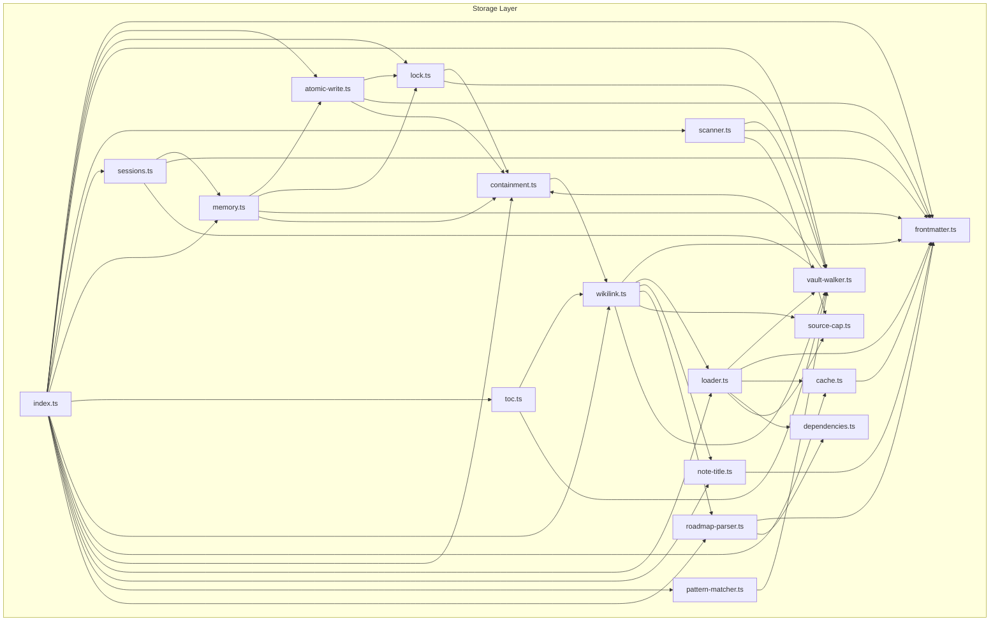
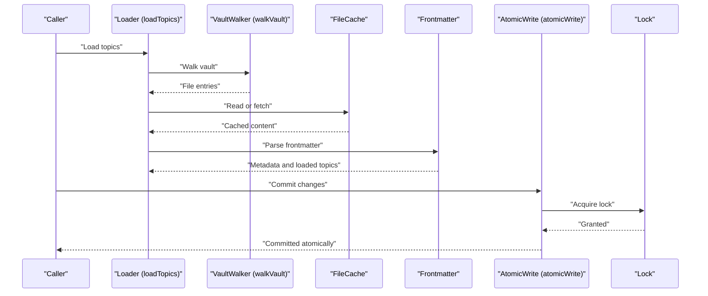
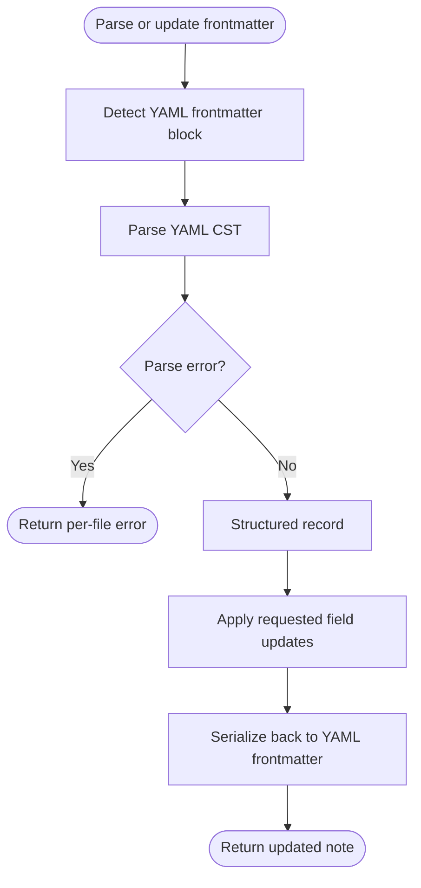
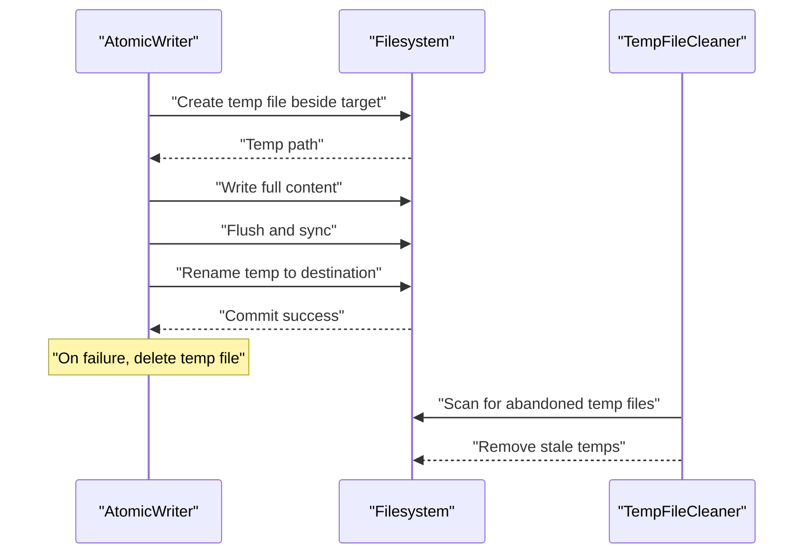
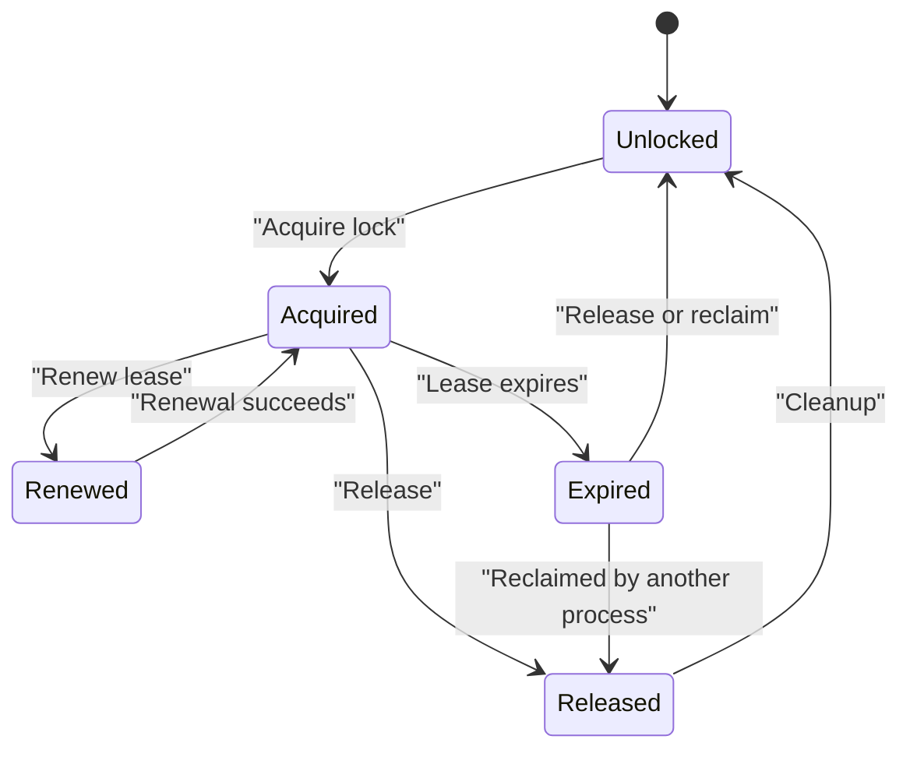
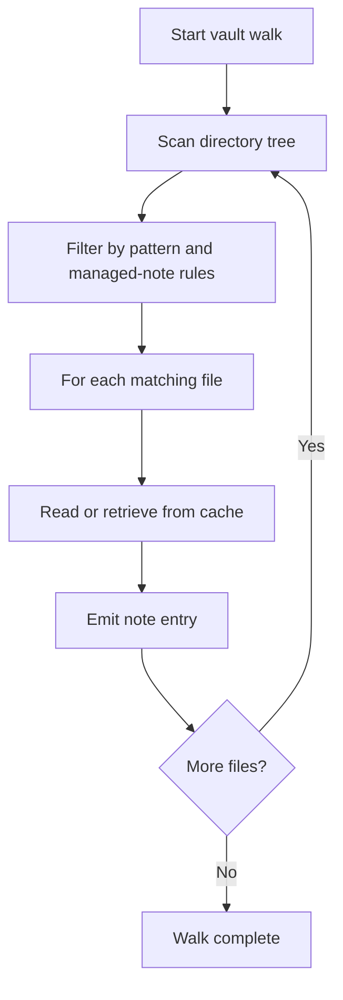
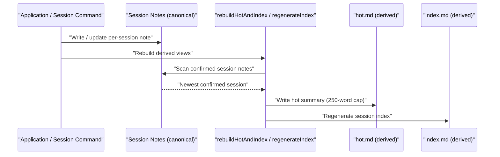
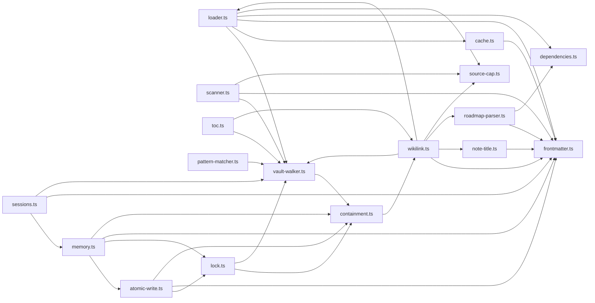

# Storage System

## Table of Contents
1. [Introduction](#introduction)
2. [Project Structure](#project-structure)
3. [Core Components](#core-components)
4. [Architecture Overview](#architecture-overview)
5. [Detailed Component Analysis](#detailed-component-analysis)
6. [Dependency Analysis](#dependency-analysis)
7. [Performance Considerations](#performance-considerations)
8. [Troubleshooting Guide](#troubleshooting-guide)
9. [Conclusion](#conclusion)
10. [References](#references)

## Introduction
This document explains the PALEE storage subsystem responsible for vault operations. It covers YAML frontmatter parsing and updating, atomic writes for crash-safe durability, file locking for concurrent access control, vault walking and scanning with caching, session memory management, dependency storage, table-of-contents management, and wikilink processing. The goal is to make the storage layer understandable for both implementers and users while preserving accuracy about field types, validation rules, serialization formats, error handling, and consistency guarantees.

## Project Structure
The storage subsystem lives under `src/storage` in the cli repository. Its modules are organized by responsibility. The public surface is the barrel file `src/storage/index.ts`; everything else is reached through it. Two modules — `dependencies.ts` and `source-cap.ts` — are internal-only and are not re-exported by the barrel.

Edges point from a module to the modules it imports, as written in the source.

## Core Components
The storage subsystem provides:

- Frontmatter parser/updater for YAML metadata.
- Atomic write system using temporary files and transaction-like commit semantics.
- File locking with concurrency control and deadlock prevention.
- Vault walker and scanner for efficient directory traversal with caching.
- Session memory management: canonical per-session notes with derived hot-memory and index views.
- Dependency storage, TOC management, and wikilink processing.

These components work together to provide safe, efficient, and consistent access to a PALEE vault.

The public API (exported from `src/storage/index.ts`) is:

- Vault traversal and loading: `walkVault`, `ensureVaultDirectory`, `relativeVaultPath`, `scanNotes`, `loadTopics`, `getTopicCache`.
- Frontmatter: `parseFrontmatter`, `updateFrontmatter`, `computeFingerprint`, `resolveNoteTitle`.
- Locking: the `Lock` class.
- Atomic writes: `atomicWrite`, plus the error classifiers `isConflictError` and `isContainmentError`.
- Caching: `FileCache` and the `UNSETTLED_HORIZON` constant.
- Sessions and memory: `loadSessions`, `readSessionIndex`, `readHotMemory`, `writeSessionNote`, `updateHotMemory`, `regenerateIndex`, `rebuildHotAndIndex`, `recoverDraft`, and related helpers.
- Patterns and roadmaps: `matchesPattern`, `matchesTags`, `extractTags`, `validatePattern`, `parseRoadmapContent`, `resolveWikilinkRoadmap`.
- TOC discovery: `discoverTocFiles`, `deriveTocEnumeration`.

## Architecture Overview
The vault storage architecture separates concerns into layers:

- Data access: vault walker and scanner enumerate notes and manage cached entries.
- Metadata manipulation: frontmatter parser/updater reads and writes YAML metadata safely.
- Persistence safety: atomic writes ensure crash-safe updates; file locks prevent unsafe concurrent modification.
- State persistence: sessions store canonical per-session notes; hot memory and the index are derived views.
- Graph construction: dependencies, TOCs, and wikilinks build the knowledge graph used by higher layers.

## Detailed Component Analysis

### Frontmatter Parser and Updater
The frontmatter module parses YAML metadata at the top of notes and supports updating selected fields while preserving formatting fidelity. It handles common metadata shapes such as topic identifiers, statuses, mastery values, assessment timestamps, review dates, and dependency lists.

Key aspects:

- Field types: string identifiers, arrays of strings for dependencies, numeric or typed values for mastery and difficulty, date/time fields for review and assessment timestamps, and boolean or enum-like flags for status and other controls.
- Parsing only: `parseFrontmatter` parses the YAML CST and returns a structured record, or a per-file error for malformed YAML. It does not validate field values — date, allowed-set, and other field validation is the validation framework's job, not the parser's.
- Serialization format:
  - YAML frontmatter delimited by standard triple-dash markers.
  - Round-trip preservation of comments and structure is supported where the implementation permits.
  - Updates replace only requested fields, leaving unrelated metadata intact.

Error handling is limited to parse failures for malformed YAML, returned as a per-file error alongside the record-or-error result. The parser applies no repairs and performs no field validation; invalid field values are reported by the validation framework, not fixed here.

### Atomic Write System
The atomic write system ensures durability and crash safety by writing new content to a temporary file and then performing an atomic rename into place. This prevents readers from observing partial writes and supports transaction-like semantics within a single file. The entry point is `atomicWrite(vaultPath, targetPath, newContent, expectedFingerprint?, options?)` in `atomic-write.ts`.

Core behavior, in order:

- Containment first: `assertContainedInVault` (containment.ts) resolves the destination and refuses any path that escapes the vault with an `ECONTAINMENT` error (CLI exit code 3). The assertion is re-run immediately before the write, and the resolved path — not the caller's spelling — is used for every filesystem operation.
- The target's `Lock` is acquired (see File Locking below).
- Optimistic concurrency control: when the caller passes `expectedFingerprint`, the current on-disk content's SHA-256 fingerprint (`computeFingerprint`, frontmatter.ts) must match it, or the write aborts with an `ECONFLICT` error ("OCC conflict: ...", CLI exit code 4). The optional `options.expectExists` states whether the caller believes the destination already exists; a violated expectation is also an `ECONFLICT`.
- Temporary file creation in the destination's own directory, named `<target>.tmp.<pid>.<entropy>` — for example `note.md.tmp.4213.9f2ac41b`. The name carries the writing process's PID plus 8 hexadecimal characters (32 bits) drawn from `crypto.randomBytes(4)`, so two processes writing the same target never share a temp name, and a leftover temp identifies its owner.
- The destination's previous permission mode is copied onto the temp file (`fchmod`) so a rewrite never widens a deliberately restricted file, then the content is written and `fsync`ed.
- The temp file is renamed over the destination atomically, followed by a best-effort `fsync` of the containing directory so the rename itself is durable. On Windows, the writer attempts the rename up to 5 times (50 ms doubling, ±25% jitter, 300 ms cap) when an `EPERM`/`EBUSY` rename failure occurs.
- Stale temp cleanup: before writing, temp files belonging to the same target are reclaimed — but only when the PID in the name is no longer running on this host *and* the file is older than 30,000 ms (the `STALE_TEMP_MIN_AGE_MS` floor, which protects a live writer on another host sharing the vault over a network filesystem).

Consistency guarantees:

- Readers either see the old complete file or the new complete file; they never observe a partially written file.
- If the process crashes after creating the temporary file but before renaming, the abandoned temp matches the pattern `<target>.tmp.<pid>.<hex>` and is removed automatically by the next write to that target once it passes the staleness floor.
- Errors during any phase delete the temp file and leave the destination unmodified.

### File Locking Mechanism
The locking module (lock.ts) provides cross-process mutual exclusion for vault file mutations. The public surface is the `Lock` class: construct it with `new Lock(vaultPath, targetPath)`, then `acquire()` and `release()`; the read-only `lockPath` gives the lock directory, and the `lockLost` getter reports whether this process's lock was reclaimed by someone else while it still believed it held it.

Layout and identity:

- Locks do not sit next to the note. Each target maps to one directory `<vault>/.palee/locks/<sha256>.lockdir`, where `<sha256>` is the SHA-256 of the vault-relative target path (case-folded on Windows and macOS, where default volumes treat different casings as the same file). Before creating anything, the lock tree itself is asserted to be inside the vault (`assertContainedInVault`).
- Acquisition is an atomic `mkdir` of the lock directory — whoever creates it owns the lock. The winner writes one record file, `<lockId>.json`, where the lock ID has the form `L-YYYYMMDDTHHMMSS-<8 hex chars>`; the record contains `lock_id`, `target`, `pid`, `hostname`, and `created_at`.
- One lock per target file (not per vault), so unrelated notes never block each other.

Timing and retry values (constants in lock.ts):

| Parameter | Value | Meaning |
| --- | --- | --- |
| `HEARTBEAT_INTERVAL` | 15,000 ms | How often the holder touches its record's `mtime` to advertise liveness |
| `STALE_TIMEOUT` | 60,000 ms on Windows; 120,000 ms elsewhere | Age of the last heartbeat after which a lock is stale and reclaimable |
| `MAX_ACQUISITION_ITERATIONS` | 20 rounds | Hard cap on the acquisition loop |
| `ENOTEMPTY_RETRY_ATTEMPTS` | 5 retries after the first attempt | Budget for removing a stale lock directory that will not empty |
| Windows transient retry | 5 retries after the first attempt, 50 ms initial delay doubling, ±25% jitter, 300 ms cap | Backoff for `EPERM`/`EBUSY` handle contention on the lock directory |

Stale recovery:

- If the record's hostname is this machine and its PID no longer exists, the lock is reclaimable immediately — the holder crashed, so there is no reason to wait out the timeout.
- Otherwise the record's `mtime` is compared against `STALE_TIMEOUT`. A directory modified within the last 5 seconds is treated as an acquisition still in flight and conflicts instead of being swept.
- Reclaim renames the record to `<lockId>.json.quarantine` (an atomic test-and-set), re-checks staleness on the quarantined copy, deletes it only if still stale, and removes the directory. A record that turns out to be live is renamed back.
- Contention is reported as an `ECONFLICT` error with a "Lock conflict: " message prefix — for example `Lock conflict: <path> is locked by PID 1234` — which the CLI maps to exit code 4. Callers classify it with `isConflictError`.

Because each operation takes at most one file lock and acquisition is bounded by the iteration cap and the retry budgets, two PALEE processes cannot deadlock or spin indefinitely over a note: the loser gets a retryable `ECONFLICT` instead of a hang.

### Vault Walker and Scanner
Three modules divide this work. `walkVault` (vault-walker.ts) performs the recursive traversal itself. `scanNotes` (scanner.ts) layers note-level scanning on top of the walker, and `loadTopics` (loader.ts) combines the walker, the file cache, and frontmatter parsing into loaded topic objects.

Key features:

- Recursive traversal that skips all dot-directories (including `.obsidian`, `.trash`, `.git`, and `.palee` itself), `node_modules`, and dotfiles, with protection against circular symlinks and unreadable subdirectories.
- Note identity is case- and Unicode-folded (`foldIdentity`: lowercase plus NFC normalization), so differently spelled references to one note resolve to the same entry.
- `FileCache` (cache.ts) caches parsed content in memory, keyed by path. A hit is validated against the file's `mtime` and size; a file modified within the last 2,000 ms (`UNSETTLED_HORIZON`) is additionally re-read and checked by SHA-256 fingerprint, so an edit still in flight is not served stale. The cache holds at most 2,000 entries, evicting the least recently verified.
- The cache is per-process and in-memory only — nothing is persisted between CLI runs.

Complexity characteristics:

- Traversal time is proportional to the number of reachable files in the scanned subtree.
- Memory usage grows with the number of cached entries (bounded at 2,000) and in-memory indexes built by the loader.

### Session Memory Management
Session storage is built on canonical per-session notes, not an event log. There is no session log, no replay on startup, no flush on shutdown, and no memory budget.

Design points:

- Canonical state is the per-session notes stored under `.palee/sessions/` (`S-*.md`); each confirmed session note is the source of truth for that session.
- `hot.md` and `index.md` are derived views, rebuilt on demand from the session notes by `rebuildHotAndIndex` / `regenerateIndex` — they are not logs and are never replayed.
- The only bound on hot memory is the 250-word cap on its body (`MAX_HOT_WORDS`, `src/storage/memory.ts`).
- Draft checkpoints (`DRAFT-S-*.md`) capture intermediate progress during an active session and are not confirmed history.

Lifecycle:

- Session commands write or update the canonical session notes, then rebuild the derived views (`rebuildHotAndIndex` / `regenerateIndex`) as part of that command.
- Rebuilding scans the confirmed session notes, takes the newest confirmed session's body as the hot-memory summary, and regenerates the index; if there is no confirmed session, it falls back to the active-session marker context or a default message.
- Nothing is loaded or replayed at startup and nothing is flushed at shutdown; a later command rebuilds the derived views from the notes whenever it needs them.

### Dependency Storage
`src/storage/dependencies.ts` exports exactly one function: `normalizeDependencies`. It merges the canonical `depends_on` field and the legacy `dependencies` alias into a single deduplicated list of dependency identifiers in first-seen order.

It does not store dependency edges, provide graph lookup APIs, or validate cycles. Graph construction, lookup, and traversal live in `src/engine/dependency.ts`, and cycle and missing-dependency checks are enforced by the validation rules that use that engine.

### TOC Management
The table-of-contents module builds heading hierarchies from note content and integrates with the engine’s chain-building logic. It preserves heading levels and titles and supports ranking basenames by real stems when generating ordered indexes.

Key behaviors:

- Extract headings in document order.
- Build hierarchical TOC entries.
- Provide stable identifiers based on normalized title text.
- Coordinate with dependency and chain computation.

### Wikilink Processing
Wikilink processing extracts links embedded in note bodies and normalizes target references. It works closely with note-title normalization to resolve canonical names.

Capabilities:

- Parse wiki-style link syntax.
- Resolve relative and absolute targets.
- Normalize aliases and handle edge cases such as empty or malformed links.
- Feed discovered references into dependency and validation layers.

## Dependency Analysis
Read from the modules' actual imports, the graph has a clear foundation, two hubs, and one deliberate knot:

- **frontmatter.ts is the foundation.** Nine storage modules import it (atomic-write, cache, loader, memory, note-title, roadmap-parser, scanner, sessions, wikilink), because almost everything needs to parse frontmatter or compute a content fingerprint. In the other direction it depends only on the `yaml` package and the shared types in `src/types.ts`, which keeps the base of the graph stable.
- **dependencies.ts and source-cap.ts are leaves.** Neither imports anything — not even another storage module. They are pure logic (dependency-edge bookkeeping and the source-text cap), consumed by loader, roadmap-parser, scanner, and wikilink, and neither is re-exported by the public barrel.
- **loader.ts and wikilink.ts are the hubs.** loader pulls together vault-walker, cache, frontmatter, dependencies, and source-cap to build loaded topics. wikilink imports six storage modules (vault-walker, frontmatter, loader, note-title, roadmap-parser, source-cap), because resolving a link can require any of them.
- **The write path is narrow.** atomic-write depends only on lock, frontmatter (for `computeFingerprint`), and containment. lock depends only on containment and vault-walker (for `foldIdentity`). memory.ts is the main consumer above them, importing atomic-write, lock, frontmatter, and containment.
- **One genuine cycle exists, in the safety core:** vault-walker imports containment (to assert walked paths stay in the vault), containment imports `isWithinVault` from wikilink, and wikilink imports vault-walker. The cycle is tolerable because every cross-import in the triangle is a function binding used at call time, not a value needed while the modules initialize — but it does mean the three modules cannot be reasoned about (or unit-tested) entirely in isolation.
- **Storage is not engine-independent.** toc.ts, wikilink.ts, note-title.ts, and memory.ts import from `src/engine/` (toc-chain, auto-chain, tier0-hygiene, topic-id), and nearly every module imports shared types from `src/types.ts`. The only third-party package used inside the storage modules themselves is `yaml`; everything else is Node builtins (`fs`, `path`, `crypto`, `os`).

## Performance Considerations
- Directory traversal scales linearly with the number of files visited. Use pattern filters to reduce scan scope.
- File cache reduces repeated reads; size it according to available memory and vault size.
- Frontmatter parsing is per-file; batch operations should avoid unnecessary re-parsing.
- Atomic writes incur filesystem overhead; group small mutations where appropriate.
- Lock contention increases with concurrent writers; design workflows to minimize overlapping write windows.
- Session hot memory is bounded by the 250-word cap (`MAX_HOT_WORDS`); the canonical per-session notes are the durable record.
- Dependency and TOC structures should be constructed incrementally and reused across operations.

## Troubleshooting Guide
Common issues and recovery procedures. The two error codes that matter here are `ECONFLICT` (retryable contention, CLI exit code 4) and `ECONTAINMENT` (a path escaping the vault, CLI exit code 3 — never retryable).

- Malformed frontmatter:
  - Symptoms: a note fails to load, or a command reports a frontmatter/YAML parse error naming the file.
  - Actions: open the named note and fix the block between the `---` markers — the usual causes are unquoted values containing `:` or `#`, broken list indentation, and invalid dates. PALEE parses frontmatter with a YAML CST parser (`parseFrontmatter`), so a syntax error in one note does not corrupt others; correct the YAML and re-run the command.
- OCC conflict on write:
  - Symptoms: `OCC conflict: <path> was modified by another process` (`ECONFLICT`, exit 4). The file changed between PALEE's read and its write — typically an editor save or a second PALEE process.
  - Actions: re-run the command so it re-reads the current file. If it repeats, check for another process editing the same note.
- Lock conflict:
  - Symptoms: `Lock conflict: <path> is locked by PID <pid>` (`ECONFLICT`, exit 4).
  - Actions: look in `<vault>/.palee/locks/` for the target's `<sha256>.lockdir`; the `<lockId>.json` record inside names the holder's `pid`, `hostname`, and `created_at`. If that PID is alive, the lock is real — wait for it or close the other process; do not delete the lock directory. If the holder crashed, recovery is automatic: a same-host dead PID is reclaimed immediately, and any other lock goes stale 60 seconds (Windows) or 120 seconds (elsewhere) after its last heartbeat.
- Leftover temporary files:
  - Symptoms: files named `<note>.tmp.<pid>.<hex>` beside a note, for example `note.md.tmp.4213.9f2ac41b`, visible in Obsidian or in `git status`.
  - Actions: none required — the next successful write to that note deletes them once they are older than 30 seconds and the PID in the name is no longer running. They are also safe to delete by hand whenever no PALEE process is running.
- Containment refusal:
  - Symptoms: an `ECONTAINMENT` error (exit 3) on any read or write, often right after moving a vault or restoring a backup.
  - Actions: a component of the path — frequently `.palee` itself or a parent folder — is a symlink or junction resolving outside the vault. Replace the link with a real directory inside the vault. Retrying cannot succeed while the link stands, by design.
- Cache inconsistency:
  - Symptoms: a command shows content that does not match the file on disk after a manual edit.
  - Actions: `FileCache` is in-memory and per-process, so quitting and re-running the command starts from an empty cache. Within a run, entries re-validate by `mtime`/size on every hit, and files changed in the last 2,000 ms are re-checked by SHA-256 fingerprint, so staleness beyond a single in-flight edit should not persist.
- Session state missing:
  - Symptoms: PALEE starts without the expected active session or recent context.
  - Actions: check the state files directly — session notes live at `.palee/sessions/S-*.md`, the session index at `.palee/index.md`, hot memory at `.palee/hot.md`, and interrupted drafts at `.palee/sessions/DRAFT-S-*.md`. The session notes are the source of truth; the derived views are rebuilt by `regenerateIndex`/`rebuildHotAndIndex` during session commands — there is no startup rebuild pass. `loadSessions` and `readSessionIndex` are the validation framework's read path for those files, not a startup pass.

## Conclusion
The PALEE storage subsystem provides a robust foundation for vault operations. Frontmatter parsing and updating handle YAML metadata safely. Atomic writes and file locking deliver durability and concurrency control. The vault walker and scanner efficiently traverse large directories with caching. Session memory balances performance and persistence. Dependency storage, TOC management, and wikilink processing integrate into a coherent graph model. With careful attention to validation, error handling, and resource limits, the subsystem scales to large vaults while maintaining strong consistency and recovery guarantees.

## References

- [frontmatter.ts](https://github.com/Kuldeep2822k/cli/blob/main/src/storage/frontmatter.ts)
- [atomic-write.ts](https://github.com/Kuldeep2822k/cli/blob/main/src/storage/atomic-write.ts)
- [lock.ts](https://github.com/Kuldeep2822k/cli/blob/main/src/storage/lock.ts)
- [vault-walker.ts](https://github.com/Kuldeep2822k/cli/blob/main/src/storage/vault-walker.ts)
- [scanner.ts](https://github.com/Kuldeep2822k/cli/blob/main/src/storage/scanner.ts)
- [sessions.ts](https://github.com/Kuldeep2822k/cli/blob/main/src/storage/sessions.ts)
- [memory.ts](https://github.com/Kuldeep2822k/cli/blob/main/src/storage/memory.ts)
- [dependencies.ts](https://github.com/Kuldeep2822k/cli/blob/main/src/storage/dependencies.ts)
- [toc.ts](https://github.com/Kuldeep2822k/cli/blob/main/src/storage/toc.ts)
- [wikilink.ts](https://github.com/Kuldeep2822k/cli/blob/main/src/storage/wikilink.ts)
- [cache.ts](https://github.com/Kuldeep2822k/cli/blob/main/src/storage/cache.ts)
- [containment.ts](https://github.com/Kuldeep2822k/cli/blob/main/src/storage/containment.ts)
- [loader.ts](https://github.com/Kuldeep2822k/cli/blob/main/src/storage/loader.ts)
- [note-title.ts](https://github.com/Kuldeep2822k/cli/blob/main/src/storage/note-title.ts)
- [pattern-matcher.ts](https://github.com/Kuldeep2822k/cli/blob/main/src/storage/pattern-matcher.ts)
- [roadmap-parser.ts](https://github.com/Kuldeep2822k/cli/blob/main/src/storage/roadmap-parser.ts)
- [source-cap.ts](https://github.com/Kuldeep2822k/cli/blob/main/src/storage/source-cap.ts)
- [index.ts](https://github.com/Kuldeep2822k/cli/blob/main/src/storage/index.ts)
- [04-storage-layer.md](https://github.com/Kuldeep2822k/cli/blob/main/docs/04-0-storage-layer.md)
- [04-1-frontmatter-parser-and-atomic-writes.md](https://github.com/Kuldeep2822k/cli/blob/main/docs/04-1-frontmatter-parser-and-atomic-writes.md)
- [04-2-file-locking.md](https://github.com/Kuldeep2822k/cli/blob/main/docs/04-2-file-locking.md)
- [04-3-vault-walker-and-file-cache.md](https://github.com/Kuldeep2822k/cli/blob/main/docs/04-3-vault-walker-and-file-cache.md)
- [04-4-session-memory-storage.md](https://github.com/Kuldeep2822k/cli/blob/main/docs/04-4-session-memory-storage.md)
