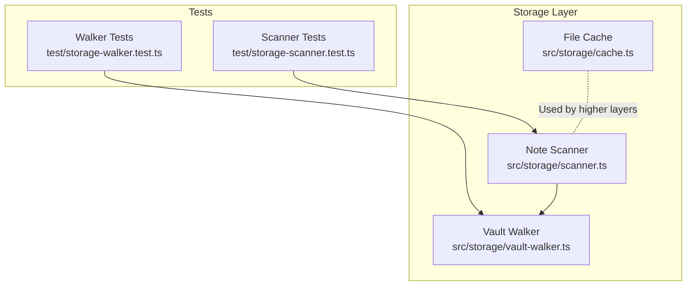
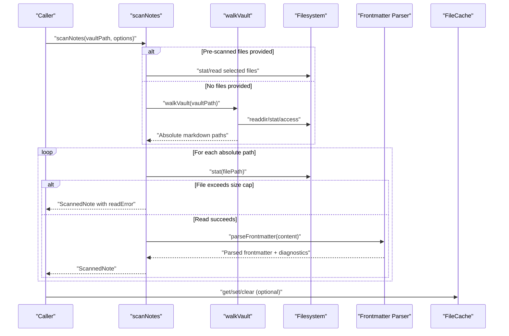
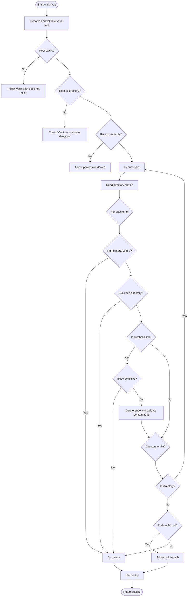
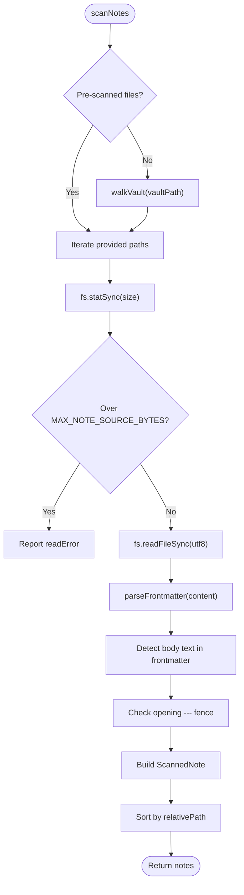
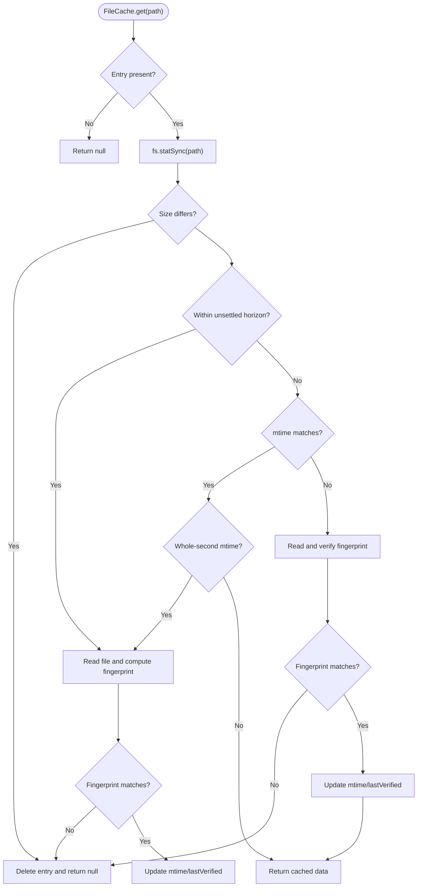
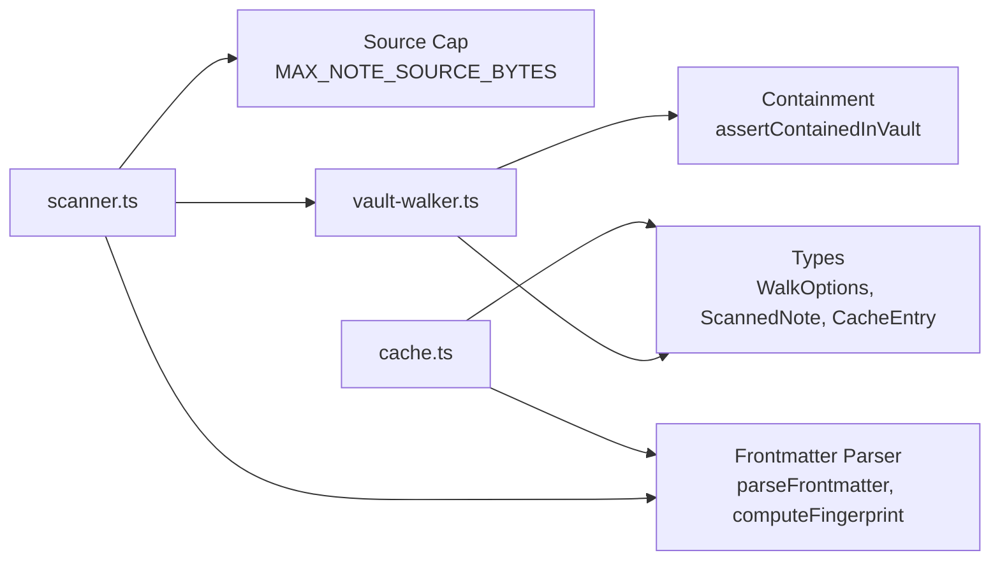

# Vault Walker and Scanner

<cite>
**Referenced Files in This Document**
- [vault-walker.ts](https://github.com/Kuldeep2822k/cli/blob/main/src/storage/vault-walker.ts)
- [scanner.ts](https://github.com/Kuldeep2822k/cli/blob/main/src/storage/scanner.ts)
- [cache.ts](https://github.com/Kuldeep2822k/cli/blob/main/src/storage/cache.ts)
- [storage-walker.test.ts](https://github.com/Kuldeep2822k/cli/blob/main/test/storage-walker.test.ts)
- [storage-scanner.test.ts](https://github.com/Kuldeep2822k/cli/blob/main/test/storage-scanner.test.ts)
</cite>

## Table of Contents
1. [Introduction](#introduction)
2. [Project Structure](#project-structure)
3. [Core Components](#core-components)
4. [Architecture Overview](#architecture-overview)
5. [Detailed Component Analysis](#detailed-component-analysis)
6. [Dependency Analysis](#dependency-analysis)
7. [Performance Considerations](#performance-considerations)
8. [Troubleshooting Guide](#troubleshooting-guide)
9. [Conclusion](#conclusion)

## Introduction
This document explains the vault walker and scanner subsystem responsible for efficient directory traversal and file discovery inside an Obsidian-style vault. It covers:

- How the vault walker discovers Markdown files while excluding hidden directories, dotfiles, non-Markdown files, `node_modules`, and optionally symbolic links.
- How the scanner reads discovered notes, parses frontmatter, detects malformed or unclosed YAML blocks, and reports per-file outcomes without aborting the entire scan.
- The in-memory cache used to reduce repeated filesystem reads of parsed note metadata.
- Navigation methods, filtering options, path normalization, and containment safeguards.
- Error handling for unreadable files, permission issues, missing paths, and filesystem anomalies.
- Performance characteristics, memory usage patterns, and scalability considerations for large enterprise-scale vaults.

The implementation is synchronous at the filesystem layer: traversal and scanning are single-threaded operations designed around deterministic ordering, bounded I/O, and stable error reporting rather than parallel worker pools.

## Project Structure
The vault walker and scanner live under the storage layer and are consumed by higher-level validation and loading pipelines.

**Diagram sources**
- [vault-walker.ts:1-368](https://github.com/Kuldeep2822k/cli/blob/main/src/storage/vault-walker.ts#L1-L368)
- [scanner.ts:1-327](https://github.com/Kuldeep2822k/cli/blob/main/src/storage/scanner.ts#L1-L327)
- [cache.ts:1-273](https://github.com/Kuldeep2822k/cli/blob/main/src/storage/cache.ts#L1-L273)
- [storage-walker.test.ts:1-211](https://github.com/Kuldeep2822k/cli/blob/main/test/storage-walker.test.ts#L1-L211)
- [storage-scanner.test.ts:1-674](https://github.com/Kuldeep2822k/cli/blob/main/test/storage-scanner.test.ts#L1-L674)

**Section sources**
- [vault-walker.ts:1-368](https://github.com/Kuldeep2822k/cli/blob/main/src/storage/vault-walker.ts#L1-L368)
- [scanner.ts:1-327](https://github.com/Kuldeep2822k/cli/blob/main/src/storage/scanner.ts#L1-L327)
- [cache.ts:1-273](https://github.com/Kuldeep2822k/cli/blob/main/src/storage/cache.ts#L1-L273)

## Core Components

### Vault Walker
The vault walker is a recursive directory navigator that returns absolute paths to discoverable Markdown notes. Its responsibilities include:

- Validating the root vault path exists, is a directory, and is readable.
- Skipping dot-directories and dot-files.
- Skipping built-in excluded directories such as `node_modules`.
- Optionally skipping or validating symbolic links.
- Applying custom exclusion directories supplied by the caller.
- Normalizing relative paths into POSIX-style vault-relative paths.
- Providing safe directory creation with strict vault-boundary enforcement.

Key navigation and filtering behaviors:

| Behavior | Implementation Detail |
|---|---|
| Root validation | Throws when the resolved root does not exist, is not a directory, or lacks read permission. |
| Dot exclusions | Any entry whose name starts with `.` is skipped, including `.obsidian`, `.trash`, `.git`, `.palee`, and hidden files. |
| Markdown-only | Only entries ending in `.md` (case-insensitive) are collected. |
| Built-in exclusions | `node_modules` is permanently excluded. |
| Custom exclusions | Caller-supplied `excludeDirs` are merged with built-in exclusions. |
| Symlink policy | By default, symlinks are ignored. When `followSymlinks` is enabled, directory symlinks are dereferenced with cycle protection, and file symlinks are included only if their real target remains inside the vault. |
| Path safety | `ensureVaultDirectory` rejects paths that escape the vault through `..`, cross-drive roots, or symlink resolution, and re-asserts containment after creation. |
| Relative path helper | `relativeVaultPath` converts absolute walked paths into POSIX-style vault-relative paths, falling back to canonical resolution when lexical comparison disagrees because of symlinked root segments. |

Memory behavior during walking:

- Results are accumulated in an array of absolute paths.
- A `visited` set prevents revisiting directories when symlink dereferencing could otherwise expose cycles.
- No content is loaded; only directory metadata and filenames are inspected.

Error handling during walking:

- Missing or invalid root paths throw descriptive errors.
- Unreadable subdirectories are silently skipped so one permission-denied folder does not abort the full vault scan.
- Dead or unresolvable symlinks are skipped.

**Section sources**
- [vault-walker.ts:1-120](https://github.com/Kuldeep2822k/cli/blob/main/src/storage/vault-walker.ts#L1-L120)
- [vault-walker.ts:120-200](https://github.com/Kuldeep2822k/cli/blob/main/src/storage/vault-walker.ts#L120-L200)
- [vault-walker.ts:201-368](https://github.com/Kuldeep2822k/cli/blob/main/src/storage/vault-walker.ts#L201-L368)
- [storage-walker.test.ts:1-211](https://github.com/Kuldeep2822k/cli/blob/main/test/storage-walker.test.ts#L1-L211)

### Note Scanner
The scanner consumes a list of absolute file paths and produces one `ScannedNote` per readable file. Its main goals are stability, determinism, and diagnostic clarity:

- Every scanned file appears in the output, even when parsing fails.
- Malformed YAML becomes a `parseError`; it does not throw from the scan.
- Unclosed frontmatter fences are detected using heuristics that distinguish legal horizontal rules from likely malformed frontmatter.
- Oversized notes are rejected stat-first before being read.
- Output is sorted by vault-relative POSIX path.
- Raw content can be captured for callers that need snapshot-consistent bytes.

Scanner input options:

| Option | Purpose |
|---|---|
| `files` | Supply pre-scanned absolute paths to avoid duplicate vault walks. |
| `includeContent` | Attach raw UTF-8 content to each returned note for snapshot injection. |

Scanner output contract:

| Field | Meaning |
|---|---|
| `absolutePath` | Absolute filesystem path to the note. |
| `relativePath` | POSIX-style path relative to the vault root. |
| `frontmatter` | Parsed frontmatter object, or `null` when absent or malformed. |
| `parseError` | Present when YAML cannot be parsed or body text leaked into frontmatter. |
| `readError` | Present when the file could not be read or was too large. |
| `content` | Optional raw content when `includeContent` is enabled. |

Heuristic detection of unclosed frontmatter:

1. If frontmatter parsing succeeds but the raw frontmatter block contains lines that look like Markdown body text, the block is treated as unclosed.
2. If no frontmatter is found but the file begins with a leading `---` fence and the remaining content looks like YAML data, it is flagged as a potentially unclosed block.
3. Legal notes beginning with a thematic break (`---`) are not falsely reported as malformed unless the heuristic sees YAML-like data behind the fence.

**Section sources**
- [scanner.ts:1-80](https://github.com/Kuldeep2822k/cli/blob/main/src/storage/scanner.ts#L1-L80)
- [scanner.ts:80-200](https://github.com/Kuldeep2822k/cli/blob/main/src/storage/scanner.ts#L80-L200)
- [scanner.ts:201-327](https://github.com/Kuldeep2822k/cli/blob/main/src/storage/scanner.ts#L201-L327)
- [storage-scanner.test.ts:1-200](https://github.com/Kuldeep2822k/cli/blob/main/test/storage-scanner.test.ts#L1-L200)
- [storage-scanner.test.ts:201-400](https://github.com/Kuldeep2822k/cli/blob/main/test/storage-scanner.test.ts#L201-L400)

### In-Memory File Cache
The file cache stores parsed payloads keyed by absolute file path. It is intended for frequently accessed metadata such as parsed frontmatter or AST nodes.

Cache semantics:

- **Unsettled horizon:** If a file was modified within 2,000 milliseconds, reads recompute a SHA-256 fingerprint to detect in-flight edits.
- **Outside unsettled horizon:** Reads first compare `mtime` and `size`; mismatches invalidate the entry.
- **Low-resolution timestamps:** When `mtime` appears to have whole-second granularity, fingerprint verification may be used to avoid serving stale entries.
- **LRU eviction:** When the number of entries exceeds the configured maximum, the least-recently-verified entry is evicted.
- **Manual invalidation:** Individual entries can be removed, or the entire cache cleared.

Cache configuration constants:

| Constant | Default Value | Purpose |
|---|---:|---|
| `UNSETTLED_HORIZON` | 2,000 ms | Fingerprint-sensitive window after file modification. |
| `MAX_CACHE_ENTRIES` | 2,000 | Upper bound on retained cache entries. |

Operations:

| Operation | Behavior |
|---|---|
| `get(path)` | Returns cached data if valid; returns `null` on miss, mismatch, or filesystem error. |
| `set(path, data, fingerprint?)` | Stores data with current `mtime`, `size`, and fingerprint; evicts LRU entries if over capacity. |
| `invalidate(path)` | Removes one entry immediately. |
| `clear()` | Empties the entire cache. |

Important limitation: the cache is process-local and does not provide distributed or cross-process consistency. It also does not automatically invalidate based on vault-wide change events; consumers must explicitly invalidate affected paths or clear the cache when appropriate.

**Section sources**
- [cache.ts:1-120](https://github.com/Kuldeep2822k/cli/blob/main/src/storage/cache.ts#L1-L120)
- [cache.ts:120-200](https://github.com/Kuldeep2822k/cli/blob/main/src/storage/cache.ts#L120-L200)
- [cache.ts:201-273](https://github.com/Kuldeep2822k/cli/blob/main/src/storage/cache.ts#L201-L273)

## Architecture Overview
The vault traversal pipeline flows from directory discovery to per-note diagnostics and optional caching.

**Diagram sources**
- [scanner.ts:201-327](https://github.com/Kuldeep2822k/cli/blob/main/src/storage/scanner.ts#L201-L327)
- [vault-walker.ts:120-200](https://github.com/Kuldeep2822k/cli/blob/main/src/storage/vault-walker.ts#L120-L200)
- [cache.ts:120-273](https://github.com/Kuldeep2822k/cli/blob/main/src/storage/cache.ts#L120-L273)

## Detailed Component Analysis

### Vault Walker Algorithm
The walker performs depth-first traversal with explicit cycle protection and layered filtering.

**Diagram sources**
- [vault-walker.ts:120-200](https://github.com/Kuldeep2822k/cli/blob/main/src/storage/vault-walker.ts#L120-L200)
- [vault-walker.ts:201-240](https://github.com/Kuldeep2822k/cli/blob/main/src/storage/vault-walker.ts#L201-L240)

#### Complexity and Memory Profile
- Time complexity is approximately linear in the number of filesystem entries examined, plus the cost of sorting or post-processing performed by callers.
- Space complexity includes:
  - An array of discovered absolute paths.
  - A `visited` set of dereferenced directory paths used to prevent cycles.
  - Directory entry arrays produced by `readdirSync`.
- There is no concurrent traversal; memory pressure grows with the breadth and depth of the vault tree rather than file contents.

#### Security and Containment
- `ensureVaultDirectory` validates both lexical containment and canonical containment.
- It refuses paths that escape through `..`, cross-drive roots, or symlink resolution.
- It performs a pre-creation containment assertion and a post-creation re-assertion to narrow a TOCTOU race window.

**Section sources**
- [vault-walker.ts:120-200](https://github.com/Kuldeep2822k/cli/blob/main/src/storage/vault-walker.ts#L120-L200)
- [vault-walker.ts:201-368](https://github.com/Kuldeep2822k/cli/blob/main/src/storage/vault-walker.ts#L201-L368)
- [storage-walker.test.ts:1-211](https://github.com/Kuldeep2822k/cli/blob/main/test/storage-walker.test.ts#L1-L211)

### Scanner Processing Pipeline
The scanner converts absolute file paths into structured scan results.

**Diagram sources**
- [scanner.ts:201-327](https://github.com/Kuldeep2822k/cli/blob/main/src/storage/scanner.ts#L201-L327)

#### Frontmatter Heuristics
The scanner applies multiple checks to distinguish:

- Valid closed frontmatter.
- Notes without frontmatter.
- Malformed YAML.
- Opening `---` fences that are actually horizontal rules.
- Unclosed frontmatter blocks where body content has been parsed as YAML.

These heuristics are intentionally conservative: they favor preserving metadata where possible while flagging likely malformed blocks for downstream validation.

**Section sources**
- [scanner.ts:1-80](https://github.com/Kuldeep2822k/cli/blob/main/src/storage/scanner.ts#L1-L80)
- [scanner.ts:80-200](https://github.com/Kuldeep2822k/cli/blob/main/src/storage/scanner.ts#L80-L200)
- [scanner.ts:201-327](https://github.com/Kuldeep2822k/cli/blob/main/src/storage/scanner.ts#L201-L327)
- [storage-scanner.test.ts:1-200](https://github.com/Kuldeep2822k/cli/blob/main/test/storage-scanner.test.ts#L1-L200)
- [storage-scanner.test.ts:201-400](https://github.com/Kuldeep2822k/cli/blob/main/test/storage-scanner.test.ts#L201-L400)

### Caching Strategy and Invalidation Policy
The cache is designed around three concerns: freshness, bounded memory, and deterministic invalidation.

| Concern | Mechanism |
|---|---|
| Freshness | Size check, `mtime` comparison, SHA-256 fingerprint, and unsettled-horizon logic. |
| Memory bounds | LRU eviction against `lastVerified` when entries exceed `MAX_CACHE_ENTRIES`. |
| Invalidation | Automatic removal on mismatch or filesystem error; manual `invalidate` and `clear` APIs. |

**Diagram sources**
- [cache.ts:120-200](https://github.com/Kuldeep2822k/cli/blob/main/src/storage/cache.ts#L120-L200)

#### Invalidation Policies
- **Automatic invalidation:** Triggered by size mismatch, missing files, read errors, or fingerprint mismatch.
- **Time-based sensitivity:** Within the unsettled horizon, fingerprints are recomputed on every read.
- **Resolution fallback:** Whole-second `mtime` values trigger fingerprint verification to avoid stale hits.
- **Eviction policy:** Least-recently-verified entry is removed when the cache exceeds its configured limit.
- **Explicit invalidation:** Callers can remove individual entries or clear the cache when they know related files changed.

**Section sources**
- [cache.ts:1-120](https://github.com/Kuldeep2822k/cli/blob/main/src/storage/cache.ts#L1-L120)
- [cache.ts:120-273](https://github.com/Kuldeep2822k/cli/blob/main/src/storage/cache.ts#L120-L273)

## Dependency Analysis
The subsystem has a small, focused dependency graph.

**Diagram sources**
- [vault-walker.ts:1-30](https://github.com/Kuldeep2822k/cli/blob/main/src/storage/vault-walker.ts#L1-L30)
- [scanner.ts:1-30](https://github.com/Kuldeep2822k/cli/blob/main/src/storage/scanner.ts#L1-L30)
- [cache.ts:1-25](https://github.com/Kuldeep2822k/cli/blob/main/src/storage/cache.ts#L1-L25)

### Coupling and Cohesion
- The walker depends on filesystem I/O, path utilities, types, and vault containment logic.
- The scanner depends on the walker, frontmatter parsing, source-cap limits, and types.
- The cache depends on filesystem I/O, fingerprint computation, and types.
- High cohesion: each module owns one primary concern—directory traversal, per-note diagnostics, or metadata caching.
- Moderate coupling: the scanner imports the walker directly; the cache imports frontmatter utilities.

### External Integration Points
- **Filesystem API:** `fs.existsSync`, `fs.statSync`, `fs.accessSync`, `fs.readdirSync`, `fs.realpathSync`, `fs.readFileSync`, `fs.mkdirSync`.
- **Path API:** Node.js `path` utilities for resolution, joining, relative paths, and extension handling.
- **Validation framework:** The scanner’s output is consumed by validation rules that inspect frontmatter and report diagnostics.
- **Topic loaders:** Higher layers can reuse pre-scanned files to avoid duplicate vault walks and combine parsed content with topic loading.

**Section sources**
- [vault-walker.ts:1-368](https://github.com/Kuldeep2822k/cli/blob/main/src/storage/vault-walker.ts#L1-L368)
- [scanner.ts:1-327](https://github.com/Kuldeep2822k/cli/blob/main/src/storage/scanner.ts#L1-L327)
- [cache.ts:1-273](https://github.com/Kuldeep2822k/cli/blob/main/src/storage/cache.ts#L1-L273)

## Performance Considerations

### Traversal Performance
- The walker is synchronous and single-threaded. Parallelization would require careful handling of shared state, filesystem ordering, and error aggregation.
- Filtering occurs early: dot entries and excluded directories are skipped before recursion.
- Symbolic link handling adds extra `realpathSync` and `statSync` calls only when enabled.

Recommendations for very large vaults:

- Prefer pre-scanned file lists when multiple components need the same vault enumeration.
- Avoid enabling `followSymlinks` unless required, as it increases syscall volume and introduces additional containment checks.
- Use custom `excludeDirs` to prune known irrelevant subtrees such as generated assets or external repositories.

### Scanning Performance
- Each note is read once per scan unless `includeContent` is disabled.
- Oversized notes are rejected stat-first, avoiding expensive reads and line scans.
- Sorting is performed over `ScannedNote` objects by relative path, which is predictable and platform-stable.

Optimization techniques:

- Batch vault scans into a single walk and pass `files` to all scanners or loaders.
- Disable `includeContent` when only frontmatter diagnostics are needed.
- Apply application-level concurrency only around independent workloads that do not mutate shared vault state.

### Cache Performance
- Cache misses trigger filesystem stat and possibly content reads.
- Hits outside the unsettled horizon are fast O(1) map lookups followed by stat comparison.
- LRU eviction avoids unbounded growth, but eviction itself iterates entries to find the oldest `lastVerified`.

Memory management guidance:

- Tune `MAX_CACHE_ENTRIES` according to expected vault size and available heap space.
- Clear the cache after bulk mutations or long-running maintenance tasks.
- Invalidate specific paths when consumers know a file changed but do not want to discard unrelated entries.

### Scalability Considerations for Enterprise Vaults
- Synchronous traversal scales with filesystem throughput rather than CPU cores.
- For millions of files, consider:
  - Reducing symlink traversal.
  - Using targeted scans instead of full-vault walks.
  - Reusing pre-scanned paths across commands.
  - Bounding cache size and clearing it between heavy operations.
- Distributed or multi-process scenarios should treat the cache as process-local and coordinate invalidation through durable state or explicit coordination.

[No sources needed since this section provides general guidance]

## Troubleshooting Guide

### Common Walker Errors

| Symptom | Likely Cause | Resolution |
|---|---|---|
| Error mentioning vault path does not exist | The root path is wrong or missing. | Verify the vault path and ensure it exists. |
| Error mentioning vault path is not a directory | The path points to a file. | Pass a directory, not a file. |
| Permission denied on vault root | Current user lacks read access. | Fix filesystem permissions or run with sufficient privileges. |
| Hidden directories still appear | Custom exclusion or filter logic may be bypassed elsewhere. | Confirm walker options and downstream filters. |
| Symlinked files appear unexpectedly | `followSymlinks` is enabled. | Disable symlink following or restrict targets. |
| Paths look incorrect on macOS or Windows | Lexical vs canonical path differences. | Use `relativeVaultPath` or rely on walked absolute paths consistently. |

**Section sources**
- [vault-walker.ts:120-200](https://github.com/Kuldeep2822k/cli/blob/main/src/storage/vault-walker.ts#L120-L200)
- [vault-walker.ts:201-368](https://github.com/Kuldeep2822k/cli/blob/main/src/storage/vault-walker.ts#L201-L368)
- [storage-walker.test.ts:1-211](https://github.com/Kuldeep2822k/cli/blob/main/test/storage-walker.test.ts#L1-L211)

### Common Scanner Diagnostics

| Symptom | Meaning | Action |
|---|---|---|
| `parseError` present | YAML parsing failed or body text leaked into frontmatter. | Inspect the note’s frontmatter fence and YAML syntax. |
| `readError` present | File could not be read or was too large. | Check permissions, locks, and file size. |
| Note missing from scan results | Not a Markdown file, excluded directory, or unreadable. | Confirm filename extension and directory visibility. |
| Unclosed frontmatter warning | Opening `---` fence likely missing closing fence. | Close the fence or use a different marker for thematic breaks. |
| Horizontal rule confused with frontmatter | Note begins with `---` but has no YAML frontmatter. | Use `***` for thematic breaks or close the fence properly. |

**Section sources**
- [scanner.ts:201-327](https://github.com/Kuldeep2822k/cli/blob/main/src/storage/scanner.ts#L201-L327)
- [storage-scanner.test.ts:1-200](https://github.com/Kuldeep2822k/cli/blob/main/test/storage-scanner.test.ts#L1-L200)
- [storage-scanner.test.ts:201-400](https://github.com/Kuldeep2822k/cli/blob/main/test/storage-scanner.test.ts#L201-L400)

### Cache Invalidation Issues

| Symptom | Likely Cause | Resolution |
|---|---|---|
| Stale data served | `mtime` changed but cache was not invalidated. | Invalidate the path or clear the cache. |
| Cache not helping performance | Entries evicted too quickly or never populated. | Increase `MAX_CACHE_ENTRIES` or populate more frequently accessed entries. |
| Memory grows unexpectedly | Many unique paths cached without eviction. | Reduce cache size, clear after batch operations, or scope caches per operation. |
| Fingerprint mismatch errors | File changed during unsettled horizon. | Allow the cache to refresh; do not assume immediate consistency. |

**Section sources**
- [cache.ts:120-273](https://github.com/Kuldeep2822k/cli/blob/main/src/storage/cache.ts#L120-L273)

## Conclusion
The vault walker and scanner form a disciplined boundary between the filesystem and the rest of the Palee storage pipeline. The walker focuses on safe, predictable discovery of Markdown notes, while the scanner converts those discoveries into stable, diagnostic-rich records suitable for validation and loading. The in-memory cache provides a practical optimization for frequently accessed metadata, bounded by LRU eviction and timestamp/fingerprint-based invalidation.

For enterprise-scale vaults, the most important operational advice is to minimize redundant walks, avoid unnecessary symlink traversal, keep scanner output deterministic, and manage cache lifetime explicitly. Error handling is designed to be resilient: missing files, permission problems, malformed YAML, and filesystem anomalies produce actionable diagnostics rather than abrupt failures.

[No sources needed since this section summarizes without analyzing specific files]