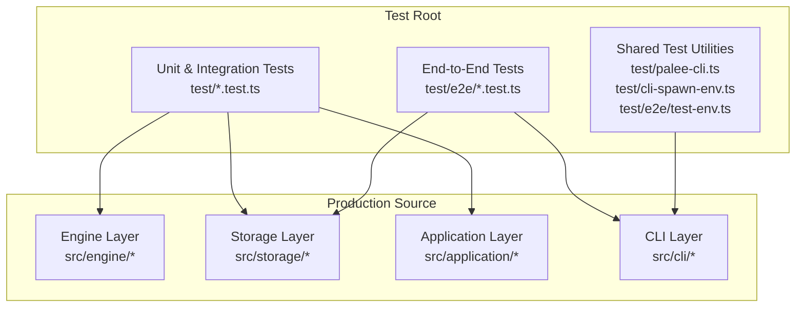
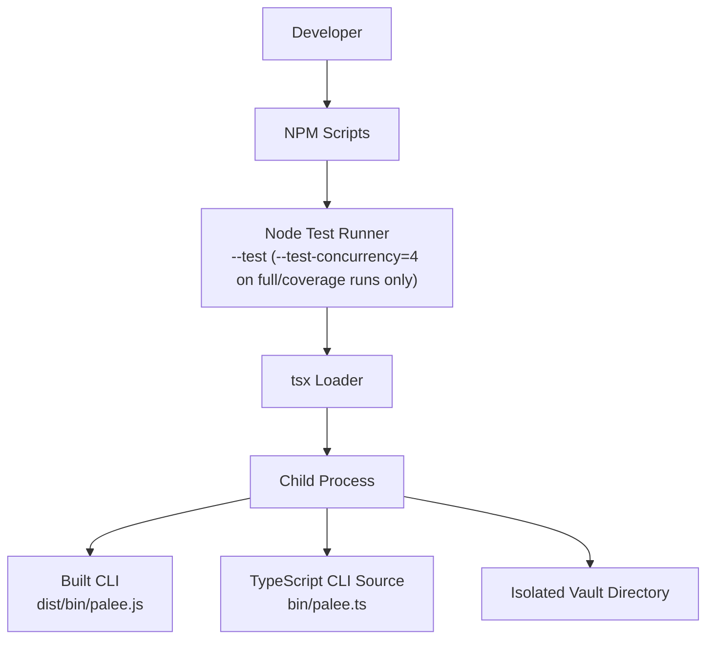
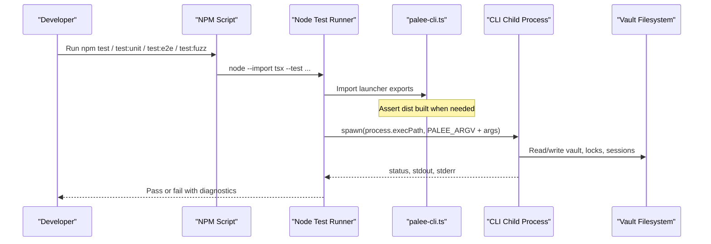
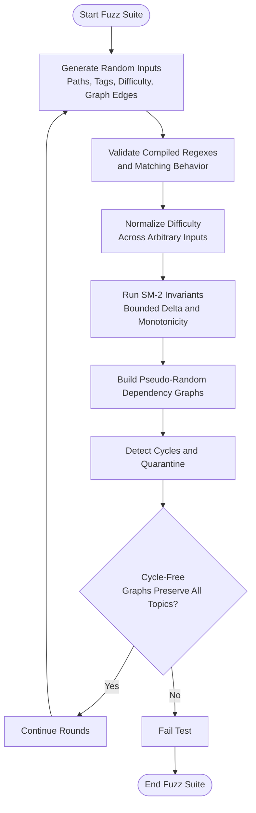
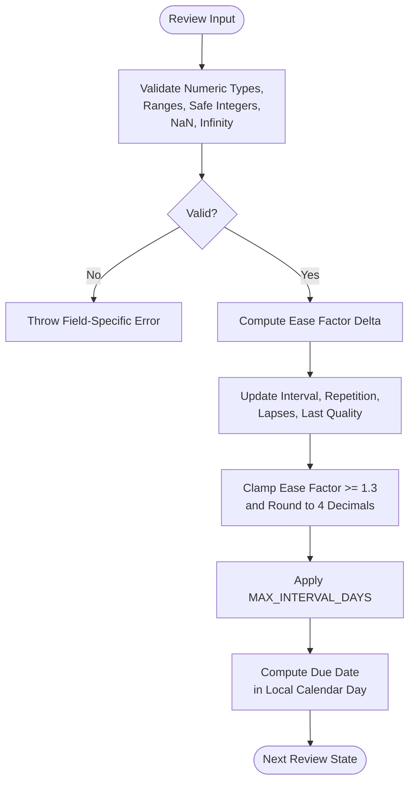
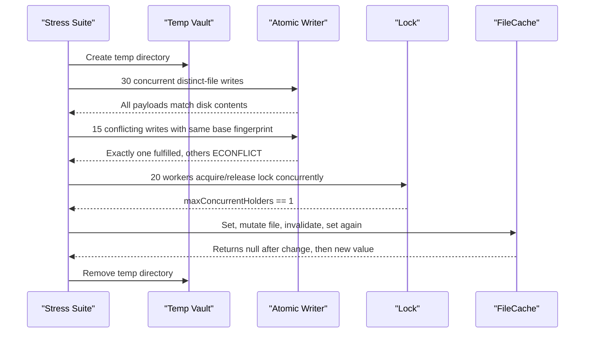
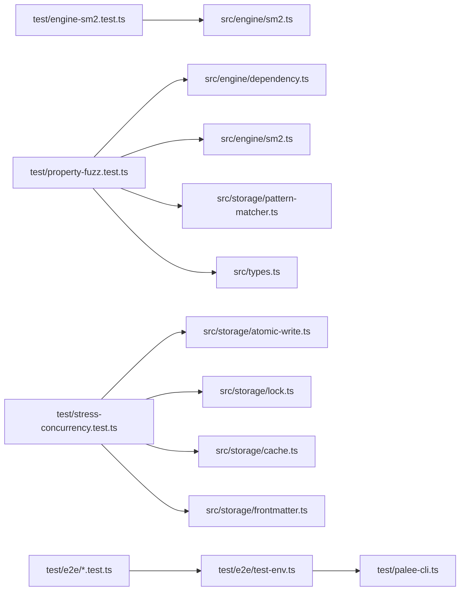

# Testing Guide

## Table of Contents
1. [Introduction](#introduction)
2. [Project Structure](#project-structure)
3. [Core Components](#core-components)
4. [Architecture Overview](#architecture-overview)
5. [Detailed Component Analysis](#detailed-component-analysis)
6. [Dependency Analysis](#dependency-analysis)
7. [Performance Considerations](#performance-considerations)
8. [Troubleshooting Guide](#troubleshooting-guide)
9. [Conclusion](#conclusion)
10. [References](#references)

## Introduction
This document explains the PALEE testing strategy and how to write, run, debug, and maintain tests across unit, integration, end-to-end, fuzz, and stress layers. The suite emphasizes deterministic behavior, property-based invariants, boundary condition coverage, concurrency safety, filesystem isolation, and strict CI quality gates.

Key principles:
- Deterministic tests over time-dependent or process-race-sensitive code.
- Property-based and fuzz checks for algorithmic components such as SM-2 scheduling and dependency graph algorithms.
- Isolated filesystem fixtures so concurrent tests do not share state.
- Explicit CLI launch policy that distinguishes between built artifacts and TypeScript sources under coverage.
- Coverage thresholds enforced by c8 and changed-code diff gating on pull requests.

The suite in numbers (full runs measured on 2026-11-03; thresholds and matrix read from `.c8rc.json` and `.github/workflows/ci.yml`):

| Measure | Value |
|---|---|
| Full suite size | 2,227 tests in 318 suites, 0 failures (`npm test`, 2026-11-03) |
| Coverage floors (c8, `check-coverage` on) | Lines 96%, statements 96%, functions 93%, branches 88% |
| CI test matrix | Node 22.x and 24.x on Ubuntu, Windows, and macOS, plus Node 26.x on Ubuntu |
| Changed-code gate | `diff-cover` on pull requests, fail under 50% |

## Project Structure
Tests live under `test/` with a clear separation between fast unit-style suites, broader integration scenarios, and end-to-end CLI scenarios.

## Core Components
The testing system is built around three reusable utilities:

| Utility | Responsibility | Key Behavior |
|---|---|---|
| `test/palee-cli.ts` | CLI child-process launcher | Chooses between the built `dist/bin/palee.js` and TypeScript sources under coverage; asserts the build exists before test execution. |
| `test/cli-spawn-env.ts` | Spawn environment helpers | Removes coverage flags from child processes and defines the per-spawn timeout budget. |
| `test/e2e/test-env.ts` | E2E vault lifecycle | Creates an isolated temporary vault, config directory, and helper methods for running the CLI, creating topics, reading sessions, and cleaning up. |

Important details:
- Under normal runs, tests spawn the prebuilt CLI entry point to avoid tsx cold-start overhead.
- Under c8 coverage, tests spawn the TypeScript entry through `--import tsx`, allowing coverage maps to merge across parent and children.
- Every CLI invocation is bounded by a timeout so hung children fail deterministically rather than blocking workers.
- E2E helpers set `PALEE_CONFIG_DIR` and `NODE_ENV=test` for every child process.

## Architecture Overview
The test runner uses Node’s built-in test runner with TypeScript support via tsx. NPM scripts organize execution by scope: full tests, unit-focused tests, end-to-end tests, fuzz tests, and coverage runs.

Execution paths (scripts as defined in `package.json`; test counts from full runs on 2026-11-03 and will drift as the suite grows):

| Script | Pretest build | What it runs | Tests (2026-11-03) |
|---|---|---|---|
| `npm test` | Yes | Every `test/**/*.test.ts` with four concurrent workers | 2,227 |
| `npm run test:unit` | No | `test/storage-*.test.ts`, `test/engine-*.test.ts`, `test/types-*.test.ts`, and `test/smoke.test.ts` | 783 |
| `npm run test:fast` | Yes | CLI, engine, storage, session, and types suites, plus smoke, fault injection, property fuzz, stress concurrency, and the timezone matrix | 1,564 |
| `npm run test:e2e` | Yes | Only files under `test/e2e` (no concurrency cap) | 160 |
| `npm run test:fuzz` | Yes | `property-fuzz`, `stress-concurrency`, and the `challenger1-*` suites | 31 |
| `npm run test:coverage` | Yes | The full suite wrapped in c8; the run fails below the coverage floors (lines 96%, statements 96%, functions 93%, branches 88%) | 2,227 (same glob as npm test) |

## Detailed Component Analysis

### Test Organization Strategy
The repository separates tests by fidelity and cost:

| Category | Location | Purpose | Examples |
|---|---|---|---|
| Unit tests | `test/*.test.ts` | Pure functions, engine logic, storage parsing, validation rules, small CLI interactions. | `engine-sm2.test.ts`, `storage-frontmatter.test.ts`, `validation-rules.test.ts` |
| Integration tests | `test/*.test.ts` | Multi-module interactions, file system behavior, lock contention, loader/scanner pipelines. | `stress-concurrency.test.ts`, `cli-adopt-batch.test.ts` |
| End-to-end tests | `test/e2e/*.test.ts` | Real CLI launches against isolated vaults and configs. | `tier1-feature-coverage.test.ts`, `tier2-boundary-corner.test.ts` |
| Fuzz and property tests | `test/property-fuzz.test.ts`, `test/stress-concurrency.test.ts`, `test/challenger*.test.ts` | Randomized inputs, ReDoS probes, mathematical invariants, graph cycle invariants. | Pattern matcher fuzz, SM-2 monotonicity, cycle detection invariants |
| Smoke and infrastructure tests | `test/smoke.test.ts`, `test/package-publish-guard.test.ts`, `test/ci-workflow-matrix.test.ts` | Build output, package metadata, CI matrix expectations. | Global binary smoke, tarball verification |

Guidelines:
- Prefer pure assertions over snapshotting where possible.
- Use fixtures created inside `before` or per-test setup rather than shared global state.
- Keep end-to-end tests focused on CLI contracts and filesystem outcomes.
- Put concurrency-sensitive logic in dedicated suites like `stress-concurrency.test.ts`.

### Test Execution Workflow

Key workflow rules:
- Build hooks are per-script, not uniform: `test`, `test:fast`, `test:e2e`, `test:fuzz`, and `test:coverage` each have a `pretest*` hook that runs `npm run build` before the suite starts. `test:unit` is the exception — it has no pretest hook and runs directly against the TypeScript sources via tsx, so build first yourself if a suite it selects needs the built CLI (`test/palee-cli.ts` fails fast with a clear message when `dist/` is missing).
- Coverage mode changes the launch path to include `--import tsx` and points at the source entry instead of the built artifact.
- Interactive CLI tests use marker-driven input so prompts are answered in order.

### Test Utilities and Helpers

#### CLI Launcher (`test/palee-cli.ts`)
Responsibilities:
- Detect whether the suite runs under c8 coverage.
- Choose between launching `dist/bin/palee.js` or `bin/palee.ts` through tsx.
- Fail fast with a clear message if the built CLI is missing.
- Export argv prefixes and shell command strings for consistent spawning.

Design notes:
- The module-level check prevents unrelated ENOENT failures from being mistaken for production bugs.
- Coverage-aware launching avoids mixing two independent compilation lineages (tsc vs tsx), which would corrupt coverage maps.

#### Spawn Environment (`test/cli-spawn-env.ts`)
Responsibilities:
- Provide `withoutCoverage(env)` to strip `NODE_V8_COVERAGE` from child environments.
- Define `CLI_SPAWN_TIMEOUT_MS` as the standard per-child budget.

Design notes:
- Removing coverage flags from spawned children keeps artifact checks honest and avoids merging incompatible coverage data.
- The timeout value is deliberately aligned with the synchronous spawn helpers used elsewhere.

#### E2E Vault Environment (`test/e2e/test-env.ts`)
Responsibilities:
- Create an isolated temporary directory tree containing `config` and `vault`.
- Write a minimal `config.json` pointing to the test vault.
- Launch the CLI synchronously or interactively with timeouts.
- Seed topics, update frontmatter, read hot memory and session index, list sessions, and clean up.

Concurrency and isolation guarantees:
- Each environment gets its own temp directory under `os.tmpdir()`.
- `runPalee` sets `PALEE_CONFIG_DIR` and `NODE_ENV=test`.
- Interactive runs wait for expected prompt markers before sending input.
- Cleanup swallows removal errors to avoid masking test failures with teardown noise.

### Property-Based and Fuzz Testing
Property-based testing focuses on invariants rather than fixed inputs. The project uses this approach for pattern matching, difficulty normalization, SM-2 scheduling, and dependency graph algorithms.

Key patterns:
- **ReDoS probe:** Generate hundreds of random glob patterns, compile them, and assert evaluation stays below a time threshold.
- **Total function invariant:** Ensure normalized difficulty always returns one of the allowed values for any arbitrary input.
- **SM-2 invariants:** Verify ease-factor deltas are strictly bounded and monotonic, and repeated low-quality reviews cannot push the ease factor below its minimum.
- **Graph invariants:** Generate deterministic pseudo-random graphs using a seeded generator and assert cycle detection and quarantine semantics.

### SM-2 Scheduler Testing
The SM-2 test suite covers both precondition validation and algorithmic correctness.

Coverage highlights:
- Boundary values for quality, ease factor, interval days, repetition, and lapses.
- Corrupt stored scalar values that bypass ordinary range comparisons.
- Safe-integer ceiling behavior for counts that could silently no-op.
- Overflow defenses for computed intervals and rounded ease factors.
- Calendar-day due-date computation and long-term cap behavior.

### Concurrency and Filesystem Isolation
Concurrency testing validates atomic writes, optimistic concurrency control, locking mutual exclusion, and cache consistency under load.

Isolation techniques:
- `fs.mkdtempSync` creates a unique temporary directory per test suite.
- `after` hooks remove directories recursively with force enabled.
- Conflicting writes assert exactly one success and correct error classification.
- Lock contention verifies strict mutual exclusion and eventual completion.

### Fault Injection and Adversarial Inputs
Fault injection tests cover malformed frontmatter, loader tolerance, oversized documents, and defensive sanitization.

Key scenarios:
- Unclosed or empty frontmatter fences.
- Malformed YAML that must not crash the parser.
- Sequences parsed as frontmatter must be rejected with a parse cause.
- Empty-key mappings preserved as data rather than treated as corruption.
- Loader ignores corrupted, empty, and non-PALEE notes gracefully.
- Out-of-range review statistics are clamped or sanitized according to domain rules.
- Large pasted logs are declined without reading into memory.

### Mock Implementations and External Dependencies
External dependencies are handled through:
- Spawning the real CLI rather than importing it directly, isolating process boundaries.
- Using `spawnSync` and interactive streams with explicit timeouts.
- Isolating configuration and vault state through `PALEE_CONFIG_DIR` and temporary directories.
- Avoiding global mutable state by returning disposable test environment objects.

When mocking external systems is necessary:
- Prefer replacing modules at the test boundary rather than mutating shared runtime state.
- Keep mocks small and typed to the actual interface contract.
- Validate that mocks preserve failure modes, not just happy paths.

## Dependency Analysis
The test layer depends on the production source through relative imports, while CLI tests depend on the test utilities for process launching and vault lifecycle.

Coupling observations:
- Unit tests are tightly coupled to specific modules but remain small and deterministic.
- End-to-end tests depend primarily on the CLI contract and filesystem state.
- Shared test utilities reduce duplication across CLI and E2E suites.

## Performance Considerations
- Test concurrency is capped at four workers only on the full (`npm test`) and coverage (`npm run test:coverage`) runs, balancing speed and resource usage; scoped scripts (e.g. `test:unit`) run uncapped.
- Coverage runs increase memory limits because instrumentation adds overhead: `test:coverage` raises the Node heap cap to 8 GB (`--max-old-space-size=8192`).
- CLI spawning has a cold-start cost under tsx; coverage mode accepts this cost to produce accurate coverage maps.
- Fuzz and stress suites should be grouped separately because they can be expensive.
- Avoid global filesystem state; create and destroy per-suite directories.
- Use deterministic seeds for randomized tests when reproducibility matters.

## Troubleshooting Guide

### Common Failure Modes
| Symptom | Likely Cause | Resolution |
|---|---|---|
| Missing built CLI error during import | Tests ran without building first | Run `npm run build` first, or use a script with a pretest hook such as `npm test` (`npm run test:unit` has no pretest hook). |
| Function coverage drops unexpectedly | Mixed tsc and tsx compilation lineages | Keep coverage runs under `npm run test:coverage`; avoid mixing direct child spawns with different compilers. |
| CLI child hangs indefinitely | Unbounded spawn without timeout | Wrap spawns with the exported timeout budget or use `runPalee` helpers. |
| E2E tests affect each other | Shared vault or config directory | Use `createTestVault` and ensure cleanup runs. |
| Flaky concurrency tests | Missing lock mutual-exclusion assertion or shared temp state | Add explicit mutual-exclusion checks and isolate per-test directories. |
| Coverage report misses CLI branches | Tests launched built artifact while coverage expects TypeScript sources | Run through the coverage script or adjust spawn arguments to use the tsx lineage. |

### Debugging Tips
- Inspect `stdout` and `stderr` returned by `runPalee` or interactive runners.
- Reduce concurrency by running a single failing test file directly.
- Temporarily replace randomized inputs with fixed failing examples from fuzz suites.
- Verify that `PALEE_CONFIG_DIR` points to the intended isolated directory.
- Confirm the test vault contains expected `.palee` state files when diagnosing session or hot-memory issues.

## Conclusion
PALEE’s test suite combines deterministic unit tests, filesystem-isolated integration tests, end-to-end CLI scenarios, property-based fuzz checks, and concurrency stress tests. The design prioritizes clarity, reproducibility, and strong invariants for scheduling and graph algorithms. Maintain this balance by keeping tests scoped, avoiding shared state, asserting error messages and edge cases explicitly, and using the provided CLI and vault utilities instead of ad-hoc spawning logic.

Quality gates are enforced by:
- NPM script organization separating fast, full, end-to-end, fuzz, and coverage runs.
- c8 coverage thresholds with `check-coverage` on: at least 96% lines, 96% statements, 93% functions, and 88% branches.
- CI matrix testing: Node 22.x and 24.x on Ubuntu, Windows, and macOS, plus Node 26.x on Ubuntu.
- Changed-code coverage diff checks on pull requests (`diff-cover`, fail under 50%).
- Separate smoke and installed-artifact verification.

## References
- [package.json:20-45](https://github.com/Kuldeep2822k/cli/blob/main/package.json#L20-L45)
- [.c8rc.json:1-12](https://github.com/Kuldeep2822k/cli/blob/main/.c8rc.json#L1-L12)
- [.github/workflows/ci.yml:1-258](https://github.com/Kuldeep2822k/cli/blob/main/.github/workflows/ci.yml#L1-L258)
- [test/palee-cli.ts:1-104](https://github.com/Kuldeep2822k/cli/blob/main/test/palee-cli.ts#L1-L104)
- [test/cli-spawn-env.ts:1-48](https://github.com/Kuldeep2822k/cli/blob/main/test/cli-spawn-env.ts#L1-L48)
- [test/e2e/test-env.ts:1-356](https://github.com/Kuldeep2822k/cli/blob/main/test/e2e/test-env.ts#L1-L356)
- [test/engine-sm2.test.ts:1-442](https://github.com/Kuldeep2822k/cli/blob/main/test/engine-sm2.test.ts#L1-L442)
- [test/property-fuzz.test.ts:1-202](https://github.com/Kuldeep2822k/cli/blob/main/test/property-fuzz.test.ts#L1-L202)
- [test/stress-concurrency.test.ts:1-144](https://github.com/Kuldeep2822k/cli/blob/main/test/stress-concurrency.test.ts#L1-L144)
- [test/fault-injection.test.ts:1-293](https://github.com/Kuldeep2822k/cli/blob/main/test/fault-injection.test.ts#L1-L293)
