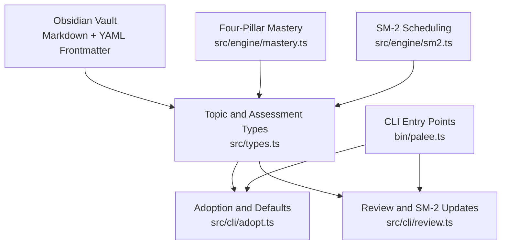
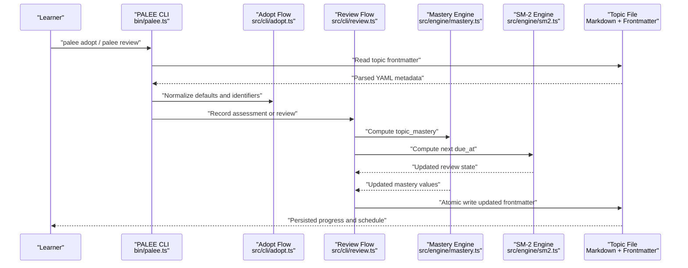
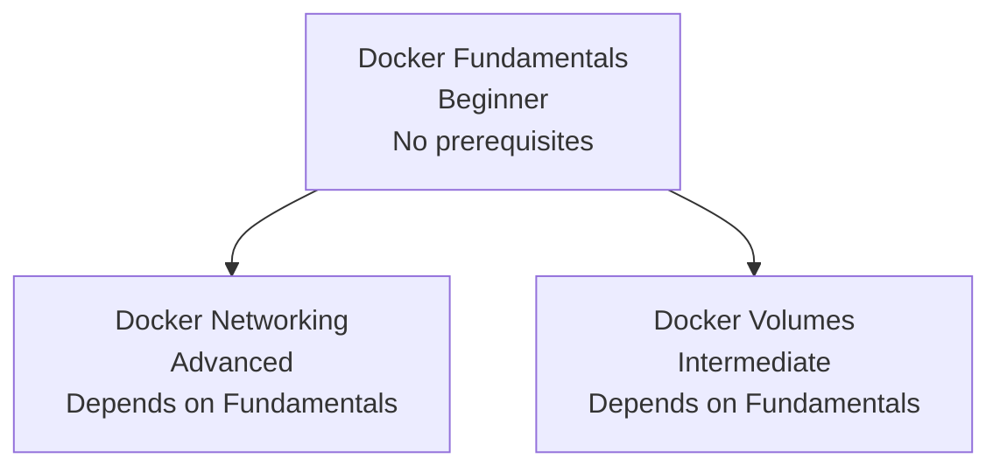
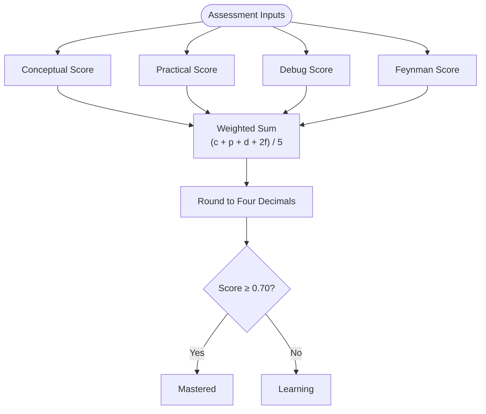
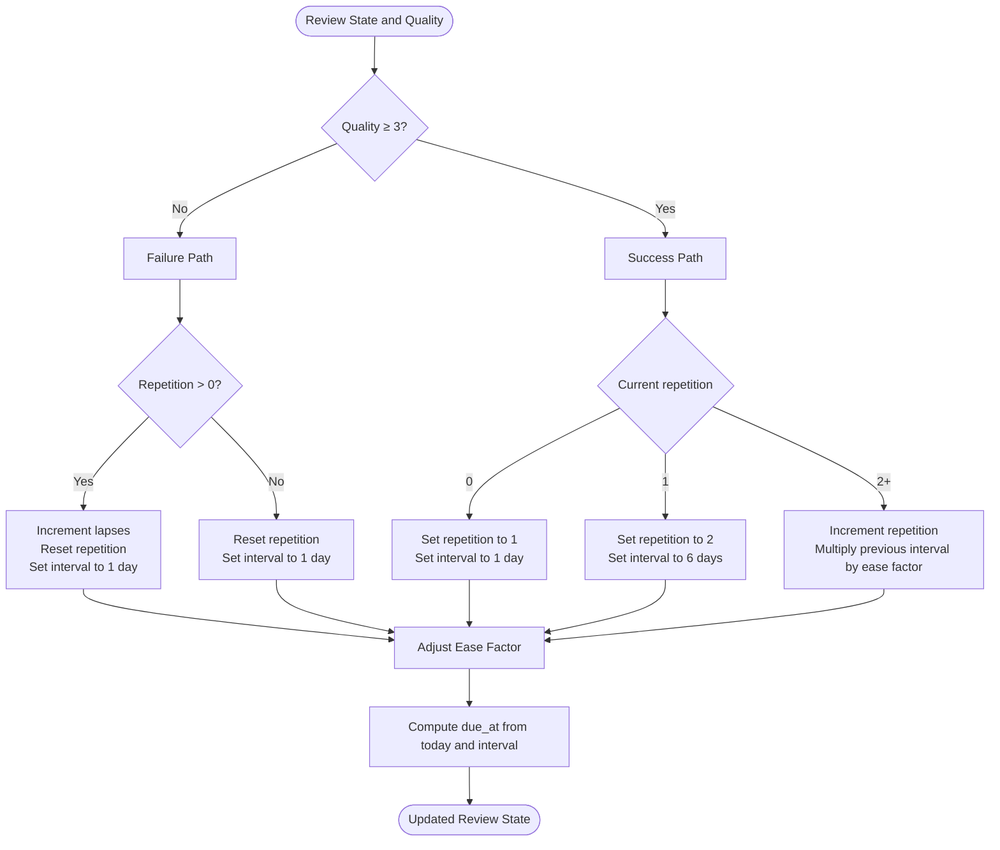
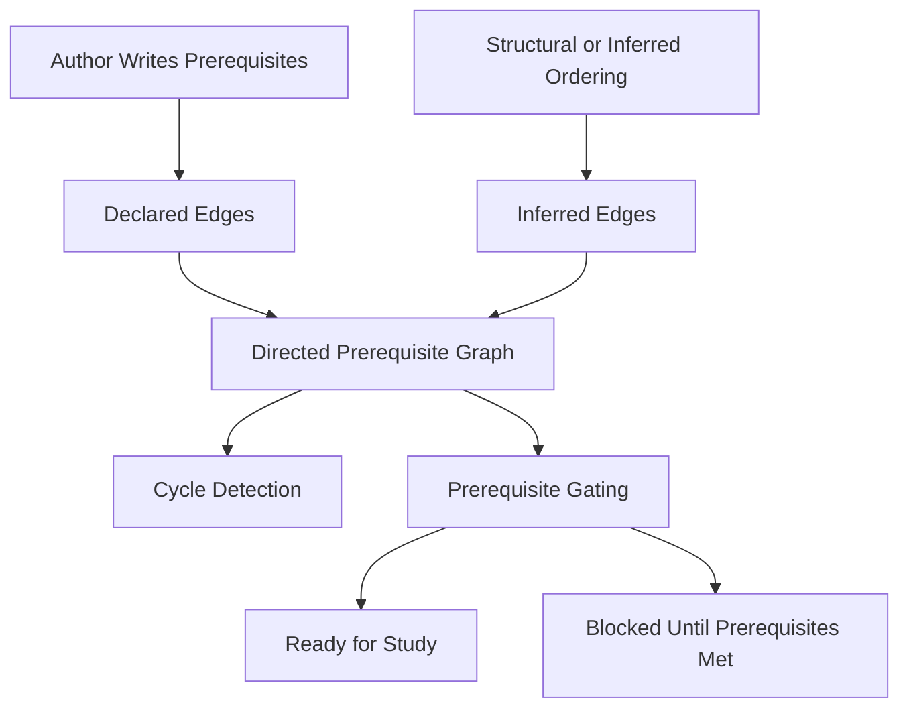
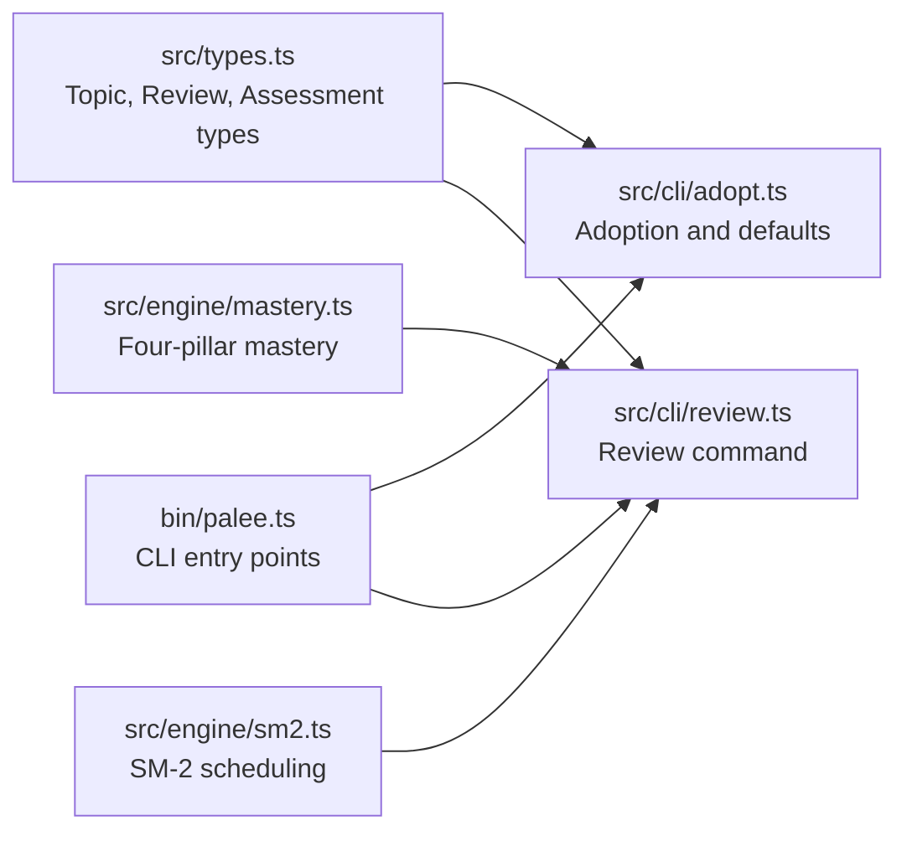

# Core Concepts

<cite>
**Referenced Files in This Document**   
- [README.md](https://github.com/Kuldeep2822k/cli/blob/main/README.md)
- [bin/palee.ts](https://github.com/Kuldeep2822k/cli/blob/main/bin/palee.ts)
- [examples/Docker Fundamentals.md](https://github.com/Kuldeep2822k/cli/blob/main/examples/Docker%20Fundamentals.md)
- [examples/Docker Networking.md](https://github.com/Kuldeep2822k/cli/blob/main/examples/Docker%20Networking.md)
- [examples/Docker Volumes.md](https://github.com/Kuldeep2822k/cli/blob/main/examples/Docker%20Volumes.md)
- [docs/01-0-overview.md](https://github.com/Kuldeep2822k/cli/blob/main/docs/01-0-overview.md)
- [docs/03-1-sm2-spaced-repetition-algorithm.md](https://github.com/Kuldeep2822k/cli/blob/main/docs/03-1-sm2-spaced-repetition-algorithm.md)
- [docs/05-1-topic-and-assessment-schema.md](https://github.com/Kuldeep2822k/cli/blob/main/docs/05-1-topic-and-assessment-schema.md)
- [docs/adr/0004-four-pillar-pedagogical-mastery.md](https://github.com/Kuldeep2822k/cli/blob/main/docs/adr/0004-four-pillar-pedagogical-mastery.md)
- [docs/adr/0012-declared-prerequisites.md](https://github.com/Kuldeep2822k/cli/blob/main/docs/adr/0012-declared-prerequisites.md)
- [src/types.ts](https://github.com/Kuldeep2822k/cli/blob/main/src/types.ts)
- [src/engine/mastery.ts](https://github.com/Kuldeep2822k/cli/blob/main/src/engine/mastery.ts)
- [src/engine/sm2.ts](https://github.com/Kuldeep2822k/cli/blob/main/src/engine/sm2.ts)
- [src/cli/adopt.ts](https://github.com/Kuldeep2822k/cli/blob/main/src/cli/adopt.ts)
- [src/cli/review.ts](https://github.com/Kuldeep2822k/cli/blob/main/src/cli/review.ts)
</cite>

## Table of Contents
1. [Introduction](#introduction)
2. [Project Structure](#project-structure)
3. [Core Components](#core-components)
4. [Architecture Overview](#architecture-overview)
5. [Detailed Component Analysis](#detailed-component-analysis)
6. [Dependency Analysis](#dependency-analysis)
7. [Performance Considerations](#performance-considerations)
8. [Troubleshooting Guide](#troubleshooting-guide)
9. [Conclusion](#conclusion)

## Introduction
This section explains the foundational ideas you need to understand before using PALEE effectively. PALETTE treats your learning material as structured Markdown files enriched with YAML frontmatter, and it uses two complementary engines:

- A **four-pillar mastery model** that measures conceptual understanding, practical application, debugging ability, and Feynman-style explanation.
- An **SM-2 spaced repetition engine** that schedules reviews based on recall quality and perceived difficulty.

PALEE also models prerequisite relationships between topics so that recommendations respect both what you should review next and what you are allowed to study next.

At a high level:
- Your notes live in an Obsidian vault.
- Metadata such as topic identity, prerequisites, mastery scores, and review state lives in YAML frontmatter.
- The CLI commands read, validate, schedule, and update that metadata through atomic writes.
- The engine logic is deterministic and separated from file I/O.

**Section sources**
- [docs/01-0-overview.md:12-35](https://github.com/Kuldeep2822k/cli/blob/main/docs/01-0-overview.md#L12-L35)
- [README.md:1-100](https://github.com/Kuldeep2822k/cli/blob/main/README.md#L1-L100)

## Project Structure
The core concepts in this guide map directly to concrete parts of the repository:

| Concept | Where You See It | What It Means |
|---|---|---|
| Topic file | `examples/Docker Fundamentals.md` | A Markdown note with YAML frontmatter describing a single learning unit. |
| Prerequisite graph | `examples/Docker Networking.md`, `examples/Docker Volumes.md` | Topics can declare dependencies on other topics by ID. |
| Mastery model | `src/engine/mastery.ts`, `docs/adr/0004-four-pillar-pedagogical-mastery.md` | Four assessment dimensions combined into one overall score. |
| Spaced repetition | `src/engine/sm2.ts`, `docs/03-1-sm2-spaced-repetition-algorithm.md` | Scheduling algorithm that adjusts intervals and difficulty over time. |
| Data contract | `src/types.ts`, `docs/05-1-topic-and-assessment-schema.md` | Required and optional fields stored in topic frontmatter. |
| User interaction | `bin/palee.ts`, `src/cli/adopt.ts`, `src/cli/review.ts` | Commands for adopting notes, recording assessments, and reviewing. |

**Diagram sources**
- [src/types.ts:1-200](https://github.com/Kuldeep2822k/cli/blob/main/src/types.ts#L1-L200)
- [src/cli/adopt.ts:1-200](https://github.com/Kuldeep2822k/cli/blob/main/src/cli/adopt.ts#L1-L200)
- [src/cli/review.ts:1-200](https://github.com/Kuldeep2822k/cli/blob/main/src/cli/review.ts#L1-L200)
- [src/engine/mastery.ts:1-200](https://github.com/Kuldeep2822k/cli/blob/main/src/engine/mastery.ts#L1-L200)
- [src/engine/sm2.ts:1-200](https://github.com/Kuldeep2822k/cli/blob/main/src/engine/sm2.ts#L1-L200)
- [bin/palee.ts:1-200](https://github.com/Kuldeep2822k/cli/blob/main/bin/palee.ts#L1-L200)

**Section sources**
- [docs/01-0-overview.md:36-142](https://github.com/Kuldeep2822k/cli/blob/main/docs/01-0-overview.md#L36-L142)
- [docs/05-1-topic-and-assessment-schema.md:1-171](https://github.com/Kuldeep2822k/cli/blob/main/docs/05-1-topic-and-assessment-schema.md#L1-L171)

## Core Components
Before diving into algorithms, understand these five building blocks:

1. **Topic**: A single unit of learning represented by a Markdown file and its frontmatter.
2. **Assessment pillars**: Conceptual, practical, debug, and Feynman scores that describe competence.
3. **Mastery score**: A weighted combination of the four pillars, used to decide whether a topic is mastered.
4. **Review state**: SM-2 fields such as ease factor, interval days, repetition count, lapses, and due date.
5. **Prerequisite relationship**: A directed edge from a dependent topic to a prerequisite topic.

A topic is not just content; it is content plus machine-readable metadata. That metadata lets PALEE compute what to study, when to review it, and whether prerequisites are satisfied.

**Section sources**
- [docs/05-1-topic-and-assessment-schema.md:12-45](https://github.com/Kuldeep2822k/cli/blob/main/docs/05-1-topic-and-assessment-schema.md#L12-L45)
- [docs/adr/0004-four-pillar-pedagogical-mastery.md:1-59](https://github.com/Kuldeep2822k/cli/blob/main/docs/adr/0004-four-pillar-pedagogical-mastery.md#L1-L59)

## Architecture Overview
The user-facing workflow follows a predictable path:

**Diagram sources**
- [bin/palee.ts:1-200](https://github.com/Kuldeep2822k/cli/blob/main/bin/palee.ts#L1-L200)
- [src/cli/adopt.ts:1-200](https://github.com/Kuldeep2822k/cli/blob/main/src/cli/adopt.ts#L1-L200)
- [src/cli/review.ts:1-200](https://github.com/Kuldeep2822k/cli/blob/main/src/cli/review.ts#L1-L200)
- [src/engine/mastery.ts:1-200](https://github.com/Kuldeep2822k/cli/blob/main/src/engine/mastery.ts#L1-L200)
- [src/engine/sm2.ts:1-200](https://github.com/Kuldeep2822k/cli/blob/main/src/engine/sm2.ts#L1-L200)

## Detailed Component Analysis

### Topics as Structured Markdown Files
A topic file has two layers:

- **Body**: Human-readable Markdown explaining the concept.
- **Frontmatter**: YAML metadata that PALEE reads and updates.

#### Required and Optional Topic Fields
From the schema documentation and example files, the most important fields are:

| Field | Meaning | Required or Optional | Notes |
|---|---|---|---|
| `palee_schema` | Version of the PALEE metadata format | Required | Current examples use version `1`. |
| `palee_id` | Stable identifier for the topic | Required after adoption | Generated during adoption; used for dependency resolution. |
| `title` | Human-friendly name | Required in examples | Used for display and identification. |
| `difficulty` | Normalized complexity category | Required in examples | Normalized to beginner, intermediate, or advanced. |
| `depends_on` | List of prerequisite topic IDs | Optional | Empty array means no declared prerequisites. |
| `topic_mastery` | Overall mastery score | Required in examples | Weighted result of the four pillars. |
| `assessed_at` | Timestamp of last assessment | Optional | Can be null initially. |
| `conceptual` | Theoretical understanding | Required in examples | Range 0.0 to 1.0. |
| `practical` | Hands-on application skill | Required in examples | Range 0.0 to 1.0. |
| `debug` | Troubleshooting ability | Required in examples | Range 0.0 to 1.0. |
| `feynman` | Ability to explain simply | Required in examples | Double-weighted in mastery calculation. |
| `ease_factor` | SM-2 difficulty multiplier | Required in examples | Minimum floor prevents scheduling collapse. |
| `interval_days` | Days until next review | Required in examples | Resets on lapse or first successful review. |
| `repetition` | Consecutive successful reviews | Required in examples | Resets on failure. |
| `lapses` | Failed reviews on learned topics | Required in examples | Increments only when prior repetitions exist. |
| `last_quality` | Most recent recall rating | Optional | Null before first review. |
| `last_reviewed_at` | Last review date | Optional | Date-only string. |
| `due_at` | Next review date | Optional | Date-only string. |

#### Example Topic Structures
The Docker examples demonstrate three states:

- **Docker Fundamentals**: A beginner-level topic with initial review data already recorded.
- **Docker Networking**: An advanced topic that depends on Docker Fundamentals.
- **Docker Volumes**: An intermediate topic that also depends on Docker Fundamentals.

These examples show how:
- `depends_on` links topics together.
- Initial mastery and review fields start at defaults.
- Later reviews update `due_at`, `ease_factor`, `interval_days`, `repetition`, and related fields.

**Diagram sources**
- [examples/Docker Fundamentals.md:1-26](https://github.com/Kuldeep2822k/cli/blob/main/examples/Docker%20Fundamentals.md#L1-L26)
- [examples/Docker Networking.md:1-30](https://github.com/Kuldeep2822k/cli/blob/main/examples/Docker%20Networking.md#L1-L30)
- [examples/Docker Volumes.md:1-27](https://github.com/Kuldeep2822k/cli/blob/main/examples/Docker%20Volumes.md#L1-L27)

**Section sources**
- [docs/05-1-topic-and-assessment-schema.md:12-171](https://github.com/Kuldeep2822k/cli/blob/main/docs/05-1-topic-and-assessment-schema.md#L12-L171)
- [examples/Docker Fundamentals.md:1-26](https://github.com/Kuldeep2822k/cli/blob/main/examples/Docker%20Fundamentals.md#L1-L26)
- [examples/Docker Networking.md:1-30](https://github.com/Kuldeep2822k/cli/blob/main/examples/Docker%20Networking.md#L1-L30)
- [examples/Docker Volumes.md:1-27](https://github.com/Kuldeep2822k/cli/blob/main/examples/Docker%20Volumes.md#L1-L27)

### The Four-Pillar Pedagogical Assessment Model
PALEE does not measure mastery as a single scalar. Instead, it evaluates four dimensions:

| Pillar | What It Measures | Weight |
|---|---|---:|
| Conceptual | Understanding theoretical principles | 20% |
| Practical | Applying knowledge in hands-on work | 20% |
| Debug | Diagnosing and fixing errors | 20% |
| Feynman | Explaining the topic clearly without jargon | 40% |

The overall mastery formula is:

`topic_mastery = round((conceptual + practical + debug + 2 × feynman) / 5, 4)`

Key implications:
- Feynman carries double weight because clear articulation is treated as strong evidence of genuine comprehension.
- Without any Feynman score, the maximum possible mastery is 0.60, which cannot reach the typical mastery gate of 0.70.
- Scores are normalized and rounded to four decimal places.

**Diagram sources**
- [docs/adr/0004-four-pillar-pedagogical-mastery.md:12-59](https://github.com/Kuldeep2822k/cli/blob/main/docs/adr/0004-four-pillar-pedagogical-mastery.md#L12-L59)
- [docs/03-1-sm2-spaced-repetition-algorithm.md:130-200](https://github.com/Kuldeep2822k/cli/blob/main/docs/03-1-sm2-spaced-repetition-algorithm.md#L130-L200)
- [src/engine/mastery.ts:1-200](https://github.com/Kuldeep2822k/cli/blob/main/src/engine/mastery.ts#L1-L200)

**Section sources**
- [docs/adr/0004-four-pillar-pedagogical-mastery.md:1-59](https://github.com/Kuldeep2822k/cli/blob/main/docs/adr/0004-four-pillar-pedagogical-mastery.md#L1-L59)
- [docs/03-1-sm2-spaced-repetition-algorithm.md:130-200](https://github.com/Kuldeep2822k/cli/blob/main/docs/03-1-sm2-spaced-repetition-algorithm.md#L130-L200)
- [docs/05-1-topic-and-assessment-schema.md:60-95](https://github.com/Kuldeep2822k/cli/blob/main/docs/05-1-topic-and-assessment-schema.md#L60-L95)

### SM-2 Spaced Repetition Algorithm
The SM-2 engine determines **when** to review a topic, while the mastery engine determines **how well** you know it. They answer different questions.

#### Quality Rating Scale
When you record a review, you rate recall from 0 to 5:

| Rating | Meaning | Effect |
|---:|---|---|
| 5 | Perfect, instant recall | Increases interval and may increase ease factor. |
| 4 | Correct with minor hesitation | Standard interval growth; ease factor unchanged. |
| 3 | Correct but difficult recall | Minimum interval growth; ease factor decreases slightly. |
| 2 | Incorrect; easy answer seemed obvious | Lapse; repetition resets; interval becomes 1 day. |
| 1 | Incorrect; familiar but could not recall | Lapse; repetition resets; interval becomes 1 day. |
| 0 | Complete blackout | Lapse; repetition resets; interval becomes 1 day. |

#### How Timing Is Calculated
The algorithm maintains several state variables:

- **Ease Factor**: A difficulty multiplier starting near 2.5, bounded below by 1.3.
- **Interval Days**: Calendar days until the next review.
- **Repetition**: Count of consecutive successful reviews.
- **Lapses**: Count of failed reviews after the topic was learned.
- **Due Date**: The calendar date when the topic becomes due again.

For successful recalls (rating 3 or higher), the interval grows according to the current repetition count and ease factor. For failures (rating below 3), the repetition resets and the interval returns to 1 day. The ease factor is adjusted after every review, becoming smaller for harder performance and larger for easier performance.

**Diagram sources**
- [docs/03-1-sm2-spaced-repetition-algorithm.md:24-120](https://github.com/Kuldeep2822k/cli/blob/main/docs/03-1-sm2-spaced-repetition-algorithm.md#L24-L120)
- [src/engine/sm2.ts:1-200](https://github.com/Kuldeep2822k/cli/blob/main/src/engine/sm2.ts#L1-L200)

#### Common Misconceptions About Spaced Repetition
- **Spaced repetition is not the same as mastery.** A topic can be due for review even if mastery is low, and a mastered topic can still be scheduled for maintenance review.
- **Ease factor is not the same as difficulty label.** `difficulty` describes the topic’s intended complexity, while `ease_factor` adapts to your actual recall performance.
- **An interval is not a fixed number of days forever.** It changes based on recall quality and previous repetition history.
- **A lapse is not just a wrong answer.** In SM-2, a lapse usually resets repetition and returns the interval to 1 day, signaling that the memory trace needs reinforcement.

**Section sources**
- [docs/03-1-sm2-spaced-repetition-algorithm.md:1-200](https://github.com/Kuldeep2822k/cli/blob/main/docs/03-1-sm2-spaced-repetition-algorithm.md#L1-L200)
- [docs/05-1-topic-and-assessment-schema.md:96-171](https://github.com/Kuldeep2822k/cli/blob/main/docs/05-1-topic-and-assessment-schema.md#L96-L171)
- [src/engine/sm2.ts:1-200](https://github.com/Kuldeep2822k/cli/blob/main/src/engine/sm2.ts#L1-L200)

### Prerequisites and Directed Acyclic Graphs
Prerequisites form a directed graph where edges point from a dependent topic toward its prerequisites. For example:

- `Docker Networking` depends on `Docker Fundamentals`.
- `Docker Volumes` depends on `Docker Fundamentals`.
- `Docker Fundamentals` has no declared prerequisites.

This creates a simple directed acyclic graph rooted at Docker Fundamentals.

#### How Prerequisites Influence Recommendations
PALEE distinguishes between:
- **What is due for review**, determined by SM-2 scheduling.
- **What is ready to study**, determined by prerequisite satisfaction.

A topic may be due for review but blocked from planning or progression if its prerequisites are not met. Conversely, a topic may be eligible for study even if its next review is far in the future.

#### Declared Prerequisites
Prerequisites can come from multiple sources:
- Explicit frontmatter `depends_on`.
- Structural or inferred ordering in certain workflows.
- Explicit prerequisite sections in the note body under recognized headings.

Important rules include:
- Only explicit links under recognized prerequisite headings are considered declarations.
- Hedged or ambiguous statements do not automatically become gates.
- Missing or ambiguous references cost their own edge rather than failing the whole adoption process.
- A declared list replaces the inferred predecessor for that note instead of merging them silently.

**Diagram sources**
- [docs/adr/0012-declared-prerequisites.md:1-82](https://github.com/Kuldeep2822k/cli/blob/main/docs/adr/0012-declared-prerequisites.md#L1-L82)
- [examples/Docker Networking.md:1-30](https://github.com/Kuldeep2822k/cli/blob/main/examples/Docker%20Networking.md#L1-L30)
- [examples/Docker Volumes.md:1-27](https://github.com/Kuldeep2822k/cli/blob/main/examples/Docker%20Volumes.md#L1-L27)

**Section sources**
- [docs/adr/0012-declared-prerequisites.md:1-82](https://github.com/Kuldeep2822k/cli/blob/main/docs/adr/0012-declared-prerequisites.md#L1-L82)
- [docs/05-1-topic-and-assessment-schema.md:30-45](https://github.com/Kuldeep2822k/cli/blob/main/docs/05-1-topic-and-assessment-schema.md#L30-L45)
- [examples/Docker Networking.md:1-30](https://github.com/Kuldeep2822k/cli/blob/main/examples/Docker%20Networking.md#L1-L30)
- [examples/Docker Volumes.md:1-27](https://github.com/Kuldeep2822k/cli/blob/main/examples/Docker%20Volumes.md#L1-L27)

### Practical Examples

#### Example 1: Minimal Topic File
A minimal topic should include:
- A schema version.
- A stable topic ID.
- A title.
- A difficulty value.
- An empty or populated prerequisite list.
- Assessment pillar fields.
- Review state fields.

The Docker Fundamentals example shows how a topic begins with default or initial values and later gains review data such as `last_quality`, `last_reviewed_at`, and `due_at`.

#### Example 2: Prerequisite Declaration
A topic can declare prerequisites by listing other topic IDs:

- `Docker Networking` lists `T-docker-fundamentals`.
- `Docker Volumes` lists `T-docker-fundamentals`.
- `Docker Fundamentals` declares no prerequisites.

This makes Docker Fundamentals a prerequisite for both networking and volumes.

#### Example 3: Recording an Assessment
When you assess a topic:
1. Provide scores for conceptual, practical, debug, and Feynman.
2. PALEE computes `topic_mastery`.
3. If mastery reaches the configured gate, downstream prerequisites may become satisfied.
4. The assessment timestamp is recorded.

#### Example 4: Recording a Review
When you review a topic:
1. Rate recall quality from 0 to 5.
2. PALEE updates SM-2 state: ease factor, interval, repetition, lapses, and due date.
3. The next review date reflects your performance and previous repetition history.

**Section sources**
- [examples/Docker Fundamentals.md:1-26](https://github.com/Kuldeep2822k/cli/blob/main/examples/Docker%20Fundamentals.md#L1-L26)
- [examples/Docker Networking.md:1-30](https://github.com/Kuldeep2822k/cli/blob/main/examples/Docker%20Networking.md#L1-L30)
- [examples/Docker Volumes.md:1-27](https://github.com/Kuldeep2822k/cli/blob/main/examples/Docker%20Volumes.md#L1-L27)
- [docs/05-1-topic-and-assessment-schema.md:60-171](https://github.com/Kuldeep2822k/cli/blob/main/docs/05-1-topic-and-assessment-schema.md#L60-L171)

## Dependency Analysis
At the code level, the core concepts depend on a small set of modules:

**Diagram sources**
- [src/types.ts:1-200](https://github.com/Kuldeep2822k/cli/blob/main/src/types.ts#L1-L200)
- [src/cli/adopt.ts:1-200](https://github.com/Kuldeep2822k/cli/blob/main/src/cli/adopt.ts#L1-L200)
- [src/cli/review.ts:1-200](https://github.com/Kuldeep2822k/cli/blob/main/src/cli/review.ts#L1-L200)
- [src/engine/mastery.ts:1-200](https://github.com/Kuldeep2822k/cli/blob/main/src/engine/mastery.ts#L1-L200)
- [src/engine/sm2.ts:1-200](https://github.com/Kuldeep2822k/cli/blob/main/src/engine/sm2.ts#L1-L200)
- [bin/palee.ts:1-200](https://github.com/Kuldeep2822k/cli/blob/main/bin/palee.ts#L1-L200)

**Section sources**
- [src/types.ts:1-200](https://github.com/Kuldeep2822k/cli/blob/main/src/types.ts#L1-L200)
- [src/cli/adopt.ts:1-200](https://github.com/Kuldeep2822k/cli/blob/main/src/cli/adopt.ts#L1-L200)
- [src/cli/review.ts:1-200](https://github.com/Kuldeep2822k/cli/blob/main/src/cli/review.ts#L1-L200)
- [src/engine/mastery.ts:1-200](https://github.com/Kuldeep2822k/cli/blob/main/src/engine/mastery.ts#L1-L200)
- [src/engine/sm2.ts:1-200](https://github.com/Kuldeep2822k/cli/blob/main/src/engine/sm2.ts#L1-L200)
- [bin/palee.ts:1-200](https://github.com/Kuldeep2822k/cli/blob/main/bin/palee.ts#L1-L200)

## Performance Considerations
- Keep prerequisite graphs small and acyclic. Long chains or cycles make recommendation and validation more expensive.
- Avoid excessive prerequisite duplication. Each dependency adds graph traversal and gating checks.
- Record reviews deliberately. Frequent reviews update frontmatter, which involves parsing, validation, and atomic writes.
- Treat mastery and scheduling separately. Updating assessment pillars changes mastery; updating recall quality changes scheduling. Both affect recommendations, but through different mechanisms.

[No sources needed since this section provides general guidance]

## Troubleshooting Guide

### My topic never becomes “mastered”
Possible causes:
- Feynman score is zero or too low. Because Feynman is double-weighted, missing or weak articulation can prevent reaching the mastery gate.
- Other pillars are low. Even with a strong Feynman score, poor conceptual, practical, or debug scores reduce overall mastery.
- Assessment timestamps are missing. Check `assessed_at` and pillar values.

Remedies:
- Record meaningful Feynman scores after explaining the topic clearly.
- Improve practical and debugging practice.
- Reassess after meaningful study or implementation.

**Section sources**
- [docs/adr/0004-four-pillar-pedagogical-mastery.md:12-59](https://github.com/Kuldeep2822k/cli/blob/main/docs/adr/0004-four-pillar-pedagogical-mastery.md#L12-L59)
- [docs/05-1-topic-and-assessment-schema.md:60-95](https://github.com/Kuldeep2822k/cli/blob/main/docs/05-1-topic-and-assessment-schema.md#L60-L95)

### A topic is due for review but I cannot study it
Possible causes:
- A prerequisite is not yet mastered.
- The prerequisite reference is missing, ambiguous, or hedged.
- The prerequisite graph contains structural or declared edges that block readiness.

Remedies:
- Check `depends_on` and verify referenced topic IDs exist.
- Review prerequisite declarations in frontmatter and recognized prerequisite sections.
- Resolve missing or ambiguous references before expecting the gate to lift.

**Section sources**
- [docs/adr/0012-declared-prerequisites.md:1-82](https://github.com/Kuldeep2822k/cli/blob/main/docs/adr/0012-declared-prerequisites.md#L1-L82)
- [docs/05-1-topic-and-assessment-schema.md:30-45](https://github.com/Kuldeep2822k/cli/blob/main/docs/05-1-topic-and-assessment-schema.md#L30-L45)

### My review dates look unexpected
Possible causes:
- Recent recall quality was low, causing a lapse and interval reset.
- Ease factor decreased after repeated failures.
- The topic had no prior repetitions, so the first successful review follows special initialization behavior.

Remedies:
- Reflect honestly on recall quality.
- Use earlier reviews to reinforce weaker topics.
- Remember that SM-2 adapts to performance over time.

**Section sources**
- [docs/03-1-sm2-spaced-repetition-algorithm.md:24-120](https://github.com/Kuldeep2822k/cli/blob/main/docs/03-1-sm2-spaced-repetition-algorithm.md#L24-L120)
- [docs/05-1-topic-and-assessment-schema.md:96-171](https://github.com/Kuldeep2822k/cli/blob/main/docs/05-1-topic-and-assessment-schema.md#L96-L171)

## Conclusion
PALEE’s core concepts rest on three ideas:

1. **Topics are structured Markdown files with YAML frontmatter** that encode identity, prerequisites, mastery, and review state.
2. **Mastery is multidimensional**, combining conceptual understanding, practical application, debugging ability, and Feynman-style explanation.
3. **Scheduling is adaptive**, using SM-2 to expand or shrink review intervals based on recall quality and perceived difficulty.
4. **Dependencies create a directed graph** that influences what you can study, independent of what is due for review.

Understanding these ideas helps you interpret PALEE’s recommendations correctly, maintain healthy prerequisite graphs, and use spaced repetition as a tool for durable technical learning rather than short-term memorization.

[No sources needed since this section summarizes without analyzing specific files]