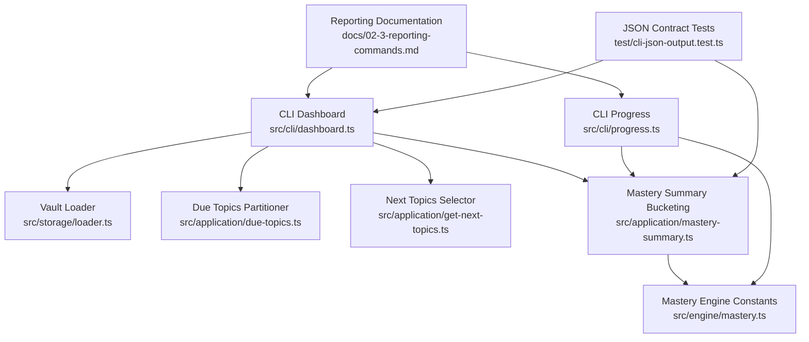
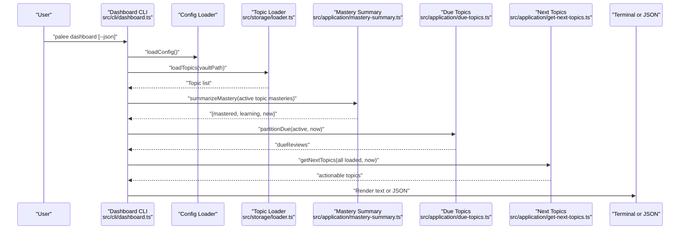
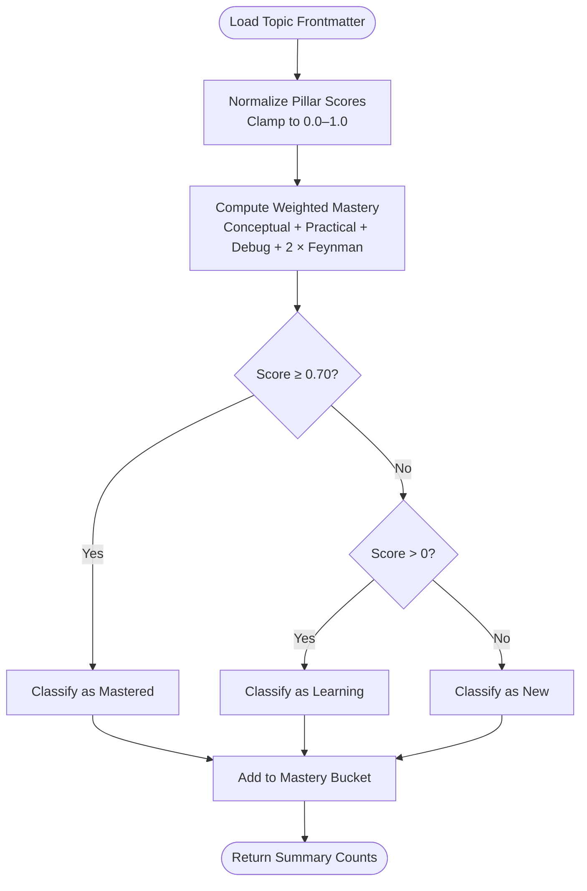
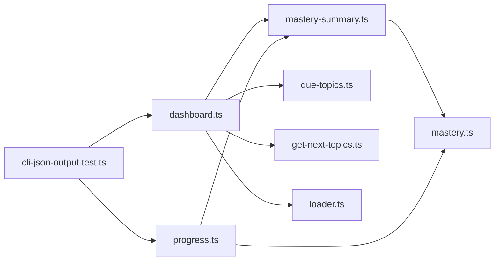

# Reporting and Analytics

::: details Referenced Files in This Document

- [dashboard.ts](https://github.com/Kuldeep2822k/cli/blob/main/src/cli/dashboard.ts)
- [progress.ts](https://github.com/Kuldeep2822k/cli/blob/main/src/cli/progress.ts)
- [mastery-summary.ts](https://github.com/Kuldeep2822k/cli/blob/main/src/application/mastery-summary.ts)
- [mastery.ts](https://github.com/Kuldeep2822k/cli/blob/main/src/engine/mastery.ts)
- [due-topics.ts](https://github.com/Kuldeep2822k/cli/blob/main/src/application/due-topics.ts)
- [get-next-topics.ts](https://github.com/Kuldeep2822k/cli/blob/main/src/application/get-next-topics.ts)
- [loader.ts](https://github.com/Kuldeep2822k/cli/blob/main/src/storage/loader.ts)
- [02-3-reporting-commands.md](https://github.com/Kuldeep2822k/cli/blob/main/docs/02-3-reporting-commands.md)
- [cli-json-output.test.ts](https://github.com/Kuldeep2822k/cli/blob/main/test/cli-json-output.test.ts)
- [application-mastery-summary.test.ts](https://github.com/Kuldeep2822k/cli/blob/main/test/application-mastery-summary.test.ts)

:::

## Table of Contents
1. [Introduction](#introduction)
2. [Project Structure](#project-structure)
3. [Core Components](#core-components)
4. [Architecture Overview](#architecture-overview)
5. [Detailed Component Analysis](#detailed-component-analysis)
6. [Dependency Analysis](#dependency-analysis)
7. [Performance Considerations](#performance-considerations)
8. [Troubleshooting Guide](#troubleshooting-guide)
9. [Conclusion](#conclusion)

## Introduction
This document explains PALEE’s reporting and analytics capabilities with a focus on:

- The **`palee dashboard`** command for visual progress reports.
- The **mastery summary logic** used across `dashboard`, `progress`, and planning commands to report topic mastery.
- How to interpret overall mastery, pillar-derived scores, review completion/backlog metrics, and learning activity signals.
- Output formats: terminal display and machine-readable JSON for automation.
- Practical reporting scenarios such as weekly reviews, knowledge-gap identification, and long-term outcome tracking.
- Performance considerations for large vaults and tips for efficient reporting.
- Exporting data for external analysis and integration with personal analytics dashboards.

PALEE’s four-pillar model underpins its mastery calculation: Conceptual Understanding, Practical Application, Debugging & Troubleshooting, and Feynman Technique Articulation. Mastery is weighted so that the Feynman pillar carries additional emphasis, and the system uses a canonical threshold to classify topics into mastered, learning, or new states.

## Project Structure
Reporting functionality spans three layers:

| Layer | Responsibility | Representative Files |
|---|---|---|
| CLI layer | Parses flags, validates configuration, renders human output, emits JSON | `src/cli/dashboard.ts`, `src/cli/progress.ts` |
| Application layer | Pure business logic for mastery bucketing, due-topic partitioning, and next-topic selection | `src/application/mastery-summary.ts`, `src/application/due-topics.ts`, `src/application/get-next-topics.ts` |
| Engine layer | Canonical mastery computation, normalization, and shared constants | `src/engine/mastery.ts` |
| Storage layer | Loads vault topics and related metadata | `src/storage/loader.ts` |
| Documentation | User-facing command documentation | `docs/02-3-reporting-commands.md` |
| Tests | Contracts for JSON structure, mastery bucketing, and empty-vault behavior | `test/cli-json-output.test.ts`, `test/application-mastery-summary.test.ts` |

## Core Components

### Dashboard Command
The `palee dashboard` command produces an executive snapshot of your vault:

- Scans all topics through the storage loader.
- Classifies active topics by mastery buckets.
- Computes review-backlog counts.
- Selects the next actionable review using the same logic as `palee next`.
- Breaks down totals by difficulty tier.
- Renders either styled terminal text or structured JSON.

Key behaviors documented by implementation:

- Archived topics are excluded from derived figures such as mastered, learning, new, and difficulty breakdowns.
- `reviews_due` counts elapsed scheduled reviews; notes with no scheduled due date (`due_at` null) are not included — that set overlaps, but is not identical to, the zero-mastery “New” bucket. In particular, assessed-but-never-reviewed topics with mastery > 0 also have `due_at` null and sit in Learning/Mastered, not New; the New bucket is defined purely by zero mastery.
- `next_review` is the first non-archived topic from the prerequisite-gated actionable set returned by the next-topic use case.
- Empty vaults emit consistent JSON fields even when there is no data.

### Mastery Summary and Four-Pillar Model
Mastery summary logic is intentionally pure and reusable:

- `summarizeMastery` counts topics into three independent buckets:
  - Mastered: at or above the mastery threshold.
  - Learning: greater than zero but below the threshold.
  - New: exactly zero mastery.
- The default threshold is `0.70`, defined centrally in the mastery engine.
- Zero mastery always counts as “new,” even if another predicate might otherwise match.
- The function has no I/O, process state, or Commander dependency.

The underlying four-pillar model computes an overall topic mastery score from frontmatter assessment values. Pillars are normalized before calculation, and the formula emphasizes conceptual understanding, practical application, debugging ability, and especially Feynman articulation.

### Progress Command
The `palee progress` command provides deeper analytics:

- Vault-wide mode aggregates active topics and shows average mastery, repetition totals, lapse totals, and per-difficulty averages.
- Topic-specific mode surfaces SRS metadata for one note, including mastery, difficulty, repetitions, lapses, assessed date, and last reviewed date.
- It reuses the same mastery bucketing logic as the dashboard.
- It handles missing or ambiguous topic queries with structured errors in JSON mode.

## Architecture Overview

## Detailed Component Analysis

### Dashboard Metrics and Their Meaning

| Metric | Meaning | Interpretation Guidance |
|---|---|---|
| `total_topics` | All loaded topics, including archived | Use this to understand vault size, but do not treat it as the active learning population. |
| `active_topic_count` | Non-archived topics | Use this as the denominator for dashboard percentages. |
| `archived_topic_count` | Topics marked archived | These are tracked separately and excluded from derived mastery figures. |
| `mastered` | Topics at or above the mastery threshold | Indicates completed learning units that can satisfy downstream prerequisites. |
| `learning` | Topics with partial mastery below the threshold | Indicates active learning work still progressing toward mastery. |
| `new` | Topics with zero mastery | Indicates unreviewed content that may be actionable through `palee next`. |
| `mastered_pct`, `learning_pct`, `new_pct` | Percentages over active topics | Show relative distribution across mastery states. |
| `reviews_due` | Elapsed scheduled reviews | Represents backlog pressure, not total actionability. Never-reviewed topics remain “New.” |
| `by_difficulty` | Counts and mastered subtotals per difficulty tier | Helps identify whether learning is concentrated at one level or spread across levels. |
| `next_review` | First actionable non-archived topic selected by next-topic logic | Shows what PALEE would hand you immediately, after prerequisite gating. |

#### Why Reviews Due Is Not the Same as Actionable Topics
The dashboard’s `reviews_due` is intentionally a review-backlog metric. It counts scheduled reviews whose time has passed. A fresh vault can have `reviews_due: 0` while `next_review` names a topic because `palee next` includes never-reviewed topics in its actionable set. This distinction prevents double-counting “New” topics in the backlog while still surfacing immediate next actions.

#### Why Archived Topics Are Excluded From Derived Figures
Archived topics are removed from mastery aggregation and difficulty breakdowns. This avoids inflating or diluting learning metrics with content no longer actively maintained.

### Mastery Calculation Flow

#### Interpreting Mastery Scores
- A score near `0.0` means little or no recorded assessment.
- A score between `0.0` and `0.70` means partial mastery; these topics are “learning.”
- A score at or above `0.70` means mastery; these topics satisfy prerequisite gates and count as “mastered.”
- Because the Feynman pillar is weighted more heavily, strong articulation can raise overall mastery even when other pillars are moderate.

### Output Formats

#### Terminal Display
When run without `--json`, `palee dashboard` prints a boxed ASCII-style summary including:

- Total active topics and archived count.
- Mastered, learning, and new counts with percentages.
- Review backlog count.
- Difficulty-tier breakdown.
- Next review title, ID, mastery, and repetition count.
- Onboarding hints when the vault is empty.

#### JSON Output
Use `--json` or set the environment variable to enable machine-readable output. The JSON contract verified by tests includes:

- Numeric counts for `total_topics`, `active_topic_count`, `archived_topic_count`, `mastered`, `learning`, `new`, and `reviews_due`.
- Percentage fields for mastered, learning, and new proportions.
- A `by_difficulty` object with `beginner`, `intermediate`, and `advanced` entries.
- A `next_review` object or `null`.
- Consistent keys even when the vault is empty.

Errors in JSON mode are emitted to standard error as structured objects rather than plain text.

### Custom Reports for Time Periods, Categories, and Thresholds

#### Built-in Capabilities
- **Time periods**: Only the dashboard command reads the current time to compute review backlogs and next actions (`partitionDue`/`getNextTopics`); `progress` does not read the current time for computation and computes neither backlogs nor next actions. Neither command exposes explicit start/end date filters.
- **Topic categories**: The dashboard groups by difficulty (`beginner`, `intermediate`, `advanced`). There is no built-in category filter by arbitrary tags or folders.
- **Mastery thresholds**: The dashboard and progress commands use the canonical `MASTERY_THRESHOLD = 0.70`. There is no CLI flag to override it.

#### Recommended Approach for Custom Filtering
Vault-wide JSON does not carry per-topic records, so it cannot be filtered per topic:

- `palee progress --json` (vault-wide) emits only aggregates: `global_mastery`, `avg_mastery`, `total_repetitions`, `total_lapses`, and `by_difficulty` — no per-topic rows, and no `assessed_at`, `last_reviewed_at`, or `due_at` fields to filter on.
- `palee dashboard --json` carries per-topic data only inside `next_review`.

For per-topic filtering, call `palee progress --topic <id> --json` once per topic and filter the returned fields in your script:

- `mastery` (note: the single-topic field is `mastery`, not `topic_mastery`), `repetition`, `lapses`, `assessed_at`, and `last_reviewed_at`.
- Filter by dates around `assessed_at` or `last_reviewed_at`, or by mastery ranges such as `mastery < 0.70` for gaps or `mastery >= 0.9` for advanced retention checks.

Use vault-wide JSON only for aggregate trending. This approach keeps PALEE’s canonical calculations intact while giving you flexibility for custom analytics.

### Practical Reporting Scenarios

#### Weekly Progress Review
Run `palee dashboard --json` weekly and track:

- Change in `mastered_pct` versus `learning_pct`.
- Growth in `reviews_due`.
- Shifts in `by_difficulty` to see whether learning is staying balanced.
- Whether `next_review` changes frequently, indicating unstable scheduling or insufficient review cadence.

Save the JSON output to a file or database and plot trends over weeks.

#### Identifying Knowledge Gaps
Vault-wide `palee progress --json` exposes only aggregates, so it cannot identify individual gap topics. Instead, call `palee progress --topic <id> --json` once per topic, then:

- Identify topics where `mastery < 0.70`.
- Group by difficulty to find weak areas.
- Cross-reference with `repetition` and `lapses`:
  - Low repetition plus high lapses suggests fragile memory.
  - High repetition but low mastery suggests ineffective review or overly ambitious material.
- Prioritize topics with recent assessments (`assessed_at`, `last_reviewed_at`) but declining or stalled mastery.

#### Tracking Long-Term Learning Outcomes
Over months, compare:

- Overall mastery progression.
- Time between assessment and mastery.
- Lapse reduction as mastery increases.
- Difficulty distribution shifts toward intermediate and advanced topics.
- Consistency of review activity reflected by timestamps.

#### Detecting Stalled Learning
Stalls often appear as:

- Persistent `learning` topics with unchanged mastery.
- Increasing `lapses` without corresponding review activity.
- High `reviews_due` combined with low new mastery gains.
- `next_review` pointing repeatedly to the same topic, which may indicate excessive difficulty or missing prerequisites.

## Dependency Analysis

### Coupling and Cohesion
- The dashboard command depends on multiple services but remains focused on orchestration and presentation.
- Mastery bucketing is isolated in a pure module, improving testability and reuse.
- The mastery engine centralizes canonical constants and formulas, reducing drift across commands.
- JSON contracts are enforced by tests, making external integrations safer.

### External Integration Points
- Standard output for JSON consumption.
- Standard error for structured JSON errors.
- Exit codes for configuration and usage failures.
- Timestamps and ISO-like date strings for downstream processing.

## Performance Considerations

### Large Vaults
When generating reports for large vaults:

- Prefer JSON output for automation pipelines because it avoids expensive terminal rendering.
- Avoid repeated full-scan commands in tight loops; cache parsed JSON when possible.
- Use topic-specific progress queries only when necessary, since aggregate scans still load the vault.
- Monitor vault size and consider splitting very large learning collections into separate vaults if tooling allows.

### Optimization Tips
- Run reporting commands during off-peak times.
- Combine multiple metrics into a single JSON parse step in your script.
- Filter locally after receiving JSON instead of invoking PALEE repeatedly.
- Use the difficulty breakdown to prioritize scanning or remediation rather than inspecting every topic manually.
- Keep archived topics separated conceptually so they do not distort performance-related metrics.

## Troubleshooting Guide

### Common Issues

| Symptom | Likely Cause | Resolution |
|---|---|---|
| Dashboard reports zero reviews due but `next_review` is present | Never-reviewed topics are counted as “New,” not as scheduled backlog | This is intentional; use `palee next` to see actionable topics. |
| Archived topics do not appear in mastery breakdowns | Archived topics are excluded from derived figures | Treat them as inactive content, not part of active learning metrics. |
| JSON parsing fails | JSON mode was not actually active, so stdout carried human-readable text instead of JSON | Ensure `--json` or `PALEE_JSON` was actually active; in JSON mode, dashboard/progress stdout carries one structured JSON document and diagnostics go to stderr. |
| Topic query returns not found or ambiguous | Query matches none or multiple topics | Use exact IDs or more specific titles. |
| Error output is plain text | JSON mode was not enabled | Add `--json` or set the JSON environment variable. |
| Exit code indicates configuration failure | Missing or invalid vault path | Check configuration and ensure the vault directory exists. |

### Error Handling Contract
- Configuration and setup errors in JSON mode emit structured JSON objects to standard error.
- Usage errors, such as missing or ambiguous topic queries, set a non-zero exit code.
- Unexpected runtime exceptions use a distinct error exit code path.

## Conclusion
PALEE’s reporting and analytics center on two complementary views:

- The **dashboard** gives a concise, high-level snapshot of mastery, review backlog, difficulty distribution, and the next actionable topic.
- The **mastery summary logic** provides a consistent, threshold-based classification of topics across the four-pillar model.

For most automation needs, use `palee dashboard --json` and `palee progress --json`. For deep dives, combine JSON exports with local filtering to build weekly reviews, gap analyses, and long-term learning trend reports. Keep archived topics out of active metrics, distinguish review backlog from actionable topics, and rely on the canonical mastery threshold for consistent interpretations.
