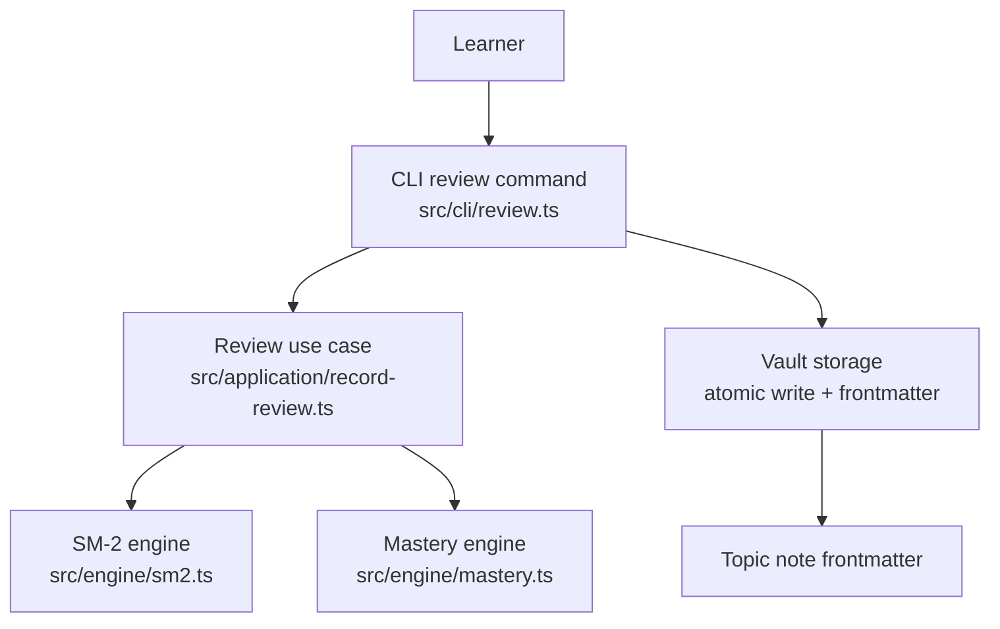
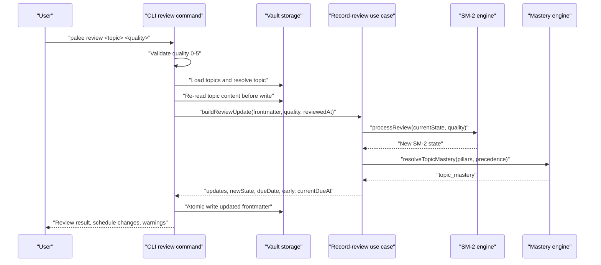
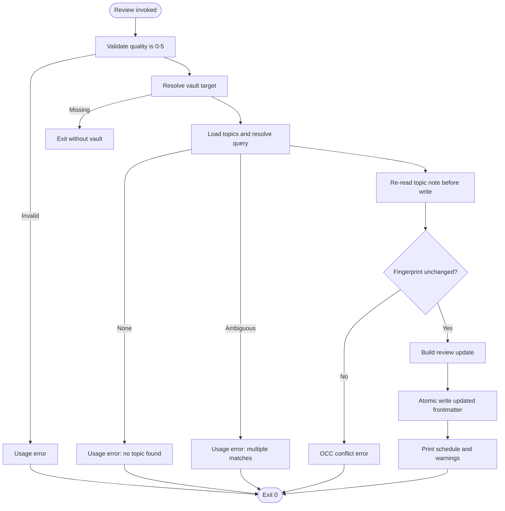
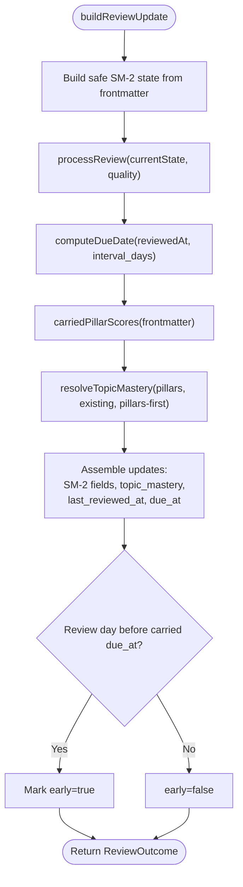
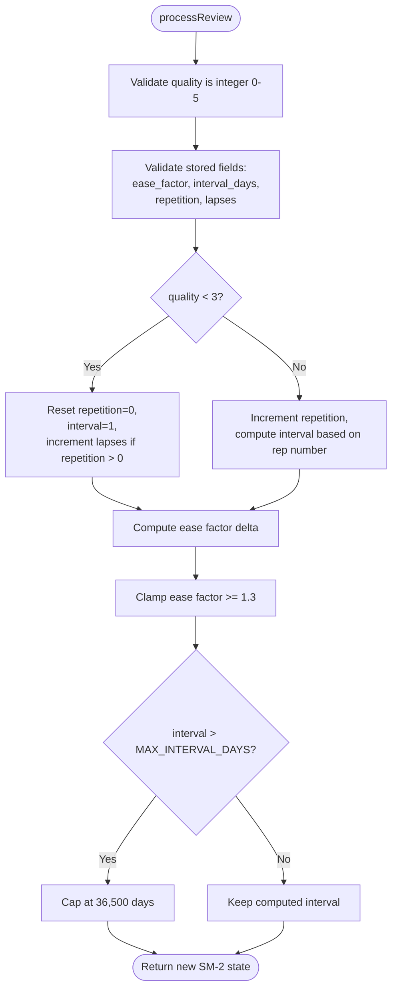
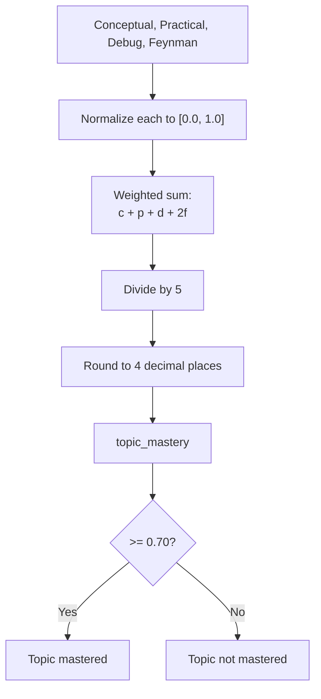
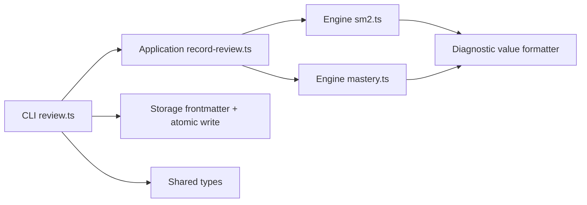

# Interactive Review Workflow

::: details Referenced Files in This Document

- [src/cli/review.ts](https://github.com/Kuldeep2822k/cli/blob/main/src/cli/review.ts)
- [src/application/record-review.ts](https://github.com/Kuldeep2822k/cli/blob/main/src/application/record-review.ts)
- [src/engine/sm2.ts](https://github.com/Kuldeep2822k/cli/blob/main/src/engine/sm2.ts)
- [src/engine/mastery.ts](https://github.com/Kuldeep2822k/cli/blob/main/src/engine/mastery.ts)
- [src/storage/sessions.ts](https://github.com/Kuldeep2822k/cli/blob/main/src/storage/sessions.ts)
- [docs/adr/0001-supermemo-sm2-algorithm.md](https://github.com/Kuldeep2822k/cli/blob/main/docs/adr/0001-supermemo-sm2-algorithm.md)
- [docs/adr/0004-four-pillar-pedagogical-mastery.md](https://github.com/Kuldeep2822k/cli/blob/main/docs/adr/0004-four-pillar-pedagogical-mastery.md)
- [docs/adr/0007-hot-memory-read-state-contract.md](https://github.com/Kuldeep2822k/cli/blob/main/docs/adr/0007-hot-memory-read-state-contract.md)
- [docs/adr/0019-session-memory-lifecycle.md](https://github.com/Kuldeep2822k/cli/blob/main/docs/adr/0019-session-memory-lifecycle.md)
- [docs/adr/0021-assessment-surface.md](https://github.com/Kuldeep2822k/cli/blob/main/docs/adr/0021-assessment-surface.md)
- [test/cli-review-early.test.ts](https://github.com/Kuldeep2822k/cli/blob/main/test/cli-review-early.test.ts)
- [test/application-record-review.test.ts](https://github.com/Kuldeep2822k/cli/blob/main/test/application-record-review.test.ts)

:::

## Table of Contents
1. [Introduction](#introduction)
2. [Project Structure](#project-structure)
3. [Core Components](#core-components)
4. [Architecture Overview](#architecture-overview)
5. [Detailed Component Analysis](#detailed-component-analysis)
6. [Dependency Analysis](#dependency-analysis)
7. [Performance Considerations](#performance-considerations)
8. [Troubleshooting Guide](#troubleshooting-guide)
9. [Conclusion](#conclusion)

## Introduction
PALEE’s interactive review workflow connects a learner’s recall quality to two persistent learning signals:

1. **SM-2 scheduling state**: `ease_factor`, `interval_days`, `repetition`, `lapses`, `last_reviewed_at`, and `due_at`.
2. **Topic mastery score**: the four-pillar weighted mastery value that gates prerequisite visibility.

The review command is intentionally narrow. It accepts a topic identifier and a single recall-quality rating, validates it, computes the next SM-2 state, carries forward only assessment pillars the learner actually provided, recomputes `topic_mastery`, and writes the updated note. It does not collect new pillar scores by itself; for that, PALEE provides a separate assessment surface.

## Project Structure
The review feature spans four layers:

| Layer | Responsibility | Key files |
|---|---|---|
| CLI layer | Parses arguments, resolves topics, formats output, maps errors to exit codes | `src/cli/review.ts` |
| Application use case | Pure review update computation, early-review detection, mastery resolution | `src/application/record-review.ts` |
| Engine layer | SM-2 algorithm, date formatting, mastery calculation, pillar normalization | `src/engine/sm2.ts`, `src/engine/mastery.ts` |
| Storage layer | Topic loading, frontmatter parsing/writing, atomic writes | `src/storage/*` |



## Core Components
This section summarizes the components that implement the review workflow and their contracts.

| Component | Purpose | Important inputs | Important outputs | Failure behavior |
|---|---|---|---|---|
| `reviewCommand` | CLI entry point for spaced-repetition reviews | Topic query string, quality string, optional `force` flag | Console feedback, updated note file, exit code | Invalid quality or missing/ambiguous topic exits with usage error; OCC conflict exits with lock code; unexpected exceptions map through `exitCodeFor` |
| `buildReviewUpdate` | Pure application-layer review computation | Parsed frontmatter, numeric quality, review timestamp | Updated frontmatter fields, SM-2 state, due date, early-review flags | Throws on invalid stored SM-2 state or malformed field types |
| `processReview` | Canonical SM-2 transition | Current SM-2 fields, integer quality 0–5 | New `ease_factor`, `interval_days`, `repetition`, `lapses`, `last_quality` | Throws when quality or any stored field violates its precondition |
| `computeTopicMastery` / `resolveTopicMastery` | Four-pillar mastery computation | Conceptual, practical, debug, Feynman scores; existing mastery; precedence mode | Normalized mastery value between 0.0 and 1.0 | Normalizes and clamps input; when any stored pillar is > 0, `topic_mastery` is recomputed from the pillars; otherwise the existing stored value is carried forward unchanged (returning 0 only when there is no existing value either) |

## Architecture Overview
The review process is layered so that I/O, validation, scheduling math, and user feedback stay separable.



## Detailed Component Analysis

### Review Command Interface
The `review` command is designed for simplicity and safety:

- **Required inputs**:
  - A topic identifier (exact `palee_id`, substring match against IDs, or title substring).
  - A quality rating string matching `[0-5]`.
- **Optional flags**:
  - `--force`: suppresses the early-review warning but still records the review.
- **Input validation**:
  - Quality must be an integer from 0 to 5.
  - The vault target must be resolvable.
  - Exactly one topic must match the query.
- **Output**:
  - Success message identifying the topic.
  - Recorded quality.
  - New ease factor.
  - Next interval in days.
  - Next due date.
  - New repetition count.
  - Warning if quality is below 3.
  - Early-review warning unless `--force` is passed.
- **Exit codes**:
  - Usage errors for invalid quality, missing vault, or ambiguous/missing topic.
  - Lock/OCC conflict code for concurrent modification.
  - Generic failure code for unexpected exceptions.



### Application-Layer Review Update
`buildReviewUpdate` is the pure boundary between CLI I/O and scheduling math. Its responsibilities include:

- Constructing a safe current SM-2 state from raw frontmatter.
- Calling `processReview` to compute the next SM-2 state.
- Computing the next due date using local calendar arithmetic.
- Detecting early reviews by comparing the review timestamp with the carried `due_at`.
- Resolving topic mastery using `pillars-first` precedence.
- Carrying forward only pillar scores already present in the note.
- Returning updates for `last_reviewed_at` and `due_at`.

Important contract decisions:

- Absent pillar keys are never minted as zero. This avoids marking a note “assessed but zero” when no assessment was recorded.
- Existing pillar values are carried forward after normalization (clamp to [0, 1], round to 4 decimals, coerce numeric strings); absent pillar keys are never written.
- When any stored pillar is > 0, `topic_mastery` is recomputed from the pillars; otherwise the existing stored value is carried forward unchanged. Review quality alone does not raise it.
- Early-review detection compares calendar days, not UTC instants, so same-day reviews remain non-early.



### SM-2 Scheduling State Updates
The SM-2 engine implements SuperMemo-2 scheduling with strong preconditions and bounded growth:

- **Quality delta**: computed by the canonical formula, with minimum ease factor clamped to 1.3.
- **Successful review** (`quality >= 3`):
  - Repetition increments.
  - Interval becomes 1 day for repetition 1, 6 days for repetition 2, or rounded previous interval multiplied by ease factor thereafter.
- **Failed review** (`quality < 3`):
  - Repetition resets to 0.
  - Interval resets to 1 day.
  - Lapse counter increments only when the topic had prior repetitions.
- **Interval cap**: maximum 36,500 days (100 years), preventing unbounded schedule growth and protecting the representable calendar range.
- **Date arithmetic**: performed in local time to avoid daylight saving drift.



### Four-Pillar Pedagogical Assessment Model
PALEE models mastery across four dimensions:

| Pillar | Weight | Meaning |
|---|---:|---|
| Conceptual | 20% | Theoretical understanding of core principles. |
| Practical | 20% | Ability to apply concepts in execution or implementation. |
| Debug | 20% | Ability to troubleshoot, diagnose, and repair failures. |
| Feynman | 40% | Ability to articulate and explain concepts simply without jargon. |

The canonical formula is:

```text
topic_mastery = round((conceptual + practical + debug + 2 × feynman) / 5, 4)
```

Key consequences:

- Each pillar is normalized to `[0.0, 1.0]`.
- The threshold for mastering a topic is `0.70`.
- Because Feynman is double-weighted, the three ordinary pillars alone can reach at most `0.60`; a non-zero Feynman score is required to pass the gate.
- Review derives mastery from existing pillar scores; it does not collect new pillar scores.



### Session Continuity and Draft Recovery
Sessions are not part of the review workflow — `review` imports nothing from `src/storage/sessions.ts` and never reads sessions, drafts, or `hot.md`. See the Session Management page for session continuity and draft recovery.

### Batch Review Capability
The repository exposes one review operation per invocation: a single topic query and a single quality rating. There is no dedicated batch review subcommand in the reviewed source files.

Practical batching approaches available from the current design:

- **Shell-level iteration**: run the review command repeatedly over a list of topics.
- **Automated scripts**: wrap `palee review` in a script that supplies topic queries and qualities.
- **Per-topic concurrency control**: because each review performs an OCC-safe re-read and atomic write, concurrent automation should serialize per-topic writes to avoid lock conflicts.

The design favors explicit, auditable interactions per topic rather than hidden bulk mutation.

### Typical Review Sessions

#### Example 1: First review of a newly adopted topic
- The learner runs `palee review T-example 5`.
- The system validates quality, resolves the topic, loads its frontmatter, and computes the first successful SM-2 step.
- Output includes a new repetition count, a one-day interval, and the next due date. (No mastery value is displayed; mastery is written to frontmatter but not printed by `review`.)
- If the note has no pillar assessments, review does not mint pillar keys; mastery remains derived from absent pillars.

#### Example 2: Early review
- The note has a future `due_at`.
- The review is still recorded and exits successfully.
- The CLI prints an early-review warning naming the actual due date.
- Passing `--force` suppresses the warning but still records the review.

#### Example 3: Failed review
- The learner enters a quality below 3.
- SM-2 resets repetition to 0, sets interval to 1 day, and may increment lapses.
- The CLI warns that the review failed and the interval reset occurred.

#### Example 4: Already mastered topic
- The topic’s pillars produce a mastery score of at least 0.70.
- The review still updates SM-2 scheduling.
- Mastery is recomputed from existing pillars; review quality alone does not raise mastery.

These behaviors are validated by the CLI early-review tests and the application-layer review tests.

## Dependency Analysis
The review pipeline depends on well-defined boundaries:



Coupling characteristics:

- The CLI layer owns filesystem interaction, topic resolution, user-facing output, and exit codes.
- The application layer owns the review state transition and mastery resolution without direct I/O.
- The SM-2 engine owns scheduling math and date formatting.
- The mastery engine owns pillar normalization and weighted scoring.
- Session persistence is orthogonal to topic review: sessions track study activity, while topic notes track SM-2 and mastery state.

Potential risks:

- Concurrent edits to the same topic note trigger an OCC conflict.
- Corrupted stored SM-2 fields cause explicit validation errors rather than silent clamping.
- Mistaking review quality for mastery can lead to incorrect expectations about prerequisite gating.

## Performance Considerations
- Review is lightweight: it loads topics, parses frontmatter, computes deterministic scheduling, and performs one atomic write.
- The SM-2 algorithm uses constant-time arithmetic per review.
- Mastery computation normalizes and combines four small scalar inputs.
- The interval cap prevents extreme date calculations.
- Session loading tolerates malformed entries without aborting the entire scan, keeping large vaults resilient.

Recommended practices:

- Avoid running many concurrent reviews on the same topic; serialize per-topic writes.
- Prefer exact topic identifiers where possible to reduce fuzzy resolution overhead.
- Keep pillar assessments consistent; review preserves existing pillars but does not fix them.

## Troubleshooting Guide

### Common Errors and Recovery

| Symptom | Likely cause | Resolution |
|---|---|---|
| `Quality must be an integer from 0 to 5` | Non-numeric or out-of-range quality input | Pass an integer from 0 to 5. |
| `No topic found matching...` | Query does not match any topic | Use an exact `palee_id`, a more specific substring, or verify the topic exists. |
| `Multiple topics match...` | Fuzzy query matches several topics | Provide an exact ID or a more specific query. |
| `OCC conflict` | Another process modified the topic note between read and write | Retry the review after the other process finishes. |
| `Invalid ease_factor / interval_days / repetition / lapses` | Corrupted or unexpected SM-2 frontmatter values | Run `palee validate --fix` to repair SM-2 state. |
| `Invalid days: advancing the due date...` | Computed interval pushed the due date beyond the representable calendar range | Repair or reset the problematic SM-2 state via validation tools. |
| Early-review warning appears | Review happened before the stored `due_at` | Accept the warning, or pass `--force` to suppress it while still recording the review. |
| Review succeeds but mastery stays low | Review does not collect new pillar scores | Use the assessment command to provide conceptual, practical, debug, or Feynman scores. |

### Data Validation Rules Applied During Reviews
- Quality is validated as an integer in `[0, 5]`.
- Stored SM-2 fields are validated before scheduling:
  - `ease_factor` must be a finite number ≥ 1.3.
  - `interval_days` must be a finite number ≥ 1.
  - `repetition` must be a non-negative integer within safe bounds.
  - `lapses` must be a non-negative integer within safe bounds.
- Pillar scores are normalized to `[0.0, 1.0]`.
- Absent pillar keys are not written as zero.
- When any stored pillar is > 0, `topic_mastery` is recomputed from the pillars; otherwise the existing stored value is carried forward unchanged.

### Recovery Procedures
1. **Repair corrupted SM-2 state**: run the validation fixer referenced by the error message.
2. **Retry after OCC conflict**: wait for concurrent writers to finish and rerun the review.
3. **Correct assessment data**: use the assessment command to provide missing pillar scores; review alone cannot raise mastery from recall quality.
4. **Restore session continuity**: if session data is incomplete or corrupt, rely on the session subsystem’s rebuild behavior, which counts unreadable sessions and retains canonical history.

## Conclusion
PALEE’s interactive review workflow is deliberately focused: it turns a self-reported recall rating into durable scheduling state and a refreshed mastery score without inventing assessment data. The four-pillar model ensures that true mastery requires conceptual, practical, debugging, and articulation competence, with Feynman’s double weight emphasizing clear explanation. The review command protects learners through strict validation, OCC-safe writes, explicit error messages, and early-review warnings. Session continuity and atomic storage keep the broader learning progression reliable, while the assessment surface remains the proper place to adjust mastery-driven prerequisite gating.
