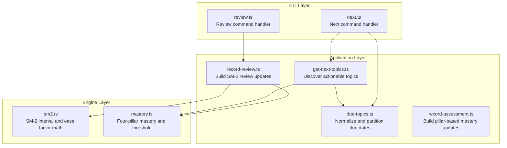
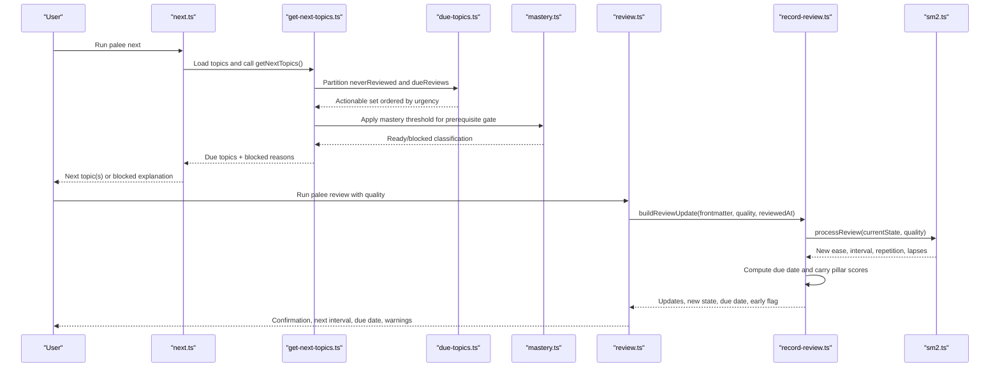
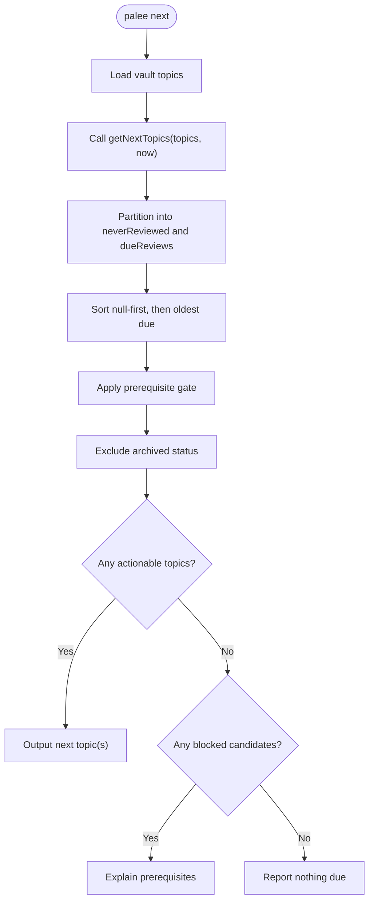
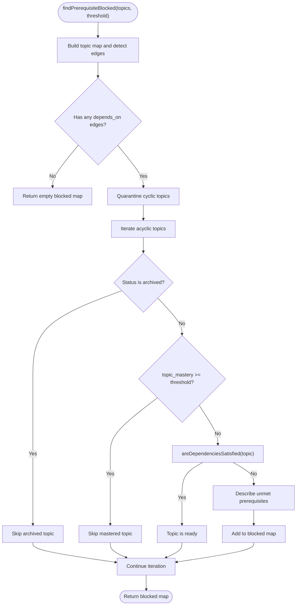
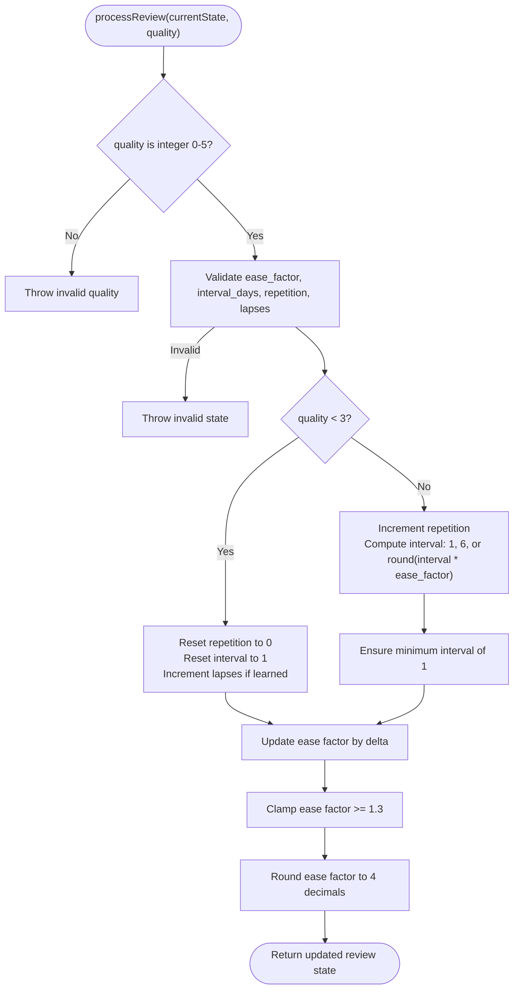
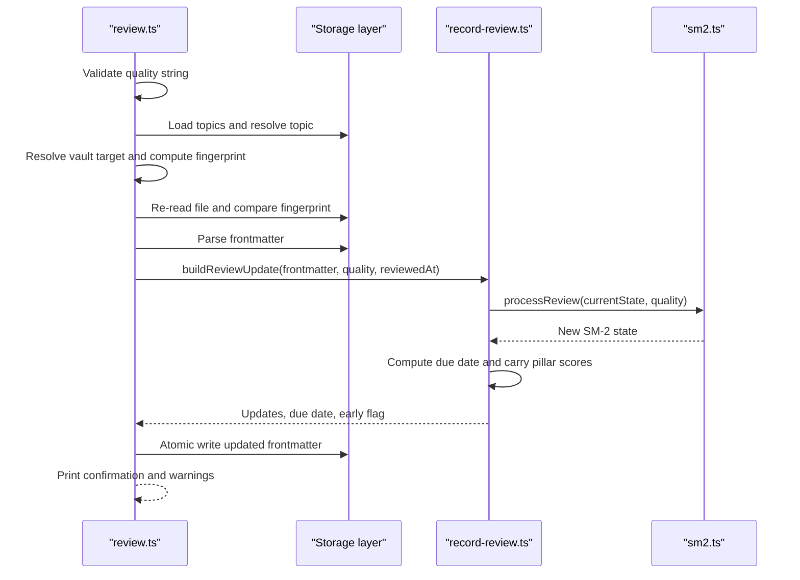
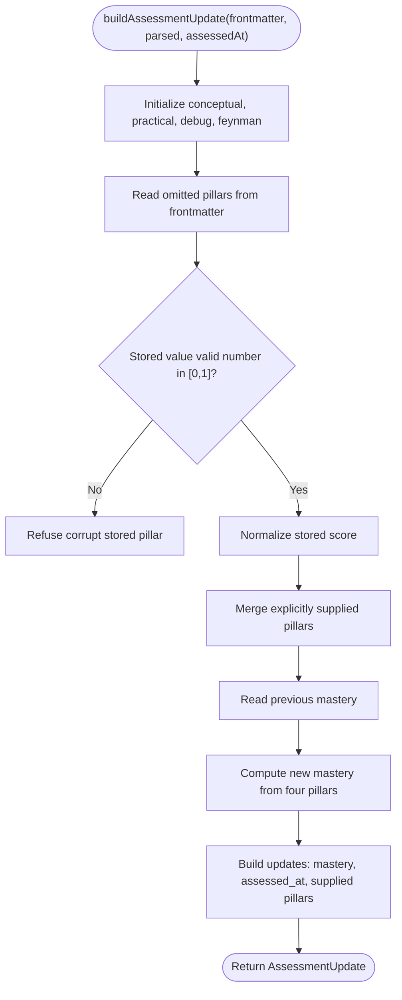
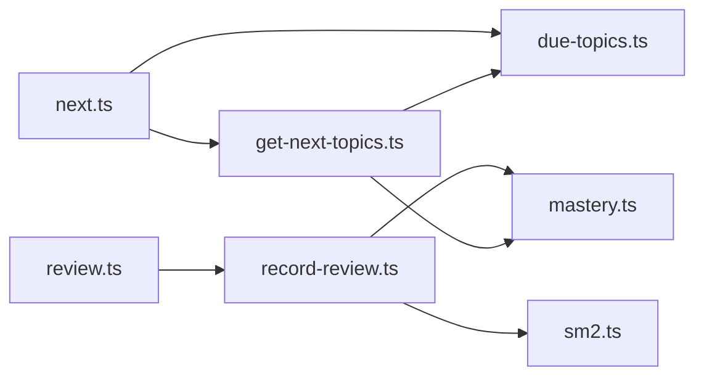

# Review and Scheduling

::: details Referenced Files in This Document

- [next.ts](https://github.com/Kuldeep2822k/cli/blob/main/src/cli/next.ts)
- [review.ts](https://github.com/Kuldeep2822k/cli/blob/main/src/cli/review.ts)
- [get-next-topics.ts](https://github.com/Kuldeep2822k/cli/blob/main/src/application/get-next-topics.ts)
- [due-topics.ts](https://github.com/Kuldeep2822k/cli/blob/main/src/application/due-topics.ts)
- [record-review.ts](https://github.com/Kuldeep2822k/cli/blob/main/src/application/record-review.ts)
- [record-assessment.ts](https://github.com/Kuldeep2822k/cli/blob/main/src/application/record-assessment.ts)
- [sm2.ts](https://github.com/Kuldeep2822k/cli/blob/main/src/engine/sm2.ts)
- [mastery.ts](https://github.com/Kuldeep2822k/cli/blob/main/src/engine/mastery.ts)
- [0020-readiness-and-scheduling-contracts.md](https://github.com/Kuldeep2822k/cli/blob/main/docs/adr/0020-readiness-and-scheduling-contracts.md)
- [0021-assessment-surface.md](https://github.com/Kuldeep2822k/cli/blob/main/docs/adr/0021-assessment-surface.md)

:::

## Table of Contents
1. [Introduction](#introduction)
2. [Project Structure](#project-structure)
3. [Core Components](#core-components)
4. [Architecture Overview](#architecture-overview)
5. [Detailed Component Analysis](#detailed-component-analysis)
6. [Dependency Analysis](#dependency-analysis)
7. [Performance Considerations](#performance-considerations)
8. [Troubleshooting Guide](#troubleshooting-guide)
9. [Conclusion](#conclusion)

## Introduction
This document explains PALEE’s review and scheduling system: how the `palee next` command discovers topics ready for review, how SM-2 spacing controls review frequency, how prerequisite mastery gates learning progression, and how assessments and reviews update schedules. It also covers priority ordering, early and missed reviews, handling blocked topics, and performance considerations for large vaults.

PALEE separates user-facing CLI commands from pure application use cases and engine algorithms:
- The CLI layer handles configuration, vault resolution, input validation, output formatting, concurrency protection, and exit codes.
- The application layer contains pure scheduling, readiness, assessment, and review logic that can be unit-tested independently.
- The engine layer implements SM-2 scheduling, dependency gating, mastery computation, and date helpers.

## Project Structure
The review and scheduling flow spans three layers:

**Diagram sources**
- [next.ts:1-227](https://github.com/Kuldeep2822k/cli/blob/main/src/cli/next.ts#L1-L227)
- [review.ts:1-141](https://github.com/Kuldeep2822k/cli/blob/main/src/cli/review.ts#L1-L141)
- [get-next-topics.ts:1-199](https://github.com/Kuldeep2822k/cli/blob/main/src/application/get-next-topics.ts#L1-L199)
- [due-topics.ts:1-58](https://github.com/Kuldeep2822k/cli/blob/main/src/application/due-topics.ts#L1-L58)
- [record-review.ts:1-116](https://github.com/Kuldeep2822k/cli/blob/main/src/application/record-review.ts#L1-L116)
- [record-assessment.ts:1-134](https://github.com/Kuldeep2822k/cli/blob/main/src/application/record-assessment.ts#L1-L134)
- [sm2.ts:1-200](https://github.com/Kuldeep2822k/cli/blob/main/src/engine/sm2.ts#L1-L200)
- [mastery.ts:1-229](https://github.com/Kuldeep2822k/cli/blob/main/src/engine/mastery.ts#L1-L229)

**Section sources**
- [next.ts:1-227](https://github.com/Kuldeep2822k/cli/blob/main/src/cli/next.ts#L1-L227)
- [review.ts:1-141](https://github.com/Kuldeep2822k/cli/blob/main/src/cli/review.ts#L1-L141)
- [get-next-topics.ts:1-199](https://github.com/Kuldeep2822k/cli/blob/main/src/application/get-next-topics.ts#L1-L199)
- [due-topics.ts:1-58](https://github.com/Kuldeep2822k/cli/blob/main/src/application/due-topics.ts#L1-L58)
- [record-review.ts:1-116](https://github.com/Kuldeep2822k/cli/blob/main/src/application/record-review.ts#L1-L116)
- [record-assessment.ts:1-134](https://github.com/Kuldeep2822k/cli/blob/main/src/application/record-assessment.ts#L1-L134)
- [sm2.ts:1-200](https://github.com/Kuldeep2822k/cli/blob/main/src/engine/sm2.ts#L1-L200)
- [mastery.ts:1-229](https://github.com/Kuldeep2822k/cli/blob/main/src/engine/mastery.ts#L1-L229)

## Core Components
- **Next discovery**: `getNextTopics` computes actionable topics by combining never-reviewed notes with elapsed scheduled reviews, then applies prerequisite gating.
- **Due-date normalization and partitioning**: `normalizeDueDate`, `compareDue`, and `partitionDue` define when a topic is actionable.
- **SM-2 scheduling**: `processReview` updates ease factor, repetition, interval, lapses, and last quality; `computeDueDate` converts intervals to calendar dates.
- **Mastery and prerequisites**: Mastery is computed from four pillars with Feynman double-weighted; a threshold of 0.70 gates prerequisite edges.
- **Assessment updates**: `buildAssessmentUpdate` merges explicit pillar scores over stored values and recomputes mastery without silently clamping corrupt stored data.
- **Review updates**: `buildReviewUpdate` computes new SM-2 state, next due date, carried pillar scores, updated mastery, and early-review detection.

**Section sources**
- [get-next-topics.ts:1-199](https://github.com/Kuldeep2822k/cli/blob/main/src/application/get-next-topics.ts#L1-L199)
- [due-topics.ts:1-58](https://github.com/Kuldeep2822k/cli/blob/main/src/application/due-topics.ts#L1-L58)
- [sm2.ts:1-200](https://github.com/Kuldeep2822k/cli/blob/main/src/engine/sm2.ts#L1-L200)
- [mastery.ts:1-229](https://github.com/Kuldeep2822k/cli/blob/main/src/engine/mastery.ts#L1-L229)
- [record-assessment.ts:1-134](https://github.com/Kuldeep2822k/cli/blob/main/src/application/record-assessment.ts#L1-L134)
- [record-review.ts:1-116](https://github.com/Kuldeep2822k/cli/blob/main/src/application/record-review.ts#L1-L116)

## Architecture Overview
The `palee next` workflow answers “what should I work on now?” while enforcing the prerequisite policy. The `palee review` workflow records recall quality, expands or resets the SM-2 schedule, and persists updated frontmatter.

**Diagram sources**
- [next.ts:1-227](https://github.com/Kuldeep2822k/cli/blob/main/src/cli/next.ts#L1-L227)
- [get-next-topics.ts:1-199](https://github.com/Kuldeep2822k/cli/blob/main/src/application/get-next-topics.ts#L1-L199)
- [due-topics.ts:1-58](https://github.com/Kuldeep2822k/cli/blob/main/src/application/due-topics.ts#L1-L58)
- [mastery.ts:1-229](https://github.com/Kuldeep2822k/cli/blob/main/src/engine/mastery.ts#L1-L229)
- [review.ts:1-141](https://github.com/Kuldeep2822k/cli/blob/main/src/cli/review.ts#L1-L141)
- [record-review.ts:1-116](https://github.com/Kuldeep2822k/cli/blob/main/src/application/record-review.ts#L1-L116)
- [sm2.ts:1-200](https://github.com/Kuldeep2822k/cli/blob/main/src/engine/sm2.ts#L1-L200)

## Detailed Component Analysis

### Next Command and Topic Discovery
The next command loads topics, calls the pure `getNextTopics` use case, filters out archived notes, and decides whether the vault is ready, blocked, or has nothing due. In JSON mode it exposes `status`, `blocked`, and either `next` plus counts or an extended `due_topics` list.

Key behaviors:
- Actionable topics are never-reviewed notes plus elapsed scheduled reviews.
- Archived notes are excluded from the final result so `next`, `plan`, and `dashboard` agree.
- Blocked topics are reported separately with human-readable prerequisite reasons.
- Missing or invalid vault paths produce documented error payloads and exit codes.

**Diagram sources**
- [next.ts:1-227](https://github.com/Kuldeep2822k/cli/blob/main/src/cli/next.ts#L1-L227)
- [get-next-topics.ts:1-199](https://github.com/Kuldeep2822k/cli/blob/main/src/application/get-next-topics.ts#L1-L199)
- [due-topics.ts:1-58](https://github.com/Kuldeep2822k/cli/blob/main/src/application/due-topics.ts#L1-L58)

**Section sources**
- [next.ts:1-227](https://github.com/Kuldeep2822k/cli/blob/main/src/cli/next.ts#L1-L227)
- [get-next-topics.ts:1-199](https://github.com/Kuldeep2822k/cli/blob/main/src/application/get-next-topics.ts#L1-L199)
- [due-topics.ts:1-58](https://github.com/Kuldeep2822k/cli/blob/main/src/application/due-topics.ts#L1-L58)
- [0020-readiness-and-scheduling-contracts.md:1-68](https://github.com/Kuldeep2822k/cli/blob/main/docs/adr/0020-readiness-and-scheduling-contracts.md#L1-L68)

### Prerequisite Gating and Learning Progression
Prerequisite gating is centralized in `findPrerequisiteBlocked`. A topic is blocked only when:
- It is not archived.
- Its mastery is below the threshold (default 0.70).
- The dependency engine reports unmet prerequisites.
- There are concrete blockers named after the engine’s predicate.

Important details:
- Advisory edges (`toc`, `tie`) and missing references are handled by the dependency predicate rather than duplicated here.
- Topics downstream of cycles are quarantined before gating; they are not reported as blocked because their ordering claim was already quarantined.
- Archived topics participate in the graph so absent archived prerequisites do not read as missing dependencies.

**Diagram sources**
- [get-next-topics.ts:1-199](https://github.com/Kuldeep2822k/cli/blob/main/src/application/get-next-topics.ts#L1-L199)
- [mastery.ts:1-229](https://github.com/Kuldeep2822k/cli/blob/main/src/engine/mastery.ts#L1-L229)

**Section sources**
- [get-next-topics.ts:1-199](https://github.com/Kuldeep2822k/cli/blob/main/src/application/get-next-topics.ts#L1-L199)
- [0020-readiness-and-scheduling-contracts.md:1-68](https://github.com/Kuldeep2822k/cli/blob/main/docs/adr/0020-readiness-and-scheduling-contracts.md#L1-L68)

### SM-2 Spaced Repetition Engine
SM-2 drives review frequency through four state fields:
- Ease factor: increases or decreases based on recall quality.
- Interval days: expands on successful recalls and resets on failures.
- Repetition: counts consecutive successful steps.
- Lapses: counts failed recalls after initial learning.

Quality ratings are integers from 0 to 5:
- Quality less than 3 resets repetition and interval.
- Quality 3 or higher advances repetition and expands the interval using the current ease factor.
- Ease factor is clamped to a minimum of 1.3.
- Interval growth is capped at 36,500 days (about 100 years) to avoid corrupt future dates.

**Diagram sources**
- [sm2.ts:1-200](https://github.com/Kuldeep2822k/cli/blob/main/src/engine/sm2.ts#L1-L200)

**Section sources**
- [sm2.ts:1-200](https://github.com/Kuldeep2822k/cli/blob/main/src/engine/sm2.ts#L1-L200)

### Review Recording Workflow
The review command validates the quality rating, resolves the target topic, protects against concurrent writes, builds SM-2 updates, and persists them atomically. It also detects early reviews and provides guidance when SM-2 state is corrupted.

Key behaviors:
- Quality must be a string matching `0` through `5`.
- Concurrent modification between load and write raises an OCC conflict error.
- Corrupted SM-2 state names the offending field and suggests repair via validation.
- Early reviews are still recorded but warn unless `--force` is used.
- The next due date is formatted locally and shown to the learner.

**Diagram sources**
- [review.ts:1-141](https://github.com/Kuldeep2822k/cli/blob/main/src/cli/review.ts#L1-L141)
- [record-review.ts:1-116](https://github.com/Kuldeep2822k/cli/blob/main/src/application/record-review.ts#L1-L116)
- [sm2.ts:1-200](https://github.com/Kuldeep2822k/cli/blob/main/src/engine/sm2.ts#L1-L200)

**Section sources**
- [review.ts:1-141](https://github.com/Kuldeep2822k/cli/blob/main/src/cli/review.ts#L1-L141)
- [record-review.ts:1-116](https://github.com/Kuldeep2822k/cli/blob/main/src/application/record-review.ts#L1-L116)

### Assessment and Mastery Model
Mastery determines which prerequisite chains open. PALEE uses a four-pillar model:
- Conceptual understanding
- Practical application
- Debugging and troubleshooting
- Feynman technique articulation (double-weighted)

Overall mastery is computed as `(conceptual + practical + debug + 2 × feynman) / 5`, normalized to four decimal places. The readiness threshold is 0.70.

Assessment updates:
- Explicitly supplied pillars replace stored values.
- Omitted pillars are preserved from the note rather than minted as zero.
- Corrupt stored pillar values are refused rather than clamped into a mastery score.
- `assessed_at` is stamped when an assessment occurs.
- Availability diff shows which topics become newly available or newly blocked after mastery changes.

**Diagram sources**
- [record-assessment.ts:1-134](https://github.com/Kuldeep2822k/cli/blob/main/src/application/record-assessment.ts#L1-L134)
- [mastery.ts:1-229](https://github.com/Kuldeep2822k/cli/blob/main/src/engine/mastery.ts#L1-L229)
- [0021-assessment-surface.md:1-86](https://github.com/Kuldeep2822k/cli/blob/main/docs/adr/0021-assessment-surface.md#L1-L86)

**Section sources**
- [record-assessment.ts:1-134](https://github.com/Kuldeep2822k/cli/blob/main/src/application/record-assessment.ts#L1-L134)
- [mastery.ts:1-229](https://github.com/Kuldeep2822k/cli/blob/main/src/engine/mastery.ts#L1-L229)
- [0021-assessment-surface.md:1-86](https://github.com/Kuldeep2822k/cli/blob/main/docs/adr/0021-assessment-surface.md#L1-L86)

### Priority Ordering and Urgency
Priority is defined by two factors:
1. **Urgency**: Never-reviewed topics are treated as actionable alongside elapsed scheduled reviews. Among scheduled topics, older due dates come first.
2. **Learning progression**: Prerequisites must be satisfied before dependent topics appear. A topic cannot be recommended simply because its SM-2 interval has expired if its prerequisites are not yet mastered.

The ordering contract is:
- Null due dates sort first.
- Equal or both-null due dates preserve stability.
- Non-null due dates sort by ascending timestamp.
- Archived topics are filtered after discovery so they never compete for the next slot.

**Section sources**
- [due-topics.ts:1-58](https://github.com/Kuldeep2822k/cli/blob/main/src/application/due-topics.ts#L1-L58)
- [get-next-topics.ts:1-199](https://github.com/Kuldeep2822k/cli/blob/main/src/application/get-next-topics.ts#L1-L199)
- [next.ts:1-227](https://github.com/Kuldeep2822k/cli/blob/main/src/cli/next.ts#L1-L227)

### Handling Early Reviews and Missed Reviews
Early reviews:
- Detected by comparing the local calendar day of the review timestamp with the stored `due_at` value.
- Still record the review and advance the SM-2 schedule.
- Warn the learner that counting the review now compounds the interval off-schedule.
- Can suppress the warning with `--force`, but do not skip recording.

Missed reviews:
- Any topic whose due date is in the past appears as a scheduled review candidate.
- If no topic is eligible after prerequisite filtering, `next` reports either blocked prerequisites or nothing due.
- Repeated missed reviews accumulate in the queue until reviewed; each review adjusts ease and interval according to SM-2 rules.

**Section sources**
- [record-review.ts:1-116](https://github.com/Kuldeep2822k/cli/blob/main/src/application/record-review.ts#L1-L116)
- [review.ts:1-141](https://github.com/Kuldeep2822k/cli/blob/main/src/cli/review.ts#L1-L141)
- [get-next-topics.ts:1-199](https://github.com/Kuldeep2822k/cli/blob/main/src/application/get-next-topics.ts#L1-L199)

### Custom Review Intervals and Manual Scheduling Overrides
The implementation does not expose a general-purpose API for arbitrary custom review intervals outside normal SM-2 scheduling. Instead:
- `interval_days` and `ease_factor` are persisted frontmatter fields that influence future SM-2 computations.
- Corrupted or invalid SM-2 fields are refused by the review engine, preventing silent corruption.
- Repairing malformed review state is delegated to validation utilities.

Therefore, manual overrides should be understood as editing stored SM-2 state rather than invoking a dedicated override endpoint. The safe path is:
1. Inspect the note’s SM-2 fields.
2. Use validation tools to identify and repair invalid values.
3. Record a legitimate review to let SM-2 adjust the schedule normally.

**Section sources**
- [sm2.ts:1-200](https://github.com/Kuldeep2822k/cli/blob/main/src/engine/sm2.ts#L1-L200)
- [record-review.ts:1-116](https://github.com/Kuldeep2822k/cli/blob/main/src/application/record-review.ts#L1-L116)
- [review.ts:1-141](https://github.com/Kuldeep2822k/cli/blob/main/src/cli/review.ts#L1-L141)

### Integration with Daily Planning Tools
The documentation indicates that `palee plan` and `palee next` answer the same question about what to study now. The readiness and scheduling contracts ensure both commands enforce the same prerequisite gate, so planning outputs and immediate next-topic recommendations stay consistent.

For external daily planning tools, the machine-readable JSON output from `next` is the integration point:
- `status`: `ready`, `blocked`, or `nothing_due`.
- `next`: the top recommended topic when available.
- `due_count` and `total_topics`: summary counts.
- `blocked`: prerequisite blockers with reasons.
- Extended mode may include `due_topics` with per-topic metadata.

**Section sources**
- [next.ts:1-227](https://github.com/Kuldeep2822k/cli/blob/main/src/cli/next.ts#L1-L227)
- [0020-readiness-and-scheduling-contracts.md:1-68](https://github.com/Kuldeep2822k/cli/blob/main/docs/adr/0020-readiness-and-scheduling-contracts.md#L1-L68)

## Dependency Analysis
The review and scheduling subsystem has clear boundaries:

Coupling observations:
- The CLI depends on application use cases, not directly on SM-2 internals.
- Application use cases are pure functions and depend only on storage types, engine helpers, and shared scheduling primitives.
- SM-2 is isolated from CLI concerns such as JSON output, vault paths, and concurrency.
- Mastery and prerequisite gating are shared across readiness and assessment workflows.

Potential risks:
- Circular imports are avoided by keeping SM-2 and mastery as leaf engines.
- Read models share `partitionDue` and the prerequisite gate instead of re-deriving readiness rules, reducing drift risk.
- Archived topic handling and cycle quarantine are coordinated through explicit decisions documented in the ADRs.

**Diagram sources**
- [next.ts:1-227](https://github.com/Kuldeep2822k/cli/blob/main/src/cli/next.ts#L1-L227)
- [review.ts:1-141](https://github.com/Kuldeep2822k/cli/blob/main/src/cli/review.ts#L1-L141)
- [get-next-topics.ts:1-199](https://github.com/Kuldeep2822k/cli/blob/main/src/application/get-next-topics.ts#L1-L199)
- [due-topics.ts:1-58](https://github.com/Kuldeep2822k/cli/blob/main/src/application/due-topics.ts#L1-L58)
- [record-review.ts:1-116](https://github.com/Kuldeep2822k/cli/blob/main/src/application/record-review.ts#L1-L116)
- [sm2.ts:1-200](https://github.com/Kuldeep2822k/cli/blob/main/src/engine/sm2.ts#L1-L200)
- [mastery.ts:1-229](https://github.com/Kuldeep2822k/cli/blob/main/src/engine/mastery.ts#L1-L229)

**Section sources**
- [next.ts:1-227](https://github.com/Kuldeep2822k/cli/blob/main/src/cli/next.ts#L1-L227)
- [review.ts:1-141](https://github.com/Kuldeep2822k/cli/blob/main/src/cli/review.ts#L1-L141)
- [get-next-topics.ts:1-199](https://github.com/Kuldeep2822k/cli/blob/main/src/application/get-next-topics.ts#L1-L199)
- [due-topics.ts:1-58](https://github.com/Kuldeep2822k/cli/blob/main/src/application/due-topics.ts#L1-L58)
- [record-review.ts:1-116](https://github.com/Kuldeep2822k/cli/blob/main/src/application/record-review.ts#L1-L116)
- [sm2.ts:1-200](https://github.com/Kuldeep2822k/cli/blob/main/src/engine/sm2.ts#L1-L200)
- [mastery.ts:1-229](https://github.com/Kuldeep2822k/cli/blob/main/src/engine/mastery.ts#L1-L229)
- [0020-readiness-and-scheduling-contracts.md:1-68](https://github.com/Kuldeep2822k/cli/blob/main/docs/adr/0020-readiness-and-scheduling-contracts.md#L1-L68)

## Performance Considerations
Large review sets introduce several costs:
- Loading all topics from the vault.
- Building the topic graph and detecting edges.
- Quarantining cyclic topics.
- Computing readiness and prerequisite blocks for every candidate.
- Sorting and filtering actionable topics.

Optimization strategies supported by the design:
- **Fast path for graphs without edges**: When no topic has `depends_on`, prerequisite blocking is skipped entirely.
- **Shared readiness gate**: Commands reuse the same prerequisite decision rather than duplicating mastery comparisons.
- **Single pass partitioning**: `partitionDue` splits items into elapsed reviews and never-reviewed topics in one loop.
- **Null-first ordering**: Stable sorting avoids unnecessary comparison overhead for unscheduled topics.
- **Capped intervals**: The 36,500-day cap prevents extremely far-future dates that could degrade display and scheduling calculations.
- **JSON output**: Automation pipelines can consume compact machine-readable results instead of parsing prose.

Operational recommendations:
- Run `palee next` frequently with small batches rather than accumulating a huge overdue backlog.
- Keep prerequisite chains well-scoped so gating passes remain bounded.
- Fix invalid SM-2 state promptly; corrupted fields cause validation failures during review.
- Use JSON mode for tooling integrations to reduce text-processing overhead.

[No sources needed since this section provides general guidance]

## Troubleshooting Guide

Common issues and resolutions:

| Symptom | Likely Cause | Resolution |
|---|---|---|
| `palee next` recommends a topic behind unmastered prerequisites | Prerequisite mastery is below 0.70 | Study or assess the prerequisite topic until mastery reaches the threshold |
| `palee next` reports blocked topics but no actionable ones | All candidates are gated | Read the `blocked` list and address missing or low-mastery prerequisites |
| No topics are due and none are blocked | Vault is empty or all reviews are scheduled for the future | Follow onboarding prompts or wait until scheduled reviews become due |
| Review warns about being early | The note’s stored `due_at` is later than the current local calendar day | Record anyway with `--force` if intentional, or wait until the scheduled due date |
| Review fails with invalid SM-2 state | Stored `ease_factor`, `interval_days`, `repetition`, or `lapses` is malformed | Run validation repair and then retry the review |
| Assessment refuses to write | Corrupt stored pillar value or ambiguous topic ID | Fix the stored pillar or supply the exact `palee_id` and required pillar flags |
| Planned availability differs from expected | Cycle quarantine or prerequisite gating changed readiness | Check cycle quarantine and whether mastering the assessed topic unlocks or hides dependents |

**Section sources**
- [next.ts:1-227](https://github.com/Kuldeep2822k/cli/blob/main/src/cli/next.ts#L1-L227)
- [review.ts:1-141](https://github.com/Kuldeep2822k/cli/blob/main/src/cli/review.ts#L1-L141)
- [record-review.ts:1-116](https://github.com/Kuldeep2822k/cli/blob/main/src/application/record-review.ts#L1-L116)
- [record-assessment.ts:1-134](https://github.com/Kuldeep2822k/cli/blob/main/src/application/record-assessment.ts#L1-L134)
- [sm2.ts:1-200](https://github.com/Kuldeep2822k/cli/blob/main/src/engine/sm2.ts#L1-L200)
- [0020-readiness-and-scheduling-contracts.md:1-68](https://github.com/Kuldeep2822k/cli/blob/main/docs/adr/0020-readiness-and-scheduling-contracts.md#L1-L68)
- [0021-assessment-surface.md:1-86](https://github.com/Kuldeep2822k/cli/blob/main/docs/adr/0021-assessment-surface.md#L1-L86)

## Conclusion
PALEE’s review and scheduling system combines SM-2 spaced repetition with prerequisite gating and a four-pillar mastery model. The `next` command surfaces urgent, schedulable, and prerequisite-ready topics, while `review` records recall quality and updates the schedule. Mastery derived from conceptual, practical, debugging, and Feynman pillars controls learning progression, and assessment updates provide the mechanism to open prerequisite gates safely.

For efficient study sessions:
- Treat `palee next` as the authoritative recommendation.
- Respect prerequisite mastery thresholds.
- Record reviews honestly; SM-2 adapts difficulty and interval based on recall quality.
- Handle early and missed reviews intentionally.
- Use JSON output for automation and keep SM-2 state valid.
- Leverage assessment updates to unlock learning paths rather than bypassing prerequisites.

[No sources needed since this section summarizes without analyzing specific files]