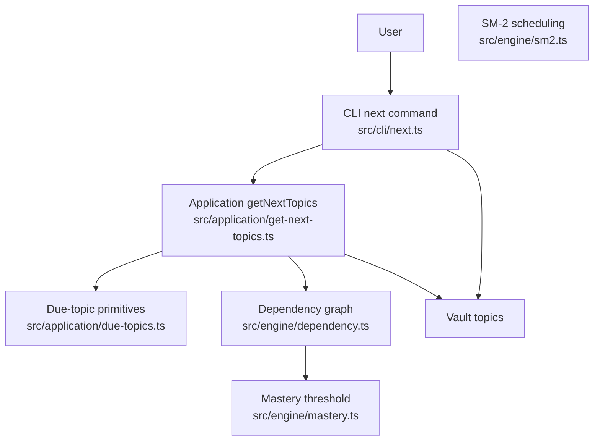
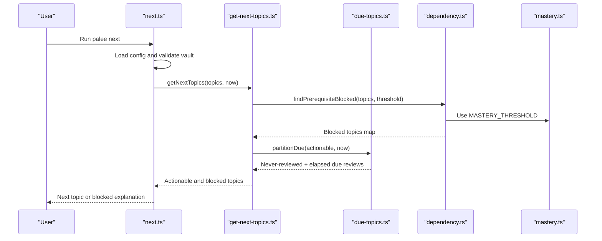
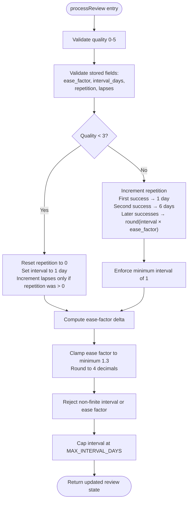
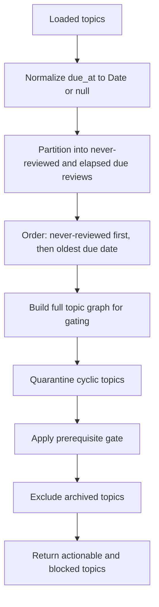
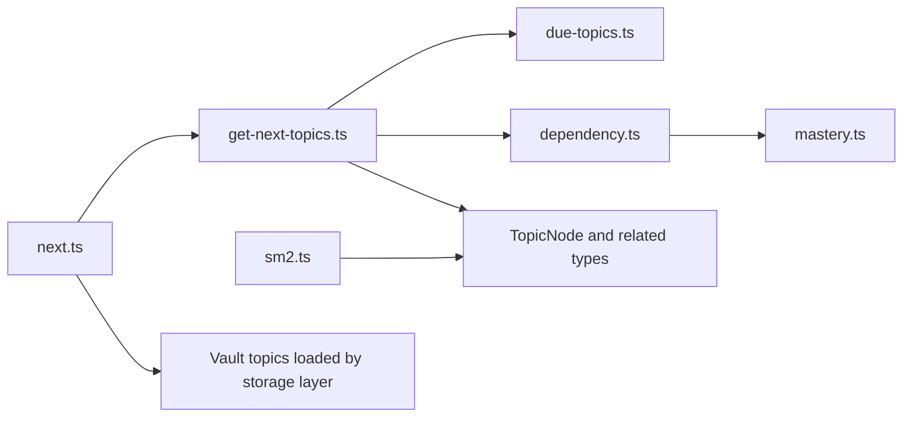

# Scheduling Algorithms and Discovery

::: details Referenced Files in This Document

- [sm2.ts](https://github.com/Kuldeep2822k/cli/blob/main/src/engine/sm2.ts)
- [get-next-topics.ts](https://github.com/Kuldeep2822k/cli/blob/main/src/application/get-next-topics.ts)
- [due-topics.ts](https://github.com/Kuldeep2822k/cli/blob/main/src/application/due-topics.ts)
- [next.ts](https://github.com/Kuldeep2822k/cli/blob/main/src/cli/next.ts)
- [mastery.ts](https://github.com/Kuldeep2822k/cli/blob/main/src/engine/mastery.ts)
- [dependency.ts](https://github.com/Kuldeep2822k/cli/blob/main/src/engine/dependency.ts)
- [engine-sm2.test.ts](https://github.com/Kuldeep2822k/cli/blob/main/test/engine-sm2.test.ts)
- [application-get-next-topics.test.ts](https://github.com/Kuldeep2822k/cli/blob/main/test/application-get-next-topics.test.ts)
- [cli-next-plan-prerequisite-gating.test.ts](https://github.com/Kuldeep2822k/cli/blob/main/test/cli-next-plan-prerequisite-gating.test.ts)

:::

## Table of Contents
1. [Introduction](#introduction)
2. [Project Structure](#project-structure)
3. [Core Components](#core-components)
4. [Architecture Overview](#architecture-overview)
5. [Detailed Component Analysis](#detailed-component-analysis)
6. [Dependency Analysis](#dependency-analysis)
7. [Performance Considerations](#performance-considerations)
8. [Troubleshooting Guide](#troubleshooting-guide)
9. [Conclusion](#conclusion)

## Introduction
This document explains how PALEE schedules topic reviews and discovers topics ready for study. It covers two tightly coupled parts:

- The **SM-2 spaced repetition engine**, which updates a topic’s review state after an assessment and computes the next due date.
- The **topic discovery system**, which finds actionable topics, applies prerequisite gating through the dependency graph, and orders them for the `palee next` command.

The implementation is layered: CLI commands read vault data, application logic selects due or never-reviewed topics and filters them through readiness rules, and the engine performs pure scheduling math and graph analysis.

## Project Structure
For scheduling and discovery, the relevant layers are:

| Layer | Responsibility | Key Files |
|---|---|---|
| CLI | Parses user options and prints results for `palee next` | [next.ts](https://github.com/Kuldeep2822k/cli/blob/main/src/cli/next.ts) |
| Application | Selects due/never-reviewed topics, enforces prerequisites, returns structured results | [get-next-topics.ts](https://github.com/Kuldeep2822k/cli/blob/main/src/application/get-next-topics.ts), [due-topics.ts](https://github.com/Kuldeep2822k/cli/blob/main/src/application/due-topics.ts) |
| Engine | SM-2 interval/ease-factor math, mastery calculation, dependency graph and cycle detection | [sm2.ts](https://github.com/Kuldeep2822k/cli/blob/main/src/engine/sm2.ts), [mastery.ts](https://github.com/Kuldeep2822k/cli/blob/main/src/engine/mastery.ts), [dependency.ts](https://github.com/Kuldeep2822k/cli/blob/main/src/engine/dependency.ts) |
| Tests | Validate scheduling decisions, edge cases, and cross-command consistency | [engine-sm2.test.ts](https://github.com/Kuldeep2822k/cli/blob/main/test/engine-sm2.test.ts), [application-get-next-topics.test.ts](https://github.com/Kuldeep2822k/cli/blob/main/test/application-get-next-topics.test.ts), [cli-next-plan-prerequisite-gating.test.ts](https://github.com/Kuldeep2822k/cli/blob/main/test/cli-next-plan-prerequisite-gating.test.ts) |

## Core Components

### SM-2 Spaced Repetition Engine
The SM-2 engine maintains per-topic review state:

- `ease_factor`: confidence multiplier, minimum 1.3, rounded to four decimal places.
- `interval_days`: calendar days until the next review, capped at 36,500 days (about 100 years).
- `repetition`: number of successful review steps.
- `lapses`: count of failed reviews on previously learned topics.
- `last_quality`: most recent quality rating.

The core processing function validates stored values defensively because raw frontmatter can contain unexpected types. It then branches by the quality rating:

| Quality Range | Review Outcome | Repetition | Interval Rule | Lapse Handling | Ease Factor |
|---|---|---|---|---|---|
| 0–2 | Failure | Reset to 0 | Set to 1 day | Increment only if `repetition > 0` | Decreased by canonical delta, clamped to 1.3 |
| 3 | First success | Increments to 1 | Set to 1 day | No change | Increased by delta, clamped to 1.3 |
| 4 | Second success | Increments to 2 | Set to 6 days | No change | Increased by delta, clamped to 1.3 |
| 5+ | Subsequent success | Increments | `round(interval_days × ease_factor)` | No change | Increased by delta, clamped to 1.3 |

The ease-factor delta follows the canonical SuperMemo formula. A perfect response increases it slightly, hesitation has no effect, and incorrect responses reduce it more aggressively.

Important safety properties include:

- Non-finite computed intervals or ease factors throw rather than persisting invalid schedule state.
- Intervals are capped at 36,500 days so long-lived notes do not produce corrupt due dates.
- Date computation uses local calendar days instead of UTC millisecond arithmetic, avoiding daylight saving ambiguity.
- Extreme inputs such as strings, booleans, NaN, Infinity, negative counts, fractional counts, and safe-integer boundary values are rejected with field-specific diagnostics.

### Topic Discovery and Readiness Gate
The discovery layer answers one question: which topics should the learner study now?

It treats two categories as actionable:

1. Topics that have never been reviewed.
2. Topics whose scheduled due date has elapsed.

Future-due topics are excluded from the actionable set. Invalid or missing due dates are treated as “never reviewed,” giving them immediate priority.

Actionable topics are ordered with never-reviewed topics first, then by oldest due date.

Before being returned, candidates pass the prerequisite gate:

- Archived topics are excluded from recommendations.
- Already mastered topics (`topic_mastery ≥ MASTERY_THRESHOLD`) are not gated.
- Prerequisites must be satisfied according to the dependency engine.
- Missing dependencies are reported as blockers.
- Unmastered prerequisites block dependent topics.
- Topics involved in cycles are not silently withheld; they remain in the due list but are surfaced elsewhere as quarantined cycles.

The result includes both actionable topics and blocked topics with human-readable waiting-on reasons.

### CLI Integration for `palee next`
The CLI command loads configuration, validates the vault path, loads topics, calls the application layer, filters out archived topics, and outputs either human-readable text or machine-readable JSON.

Key behaviors:

- When no topics are due, the status is `ready`, `blocked`, or `nothing_due`.
- In JSON mode, the output exposes `next`, `due_count`, `total_topics`, `status`, and `blocked`.
- In `--all` mode, all actionable topics are listed instead of just the first recommendation.
- Human-readable output names blocked topics when some candidates were withheld.
- Errors use a documented JSON error contract when JSON mode is active.

Command-line parameters affecting scheduling behavior:

| Parameter | Effect |
|---|---|
| None | Show the single next actionable topic |
| `--all` | Show every actionable topic |
| `--json` or `PALEE_JSON` | Emit machine-readable JSON including `status` and `blocked` |
| Vault configuration | Determines which vault is scanned |

The command does not itself compute intervals; it reads already-scheduled review state and lets the engine update it during assessments.

## Architecture Overview
The end-to-end flow for discovering the next topic is:

## Detailed Component Analysis

### SM-2 Review Processing Flow
After a learner completes an assessment, the review pipeline computes new review state and the next due date.

#### Example Scenarios

| Scenario | Inputs | Output Behavior |
|---|---|---|
| New topic, correct answer | `repetition = 0`, quality 4 | Repetition becomes 1, interval stays 1 day, ease factor increases slightly |
| New topic, incorrect answer | `repetition = 0`, quality 2 | Repetition resets to 0, interval becomes 1 day, lapse is not counted because there was no prior repetition |
| Established topic, good answer | `repetition = 5`, interval 15, ease 2.5, quality 4 | Repetition becomes 6, interval becomes `round(15 × 2.5) = 37`, ease factor increases |
| Established topic, blackout | `repetition = 5`, interval 37, ease 2.5, quality 0 | Repetition resets to 0, interval becomes 1 day, lapse increments, ease factor drops toward 1.3 |
| Near-cap interval | Interval already at 36,500 days | Interval remains capped at 36,500 days |
| Corrupt stored value | String or boolean in `interval_days` | Throws with a field-specific diagnostic instead of writing NaN |

These scenarios are validated by tests covering integer bounds, type safety, overflow protection, cap saturation, and calendar-day due-date computation.

### Topic Discovery and Priority Ordering
Discovery combines due-state classification with prerequisite gating.

#### Due-Date Calculation Rules
- Valid past or present due dates are eligible as “due.”
- Future due dates are not actionable.
- Invalid or missing due dates are treated as never-reviewed.
- Never-reviewed topics always sort ahead of dated due topics.
- Among dated topics, earlier due dates come first.

#### Prerequisite Gating Rules
- A topic is blocked when it is not archived, not yet mastered, and has an unmet prerequisite.
- Missing prerequisites are reported as blockers.
- Unmastered prerequisites block dependents until mastery reaches the threshold.
- Advisory edges and missing references are handled by the dependency predicate.
- Cyclic topics are not hidden by the gate; their scheduling semantics are undefined and are surfaced separately.

### Mastery Influence on Scheduling
Mastery affects scheduling indirectly through prerequisite gating, not directly through SM-2 intervals.

- The mastery threshold is `0.7`.
- A topic meeting or exceeding this threshold satisfies downstream prerequisites.
- Topics below the threshold can still be studied if they are due or never reviewed and have no blocking prerequisites.
- Once mastered, a topic is no longer gated by its own prerequisites.
- The SM-2 engine continues to adjust intervals independently based on review quality, ease factor, and repetition history.

This separation means mastery controls *access* to dependent topics, while SM-2 controls *timing* of repeated exposure to the same topic.

### CLI Contract and Parameters
The `next` command is the learner-facing entry point for discovery.

| Situation | Human Output | JSON Status |
|---|---|---|
| At least one actionable topic | Names the next topic with title, ID, due date, mastery, repetitions, and path | `ready` |
| Actionable topics exist but some are blocked | Names the next topic and warns about blocked topics | `ready` plus `blocked` array |
| No actionable topics and some are blocked | Explains prerequisites and suggests running `palee plan` | `blocked` |
| No actionable topics and nothing is blocked | Prints that no topics are due | `nothing_due` |
| Empty vault | Shows onboarding guidance | Empty result with zero totals |

The JSON contract includes additive keys for gating state, preserving backward compatibility while exposing whether the system is ready, blocked, or quiet.

## Dependency Analysis
The scheduling subsystem has clear directional dependencies:

Coupling characteristics:

- The CLI depends only on the application interface, not on scheduling math.
- The application layer is pure with respect to I/O and Commander state.
- The dependency engine owns graph traversal, cycle detection, and prerequisite satisfaction.
- The mastery module provides the shared readiness threshold.
- The SM-2 module owns review-state transitions and due-date computation.
- External integration points include vault loading, frontmatter parsing, session recording, and CLI configuration.

Potential circular risks are avoided by keeping scheduling math in the engine, decision logic in the application layer, and presentation in the CLI.

## Performance Considerations

### SM-2 Complexity
SM-2 processing is constant time per review:

- Validation is O(1).
- Delta computation is O(1).
- Interval and ease-factor updates are O(1).
- Interval capping and date computation are O(1).

The main performance concern is defensive validation of untrusted stored values, which prevents corruption but adds checks before every scheduling step.

### Topic Discovery Complexity
Discovery scans loaded topics once:

- Normalizing due dates is O(n).
- Partitioning into never-reviewed and due reviews is O(n).
- Sorting actionable topics is O(k log k), where k is the number of actionable topics.
- Building the prerequisite map is O(n).
- Cycle quarantine runs strongly connected components and bounded cycle enumeration over the graph.

For large vaults, the bottleneck is usually the dependency graph analysis, especially when many topics form dense strongly connected components.

### Large-Vault Optimization Characteristics
- The dependency engine builds an adjacency map once per operation.
- Strongly connected components are computed iteratively to avoid stack exhaustion.
- Cycle enumeration is bounded with a truncation flag so interactive commands do not hang on pathological graphs.
- Self-edges are preserved as one-node cycles without requiring special-case traversal logic.
- Edge lists are deduplicated and sorted for deterministic traversal.
- The discovery layer avoids recomputing readiness inside presentation code; it reuses the engine’s predicate.

These choices make the system suitable for thousands of topics, provided the vault’s dependency graph is not extremely dense with many overlapping cycles.

## Troubleshooting Guide

### Common Scheduling Issues

| Symptom | Likely Cause | Resolution |
|---|---|---|
| A topic shows `NaN-NaN-NaN` as its due date | Very long SM-2 history produced an unrepresentable date | The interval cap protects against this; inspect stored review state and run validation |
| A topic is never recommended despite being overdue | Prerequisite is unmet or missing | Check `palee plan`; fix or master the prerequisite |
| A topic is blocked but has no explicit prerequisites | Another dependency chain blocks it transitively | Trace prerequisites through the dependency graph |
| `palee next` reports nothing due but another tool recommends a topic | One tool may be filtering archived topics differently | Verify status, mastery, and prerequisite gating; `next` excludes archived topics |
| Review fails with a field-specific error | Corrupt frontmatter contains wrong types | Run `palee validate --fix` and repair the note’s review fields |
| `palee next --json` lacks expected gating keys | Using an older client or reading partial output | Ensure the full JSON payload is parsed; check `status` and `blocked` |

### Edge Cases Covered by Implementation

| Edge Case | Behavior |
|---|---|
| Topic with no prior reviews | Treated as actionable immediately and prioritized over dated due topics |
| Invalid or malformed `due_at` | Treated as never reviewed |
| Future-due topic | Excluded from actionable list |
| Early review | Allowed; SM-2 processes the assessment and computes a new interval |
| Missed deadline | Topic remains due until reviewed; discovery includes all elapsed due dates |
| Circular dependency | Topics on or downstream of a cycle are not silently withheld by the readiness gate; they appear in quarantine reporting |
| Self-dependency | Detected as a one-node cycle in the dependency graph |
| Extremely high mastery score | Treated as mastered for prerequisite gating |
| Negative or fractional mastery input | Normalized and clamped to `[0.0, 1.0]` before calculations |
| Overflowing interval or ease factor | Computed non-finite values throw rather than persisting invalid state |
| Safe-integer boundary repetition or lapse | Explicitly checked to prevent silent no-op increments |

## Conclusion
PALEE’s scheduling system separates concerns cleanly:

- SM-2 handles repeat-exposure timing through difficulty-adjusted intervals, ease factors, repetition history, and lapse tracking.
- The discovery layer determines which topics are actionable today by combining due-date logic with prerequisite gating.
- The CLI translates that decision into user-friendly output or a stable JSON contract.
- Mastery gates access to dependent topics, while SM-2 governs how often the same topic recurs.

Together, these components ensure that learners see manageable, logically ordered topics, understand why some topics are unavailable, and receive increasingly spaced reviews as mastery improves.

## References

- [next.ts:1-100](https://github.com/Kuldeep2822k/cli/blob/main/src/cli/next.ts#L1-L100)
- [get-next-topics.ts:1-199](https://github.com/Kuldeep2822k/cli/blob/main/src/application/get-next-topics.ts#L1-L199)
- [due-topics.ts:1-58](https://github.com/Kuldeep2822k/cli/blob/main/src/application/due-topics.ts#L1-L58)
- [dependency.ts:1-120](https://github.com/Kuldeep2822k/cli/blob/main/src/engine/dependency.ts#L1-L120)
- [mastery.ts:1-60](https://github.com/Kuldeep2822k/cli/blob/main/src/engine/mastery.ts#L1-L60)
- [sm2.ts:1-120](https://github.com/Kuldeep2822k/cli/blob/main/src/engine/sm2.ts#L1-L120)
- [sm2.ts:121-200](https://github.com/Kuldeep2822k/cli/blob/main/src/engine/sm2.ts#L121-L200)
- [sm2.ts:201-306](https://github.com/Kuldeep2822k/cli/blob/main/src/engine/sm2.ts#L201-L306)
- [engine-sm2.test.ts:1-120](https://github.com/Kuldeep2822k/cli/blob/main/test/engine-sm2.test.ts#L1-L120)
- [engine-sm2.test.ts:201-442](https://github.com/Kuldeep2822k/cli/blob/main/test/engine-sm2.test.ts#L201-L442)
- [application-get-next-topics.test.ts:1-77](https://github.com/Kuldeep2822k/cli/blob/main/test/application-get-next-topics.test.ts#L1-L77)
- [next.ts:1-200](https://github.com/Kuldeep2822k/cli/blob/main/src/cli/next.ts#L1-L200)
- [next.ts:201-227](https://github.com/Kuldeep2822k/cli/blob/main/src/cli/next.ts#L201-L227)
- [cli-next-plan-prerequisite-gating.test.ts:1-120](https://github.com/Kuldeep2822k/cli/blob/main/test/cli-next-plan-prerequisite-gating.test.ts#L1-L120)
- [sm2.ts:60-200](https://github.com/Kuldeep2822k/cli/blob/main/src/engine/sm2.ts#L60-L200)
- [sm2.ts:121-306](https://github.com/Kuldeep2822k/cli/blob/main/src/engine/sm2.ts#L121-L306)
- [engine-sm2.test.ts:1-200](https://github.com/Kuldeep2822k/cli/blob/main/test/engine-sm2.test.ts#L1-L200)
- [cli-next-plan-prerequisite-gating.test.ts:1-200](https://github.com/Kuldeep2822k/cli/blob/main/test/cli-next-plan-prerequisite-gating.test.ts#L1-L200)
- [get-next-topics.ts:80-160](https://github.com/Kuldeep2822k/cli/blob/main/src/application/get-next-topics.ts#L80-L160)
- [dependency.ts:120-450](https://github.com/Kuldeep2822k/cli/blob/main/src/engine/dependency.ts#L120-L450)
- [sm2.ts:1-306](https://github.com/Kuldeep2822k/cli/blob/main/src/engine/sm2.ts#L1-L306)
- [sm2.ts:60-306](https://github.com/Kuldeep2822k/cli/blob/main/src/engine/sm2.ts#L60-L306)
- [dependency.ts:1-450](https://github.com/Kuldeep2822k/cli/blob/main/src/engine/dependency.ts#L1-L450)
- [engine-sm2.test.ts:1-442](https://github.com/Kuldeep2822k/cli/blob/main/test/engine-sm2.test.ts#L1-L442)
