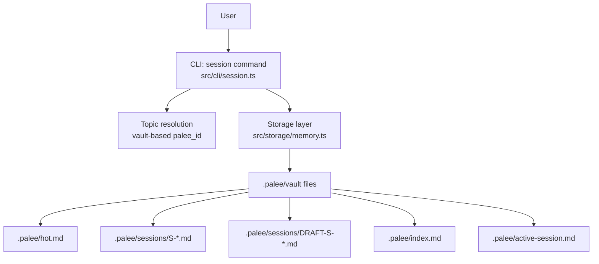
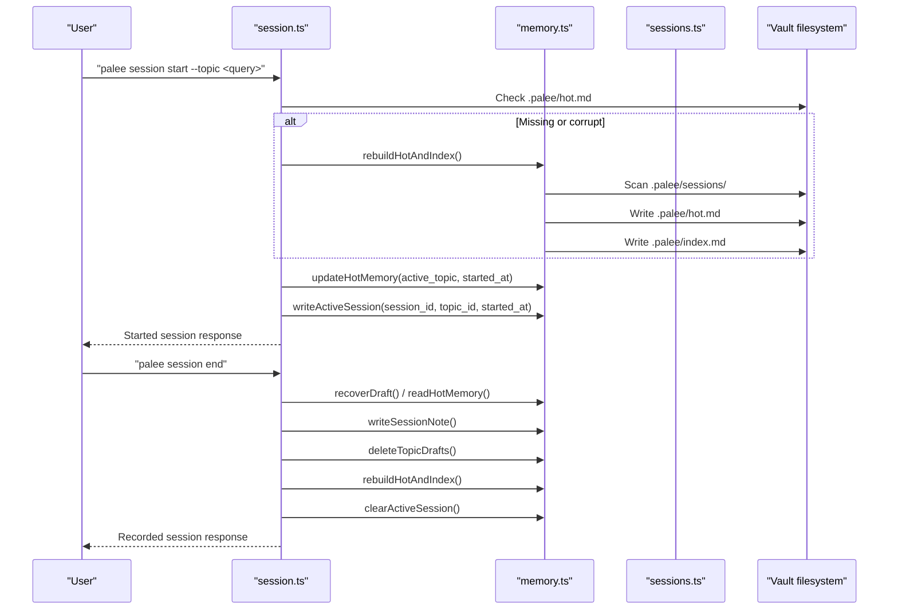
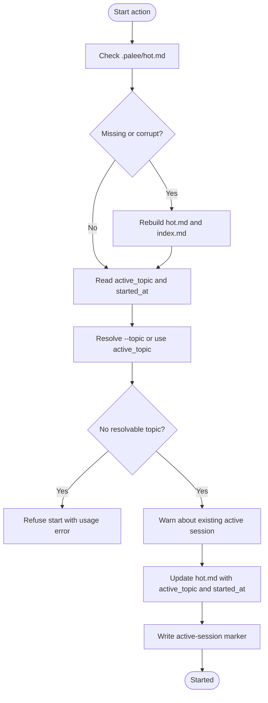
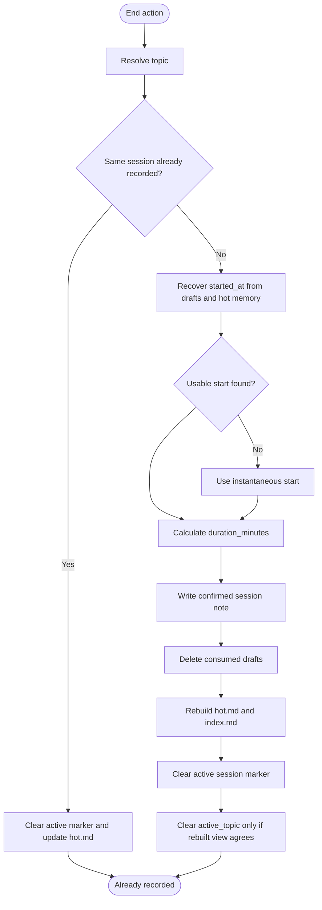
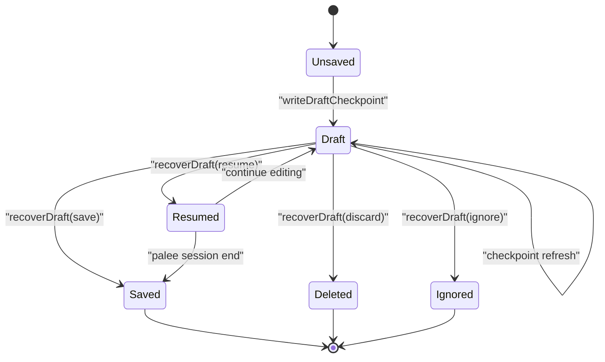
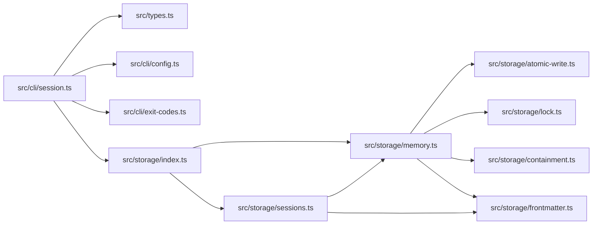

# Session Management

::: details Referenced Files in This Document

- [session.ts](https://github.com/Kuldeep2822k/cli/blob/main/src/cli/session.ts)
- [memory.ts](https://github.com/Kuldeep2822k/cli/blob/main/src/storage/memory.ts)
- [sessions.ts](https://github.com/Kuldeep2822k/cli/blob/main/src/storage/sessions.ts)
- [0019-session-memory-lifecycle.md](https://github.com/Kuldeep2822k/cli/blob/main/docs/adr/0019-session-memory-lifecycle.md)
- [session-cli.test.ts](https://github.com/Kuldeep2822k/cli/blob/main/test/session-cli.test.ts)
- [session-hot-reads.test.ts](https://github.com/Kuldeep2822k/cli/blob/main/test/session-hot-reads.test.ts)
- [session-topic-resolution.test.ts](https://github.com/Kuldeep2822k/cli/blob/main/test/session-topic-resolution.test.ts)
- [cli-session-containment.test.ts](https://github.com/Kuldeep2822k/cli/blob/main/test/cli-session-containment.test.ts)

:::

## Table of Contents
1. [Introduction](#introduction)
2. [Project Structure](#project-structure)
3. [Core Components](#core-components)
4. [Architecture Overview](#architecture-overview)
5. [Detailed Component Analysis](#detailed-component-analysis)
6. [Dependency Analysis](#dependency-analysis)
7. [Performance Considerations](#performance-considerations)
8. [Troubleshooting Guide](#troubleshooting-guide)
9. [Conclusion](#conclusion)

## Introduction
PALEE’s session management turns a vault into a set of isolated study contexts. A session is not merely a log entry; it is an active working context with:

- **Hot memory**: a small, temporary working state stored in `.palee/hot.md`. It keeps the most recent relevant notes for the active topic and is capped at 250 words.
- **Durable sessions**: confirmed records under `.palee/sessions/S-*.md` that capture topic, timestamps, duration, and completed body content.
- **Draft checkpoints**: temporary recovery files under `.palee/sessions/DRAFT-S-*.md` that survive unexpected exits.
- **Derived views**: `.palee/index.md`, which lists confirmed sessions, and `.palee/hot.md`, which reflects the newest completed session plus the active marker.

Sessions are created through the `palee session` command. They integrate with PALEE’s review, assessment, and topic operations by resolving topics against the same vault index and by treating hot memory as the learner-facing working surface rather than a permanent data store.

## Project Structure
Session functionality spans two layers:

| Layer | Responsibility | Key File |
|---|---|---|
| CLI | Parses commands, resolves topics, handles interactive draft recovery, and prints user output | [session.ts](https://github.com/Kuldeep2822k/cli/blob/main/src/cli/session.ts) |
| Storage | Manages hot memory, session notes, drafts, active markers, indexes, rebuilds, and crash recovery | [memory.ts](https://github.com/Kuldeep2822k/cli/blob/main/src/storage/memory.ts), [sessions.ts](https://github.com/Kuldeep2822k/cli/blob/main/src/storage/sessions.ts) |

## Core Components

### Session Command Surface
The session command supports four primary actions:

| Action | Purpose | Important Behavior |
|---|---|---|
| `start` | Opens or continues a working session on a topic | Validates hot memory, rebuilds if missing/corrupt, preserves start time when continuing the same topic, warns about overlapping active sessions |
| `draft` | Creates a durable checkpoint for interrupted work | Writes a `DRAFT-S-*` file and may reuse an existing active topic’s timestamp within strict bounds |
| `end` | Records the session and clears active state | Recovers start time from drafts or hot memory, calculates duration, deletes consumed drafts, rebuilds derived views |
| `list` | Shows confirmed and draft session files | Does not mutate state; returns counts and filenames |

The command also supports:

- `--topic`: Resolves a topic query to its canonical `palee_id` before writing any session state.
- `--interactive`: Prompts for unresolved draft checkpoints during `start`.
- `--json`: Emits one structured document per run while keeping conversation and warnings separate.

### Hot Memory
Hot memory is the short-term working surface for a session:

- Stored in `.palee/hot.md`.
- Holds frontmatter fields such as `last_session`, `active_topic`, `started_at`, and `updated_at`.
- Stores up to 250 words of recent notes for the active topic.
- Is derived from the newest completed session during rebuilds.
- Is intentionally **not** the main durable data store.

When hot memory is missing, corrupt, or has an unsupported schema version, the CLI rebuilds it from existing session notes rather than silently overwriting vault contents.

### Durable Sessions and Drafts
Confirmed sessions are canonical history:

- Filename pattern: `S-YYYYMMDDTHHMMSS-randomEntropy.md`.
- Frontmatter includes session identity, topic, timestamps, status, and duration.
- Written atomically with optimistic concurrency control.

Drafts are temporary recovery artifacts:

- Filename pattern: `DRAFT-S-randomEntropy.md`.
- Marked with `status: draft`.
- Retained until explicitly resumed, saved as a session, discarded, or ignored.

### Session Index
`.palee/index.md` is a derived catalog of confirmed sessions. It:

- Lists confirmed sessions in reverse chronological order.
- Uses filename-derived session IDs, not potentially inconsistent frontmatter values.
- Reports skipped sessions when they cannot be read or carry an unsupported schema.
- Is regenerated whenever session state changes.

## Architecture Overview

## Detailed Component Analysis

### Session Lifecycle

#### Start Flow

#### End Flow

### Draft Recovery and Crash Safety
Draft recovery is central to crash resilience:

1. **Checkpoint creation**: `palee session draft` writes a `DRAFT-S-*` file with a topic and timestamp.
2. **Startup detection**: `palee session start` finds unconfirmed drafts and either prompts interactively or refuses non-interactively.
3. **Recovery options**:
   - Resume: keep the draft for continued editing.
   - Save: convert the draft into a completed session.
   - Discard: remove the draft.
   - Ignore: leave it for later.
4. **Idempotent save**: Saving a draft checks whether a matching completed session was already written, preventing duplicate sessions after partial failures.
5. **Ordering invariant**: The draft is retired **after** the session note and derived views are rebuilt, so a failed rebuild can still replay the draft.

### Timestamp Rules and Staleness Clamping
PALEE deliberately avoids inflating study duration:

- A recovered `started_at` older than 24 hours is clamped to a 24-hour floor.
- A start within 60 seconds of the current time is accepted as-is.
- More than 60 seconds in the future is clamped to now.
- These rules apply consistently across draft recovery, hot memory, and session end.

This policy protects the learning signal downstream scheduling algorithms consume.

### Hot Memory vs Durable Store
| Aspect | Hot Memory (`.palee/hot.md`) | Durable Session (`.palee/sessions/S-*.md`) |
|---|---|---|
| Purpose | Temporary working context | Canonical history |
| Capacity | Up to 250 words | Full session body |
| Persistence | Survives within a session; rebuilt from history | Permanent unless deleted externally |
| Schema gate | Strict supported schema version | Supported schema version required for index inclusion |
| Primary mutation point | `updateHotMemory`, `resetHotMemory`, `rebuildHotAndIndex` | `writeSessionNote` |
| Recovery role | Reflects newest completed session and active topic | Provides evidence for rebuilds and reviews |

### Integration With Reviews, Assessments, and Topics
- Topic resolution uses the same query mechanism as other PALEE commands, so `session start --topic` resolves to the canonical `palee_id` instead of trusting arbitrary strings.
- When no explicit topic is provided, the session falls back to the `active_topic` stored in hot memory.
- This design keeps session context consistent with review and assessment flows, which also depend on topic identity.
- Hot memory is the visible working surface, but validated durable records live in session notes and topic files.

## Dependency Analysis

## Performance Considerations

- **Hot memory cap**: The 250-word limit prevents working memory from growing without bound. Truncation is word-based and adds ellipsis when trimmed.
- **Single-pass scans**: Rebuilding hot memory and the index reads session files once and applies the same confirmed-session predicate to both views.
- **Deterministic ordering**: Session files are sorted by filename, avoiding OS-dependent directory traversal differences.
- **Optimistic concurrency**: Atomic writes and fingerprint checks avoid unnecessary full rewrites while protecting against concurrent mutations.
- **Bounded draft retries**: Draft checkpoint writes retry a limited number of times with jitter, avoiding infinite contention loops.

## Troubleshooting Guide

### Orphaned Sessions
**Symptoms**:
- `palee session end` reports no active session.
- Hot memory still names a topic as active after an unexpected exit.
- Multiple draft checkpoints remain.

**Causes**:
- Process terminated while writing `.palee/hot.md` or `.palee/active-session.md`.
- Draft recovery was interrupted.
- A previous `session end` recorded the session but failed to clear the active marker.

**Remedies**:
- Run `palee session start --interactive` to resolve unresolved drafts.
- Use `palee session list` to inspect confirmed and draft files.
- Let `palee session end` rebuild derived views; it clears active state only when the rebuilt view agrees with the ended topic.
- If hot memory remains stale after recording, run `palee session start` to reset working memory as instructed by the warning.

### Memory Corruption
**Symptoms**:
- CLI detects corrupt hot memory.
- Rebuild starts automatically.
- Derived views disagree after manual edits.

**Behavior**:
- Corrupt or unsupported-schema hot memory triggers a rebuild.
- Rebuild reconstructs `.palee/hot.md` from the newest confirmed session.
- Unsupported session schemas are skipped and counted, never coerced.

**Remedies**:
- Do not manually edit `.palee/hot.md` outside the normal flow.
- Allow the CLI to rebuild derived views.
- Inspect `.palee/sessions/` for malformed session notes.

### Cross-Session Data Conflicts
**Symptoms**:
- Starting a new topic replaces the active topic.
- Two sessions appear to share the same working context.
- Review or assessment results do not match expected topic.

**Prevention**:
- Always specify `--topic` when starting a focused session.
- End the previous session before switching topics.
- Pay attention to overlap warnings from `session start`.

**Resolution**:
- End the unintended session first.
- Verify the active topic in hot memory.
- Rebuild derived views with another start or end operation.

### Backup Strategy
Recommended approach:

1. Back up the entire vault directory, including `.palee/`.
2. Treat `.palee/sessions/` as the authoritative history.
3. Treat `.palee/hot.md` as a derived working view.
4. Treat `.palee/index.md` as a rebuildable catalog.
5. Preserve `.palee/active-session.md` during crashes so recovery can identify the in-progress session.
6. Avoid backing up only hot memory; it may contain incomplete or outdated working context.

## Conclusion
PALEE’s session model separates temporary working state from durable learning history. Hot memory gives each session a focused, bounded workspace, while session notes provide auditable, schedulable records. Draft checkpoints make interrupted work recoverable, and rebuilds keep derived views consistent even after crashes. The CLI enforces safe topic resolution, timestamp clamping, and cleanup behavior, making sessions suitable for multiple concurrent learning contexts while minimizing accidental cross-session pollution.

## References

- [session.ts:220-360](https://github.com/Kuldeep2822k/cli/blob/main/src/cli/session.ts#L220-L360)
- [memory.ts:1-80](https://github.com/Kuldeep2822k/cli/blob/main/src/storage/memory.ts#L1-L80)
- [session.ts:1-80](https://github.com/Kuldeep2822k/cli/blob/main/src/cli/session.ts#L1-L80)
- [session.ts:201-360](https://github.com/Kuldeep2822k/cli/blob/main/src/cli/session.ts#L201-L360)
- [session.ts:501-856](https://github.com/Kuldeep2822k/cli/blob/main/src/cli/session.ts#L501-L856)
- [memory.ts:1-120](https://github.com/Kuldeep2822k/cli/blob/main/src/storage/memory.ts#L1-L120)
- [memory.ts:201-380](https://github.com/Kuldeep2822k/cli/blob/main/src/storage/memory.ts#L201-L380)
- [memory.ts:720-820](https://github.com/Kuldeep2822k/cli/blob/main/src/storage/memory.ts#L720-L820)
- [memory.ts:201-320](https://github.com/Kuldeep2822k/cli/blob/main/src/storage/memory.ts#L201-L320)
- [memory.ts:900-1060](https://github.com/Kuldeep2822k/cli/blob/main/src/storage/memory.ts#L900-L1060)
- [memory.ts:601-760](https://github.com/Kuldeep2822k/cli/blob/main/src/storage/memory.ts#L601-L760)
- [sessions.ts:1-200](https://github.com/Kuldeep2822k/cli/blob/main/src/storage/sessions.ts#L1-L200)
- [sessions.ts:201-279](https://github.com/Kuldeep2822k/cli/blob/main/src/storage/sessions.ts#L201-L279)
- [memory.ts:601-820](https://github.com/Kuldeep2822k/cli/blob/main/src/storage/memory.ts#L601-L820)
- [memory.ts:987-1295](https://github.com/Kuldeep2822k/cli/blob/main/src/storage/memory.ts#L987-L1295)
- [memory.ts:900-1295](https://github.com/Kuldeep2822k/cli/blob/main/src/storage/memory.ts#L900-L1295)
- [session.ts:360-500](https://github.com/Kuldeep2822k/cli/blob/main/src/cli/session.ts#L360-L500)
- [0019-session-memory-lifecycle.md:1-71](https://github.com/Kuldeep2822k/cli/blob/main/docs/adr/0019-session-memory-lifecycle.md#L1-L71)
- [memory.ts:987-1060](https://github.com/Kuldeep2822k/cli/blob/main/src/storage/memory.ts#L987-L1060)
- [session.ts:1-120](https://github.com/Kuldeep2822k/cli/blob/main/src/cli/session.ts#L1-L120)
- [session.ts:120-200](https://github.com/Kuldeep2822k/cli/blob/main/src/cli/session.ts#L120-L200)
- [sessions.ts:1-80](https://github.com/Kuldeep2822k/cli/blob/main/src/storage/sessions.ts#L1-L80)
- [session.ts:201-260](https://github.com/Kuldeep2822k/cli/blob/main/src/cli/session.ts#L201-L260)
- [session.ts:300-360](https://github.com/Kuldeep2822k/cli/blob/main/src/cli/session.ts#L300-L360)
- [0019-session-memory-lifecycle.md:30-71](https://github.com/Kuldeep2822k/cli/blob/main/docs/adr/0019-session-memory-lifecycle.md#L30-L71)
