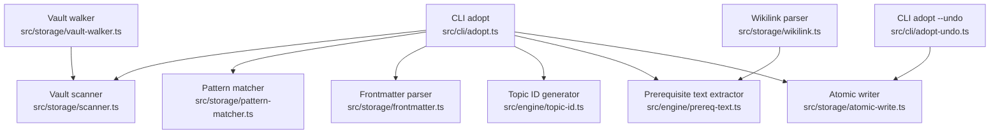
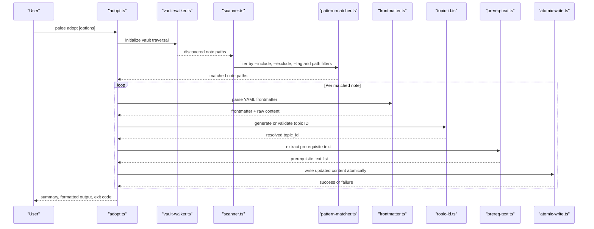
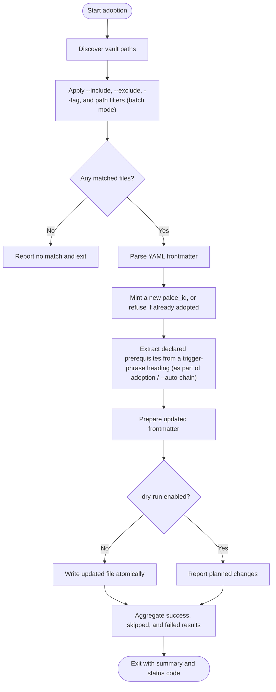
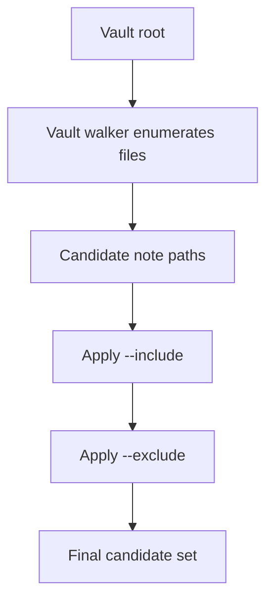
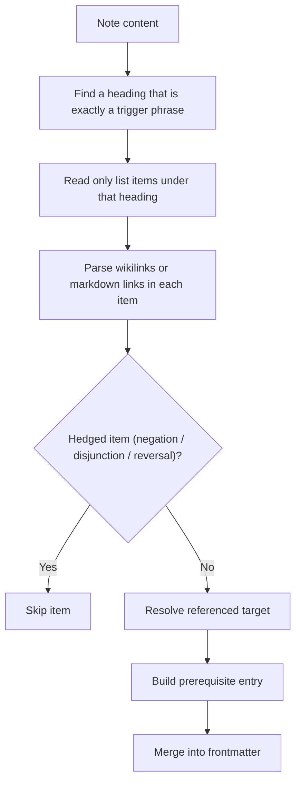
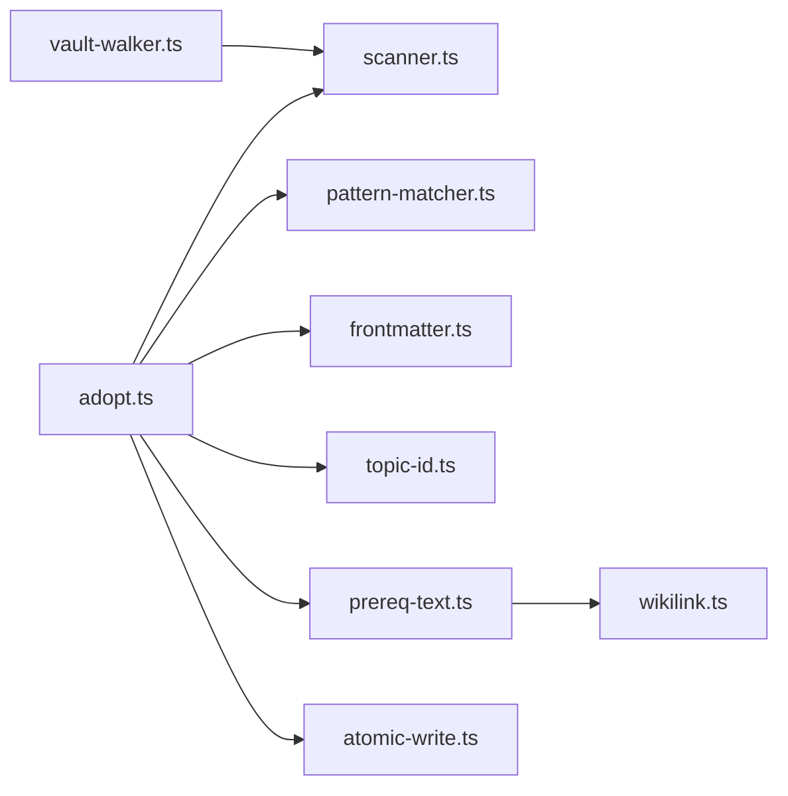

# Adopt Commands and Options

::: details Referenced Files in This Document

- [adopt.ts](https://github.com/Kuldeep2822k/cli/blob/main/src/cli/adopt.ts)
- [adopt-undo.ts](https://github.com/Kuldeep2822k/cli/blob/main/src/cli/adopt-undo.ts)
- [prereq-text.ts](https://github.com/Kuldeep2822k/cli/blob/main/src/engine/prereq-text.ts)
- [topic-id.ts](https://github.com/Kuldeep2822k/cli/blob/main/src/engine/topic-id.ts)
- [frontmatter.ts](https://github.com/Kuldeep2822k/cli/blob/main/src/storage/frontmatter.ts)
- [scanner.ts](https://github.com/Kuldeep2822k/cli/blob/main/src/storage/scanner.ts)
- [vault-walker.ts](https://github.com/Kuldeep2822k/cli/blob/main/src/storage/vault-walker.ts)
- [pattern-matcher.ts](https://github.com/Kuldeep2822k/cli/blob/main/src/storage/pattern-matcher.ts)
- [wikilink.ts](https://github.com/Kuldeep2822k/cli/blob/main/src/storage/wikilink.ts)
- [atomic-write.ts](https://github.com/Kuldeep2822k/cli/blob/main/src/storage/atomic-write.ts)
- [exit-codes.ts](https://github.com/Kuldeep2822k/cli/blob/main/src/cli/exit-codes.ts)
- [02-1-topic-management-commands.md](https://github.com/Kuldeep2822k/cli/blob/main/docs/02-1-topic-management-commands.md)

:::

## Table of Contents
1. [Introduction](#introduction)
2. [Project Structure](#project-structure)
3. [Core Components](#core-components)
4. [Architecture Overview](#architecture-overview)
5. [Detailed Component Analysis](#detailed-component-analysis)
6. [Dependency Analysis](#dependency-analysis)
7. [Performance Considerations](#performance-considerations)
8. [Troubleshooting Guide](#troubleshooting-guide)
9. [Conclusion](#conclusion)

## Introduction
The `palee adopt` command converts vault notes into managed PALEE topics by scanning the vault, parsing YAML frontmatter, minting topic identifiers, extracting declared prerequisites, and writing durable updates. It supports single-file adoption, batch processing, directory-based filtering, and dry-run previews. Undo is not a separate subcommand: `palee adopt --undo` reverses an adoption by stripping only the PALEE-owned frontmatter keys from the selected notes (see the Adopt Undo section below). There is no `palee adopt undo` subcommand — `undo` in that position would be parsed as the positional `[path]` argument.

## Project Structure
The adopt feature spans CLI option handling, engine logic for prerequisite extraction and topic ID generation, storage-layer scanning and atomic writes, and validation utilities.



## Core Components
- **CLI adopt entry point**: Parses user options, validates inputs, selects target files, runs adoption per file, aggregates results, and prints status information.
- **CLI adopt undo mode (`palee adopt --undo`)**: Reached through `palee adopt --undo`, not through a command of its own. It needs no session record and does not restore prior contents — it strips only PALEE-owned frontmatter keys from the selected notes, leaving the body and every other key byte-identical (`--drop-title` opts into also removing `title`).
- **Vault scanner and walker**: Traverse the vault using a configured walker, apply pattern matching, and produce candidate note paths.
- **Frontmatter parser**: Reads YAML frontmatter fields such as `palee_id`, `status`, `assessed_at`, and related metadata.
- **Topic ID generator**: Mints canonical topic IDs from the current time plus cryptographic randomness (see Topic ID Generation and Validation below) and validates existing IDs against the expected contract.
- **Prerequisite text extractor**: Reads only list items under a heading that is exactly a trigger phrase (such as `Prerequisites`, `Requires`, or `Depends on`) and resolves the wikilinks or markdown links those items carry.
- **Atomic writer**: Writes updated note content safely using temporary files and rename semantics.
- **Exit code definitions**: Maps operational outcomes to stable process exit codes.

## Architecture Overview
The adoption workflow follows a predictable pipeline:



## Detailed Component Analysis

### CLI adopt Command and Options
The adopt command exposes the following behavior:

| Option | Purpose | Behavior Notes |
|---|---|---|
| `[path]` (positional) | A single `.md` file or a directory, relative to the vault root | Required unless `--all` is given; see the selection rules below. |
| `--all` | Adopt all markdown files across the vault | Batch mode; every batch scan applies Tier-0 hygiene. |
| `--difficulty <level>` | Sets difficulty | `beginner`, `intermediate`, or `advanced`. |
| `--depends-on <ids>` | Declares dependencies | Comma-separated topic IDs; single-file mode only. |
| `--include <patterns>` | Includes paths matching glob patterns | Batch mode only; comma-separated and repeatable. |
| `--exclude <patterns>` | Excludes paths matching glob patterns | Batch mode only; comma-separated and repeatable. |
| `--tag <tags>` | Filters by Obsidian frontmatter tags | Batch mode only; comma-separated and repeatable. |
| `--dry-run` | Shows what would change without writing | Skips atomic writes and reports planned edits. |
| `--verbose` | Prints a detailed file-by-file inspection list |  |
| `--auto-chain` | Auto-wires `depends_on` from a note's own declared prerequisites, else the numbered tree | Batch mode only; Tier-0 hygiene is on for every batch, so this flag wires rather than filters — except that a chained scan keeps README/SUMMARY as chain backbone, which a plain scan skips. |
| `--chain-tier <tier>` | Order signal for `--auto-chain` | `strict` (default) numbers only; `full` adds listing order, which never gates. |
| `-y, --yes` | Skips the confirmation prompt | Required for a non-interactive batch run. |
| `--undo` | Reverses an adoption instead of performing one | Strips only the PALEE-owned frontmatter keys from the selected notes, preserving every other key, comment and body byte; combine with `--dry-run` to preview. |
| `--drop-title` | With `--undo`, also removes the `title` key | Adoption writes `title` but does not own it, so undo leaves it unless this flag is given. |

There is no `--pattern`, `--force`, `--prereq-text`, `--topic-id`, or `--status` flag — Commander rejects unknown flags. Selection is not combined according to precedence rules: a run must supply either a positional path or `--all`, and supplying neither is a usage error (exit 2). The filters `--include`, `--exclude`, and `--tag` are batch-only: combining any of them with a single-file path is a contradiction and exits 2.

### Adoption Workflow Logic
Adoption proceeds through these stages:



### Vault Scanning and Glob Filtering
The scanner relies on the vault walker to enumerate candidate files and then applies the batch filters. The pattern matcher normalizes paths before comparison so that Windows and POSIX-style separators behave consistently.

Key behaviors:
- Discovery starts from the configured vault root.
- `--include` keeps only candidates matching its glob patterns (batch mode only).
- `--exclude` removes unwanted paths or directories (batch mode only).
- `--tag` keeps only notes carrying the given frontmatter tags (batch mode only).
- Positional paths can act as directory filters or direct file targets.
- Invalid patterns are rejected early to avoid scanning the entire vault unintentionally.



### Tier-0 Hygiene
Every batch scan applies Tier-0 hygiene whether or not `--auto-chain` is given; `--auto-chain` wires dependencies, it does not switch hygiene on. The classifier (`src/engine/tier0-hygiene.ts`) assigns each candidate a role — `backbone`, `leaf`, or `excluded` — under these classes:

| Class | Rule | Effect |
|---|---|---|
| B1 | Repository-meta stems (for example `LICENSE`, `CONTRIBUTING`, `CHANGELOG`, `FAQ`, `HELP`, `toc`, `contents`) | `excluded` from batch adoption and chain planning |
| B2 | Translations — a `translations/` segment, or a locale-suffixed generic doc name | `excluded`; a locale suffix on an unnumbered non-generic name is instead demoted to `leaf` as a translation guess |
| B3 | Whole-token `template` / `templates` in the stem or directory | `excluded` |
| B4 | Phase subtrees — a non-final segment such as `solution`, `solutions`, `your-work`, `start`, `sketch`, or `answers` | `leaf`: attached, but collapsed so its notes never gate |
| B5 | Recognised content-doc name | `backbone` (may gate the chain); a note that does not pass B5 is a `leaf` |
| B6 | Per-rule hygiene report | Printed for every batch adoption (see below) |
| B7 | `palee_id` is not a usable string (a truthy non-string value) | Demoted to `leaf` with reason `invalid-palee-id`, without rewriting frontmatter; under `--auto-chain` such notes are listed under "Skipped: palee_id is not a usable string (B7)" and are not adopted or chained |

Batch output prints a `Tier-0 hygiene:` report with the per-rule counts:

```text
Tier-0 hygiene:
  Skipped (meta): N notes
  Skipped (translations): N notes
  Skipped (template): N notes
  Excluded total: N notes
```

Under `--auto-chain` the report also includes backbone/leaf counts, phase-subtree counts, and any B7 invalid-`palee_id` count. Adopting a single file by path is the documented override: a single-file adoption has no batch hygiene pass, so a note the report shows as skipped can be kept by adopting it directly with `palee adopt "<path>"`.

### YAML Frontmatter Parsing and Validation
The frontmatter layer reads YAML metadata and exposes fields used by adoption:
- `palee_id`: The topic identifier minted by adoption; a note already carrying one is treated as already adopted.
- `status`: A managed-note status field adoption may read, but no `--status` flag exists to select by it.
- `assessed_at` and other PALEE-managed fields may be added or updated during adoption.

Parsing failures are reported per file rather than aborting the entire batch, allowing partial runs to complete while surfacing malformed notes.

### Topic ID Generation and Validation
Topic IDs are central to PALEE's identity model. `generateTopicId()` (`src/engine/topic-id.ts`) takes no input: it mints `T-YYYYMMDD-HHMMSS-<8 hex>` from the current time plus `crypto.randomBytes` (4 bytes, rendered as 8 hex characters). It does not derive an ID from the note's filename stem or vault-relative path, and there is no `--topic-id` flag to assign one and no `--force` flag to overwrite one.

A note already carrying a `palee_id` is treated as already adopted: in single-file mode adoption errors with "Note already adopted as topic …" rather than re-minting or overwriting the ID.

### Prerequisite Text Extraction from Declared Prerequisites
There is no `--prereq-text` flag. `extractDeclaredPrerequisites` (`src/engine/prereq-text.ts`) runs as part of adoption / `--auto-chain`, not behind a flag. It reads only list items under a heading that is exactly a trigger phrase — `Prerequisites`, `Requires`, `Depends on`, and the other exact trigger phrases (`Prerequisite`, `Requirement`, `Required knowledge`, `Dependency on`, with an optional leading `Prior `) — with nothing else on the heading line. Wikilinks anywhere else in the note are not parsed as prerequisites. For each list item under such a heading:
1. Wikilinks **or** markdown links in the item are accepted as the reference.
2. Hedged items are skipped: negation, disjunction, and reversal items contribute no edge.
3. Unambiguous items are resolved to their targets and built into prerequisite entries.
4. The resulting prerequisite data is merged into the updated frontmatter.

If a linked target cannot be resolved, the command records the issue but does not necessarily fail the whole adoption.



### Atomic File Updates
All adopted changes go through the atomic writer. Instead of overwriting files directly, it:
1. Creates a temporary file in a safe location.
2. Writes the updated content.
3. Renames the temporary file to the destination.
4. Cleans up abandoned temporary files if necessary.

This design reduces corruption risk when adoption is interrupted or encounters I/O errors.

### Adopt Undo
Undo is `palee adopt --undo` (`src/cli/adopt-undo.ts`: "Reached through `palee adopt --undo`, not through a command of its own"). There is no `palee adopt undo` subcommand. Undo needs no session record. It does **not** restore prior contents: it strips only PALEE-owned frontmatter keys from the selected notes, leaving the body and every other key byte-identical. `--drop-title` opts into also removing `title`, which adoption writes but does not own. It should be used when:
- An adoption run produced incorrect metadata.
- A dry-run was followed by a real run that needs reversal.
- Recovery is required after a partially completed batch.

Combine `--undo` with `--dry-run` to preview the key stripping before any file is written.

### Integration with Topic Query System
Before adopting a file, the CLI checks whether the note already carries a `palee_id`. A note that does is treated as already adopted — in single-file mode adoption errors with "Note already adopted as topic …" — which prevents accidental overwrites and re-minting of an existing identity.

## Dependency Analysis



## Performance Considerations
Large vaults with thousands of files require careful use of selection options:

- **Restrict patterns early**: Use narrow `--include` globs such as `docs/topics/*.md` instead of broad patterns like `**/*.md` whenever possible.
- **Use directory filters**: Passing specific directories avoids scanning unrelated vault areas.
- **Prefer dry-run first**: Run with `--dry-run` to estimate scope before committing changes.
- **Expect linear scanning cost**: Vault traversal is proportional to discovered files; pattern filtering reduces downstream work.
- **Watch memory usage**: Very large batches keep many parsed notes in memory until completion; consider splitting across runs.
- **Atomic writes add I/O overhead**: Each successful adoption performs a write-and-rename operation.

## Troubleshooting Guide

### Common Issues and Resolutions

| Symptom | Likely Cause | Resolution |
|---|---|---|
| No files matched | Invalid or too restrictive `--include`, wrong vault root, or excluded directories | Verify the glob syntax and run with `--dry-run` to see discovered candidates. |
| Note already adopted | The note already carries a `palee_id` | Adoption does not re-mint or overwrite an existing ID; use `palee adopt --undo` first if the note really should be re-adopted. |
| Prerequisite links unresolved | A link under a trigger-phrase heading cannot be found | Fix broken links or exclude the file from adoption. |
| Partial adoption failures | One or more files failed to parse or write | Inspect per-file errors, fix malformed frontmatter, and rerun. |
| Undo removed nothing | The selected notes carry no PALEE-owned keys, or no usable string `palee_id` | Check the selected scope; undo is `palee adopt --undo` and needs no session record. |

### Exit Codes
Adopt-related commands map outcomes to exit codes defined in the exit-code module. Typical categories include:
- Success with no changes.
- Success with some files skipped.
- Failure due to invalid options or missing prerequisites.
- Failure caused by I/O, locking, or unrecoverable validation errors.

Consult the exit-code definitions for exact numeric mappings and consult the command output for the human-readable reason.

### Recovery Procedures
1. **Stop further changes**: Avoid running additional adoptions until the cause is understood.
2. **Inspect per-file results**: Look for parse errors, validation failures, or write failures.
3. **Use undo when possible**: Run `palee adopt --all --undo` (preview with `palee adopt --all --undo --dry-run`) to strip only the PALEE-owned frontmatter keys from the selected notes; no session record is needed and prior contents are not restored.
4. **Repair source notes**: Fix malformed YAML frontmatter or broken wikilinks.
5. **Rerun narrowly**: Limit the next attempt to the affected directory or file.
6. **Validate afterward**: Run PALEE validation commands to confirm schema integrity.

## Conclusion
The `palee adopt` command is a controlled, vault-aware tool for converting notes into managed PALEE topics. It combines batch scanning with `--include`, `--exclude`, and `--tag` filters, YAML frontmatter parsing, timestamp-plus-random topic ID minting, declared-prerequisite extraction, Tier-0 hygiene on every batch scan, and atomic file updates into a predictable workflow. By using `--all`, `--difficulty`, `--depends-on`, `--include`, `--exclude`, `--tag`, `--dry-run`, `--verbose`, `--auto-chain`, `--chain-tier`, `-y`/`--yes`, `--undo`, and `--drop-title` deliberately, users can safely adopt single files or large batches. When problems occur, `palee adopt --undo`, narrow retries, and validation provide reliable recovery paths.

## References

- [adopt.ts:1-200](https://github.com/Kuldeep2822k/cli/blob/main/src/cli/adopt.ts#L1-L200)
- [adopt-undo.ts:1-200](https://github.com/Kuldeep2822k/cli/blob/main/src/cli/adopt-undo.ts#L1-L200)
- [scanner.ts:1-200](https://github.com/Kuldeep2822k/cli/blob/main/src/storage/scanner.ts#L1-L200)
- [vault-walker.ts:1-200](https://github.com/Kuldeep2822k/cli/blob/main/src/storage/vault-walker.ts#L1-L200)
- [pattern-matcher.ts:1-200](https://github.com/Kuldeep2822k/cli/blob/main/src/storage/pattern-matcher.ts#L1-L200)
- [frontmatter.ts:1-200](https://github.com/Kuldeep2822k/cli/blob/main/src/storage/frontmatter.ts#L1-L200)
- [topic-id.ts:1-200](https://github.com/Kuldeep2822k/cli/blob/main/src/engine/topic-id.ts#L1-L200)
- [prereq-text.ts:1-200](https://github.com/Kuldeep2822k/cli/blob/main/src/engine/prereq-text.ts#L1-L200)
- [wikilink.ts:1-200](https://github.com/Kuldeep2822k/cli/blob/main/src/storage/wikilink.ts#L1-L200)
- [atomic-write.ts:1-200](https://github.com/Kuldeep2822k/cli/blob/main/src/storage/atomic-write.ts#L1-L200)
- [exit-codes.ts:1-200](https://github.com/Kuldeep2822k/cli/blob/main/src/cli/exit-codes.ts#L1-L200)
- [02-1-topic-management-commands.md:1-200](https://github.com/Kuldeep2822k/cli/blob/main/docs/02-1-topic-management-commands.md#L1-L200)
