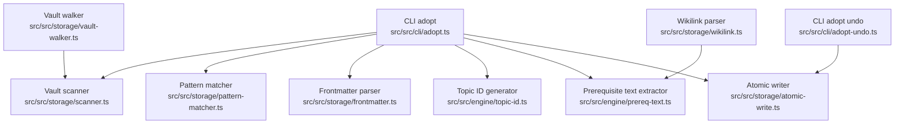
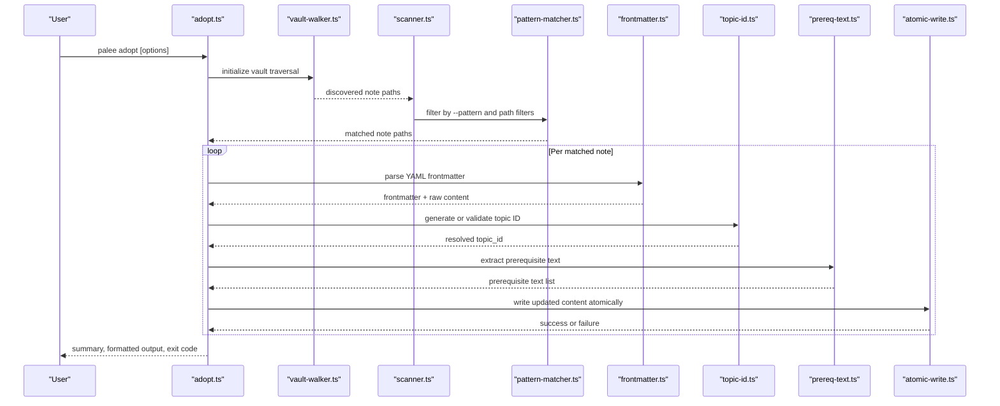
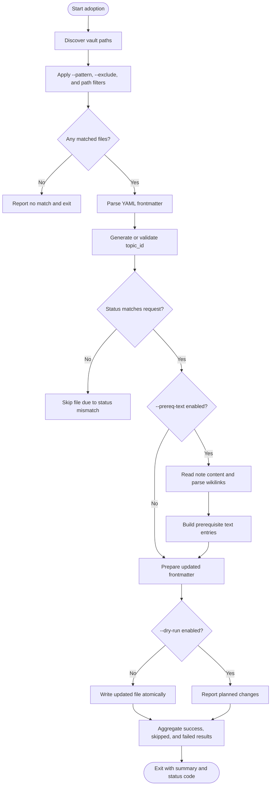
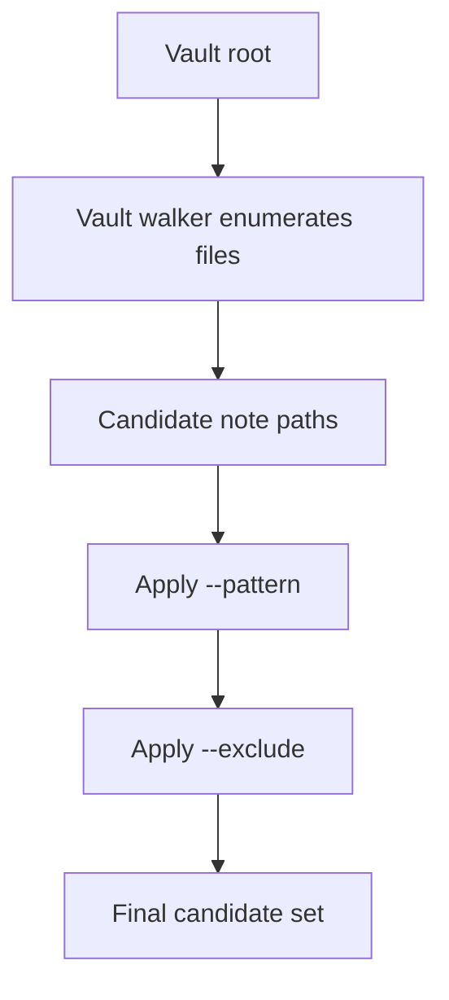
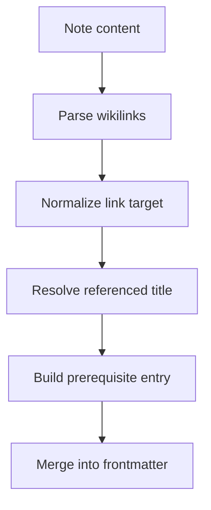
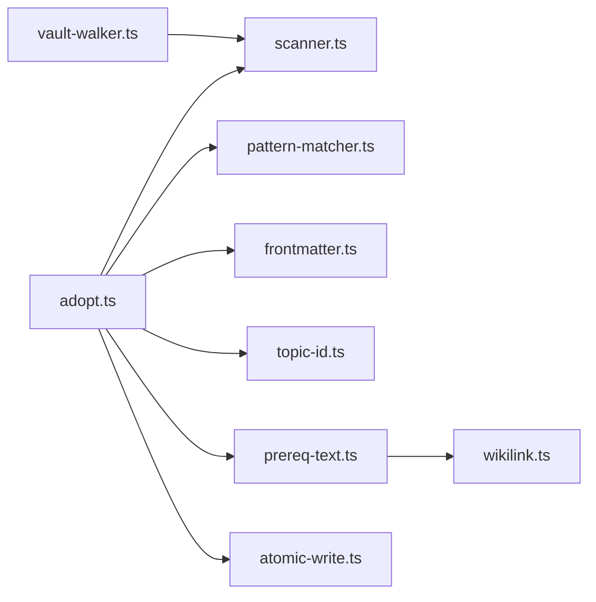

# Adopt Commands and Options

::: details Referenced Files in This Document

- [adopt.ts](https://github.com/Kuldeep2822k/cli/blob/main/src/src/cli/adopt.ts)
- [adopt-undo.ts](https://github.com/Kuldeep2822k/cli/blob/main/src/src/cli/adopt-undo.ts)
- [prereq-text.ts](https://github.com/Kuldeep2822k/cli/blob/main/src/src/engine/prereq-text.ts)
- [topic-id.ts](https://github.com/Kuldeep2822k/cli/blob/main/src/src/engine/topic-id.ts)
- [frontmatter.ts](https://github.com/Kuldeep2822k/cli/blob/main/src/src/storage/frontmatter.ts)
- [scanner.ts](https://github.com/Kuldeep2822k/cli/blob/main/src/src/storage/scanner.ts)
- [vault-walker.ts](https://github.com/Kuldeep2822k/cli/blob/main/src/src/storage/vault-walker.ts)
- [pattern-matcher.ts](https://github.com/Kuldeep2822k/cli/blob/main/src/src/storage/pattern-matcher.ts)
- [wikilink.ts](https://github.com/Kuldeep2822k/cli/blob/main/src/src/storage/wikilink.ts)
- [atomic-write.ts](https://github.com/Kuldeep2822k/cli/blob/main/src/src/storage/atomic-write.ts)
- [exit-codes.ts](https://github.com/Kuldeep2822k/cli/blob/main/src/src/cli/exit-codes.ts)
- [02-1-topic-management-commands.md](https://github.com/Kuldeep2822k/cli/blob/main/docs/docs/02-1-topic-management-commands.md)

:::

## Table of Contents
1. [Introduction](#introduction)
2. [Project Structure](#project-structure)
3. [Core Components](#core-components)
4. [Architecture Overview](#architecture-overview)
5. [Detailed Component Analysis](#detailed-component-analysis)
6. [Dependency Analysis](#dependency-analysis)
7. [Performance Considerations](#performance-considerations)
8. [Troubleshooting Guide](#troubleshooting-guide)
9. [Conclusion](#conclusion)

## Introduction
The `palee adopt` command converts vault notes into managed Palee topics by scanning the vault, parsing YAML frontmatter, generating or validating topic identifiers, extracting prerequisite text from wikilinks, and writing durable updates. It supports single-file adoption, batch processing through glob patterns, directory-based filtering, dry-run previews, forced updates, conditional adoption based on existing topic state, and structured output formats. Its companion `palee adopt undo` reverses an adoption run by restoring files to their pre-adoption state when a matching session is available.

## Project Structure
The adopt feature spans CLI option handling, engine logic for prerequisite extraction and topic ID generation, storage-layer scanning and atomic writes, and validation utilities.

**Diagram sources**
- [adopt.ts:1-200](https://github.com/Kuldeep2822k/cli/blob/main/src/src/cli/adopt.ts#L1-L200)
- [adopt-undo.ts:1-200](https://github.com/Kuldeep2822k/cli/blob/main/src/src/cli/adopt-undo.ts#L1-L200)
- [scanner.ts:1-200](https://github.com/Kuldeep2822k/cli/blob/main/src/src/storage/scanner.ts#L1-L200)
- [vault-walker.ts:1-200](https://github.com/Kuldeep2822k/cli/blob/main/src/src/storage/vault-walker.ts#L1-L200)
- [pattern-matcher.ts:1-200](https://github.com/Kuldeep2822k/cli/blob/main/src/src/storage/pattern-matcher.ts#L1-L200)
- [frontmatter.ts:1-200](https://github.com/Kuldeep2822k/cli/blob/main/src/src/storage/frontmatter.ts#L1-L200)
- [topic-id.ts:1-200](https://github.com/Kuldeep2822k/cli/blob/main/src/src/engine/topic-id.ts#L1-L200)
- [prereq-text.ts:1-200](https://github.com/Kuldeep2822k/cli/blob/main/src/src/engine/prereq-text.ts#L1-L200)
- [wikilink.ts:1-200](https://github.com/Kuldeep2822k/cli/blob/main/src/src/storage/wikilink.ts#L1-L200)
- [atomic-write.ts:1-200](https://github.com/Kuldeep2822k/cli/blob/main/src/src/storage/atomic-write.ts#L1-L200)

**Section sources**
- [adopt.ts:1-200](https://github.com/Kuldeep2822k/cli/blob/main/src/src/cli/adopt.ts#L1-L200)
- [scanner.ts:1-200](https://github.com/Kuldeep2822k/cli/blob/main/src/src/storage/scanner.ts#L1-L200)
- [vault-walker.ts:1-200](https://github.com/Kuldeep2822k/cli/blob/main/src/src/storage/vault-walker.ts#L1-L200)
- [pattern-matcher.ts:1-200](https://github.com/Kuldeep2822k/cli/blob/main/src/src/storage/pattern-matcher.ts#L1-L200)
- [frontmatter.ts:1-200](https://github.com/Kuldeep2822k/cli/blob/main/src/src/storage/frontmatter.ts#L1-L200)
- [topic-id.ts:1-200](https://github.com/Kuldeep2822k/cli/blob/main/src/src/engine/topic-id.ts#L1-L200)
- [prereq-text.ts:1-200](https://github.com/Kuldeep2822k/cli/blob/main/src/src/engine/prereq-text.ts#L1-L200)
- [wikilink.ts:1-200](https://github.com/Kuldeep2822k/cli/blob/main/src/src/storage/wikilink.ts#L1-L200)
- [atomic-write.ts:1-200](https://github.com/Kuldeep2822k/cli/blob/main/src/src/storage/atomic-write.ts#L1-L200)
- [adopt-undo.ts:1-200](https://github.com/Kuldeep2822k/cli/blob/main/src/src/cli/adopt-undo.ts#L1-L200)

## Core Components
- **CLI adopt entry point**: Parses user options, validates inputs, selects target files, runs adoption per file, aggregates results, and prints status information.
- **CLI adopt undo**: Locates a matching prior adoption session and restores files to their pre-adoption content.
- **Vault scanner and walker**: Traverse the vault using a configured walker, apply pattern matching, and produce candidate note paths.
- **Frontmatter parser**: Reads YAML frontmatter fields such as `topic_id`, `status`, `assessed_at`, and related metadata.
- **Topic ID generator**: Derives canonical topic IDs from filenames and validates existing IDs against the expected contract.
- **Prerequisite text extractor**: Reads wikilinks from note content and resolves referenced prerequisite titles.
- **Atomic writer**: Writes updated note content safely using temporary files and rename semantics.
- **Exit code definitions**: Maps operational outcomes to stable process exit codes.

**Section sources**
- [adopt.ts:1-200](https://github.com/Kuldeep2822k/cli/blob/main/src/src/cli/adopt.ts#L1-L200)
- [adopt-undo.ts:1-200](https://github.com/Kuldeep2822k/cli/blob/main/src/src/cli/adopt-undo.ts#L1-L200)
- [scanner.ts:1-200](https://github.com/Kuldeep2822k/cli/blob/main/src/src/storage/scanner.ts#L1-L200)
- [frontmatter.ts:1-200](https://github.com/Kuldeep2822k/cli/blob/main/src/src/storage/frontmatter.ts#L1-L200)
- [topic-id.ts:1-200](https://github.com/Kuldeep2822k/cli/blob/main/src/src/engine/topic-id.ts#L1-L200)
- [prereq-text.ts:1-200](https://github.com/Kuldeep2822k/cli/blob/main/src/src/engine/prereq-text.ts#L1-L200)
- [atomic-write.ts:1-200](https://github.com/Kuldeep2822k/cli/blob/main/src/src/storage/atomic-write.ts#L1-L200)
- [exit-codes.ts:1-200](https://github.com/Kuldeep2822k/cli/blob/main/src/src/cli/exit-codes.ts#L1-L200)

## Architecture Overview
The adoption workflow follows a predictable pipeline:

**Diagram sources**
- [adopt.ts:1-200](https://github.com/Kuldeep2822k/cli/blob/main/src/src/cli/adopt.ts#L1-L200)
- [vault-walker.ts:1-200](https://github.com/Kuldeep2822k/cli/blob/main/src/src/storage/vault-walker.ts#L1-L200)
- [scanner.ts:1-200](https://github.com/Kuldeep2822k/cli/blob/main/src/src/storage/scanner.ts#L1-L200)
- [pattern-matcher.ts:1-200](https://github.com/Kuldeep2822k/cli/blob/main/src/src/storage/pattern-matcher.ts#L1-L200)
- [frontmatter.ts:1-200](https://github.com/Kuldeep2822k/cli/blob/main/src/src/storage/frontmatter.ts#L1-L200)
- [topic-id.ts:1-200](https://github.com/Kuldeep2822k/cli/blob/main/src/src/engine/topic-id.ts#L1-L200)
- [prereq-text.ts:1-200](https://github.com/Kuldeep2822k/cli/blob/main/src/src/engine/prereq-text.ts#L1-L200)
- [atomic-write.ts:1-200](https://github.com/Kuldeep2822k/cli/blob/main/src/src/storage/atomic-write.ts#L1-L200)

## Detailed Component Analysis

### CLI adopt Command and Options
The adopt command exposes the following behavior:

| Option | Purpose | Behavior Notes |
|---|---|---|
| `--pattern` | Selects files using a glob-like pattern | Applied after vault discovery; supports common wildcards such as `*.md`. |
| `--dry-run` | Shows what would change without writing | Skips atomic writes and reports planned edits. |
| `--force` | Overrides protective checks | Allows adoption even when existing metadata conflicts with generated values. |
| `--prereq-text` | Enables prerequisite text extraction | Extracts prerequisite references from wikilinks and populates the corresponding field. |
| `--exclude` | Excludes specific paths or patterns | Filters out unwanted directories or files after pattern matching. |
| `--topic-id` | Supplies an explicit topic identifier | Bypasses automatic ID derivation when provided; still validated. |
| `--status` | Sets or validates the managed-note status | Restricts adoption to notes whose current status matches the requested value. |
| Output formatting flags | Controls result presentation | Supports human-readable summaries, machine-parseable structures, and log verbosity. |

The command validates that at least one selection mechanism is present, such as positional file arguments, `--pattern`, or directory-style paths. When multiple mechanisms are supplied, they are combined according to the implementation’s precedence rules.

**Section sources**
- [adopt.ts:1-200](https://github.com/Kuldeep2822k/cli/blob/main/src/src/cli/adopt.ts#L1-L200)
- [02-1-topic-management-commands.md:1-200](https://github.com/Kuldeep2822k/cli/blob/main/docs/docs/02-1-topic-management-commands.md#L1-L200)

### Adoption Workflow Logic
Adoption proceeds through these stages:

**Diagram sources**
- [adopt.ts:1-200](https://github.com/Kuldeep2822k/cli/blob/main/src/src/cli/adopt.ts#L1-L200)
- [scanner.ts:1-200](https://github.com/Kuldeep2822k/cli/blob/main/src/src/storage/scanner.ts#L1-L200)
- [pattern-matcher.ts:1-200](https://github.com/Kuldeep2822k/cli/blob/main/src/src/storage/pattern-matcher.ts#L1-L200)
- [frontmatter.ts:1-200](https://github.com/Kuldeep2822k/cli/blob/main/src/src/storage/frontmatter.ts#L1-L200)
- [topic-id.ts:1-200](https://github.com/Kuldeep2822k/cli/blob/main/src/src/engine/topic-id.ts#L1-L200)
- [prereq-text.ts:1-200](https://github.com/Kuldeep2822k/cli/blob/main/src/src/engine/prereq-text.ts#L1-L200)
- [atomic-write.ts:1-200](https://github.com/Kuldeep2822k/cli/blob/main/src/src/storage/atomic-write.ts#L1-L200)

**Section sources**
- [adopt.ts:1-200](https://github.com/Kuldeep2822k/cli/blob/main/src/src/cli/adopt.ts#L1-L200)

### Vault Scanning and Glob Filtering
The scanner relies on the vault walker to enumerate candidate files and then applies the user-provided glob pattern. The pattern matcher normalizes paths before comparison so that Windows and POSIX-style separators behave consistently.

Key behaviors:
- Discovery starts from the configured vault root.
- `--pattern` filters candidates after discovery.
- `--exclude` removes unwanted paths or directories.
- Positional paths can act as directory filters or direct file targets.
- Empty or invalid patterns are rejected early to avoid scanning the entire vault unintentionally.

**Diagram sources**
- [vault-walker.ts:1-200](https://github.com/Kuldeep2822k/cli/blob/main/src/src/storage/vault-walker.ts#L1-L200)
- [scanner.ts:1-200](https://github.com/Kuldeep2822k/cli/blob/main/src/src/storage/scanner.ts#L1-L200)
- [pattern-matcher.ts:1-200](https://github.com/Kuldeep2822k/cli/blob/main/src/src/storage/pattern-matcher.ts#L1-L200)

**Section sources**
- [vault-walker.ts:1-200](https://github.com/Kuldeep2822k/cli/blob/main/src/src/storage/vault-walker.ts#L1-L200)
- [scanner.ts:1-200](https://github.com/Kuldeep2822k/cli/blob/main/src/src/storage/scanner.ts#L1-L200)
- [pattern-matcher.ts:1-200](https://github.com/Kuldeep2822k/cli/blob/main/src/src/storage/pattern-matcher.ts#L1-L200)

### YAML Frontmatter Parsing and Validation
The frontmatter layer reads YAML metadata and exposes fields used by adoption:
- `topic_id`: Optional explicit topic identifier.
- `status`: Managed-note status used for conditional adoption.
- `assessed_at` and other Palee-managed fields may be added or updated during adoption.

Parsing failures are reported per file rather than aborting the entire batch, allowing partial runs to complete while surfacing malformed notes.

**Section sources**
- [frontmatter.ts:1-200](https://github.com/Kuldeep2822k/cli/blob/main/src/src/storage/frontmatter.ts#L1-L200)

### Topic ID Generation and Validation
Topic IDs are central to Palee’s identity model. The topic ID component supports two modes:
- **Automatic generation**: Derives a stable topic ID from the note’s filename stem and vault-relative path.
- **Explicit assignment**: Uses `--topic-id` when supplied.

When automatic generation is active, existing `topic_id` values are validated against the expected contract. If `--force` is provided, conflicting but resolvable metadata may be overwritten; otherwise, the command skips or fails the affected file depending on severity.

**Section sources**
- [topic-id.ts:1-200](https://github.com/Kuldeep2822k/cli/blob/main/src/src/engine/topic-id.ts#L1-L200)
- [adopt.ts:1-200](https://github.com/Kuldeep2822k/cli/blob/main/src/src/cli/adopt.ts#L1-L200)

### Prerequisite Text Extraction from Wikilinks
When `--prereq-text` is enabled, the engine reads note content and parses wikilinks. For each linked target:
1. The wikilink target is normalized.
2. The referenced note title is resolved.
3. Prerequisite text entries are built using the target title and any captured alias or label.
4. The resulting prerequisite data is merged into the updated frontmatter.

If a linked target cannot be resolved, the command records the issue but does not necessarily fail the whole adoption unless configured otherwise.

**Diagram sources**
- [wikilink.ts:1-200](https://github.com/Kuldeep2822k/cli/blob/main/src/src/storage/wikilink.ts#L1-L200)
- [prereq-text.ts:1-200](https://github.com/Kuldeep2822k/cli/blob/main/src/src/engine/prereq-text.ts#L1-L200)

**Section sources**
- [wikilink.ts:1-200](https://github.com/Kuldeep2822k/cli/blob/main/src/src/storage/wikilink.ts#L1-L200)
- [prereq-text.ts:1-200](https://github.com/Kuldeep2822k/cli/blob/main/src/src/engine/prereq-text.ts#L1-L200)

### Atomic File Updates
All adopted changes go through the atomic writer. Instead of overwriting files directly, it:
1. Creates a temporary file in a safe location.
2. Writes the updated content.
3. Renames the temporary file to the destination.
4. Cleans up abandoned temporary files if necessary.

This design reduces corruption risk when adoption is interrupted or encounters I/O errors.

**Section sources**
- [atomic-write.ts:1-200](https://github.com/Kuldeep2822k/cli/blob/main/src/src/storage/atomic-write.ts#L1-L200)

### Adopt Undo
`palee adopt undo` looks for a prior adoption session associated with the current vault and restores files to their pre-adoption state. It should be used when:
- An adoption run produced incorrect metadata.
- A dry-run was followed by a real run that needs reversal.
- Recovery is required after a partially completed batch.

Undo requires a valid session record; otherwise, it reports that no recovery data is available.

**Section sources**
- [adopt-undo.ts:1-200](https://github.com/Kuldeep2822k/cli/blob/main/src/src/cli/adopt-undo.ts#L1-L200)

### Integration with Topic Query System
Conditional adoption can be driven by existing topic state. Before adopting a file, the CLI may query the topic store to determine whether:
- A topic with the same identifier already exists.
- The existing topic has a status incompatible with the requested adoption.
- Conditional rules permit proceeding.

This integration prevents accidental overwrites and supports workflows where only new or eligible notes should be adopted.

**Section sources**
- [adopt.ts:1-200](https://github.com/Kuldeep2822k/cli/blob/main/src/src/cli/adopt.ts#L1-L200)

## Dependency Analysis

**Diagram sources**
- [adopt.ts:1-200](https://github.com/Kuldeep2822k/cli/blob/main/src/src/cli/adopt.ts#L1-L200)
- [scanner.ts:1-200](https://github.com/Kuldeep2822k/cli/blob/main/src/src/storage/scanner.ts#L1-L200)
- [pattern-matcher.ts:1-200](https://github.com/Kuldeep2822k/cli/blob/main/src/src/storage/pattern-matcher.ts#L1-L200)
- [frontmatter.ts:1-200](https://github.com/Kuldeep2822k/cli/blob/main/src/src/storage/frontmatter.ts#L1-L200)
- [topic-id.ts:1-200](https://github.com/Kuldeep2822k/cli/blob/main/src/src/engine/topic-id.ts#L1-L200)
- [prereq-text.ts:1-200](https://github.com/Kuldeep2822k/cli/blob/main/src/src/engine/prereq-text.ts#L1-L200)
- [wikilink.ts:1-200](https://github.com/Kuldeep2822k/cli/blob/main/src/src/storage/wikilink.ts#L1-L200)
- [atomic-write.ts:1-200](https://github.com/Kuldeep2822k/cli/blob/main/src/src/storage/atomic-write.ts#L1-L200)
- [vault-walker.ts:1-200](https://github.com/Kuldeep2822k/cli/blob/main/src/src/storage/vault-walker.ts#L1-L200)

**Section sources**
- [adopt.ts:1-200](https://github.com/Kuldeep2822k/cli/blob/main/src/src/cli/adopt.ts#L1-L200)
- [scanner.ts:1-200](https://github.com/Kuldeep2822k/cli/blob/main/src/src/storage/scanner.ts#L1-L200)
- [pattern-matcher.ts:1-200](https://github.com/Kuldeep2822k/cli/blob/main/src/src/storage/pattern-matcher.ts#L1-L200)
- [frontmatter.ts:1-200](https://github.com/Kuldeep2822k/cli/blob/main/src/src/storage/frontmatter.ts#L1-L200)
- [topic-id.ts:1-200](https://github.com/Kuldeep2822k/cli/blob/main/src/src/engine/topic-id.ts#L1-L200)
- [prereq-text.ts:1-200](https://github.com/Kuldeep2822k/cli/blob/main/src/src/engine/prereq-text.ts#L1-L200)
- [wikilink.ts:1-200](https://github.com/Kuldeep2822k/cli/blob/main/src/src/storage/wikilink.ts#L1-L200)
- [atomic-write.ts:1-200](https://github.com/Kuldeep2822k/cli/blob/main/src/src/storage/atomic-write.ts#L1-L200)
- [vault-walker.ts:1-200](https://github.com/Kuldeep2822k/cli/blob/main/src/src/storage/vault-walker.ts#L1-L200)

## Performance Considerations
Large vaults with thousands of files require careful use of selection options:

- **Restrict patterns early**: Use narrow globs such as `docs/topics/*.md` instead of broad patterns like `**/*.md` whenever possible.
- **Use directory filters**: Passing specific directories avoids scanning unrelated vault areas.
- **Avoid unnecessary prereq extraction**: Disable `--prereq-text` when prerequisite analysis is not needed.
- **Prefer dry-run first**: Run with `--dry-run` to estimate scope before committing changes.
- **Expect linear scanning cost**: Vault traversal is proportional to discovered files; pattern filtering reduces downstream work.
- **Watch memory usage**: Very large batches keep many parsed notes in memory until completion; consider splitting across runs.
- **Atomic writes add I/O overhead**: Each successful adoption performs a write-and-rename operation.

[No sources needed since this section provides general guidance]

## Troubleshooting Guide

### Common Issues and Resolutions

| Symptom | Likely Cause | Resolution |
|---|---|---|
| No files matched | Invalid or too restrictive `--pattern`, wrong vault root, or excluded directories | Verify the glob syntax and run with `--dry-run` to see discovered candidates. |
| Existing topic ID conflicts | Automatic ID differs from frontmatter value | Review the note’s filename and path, or supply `--topic-id`; use `--force` only after confirming intent. |
| Status mismatch | `--status` does not match the note’s current status | Adjust the flag or remove it to adopt regardless of status. |
| Prerequisite links unresolved | Target wikilink cannot be found | Fix broken links or exclude the file from adoption. |
| Partial adoption failures | One or more files failed to parse or write | Inspect per-file errors, fix malformed frontmatter, and rerun. |
| Undo unavailable | No matching adoption session | Confirm the session exists and that undo is invoked against the correct vault. |

### Exit Codes
Adopt-related commands map outcomes to exit codes defined in the exit-code module. Typical categories include:
- Success with no changes.
- Success with some files skipped.
- Failure due to invalid options or missing prerequisites.
- Failure caused by I/O, locking, or unrecoverable validation errors.

Consult the exit-code definitions for exact numeric mappings and consult the command output for the human-readable reason.

**Section sources**
- [exit-codes.ts:1-200](https://github.com/Kuldeep2822k/cli/blob/main/src/src/cli/exit-codes.ts#L1-L200)

### Recovery Procedures
1. **Stop further changes**: Avoid running additional adoptions until the cause is understood.
2. **Inspect per-file results**: Look for parse errors, validation failures, or write failures.
3. **Use undo when possible**: Run `palee adopt undo` if a valid session exists.
4. **Repair source notes**: Fix malformed YAML frontmatter or broken wikilinks.
5. **Rerun narrowly**: Limit the next attempt to the affected directory or file.
6. **Validate afterward**: Run Palee validation commands to confirm schema integrity.

**Section sources**
- [adopt-undo.ts:1-200](https://github.com/Kuldeep2822k/cli/blob/main/src/src/cli/adopt-undo.ts#L1-L200)
- [atomic-write.ts:1-200](https://github.com/Kuldeep2822k/cli/blob/main/src/src/storage/atomic-write.ts#L1-L200)

## Conclusion
The `palee adopt` command is a controlled, vault-aware tool for converting notes into managed Palee topics. It combines glob-based scanning, YAML frontmatter parsing, robust topic ID handling, optional prerequisite extraction, and atomic file updates into a predictable workflow. By using `--pattern`, `--exclude`, `--topic-id`, `--status`, `--prereq-text`, `--dry-run`, and `--force` deliberately, users can safely adopt single files or large batches. When problems occur, undo, narrow retries, and validation provide reliable recovery paths.