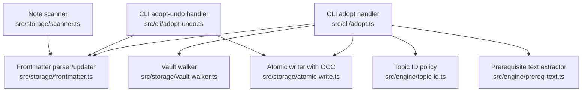
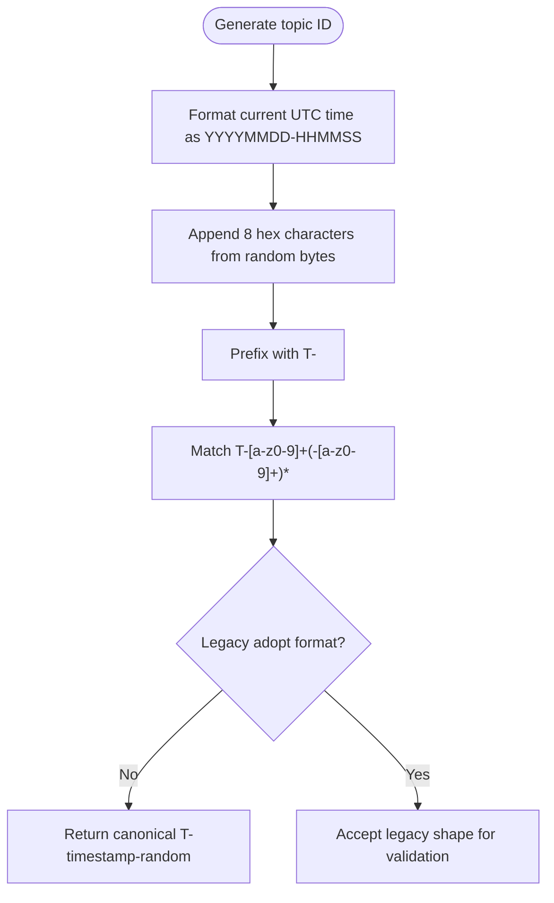
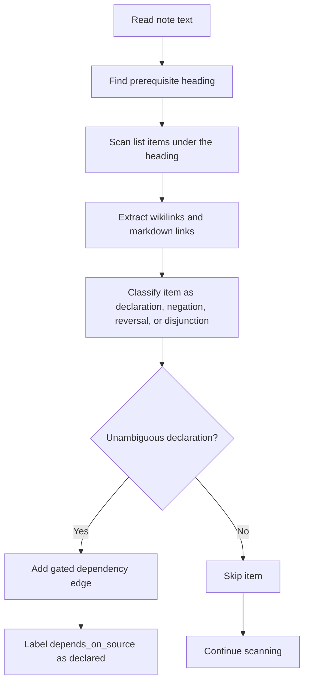
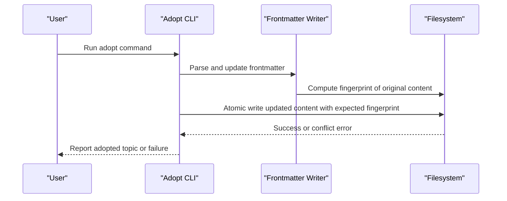
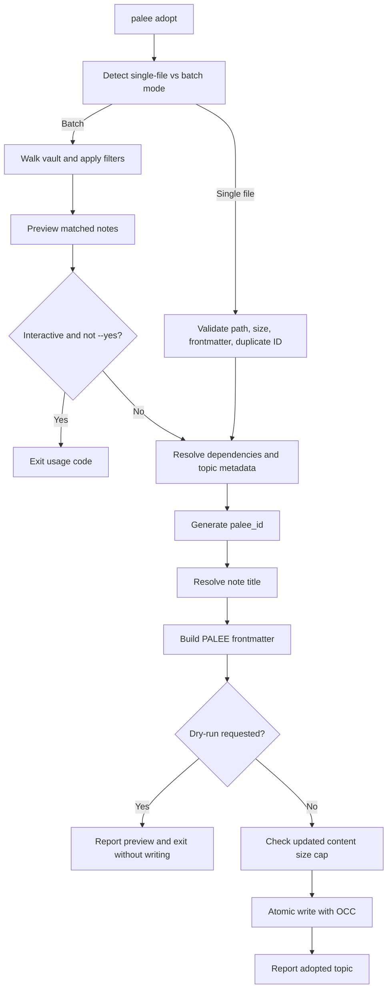
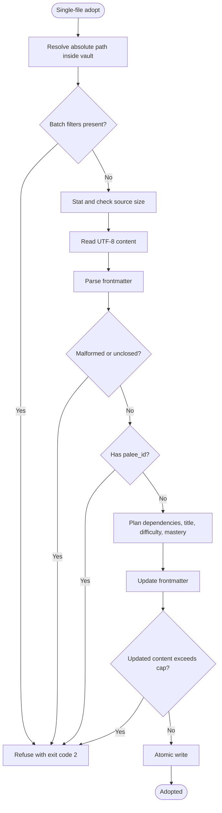
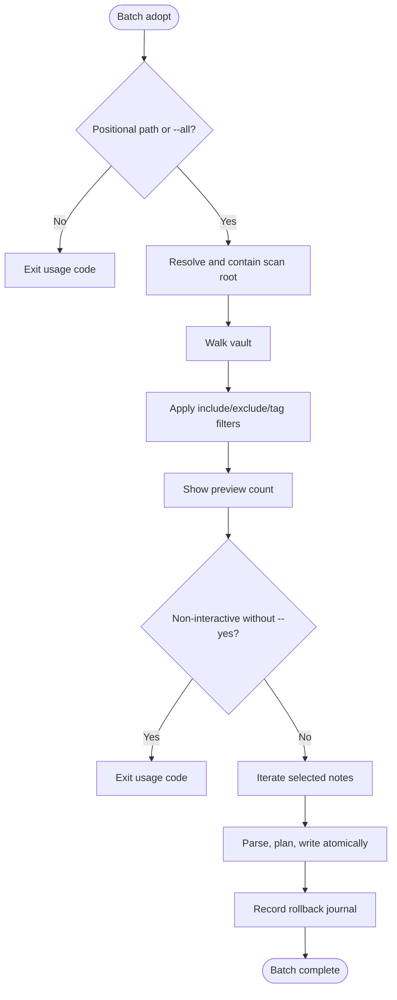
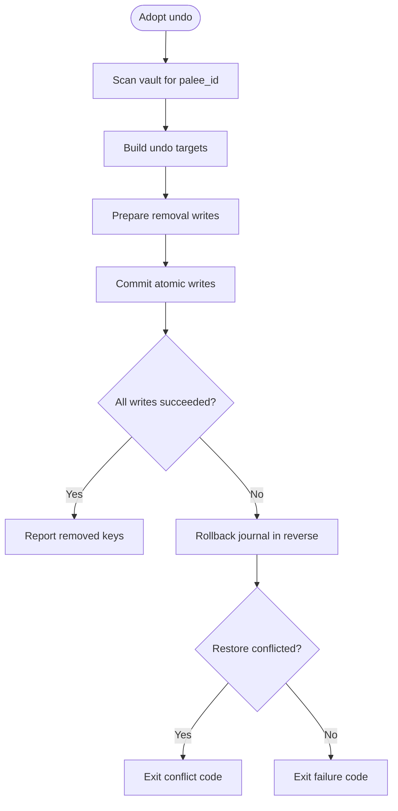
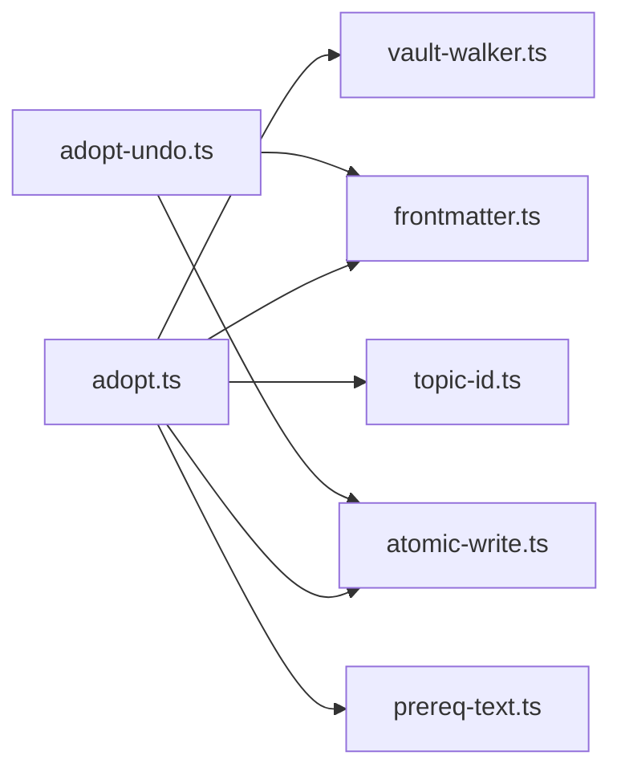

# Adopting Topics

::: details Referenced Files in This Document

- [adopt.ts](https://github.com/Kuldeep2822k/cli/blob/main/src/cli/adopt.ts)
- [adopt-undo.ts](https://github.com/Kuldeep2822k/cli/blob/main/src/cli/adopt-undo.ts)
- [topic-id.ts](https://github.com/Kuldeep2822k/cli/blob/main/src/engine/topic-id.ts)
- [prereq-text.ts](https://github.com/Kuldeep2822k/cli/blob/main/src/engine/prereq-text.ts)
- [vault-walker.ts](https://github.com/Kuldeep2822k/cli/blob/main/src/storage/vault-walker.ts)
- [frontmatter.ts](https://github.com/Kuldeep2822k/cli/blob/main/src/storage/frontmatter.ts)
- [atomic-write.ts](https://github.com/Kuldeep2822k/cli/blob/main/src/storage/atomic-write.ts)
- [cli-adopt-batch.test.ts](https://github.com/Kuldeep2822k/cli/blob/main/test/cli-adopt-batch.test.ts)
- [cli-adopt-single-file-filters.test.ts](https://github.com/Kuldeep2822k/cli/blob/main/test/cli-adopt-single-file-filters.test.ts)
- [cli-adopt-prereq-text.test.ts](https://github.com/Kuldeep2822k/cli/blob/main/test/cli-adopt-prereq-text.test.ts)

:::

## Table of Contents
1. [Introduction](#introduction)
2. [Project Structure](#project-structure)
3. [Core Components](#core-components)
4. [Architecture Overview](#architecture-overview)
5. [Detailed Component Analysis](#detailed-component-analysis)
6. [Dependency Analysis](#dependency-analysis)
7. [Performance Considerations](#performance-considerations)
8. [Troubleshooting Guide](#troubleshooting-guide)
9. [Conclusion](#conclusion)

## Introduction
The adopt command converts existing Markdown notes into managed PALEE topics by minting a `palee_id`, injecting PALEE-managed frontmatter, and optionally deriving dependencies from declared prerequisites or automatic chain rules. It supports:

- Single-file adoption for one explicit note.
- Batch adoption across a directory or the whole vault with glob-style filters.
- Prerequisite text extraction from a note’s own prerequisite section.
- Safe atomic writes backed by optimistic concurrency control.
- Reversal through the adopt-undo command, which removes only the keys PALEE added.

This document explains how to use the command, what happens under the hood, how undo works, and how to handle common issues safely.

## Project Structure
Adoption is implemented primarily in the CLI layer, with support from engine logic for topic identity and prerequisite extraction, and storage helpers for vault walking, frontmatter parsing, and atomic file updates.

**Diagram sources**
- [adopt.ts:201-531](https://github.com/Kuldeep2822k/cli/blob/main/src/cli/adopt.ts#L201-L531)
- [adopt-undo.ts:201-587](https://github.com/Kuldeep2822k/cli/blob/main/src/cli/adopt-undo.ts#L201-L587)
- [vault-walker.ts:1-200](https://github.com/Kuldeep2822k/cli/blob/main/src/storage/vault-walker.ts#L1-L200)
- [scanner.ts:1-200](https://github.com/Kuldeep2822k/cli/blob/main/src/storage/scanner.ts#L1-L200)
- [frontmatter.ts:1-200](https://github.com/Kuldeep2822k/cli/blob/main/src/storage/frontmatter.ts#L1-L200)
- [atomic-write.ts:1-200](https://github.com/Kuldeep2822k/cli/blob/main/src/storage/atomic-write.ts#L1-L200)
- [topic-id.ts:1-81](https://github.com/Kuldeep2822k/cli/blob/main/src/engine/topic-id.ts#L1-L81)
- [prereq-text.ts:1-200](https://github.com/Kuldeep2822k/cli/blob/main/src/engine/prereq-text.ts#L1-L200)

**Section sources**
- [adopt.ts:201-531](https://github.com/Kuldeep2822k/cli/blob/main/src/cli/adopt.ts#L201-L531)
- [adopt-undo.ts:201-587](https://github.com/Kuldeep2822k/cli/blob/main/src/cli/adopt-undo.ts#L201-L587)

## Core Components

### Adoption Command (`palee adopt`)
The adopt command supports two modes:

| Mode | Input | Filters | Main Behavior |
|---|---|---|---|
| Single-file | A `.md` path resolved inside the configured vault | None allowed; `--include`, `--exclude`, `--tag` are rejected | Reads the note, validates frontmatter, generates a topic ID, injects PALEE frontmatter, and writes atomically. |
| Batch | A directory, `--all`, or no positional target with `--all` | `--include`, `--exclude`, `--tag` | Walks the vault, applies filters, previews scope, asks for confirmation unless `--yes`, then adopts matching notes. |

Important single-file rules:
- The target must exist, be a file, resolve inside the vault, and end with `.md`.
- If it already has a `palee_id`, adoption refuses it.
- Malformed or unclosed YAML frontmatter blocks refuse adoption.
- After adding managed keys, the resulting content is still checked against the read-cap before writing.

Important batch rules:
- Non-interactive mode without `--yes` exits with usage code.
- Path resolution enforces vault containment.
- Pattern syntax is validated early.
- Tier-0 hygiene and template classification can skip meta notes even in batch mode.

**Section sources**
- [adopt.ts:201-531](https://github.com/Kuldeep2822k/cli/blob/main/src/cli/adopt.ts#L201-L531)
- [cli-adopt-batch.test.ts:1-180](https://github.com/Kuldeep2822k/cli/blob/main/test/cli-adopt-batch.test.ts#L1-L180)
- [cli-adopt-single-file-filters.test.ts:1-101](https://github.com/Kuldeep2822k/cli/blob/main/test/cli-adopt-single-file-filters.test.ts#L1-L101)

### Undo Command (`palee adopt --undo`)
The undo command reverses adoption changes safely:

- Selects notes that currently carry a valid string `palee_id`.
- Removes only PALEE-owned frontmatter keys.
- Preserves all other keys, comments, key order, unknown fields, and body bytes.
- Optionally drops the unowned `title` key through a separate flag.
- Collapses an empty `{}` frontmatter block back to nothing when appropriate.
- Writes through the same atomic OCC path and maintains a rollback journal.

Owned keys removed by undo include identity, schema, difficulty, dependency declarations, mastery, assessment timestamps, pillar scores, SM-2 scheduling fields, and provenance labels. Keys such as user-authored topic metadata, review data, and assessment state are intentionally not removed because they may predate or postdate adoption.

**Section sources**
- [adopt-undo.ts:1-200](https://github.com/Kuldeep2822k/cli/blob/main/src/cli/adopt-undo.ts#L1-L200)
- [adopt-undo.ts:201-587](https://github.com/Kuldeep2822k/cli/blob/main/src/cli/adopt-undo.ts#L201-L587)

### Topic Identity
A PALEE topic ID follows the policy `T-` followed by lowercase kebab-case segments. Adopted IDs are generated using a timestamp plus cryptographic randomness. Existing legacy adopt-generated formats remain valid for validation, but new adoption uses the canonical form.

**Diagram sources**
- [topic-id.ts:1-81](https://github.com/Kuldeep2822k/cli/blob/main/src/engine/topic-id.ts#L1-L81)

**Section sources**
- [topic-id.ts:1-81](https://github.com/Kuldeep2822k/cli/blob/main/src/engine/topic-id.ts#L1-L81)

### Prerequisite Text Extraction
When adopting in batch mode, a note may declare its prerequisites directly in its own text. The system scans for headings that introduce prerequisites, collects wikilinks and markdown links, and rejects hedged or reversed statements such as negations, disjunctions, or “this note is a prerequisite for X.”

Only unambiguous author statements become gating edges, and those edges are labeled so downstream tools know they came from the note itself rather than inferred ordering.

**Diagram sources**
- [prereq-text.ts:1-200](https://github.com/Kuldeep2822k/cli/blob/main/src/engine/prereq-text.ts#L1-L200)

**Section sources**
- [prereq-text.ts:1-200](https://github.com/Kuldeep2822k/cli/blob/main/src/engine/prereq-text.ts#L1-L200)
- [cli-adopt-prereq-text.test.ts:1-180](https://github.com/Kuldeep2822k/cli/blob/main/test/cli-adopt-prereq-text.test.ts#L1-L180)

### Vault Scanning and Filtering
The vault walker recursively discovers Markdown files while excluding dot-directories, hidden files, `node_modules`, and other internal directories. It protects against circular symlinks and unreadable subdirectories. By default, symlinks are ignored; follow behavior can be controlled at lower layers.

Batch adoption applies three kinds of filters:

| Filter | Purpose | Scope |
|---|---|---|
| `--include` | Include paths matching a pattern | Vault-relative path |
| `--exclude` | Exclude paths matching a pattern | Vault-relative path |
| `--tag` | Match notes carrying specific tags | Frontmatter tag values |

Pattern syntax is validated before adoption begins. In single-file mode, any of these flags is treated as a contradiction because there is no directory walk to filter.

**Section sources**
- [vault-walker.ts:1-200](https://github.com/Kuldeep2822k/cli/blob/main/src/storage/vault-walker.ts#L1-L200)
- [adopt.ts:201-531](https://github.com/Kuldeep2822k/cli/blob/main/src/cli/adopt.ts#L201-L531)

### Frontmatter Parsing and Atomic Updates
Frontmatter is parsed using a YAML concrete syntax tree so comments, key order, unknown keys, and formatting are preserved. When adopting, PALEE adds managed keys such as identity, schema, title, difficulty, dependencies, mastery, assessment timestamps, pillar scores, and SM-2 scaffolding.

Atomic writes provide durability and concurrency safety:

1. Resolve the destination inside the vault.
2. Acquire a lock on the target file.
3. Compare the expected fingerprint against disk state.
4. Reclaim abandoned temporary files from earlier crashed runs.
5. Write to a unique temporary file.
6. Flush the temp file.
7. Atomically rename it over the destination.
8. Flush the containing directory where supported.
9. Handle Windows locking with bounded exponential backoff and jitter.

Undo also uses this path, restoring previous content during rollback by writing exact prior bytes with their original fingerprints.

**Diagram sources**
- [frontmatter.ts:1-200](https://github.com/Kuldeep2822k/cli/blob/main/src/storage/frontmatter.ts#L1-L200)
- [atomic-write.ts:1-200](https://github.com/Kuldeep2822k/cli/blob/main/src/storage/atomic-write.ts#L1-L200)
- [adopt.ts:201-531](https://github.com/Kuldeep2822k/cli/blob/main/src/cli/adopt.ts#L201-L531)

**Section sources**
- [frontmatter.ts:1-200](https://github.com/Kuldeep2822k/cli/blob/main/src/storage/frontmatter.ts#L1-L200)
- [atomic-write.ts:1-200](https://github.com/Kuldeep2822k/cli/blob/main/src/storage/atomic-write.ts#L1-L200)

## Architecture Overview
The adoption workflow proceeds in stages from vault discovery to durable file mutation.

**Diagram sources**
- [adopt.ts:201-531](https://github.com/Kuldeep2822k/cli/blob/main/src/cli/adopt.ts#L201-L531)
- [vault-walker.ts:1-200](https://github.com/Kuldeep2822k/cli/blob/main/src/storage/vault-walker.ts#L1-L200)
- [frontmatter.ts:1-200](https://github.com/Kuldeep2822k/cli/blob/main/src/storage/frontmatter.ts#L1-L200)
- [atomic-write.ts:1-200](https://github.com/Kuldeep2822k/cli/blob/main/src/storage/atomic-write.ts#L1-L200)

## Detailed Component Analysis

### Single-File Adoption Flow
Single-file adoption is the safest entry point for converting one note:

1. Resolve the path relative to the configured vault.
2. Verify it is a real file inside the vault.
3. Reject batch-only flags.
4. Stat the file and reject oversized notes before reading.
5. Read UTF-8 content.
6. Parse frontmatter and reject malformed or unclosed blocks.
7. Reject notes that already have `palee_id`.
8. Normalize declared dependencies and validate or warn about `--depends-on` targets.
9. Generate a new topic ID.
10. Resolve the note title from frontmatter, first-level heading, or filename.
11. Preserve or normalize difficulty, mastery, pillars, assessment timing, and SM-2 scaffolding.
12. Update frontmatter non-destructively.
13. Check the updated content size against the read-cap.
14. Write atomically with optimistic concurrency control.

**Diagram sources**
- [adopt.ts:201-531](https://github.com/Kuldeep2822k/cli/blob/main/src/cli/adopt.ts#L201-L531)

**Section sources**
- [adopt.ts:201-531](https://github.com/Kuldeep2822k/cli/blob/main/src/cli/adopt.ts#L201-L531)
- [cli-adopt-single-file-filters.test.ts:1-101](https://github.com/Kuldeep2822k/cli/blob/main/test/cli-adopt-single-file-filters.test.ts#L1-L101)

### Batch Adoption Flow
Batch adoption scans a vault root or a provided directory:

1. Require either a positional path/directory or `--all`.
2. Resolve and contain the scan root inside the vault.
3. Walk the vault using exclusion rules.
4. Apply include, exclude, and tag filters.
5. Display a preview of matched notes.
6. Ask for confirmation in interactive mode unless `--yes`.
7. For each selected note, parse frontmatter, generate an ID, extract prerequisite edges, build metadata, and write atomically.
8. Maintain a rollback journal so partial failures can be reverted.

**Diagram sources**
- [adopt.ts:201-531](https://github.com/Kuldeep2822k/cli/blob/main/src/cli/adopt.ts#L201-L531)
- [vault-walker.ts:1-200](https://github.com/Kuldeep2822k/cli/blob/main/src/storage/vault-walker.ts#L1-L200)

**Section sources**
- [adopt.ts:201-531](https://github.com/Kuldeep2822k/cli/blob/main/src/cli/adopt.ts#L201-L531)
- [cli-adopt-batch.test.ts:1-180](https://github.com/Kuldeep2822k/cli/blob/main/test/cli-adopt-batch.test.ts#L1-L180)

### Adopt-Undo Flow
Undo is designed to reverse only what adoption added:

1. Walk the vault and select notes with a tracked string `palee_id`.
2. Parse frontmatter and compute which owned keys are present.
3. Prepare updated content by removing owned keys.
4. Collapse an empty frontmatter mapping if the whole block was PALEE’s.
5. Commit writes atomically.
6. On failure, unwind the journal in reverse order, restoring original bytes verified by fingerprint.
7. Warn about derived `.palee/` records that still reference un-adopted topics.

**Diagram sources**
- [adopt-undo.ts:201-587](https://github.com/Kuldeep2822k/cli/blob/main/src/cli/adopt-undo.ts#L201-L587)

**Section sources**
- [adopt-undo.ts:201-587](https://github.com/Kuldeep2822k/cli/blob/main/src/cli/adopt-undo.ts#L201-L587)

## Dependency Analysis
Adoption connects several modules with clear responsibilities:

| Module | Responsibility | Coupling Direction |
|---|---|---|
| `adopt.ts` | CLI entry, mode detection, filtering, preview, confirmation, orchestration | Depends on storage, engine, types |
| `adopt-undo.ts` | Reverse adoption safely | Depends on storage and CLI utilities |
| `vault-walker.ts` | Recursive vault traversal and symlink safety | Low-level filesystem helper |
| `frontmatter.ts` | YAML CST-based parsing and safe updates | Used by both adopt and undo |
| `atomic-write.ts` | Crash-resilient writes with OCC | Used by both adopt and undo |
| `topic-id.ts` | Canonical ID policy and generation | Consumed by adopt |
| `prereq-text.ts` | Author-stated prerequisite extraction | Consumed by adopt in batch mode |

**Diagram sources**
- [adopt.ts:201-531](https://github.com/Kuldeep2822k/cli/blob/main/src/cli/adopt.ts#L201-L531)
- [adopt-undo.ts:201-587](https://github.com/Kuldeep2822k/cli/blob/main/src/cli/adopt-undo.ts#L201-L587)
- [vault-walker.ts:1-200](https://github.com/Kuldeep2822k/cli/blob/main/src/storage/vault-walker.ts#L1-L200)
- [frontmatter.ts:1-200](https://github.com/Kuldeep2822k/cli/blob/main/src/storage/frontmatter.ts#L1-L200)
- [atomic-write.ts:1-200](https://github.com/Kuldeep2822k/cli/blob/main/src/storage/atomic-write.ts#L1-L200)
- [topic-id.ts:1-81](https://github.com/Kuldeep2822k/cli/blob/main/src/engine/topic-id.ts#L1-L81)
- [prereq-text.ts:1-200](https://github.com/Kuldeep2822k/cli/blob/main/src/engine/prereq-text.ts#L1-L200)

**Section sources**
- [adopt.ts:201-531](https://github.com/Kuldeep2822k/cli/blob/main/src/cli/adopt.ts#L201-L531)
- [adopt-undo.ts:201-587](https://github.com/Kuldeep2822k/cli/blob/main/src/cli/adopt-undo.ts#L201-L587)

## Performance Considerations

### Large Vaults
- Vault walking is recursive and reads directory entries synchronously; very large vaults can be slow during discovery.
- Prefer narrowing scope with a directory argument or `--all` after validating patterns, rather than scanning unrelated top-level trees.
- Use `--dry-run` first to confirm match counts before committing.

### File Size Limits
- Notes exceeding the read-cap are rejected before adoption, preventing identity minting on files that cannot be surfaced by reading commands.
- Updated content is also checked after adding managed keys.
- Very large notes should be split into focused topics before adoption.

### Concurrency and Locking
- Atomic writes hold locks and compare fingerprints, so concurrent edits can cause conflicts.
- Undo rollback also uses atomic writes and can fail on collisions.
- Run adoption sequentially when multiple processes edit the same vault.

### Encoding and Line Endings
- Frontmatter handling preserves line terminators detected from the original file, reducing unnecessary diffs.
- A leading BOM is handled explicitly so editors like Obsidian on Windows do not break fence parsing.

### Best Practices Before Adoption
- Organize notes by topic rather than by process stage.
- Give each note one clear learning objective.
- Avoid mixing unrelated concepts in one file.
- Use consistent headings and wikilinks for prerequisites.
- Keep notes below the read-cap.
- Remove duplicates and merge related notes before running batch adoption.

[No sources needed since this section provides general guidance]

## Troubleshooting Guide

### Duplicate Topic IDs
- New IDs are generated from timestamps and random bytes.
- If a note already has `palee_id`, single-file adoption refuses it.
- Validation tools should be used to detect duplicate IDs after migration or import.
- Resolution: remove the duplicate identity or consolidate topics.

**Section sources**
- [topic-id.ts:1-81](https://github.com/Kuldeep2822k/cli/blob/main/src/engine/topic-id.ts#L1-L81)
- [adopt.ts:201-531](https://github.com/Kuldeep2822k/cli/blob/main/src/cli/adopt.ts#L201-L531)

### Circular Dependencies
- Circular dependencies are handled by the dependency engine and validation framework.
- Declared prerequisites are intentional author statements and gate readiness.
- Resolution: restructure prerequisites so the graph is acyclic or remove contradictory declarations.

**Section sources**
- [prereq-text.ts:1-200](https://github.com/Kuldeep2822k/cli/blob/main/src/engine/prereq-text.ts#L1-L200)

### Malformed YAML Frontmatter
- Unclosed frontmatter opener blocks are refused because they can strand the learner’s own `palee_id`.
- Malformed YAML reports a parse error and prevents adoption.
- Resolution: close the `---` fences, fix invalid YAML, or rewrite the block carefully.

**Section sources**
- [frontmatter.ts:1-200](https://github.com/Kuldeep2822k/cli/blob/main/src/storage/frontmatter.ts#L1-L200)
- [adopt.ts:201-531](https://github.com/Kuldeep2822k/cli/blob/main/src/cli/adopt.ts#L201-L531)

### Encoding Problems
- A leading BOM is stripped for parsing and restored for writing.
- Line endings are preserved to avoid full-file diffs.
- Resolution: ensure notes are UTF-8 and avoid mixed CRLF/LF conventions in unrelated editors.

**Section sources**
- [frontmatter.ts:1-200](https://github.com/Kuldeep2822k/cli/blob/main/src/storage/frontmatter.ts#L1-L200)

### Symlink Handling
- By default, symbolic links are ignored by the vault walker.
- Follow behavior can be enabled at lower layers, but targets outside the vault are excluded.
- Dead links are skipped.
- Resolution: place actual files inside the vault or adjust symlink configuration if supported by your deployment.

**Section sources**
- [vault-walker.ts:1-200](https://github.com/Kuldeep2822k/cli/blob/main/src/storage/vault-walker.ts#L1-L200)

### Non-Interactive Mode
- Batch adoption without `--yes` exits with usage code in non-interactive environments.
- Automation scripts should pass `--yes` or pipe confirmation.

**Section sources**
- [cli-adopt-batch.test.ts:1-180](https://github.com/Kuldeep2822k/cli/blob/main/test/cli-adopt-batch.test.ts#L1-L180)

### Undo Did Not Remove Expected Keys
- Undo removes only PALEE-owned keys.
- User-authored keys such as topic metadata, review state, or assessment fields are preserved.
- The `title` key is kept by default because adoption does not own it.
- Use the dedicated flag to drop `title` if you want it removed.

**Section sources**
- [adopt-undo.ts:1-200](https://github.com/Kuldeep2822k/cli/blob/main/src/cli/adopt-undo.ts#L1-L200)
- [adopt-undo.ts:201-587](https://github.com/Kuldeep2822k/cli/blob/main/src/cli/adopt-undo.ts#L201-L587)

## Conclusion
Adoption turns ordinary Markdown notes into managed PALEE topics with stable identities, structured metadata, and optional prerequisite edges. Single-file adoption is safest for careful conversion, while batch adoption scales across directories and vaults with filtering and preview. Undo restores the pre-adoption state by removing only the keys PALEE owns. Atomic writes and fingerprint checks protect against concurrent edits and crashes. For large vaults, organize content thoughtfully, keep notes small and focused, validate patterns with dry runs, and use undo to reverse mistakes safely.

[No sources needed since this section summarizes without analyzing specific files]