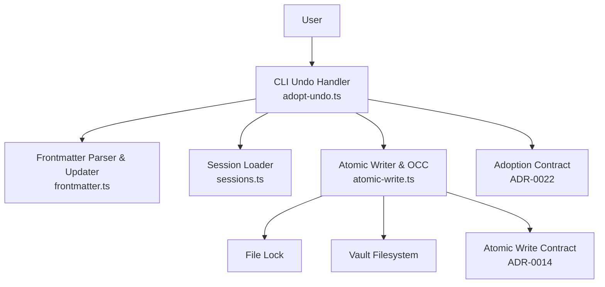
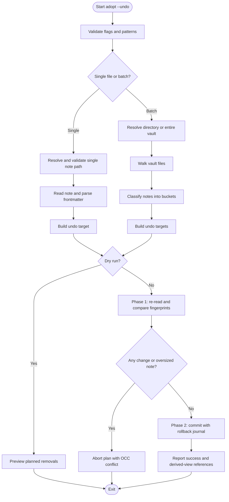
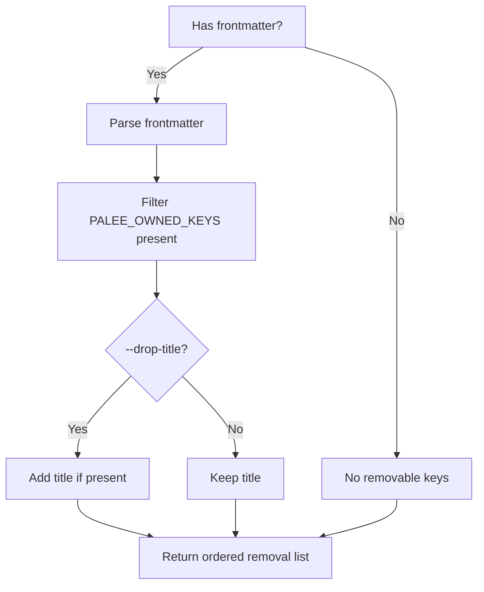
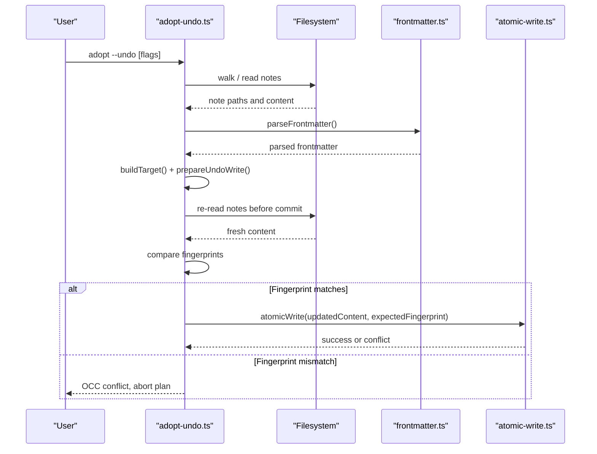
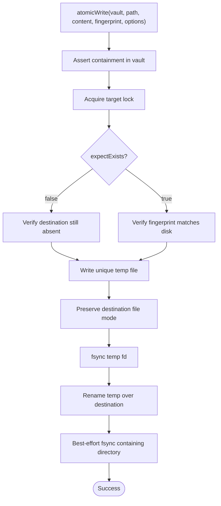
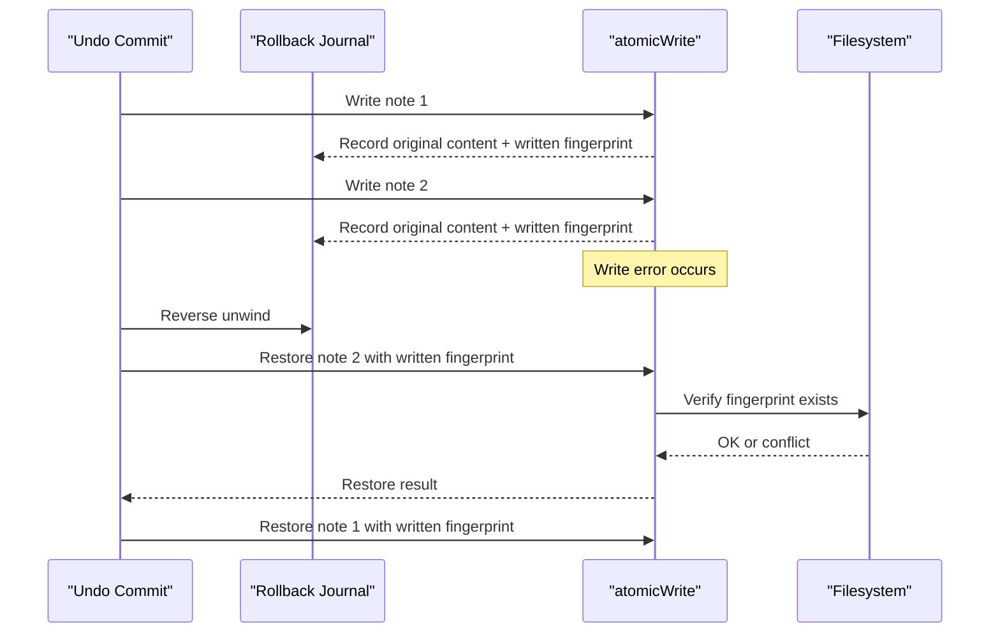
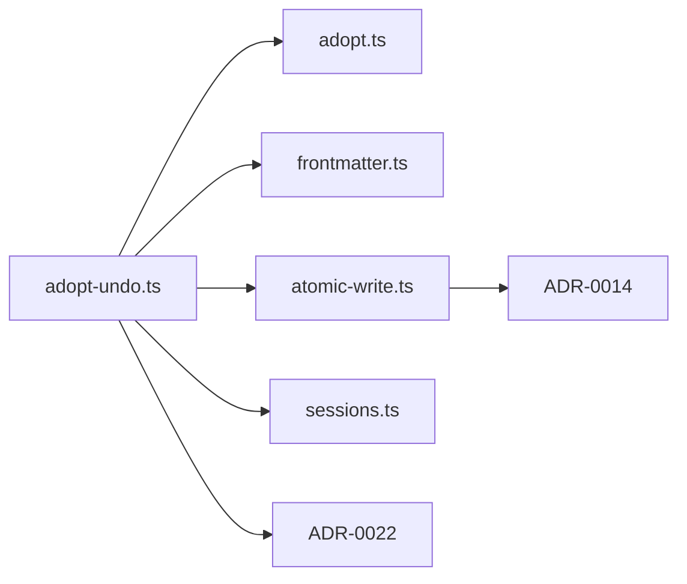

# Undo and Recovery Operations

::: details Referenced Files in This Document

- [adopt-undo.ts](https://github.com/Kuldeep2822k/cli/blob/main/src/cli/adopt-undo.ts)
- [adopt.ts](https://github.com/Kuldeep2822k/cli/blob/main/src/cli/adopt.ts)
- [atomic-write.ts](https://github.com/Kuldeep2822k/cli/blob/main/src/storage/atomic-write.ts)
- [frontmatter.ts](https://github.com/Kuldeep2822k/cli/blob/main/src/storage/frontmatter.ts)
- [sessions.ts](https://github.com/Kuldeep2822k/cli/blob/main/src/storage/sessions.ts)
- [0022-adoption-contracts.md](https://github.com/Kuldeep2822k/cli/blob/main/docs/adr/0022-adoption-contracts.md)
- [0014-atomic-write-durability-and-containment.md](https://github.com/Kuldeep2822k/cli/blob/main/docs/adr/0014-atomic-write-durability-and-containment.md)
- [0019-session-memory-lifecycle.md](https://github.com/Kuldeep2822k/cli/blob/main/docs/adr/0019-session-memory-lifecycle.md)
- [cli-adopt-undo.test.ts](https://github.com/Kuldeep2822k/cli/blob/main/test/cli-adopt-undo.test.ts)
- [cli-adopt-undo-disclosure.test.ts](https://github.com/Kuldeep2822k/cli/blob/main/test/cli-adopt-undo-disclosure.test.ts)

:::

## Table of Contents
1. [Introduction](#introduction)
2. [Project Structure](#project-structure)
3. [Core Components](#core-components)
4. [Architecture Overview](#architecture-overview)
5. [Detailed Component Analysis](#detailed-component-analysis)
6. [Dependency Analysis](#dependency-analysis)
7. [Performance Considerations](#performance-considerations)
8. [Troubleshooting Guide](#troubleshooting-guide)
9. [Conclusion](#conclusion)
10. [Appendices](#appendices)

## Introduction
The `palee adopt --undo` command reverses adoption by removing only the frontmatter keys that PALEE owns from selected notes. It does not rewrite user-authored content, comments, key order, or body text unless those bytes are directly tied to a removed PALEE-owned key. Undo is intentionally narrow: it restores the pre-adoption state for PALEE-managed metadata while preserving everything else, including keys such as `status`, `topic`, `dependencies`, and `title` (the latter unless explicitly requested with `--drop-title`).

Undo supports single-file and batch modes, mirrors adoption’s scope selection (`--all`, `--include`, `--exclude`, `--tag`), and uses dry-run previews before any vault mutation. Atomic writes and optimistic concurrency control (OCC) protect both the undo execution path and its rollback journal, so interrupted or partially completed runs can be detected and reversed safely.

## Project Structure
The undo mechanism spans three layers:

| Layer | Responsibility | Primary Files |
|---|---|---|
| CLI undo handler | Parses flags, selects targets, plans removals, reports outcomes, and delegates all writes to storage | [adopt-undo.ts](https://github.com/Kuldeep2822k/cli/blob/main/src/cli/adopt-undo.ts) |
| Storage primitives | Atomic file writing, OCC, locking, frontmatter parsing, session loading, and fingerprinting | [atomic-write.ts](https://github.com/Kuldeep2822k/cli/blob/main/src/storage/atomic-write.ts), [frontmatter.ts](https://github.com/Kuldeep2822k/cli/blob/main/src/storage/frontmatter.ts), [sessions.ts](https://github.com/Kuldeep2822k/cli/blob/main/src/storage/sessions.ts) |
| Design contracts and tests | Adoption reversal policy, durability guarantees, session behavior, and behavioral assertions | [0022-adoption-contracts.md](https://github.com/Kuldeep2822k/cli/blob/main/docs/adr/0022-adoption-contracts.md), [0014-atomic-write-durability-and-containment.md](https://github.com/Kuldeep2822k/cli/blob/main/docs/adr/0014-atomic-write-durability-and-containment.md), [0019-session-memory-lifecycle.md](https://github.com/Kuldeep2822k/cli/blob/main/docs/adr/0019-session-memory-lifecycle.md), [cli-adopt-undo.test.ts](https://github.com/Kuldeep2822k/cli/blob/main/test/cli-adopt-undo.test.ts), [cli-adopt-undo-disclosure.test.ts](https://github.com/Kuldeep2822k/cli/blob/main/test/cli-adopt-undo-disclosure.test.ts) |

## Core Components
The undo subsystem is built around five core responsibilities:

| Component | Purpose | Key Behavior |
|---|---|---|
| Owned-key set | Defines exactly which frontmatter keys undo removes | `palee_id`, `palee_schema`, `difficulty`, `depends_on`, `topic_mastery`, `assessed_at`, pillar keys, SM-2 scheduling keys, and `depends_on_source`; `title` is excluded unless `--drop-title` is used |
| Target builder | Identifies adopted notes without guessing at malformed or authored data | Requires a usable string `palee_id`; numeric or missing values are left alone |
| CST-based frontmatter updater | Removes only selected keys while preserving comments, ordering, unknown keys, and body bytes | Uses a concrete syntax tree instead of full re-serialization |
| Batch planner | Plans changes before writing and refuses partial plans when vault state drifts | Re-reads every target and compares fingerprints; oversized notes are treated as concurrent changes |
| Rollback journal | Records what was written during undo and restores original content if later writes fail | Restores in reverse order using verified atomic writes |

## Architecture Overview
Undo follows a strict scan → plan → verify → commit → journal phase model. The important invariant is that undo never assumes ownership of a key just because it happens to exist.

## Detailed Component Analysis

### Owned-Key Removal Policy
Undo removes only the keys that adoption writes. This includes topic identity, schema, difficulty, dependencies, mastery, assessment timestamps, pillar scores, SM-2 scheduling fields, and dependency provenance. It deliberately excludes keys adoption never writes, such as `status`, `topic`, and legacy `dependencies`.

The `title` key is special: adoption writes it, but it is not considered PALEE-owned because an authored title is byte-identical after adoption to a minted one. Undo therefore keeps `title` by default and requires explicit opt-in via `--drop-title`.

### Frontmatter Preservation and Comment Loss Detection
Undo relies on a YAML concrete syntax tree updater rather than full YAML re-serialization. This preserves:

- Unknown keys
- Existing comment lines
- Key ordering
- Block scalar formatting
- Line terminators (LF vs CRLF)
- Leading BOM bytes
- Body content outside the frontmatter block

When a key is removed, comments attached to that key node may also disappear. Undo computes which comment lines were lost by comparing the raw frontmatter before and after removal and reports them. This is the only part of undo that intentionally removes non-PALEE bytes, and it is surfaced as a warning rather than hidden.

An empty frontmatter block after removal is collapsed away so a note that originally had no frontmatter returns to its original shape.

### Undo Planning and Validation
Undo separates planning from execution. During planning:

1. Notes are scanned using the same scope filters as adoption.
2. Each note is classified into one of several categories: ready to undo, not adopted, unusable `palee_id`, orphan owned keys without an id, unterminated frontmatter opener, unreadable frontmatter, or oversized.
3. Targets are prepared by recomputing removals against the scan-time bytes.
4. A dry-run preview lists notes, removed keys, kept keys, and potentially lost comments.

During validation, undo re-reads every target and rejects the whole plan if any note changed under the run or grew past the read cap. This prevents undo from stripping keys from bytes it never saw.

### Atomic Writes and Optimistic Concurrency Control
Every undo write goes through the atomic writer, which:

1. Asserts the destination is inside the vault.
2. Acquires a lock on the target file.
3. Checks existence expectations.
4. Compares the expected fingerprint against current disk content.
5. Writes to a unique temporary file.
6. Preserves the destination’s permission mode.
7. Flushes the temp file.
8. Renames the temp file over the destination.
9. Best-effort flushes the containing directory.
10. Handles Windows filesystem locking with exponential backoff and jitter.

This makes undo safe against concurrent writers, deleted files, stale locks, and crashes between the temp write and rename.

### Rollback Journal and Partial Recovery
Both adoption and undo maintain a rollback journal. For undo, each successfully written note records:

- Absolute path
- Relative path
- Original content
- Fingerprint of the content written by this run

If a later write fails, the journal is unwound in reverse order. Each restore calls atomic write with `expectExists: true` and the exact fingerprint of what the undo run wrote. This means a restored note must still hold the undo output; if another process replaced it, the restore is reported as a collision and the newer bytes are preserved.

### Relationship Between Adoption Sessions, Temporary Files, and Rollback
Undo does not rewrite `.palee/sessions`, `.palee/index.md`, or `.palee/hot.md`. Those are canonical or derived session views, and undo treats them as read-only diagnostic sources. If un-adopting a note leaves a session record referencing a topic that no longer exists in the vault, undo reports the reference and directs recovery to `palee session` and `palee validate`.

Temporary files created by atomic writes are reclaimed only when they belong to a crashed writer whose process ID is gone and whose age exceeds a staleness floor. This prevents undo and other commands from deleting in-flight temp files belonging to another host or antivirus-locked process.

Session memory lifecycle rules reinforce the safety boundary: `.palee/hot.md` is derived working memory, `.palee/sessions/` is canonical history, and rebuilds do not delete canonical session files.

## Dependency Analysis
Undo depends on adoption’s selection semantics and storage-layer durability. Its most important external dependencies are:

| Dependency | Role | Coupling Level |
|---|---|---|
| `adopt.ts` | Scope selection, pattern/tag filtering, and confirmation flow | Shared CLI contract |
| `frontmatter.ts` | Safe CST-based key removal and fingerprinting | Strong |
| `atomic-write.ts` | Atomic persistence, OCC, locking, and rollback verification | Strong |
| `sessions.ts` | Reading session records for derived-view warnings | Read-only advisory |
| `0022-adoption-contracts.md` | Defines reversal policy and rollback guarantees | Design contract |
| `0014-atomic-write-durability-and-containment.md` | Defines durability, containment, and existence expectations | Design contract |

## Performance Considerations
Undo is designed for correctness first, but its structure supports large vaults:

- Scanning is separate from committing.
- Pattern and tag filtering happen early.
- Preparation touches no files.
- Dry-run mode avoids all writes.
- Fingerprint checks avoid unnecessary re-parsing or rewrites.
- Atomic writes reuse a single storage primitive across all mutation paths.
- Oversized notes are skipped rather than loaded, preventing memory pressure from very large files.

For bulk operations, always use dry-run first. The test suite verifies that dry-run output names the affected notes and keys while changing no bytes.

## Troubleshooting Guide

### Common Undo Failures

| Symptom | Likely Cause | Recommended Action |
|---|---|---|
| `Error: Not a markdown note` | A `.md` file was passed alongside a directory scan, or a non-markdown target was given to batch undo | Pass the note alone or pass a directory |
| `Error: Path escapes vault` | Target resolves outside the configured vault root | Use a path inside the vault |
| `Error: Non-interactive environment` | Batch undo ran without `-y/--yes` in a non-TTY environment | Add `--yes` or automate confirmation |
| `Error: <path> has malformed frontmatter` | Frontmatter cannot be parsed | Fix YAML syntax or leave the note unchanged |
| `Error: OCC conflict: ... modified while this run was reading/planning` | Another process edited the note, or the note grew past the read cap | Re-run after the conflicting operation completes |
| `Rollback incomplete` | One or more restored notes could not be verified against their expected fingerprint | Inspect per-note errors and rerun undo or restore manually |
| References to un-adopted topics in `.palee/` | Session records still name a topic that no longer exists | Use `palee session` and `palee validate`; undo does not rewrite sessions |

### Locked Files
A locked file typically manifests as a lock conflict during atomic write. Undo holds the lock only while performing the OCC check and temp-file write/rename. If another process holds the lock:

1. Wait for the other process to finish.
2. Run `palee validate` to inspect vault state.
3. Retry undo after resolving the lock.
4. If the lock appears stale, check for crashed processes or external tools holding the file open.

### Permission Issues
Permission failures can occur when:

- The vault directory cannot be enumerated.
- A note cannot be read.
- The temp file cannot be created.
- The destination file mode cannot be preserved.

Check filesystem permissions for the vault, the `.palee` tree, and individual notes. Do not force-rewrite notes with overly restrictive permissions unless you understand how Obsidian and other tools access them.

### Corrupted Session Data
Corrupted or unreadable session data does not prevent undo from processing readable notes, but it can affect derived-view diagnostics:

- Unreadable session files are recorded with a read error.
- Corrupt frontmatter in sessions is recorded as a parse error.
- Derived views remain consistent with canonical session data.
- Rebuilds do not delete canonical session files.

Use `palee session` and `palee validate` to diagnose session issues separately from undo.

## Conclusion
`palee adopt --undo` is a narrowly scoped reversal tool. It removes only PALEE-owned frontmatter, preserves user-authored content, warns about comment loss tied to removed keys, and refuses to guess ownership of ambiguous keys like `title`. Its safety comes from three layers:

1. Careful ownership boundaries around frontmatter keys.
2. Atomic writes with optimistic concurrency control.
3. A verified rollback journal that restores in reverse order.

For mass adoption operations, the recommended workflow is:

1. Plan adoption with dry-run.
2. Review generated keys and scope.
3. Run adoption with confirmation.
4. Validate results before committing.
5. If mistakes occur, run `palee adopt --undo --dry-run` first.
6. Confirm the dry-run summary.
7. Run undo with `--yes` only after reviewing the plan.
8. Check derived-view warnings and run `palee validate`.

## Appendices

### Practical Scenarios

| Scenario | Expected Behavior | Recovery Guidance |
|---|---|---|
| Failed adoption mid-batch | Rollback journal restores previously written notes in reverse order | Check rollback messages and rerun validation |
| Reverting bulk adoption mistakes | Undo strips owned keys from matching notes and leaves authored content | Use dry-run first, then confirm with `--yes` |
| Interrupted undo operation | Rollback journal restores undo output where possible | Inspect unrestored notes and rerun undo |
| Recovering from failed adoptions | Undo restores pre-adoption PALEE metadata | Validate notes and sessions after undo |
| Partial recovery after interrupted operations | Only notes whose original content still matches the journal are restored | Treat conflicts as evidence of concurrent modification |

### Best Practices for Mass Adoption and Undo

- Always run dry-run before adoption and before undo.
- Prefer small scopes first: single file, then directory, then entire vault.
- Use `--include` and `--exclude` carefully; they affect which notes lose keys.
- Avoid mixing write-describing flags with `--undo`; they are refused.
- Validate results after adoption and after undo.
- Keep session management separate from topic note editing.
- Treat OCC conflicts as signals to stop and re-plan, not retry blindly.
- Preserve backups or version-control snapshots before large-scale operations.

## References

- [adopt-undo.ts:1-200](https://github.com/Kuldeep2822k/cli/blob/main/src/cli/adopt-undo.ts#L1-L200)
- [atomic-write.ts:1-200](https://github.com/Kuldeep2822k/cli/blob/main/src/storage/atomic-write.ts#L1-L200)
- [frontmatter.ts:1-200](https://github.com/Kuldeep2822k/cli/blob/main/src/storage/frontmatter.ts#L1-L200)
- [sessions.ts:1-200](https://github.com/Kuldeep2822k/cli/blob/main/src/storage/sessions.ts#L1-L200)
- [0022-adoption-contracts.md:1-77](https://github.com/Kuldeep2822k/cli/blob/main/docs/adr/0022-adoption-contracts.md#L1-L77)
- [0014-atomic-write-durability-and-containment.md:1-79](https://github.com/Kuldeep2822k/cli/blob/main/docs/adr/0014-atomic-write-durability-and-containment.md#L1-L79)
- [adopt-undo.ts:201-500](https://github.com/Kuldeep2822k/cli/blob/main/src/cli/adopt-undo.ts#L201-L500)
- [adopt-undo.ts:501-850](https://github.com/Kuldeep2822k/cli/blob/main/src/cli/adopt-undo.ts#L501-L850)
- [adopt-undo.ts:851-1156](https://github.com/Kuldeep2822k/cli/blob/main/src/cli/adopt-undo.ts#L851-L1156)
- [adopt-undo.ts:201-350](https://github.com/Kuldeep2822k/cli/blob/main/src/cli/adopt-undo.ts#L201-L350)
- [frontmatter.ts:201-220](https://github.com/Kuldeep2822k/cli/blob/main/src/storage/frontmatter.ts#L201-L220)
- [adopt-undo.ts:350-500](https://github.com/Kuldeep2822k/cli/blob/main/src/cli/adopt-undo.ts#L350-L500)
- [cli-adopt-undo.test.ts:201-500](https://github.com/Kuldeep2822k/cli/blob/main/test/cli-adopt-undo.test.ts#L201-L500)
- [cli-adopt-undo-disclosure.test.ts:201-359](https://github.com/Kuldeep2822k/cli/blob/main/test/cli-adopt-undo-disclosure.test.ts#L201-L359)
- [atomic-write.ts:201-450](https://github.com/Kuldeep2822k/cli/blob/main/src/storage/atomic-write.ts#L201-L450)
- [adopt.ts:1-200](https://github.com/Kuldeep2822k/cli/blob/main/src/cli/adopt.ts#L1-L200)
- [sessions.ts:201-279](https://github.com/Kuldeep2822k/cli/blob/main/src/storage/sessions.ts#L201-L279)
- [0019-session-memory-lifecycle.md:1-71](https://github.com/Kuldeep2822k/cli/blob/main/docs/adr/0019-session-memory-lifecycle.md#L1-L71)
