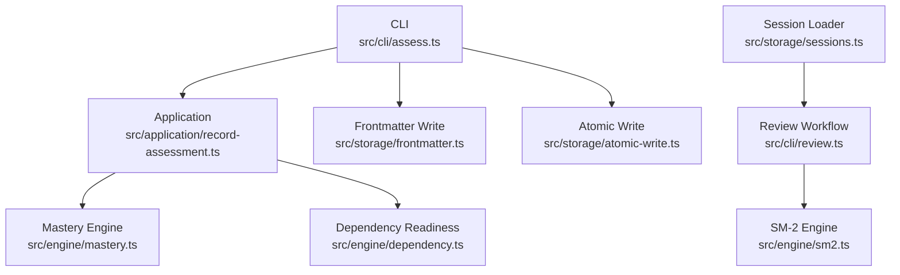
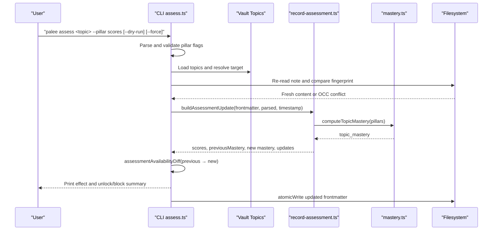
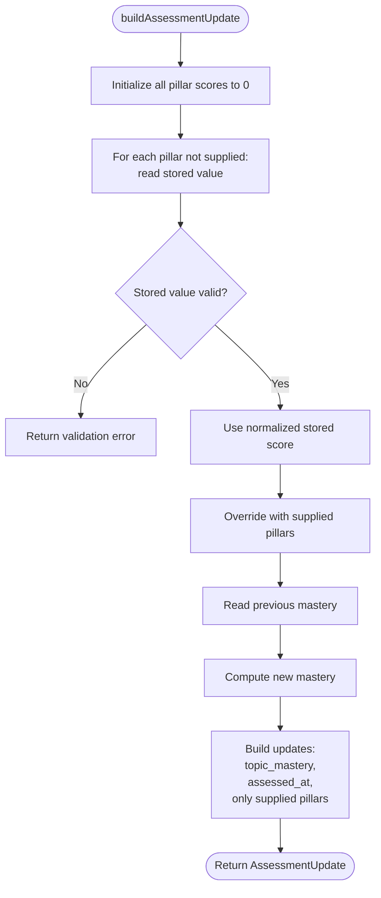
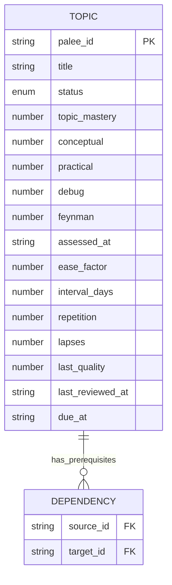
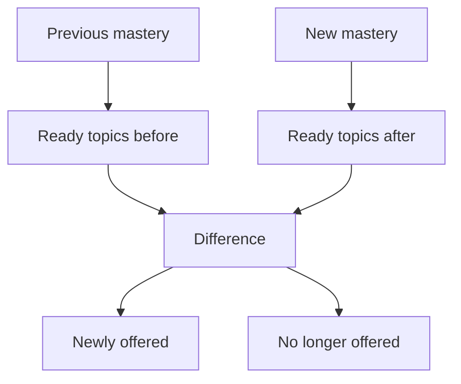

# Assessing Topics

::: details Referenced Files in This Document

- [assess.ts](https://github.com/Kuldeep2822k/cli/blob/main/src/cli/assess.ts)
- [record-assessment.ts](https://github.com/Kuldeep2822k/cli/blob/main/src/application/record-assessment.ts)
- [mastery.ts](https://github.com/Kuldeep2822k/cli/blob/main/src/engine/mastery.ts)
- [sm2.ts](https://github.com/Kuldeep2822k/cli/blob/main/src/engine/sm2.ts)
- [sessions.ts](https://github.com/Kuldeep2822k/cli/blob/main/src/storage/sessions.ts)
- [0004-four-pillar-pedagogical-mastery.md](https://github.com/Kuldeep2822k/cli/blob/main/docs/adr/0004-four-pillar-pedagogical-mastery.md)
- [0019-session-memory-lifecycle.md](https://github.com/Kuldeep2822k/cli/blob/main/docs/adr/0019-session-memory-lifecycle.md)
- [0021-assessment-surface.md](https://github.com/Kuldeep2822k/cli/blob/main/docs/adr/0021-assessment-surface.md)
- [03-1-sm2-spaced-repetition-algorithm.md](https://github.com/Kuldeep2822k/cli/blob/main/docs/03-1-sm2-spaced-repetition-algorithm.md)
- [05-1-topic-and-assessment-schema.md](https://github.com/Kuldeep2822k/cli/blob/main/docs/05-1-topic-and-assessment-schema.md)
- [cli-assess.test.ts](https://github.com/Kuldeep2822k/cli/blob/main/test/cli-assess.test.ts)
- [application-record-assessment.test.ts](https://github.com/Kuldeep2822k/cli/blob/main/test/application-record-assessment.test.ts)

:::

## Table of Contents
1. [Introduction](#introduction)
2. [Project Structure](#project-structure)
3. [Core Components](#core-components)
4. [Architecture Overview](#architecture-overview)
5. [Detailed Component Analysis](#detailed-component-analysis)
6. [Dependency Analysis](#dependency-analysis)
7. [Performance Considerations](#performance-considerations)
8. [Troubleshooting Guide](#troubleshooting-guide)
9. [Conclusion](#conclusion)
10. [Appendices](#appendices)

## Introduction
This document explains how to use PALEE’s `palee assess` command and the four-pillar pedagogical assessment system that powers topic mastery, prerequisite gating, and review scheduling. It covers:

- The four pillars: conceptual, practical, debug, and Feynman.
- How pillar scores combine into a single `topic_mastery` value.
- How mastery gates downstream topics at the 0.70 threshold.
- How assessments interact with SM-2 spaced repetition through `assessed_at`.
- All CLI options for recording assessments, including pillar scores, confidence-like modifiers, timestamps, preview behavior, and concurrency safety.
- Best practices for consistent scoring and interpreting mastery results.
- Workflows for daily review sessions, post-learning assessments, and periodic re-evaluation.
- Integration with the session management system and the storage model used by PALEE.

The key design principle is separation of concerns: `palee assess` records understanding-based pillar scores and recomputes mastery; `palee review` records recall-based SM-2 state. Mastery opens prerequisites; SM-2 schedules when you should review again.

## Project Structure
Assessment-related code spans the CLI, application layer, engine, and storage layers. The most relevant files are:

| Layer | File | Responsibility |
|---|---|---|
| CLI | `src/cli/assess.ts` | Parses flags, resolves topics, prints effects, writes notes |
| Application | `src/application/record-assessment.ts` | Pure assessment update logic and readiness diff |
| Engine | `src/engine/mastery.ts` | Pillar weighting, normalization, mastery threshold |
| Engine | `src/engine/sm2.ts` | Spaced repetition scheduling (SM-2) |
| Storage | `src/storage/sessions.ts` | Session history and derived memory used by review workflows |
| Documentation | `docs/adr/0004...`, `docs/adr/0021...`, `docs/03-1-sm2...`, `docs/05-1-topic...` | Pedagogical model, assessment surface, SM-2 policy, schema |
| Tests | `test/cli-assess.test.ts`, `test/application-record-assessment.test.ts` | End-to-end and unit contracts for assessment behavior |



## Core Components
The assessment system has four cooperating parts:

1. **Four-pillar model**: Conceptual, practical, debug, and Feynman scores are stored as per-topic frontmatter fields.
2. **Mastery calculation**: Weighted combination of pillars produces `topic_mastery`, rounded to four decimal places.
3. **Assessment recording**: `palee assess` updates only the named pillars, recalculates mastery, and sets `assessed_at`.
4. **Readiness gating**: A mastered topic reaches or exceeds 0.70 mastery, allowing dependent topics to appear in planning output.

The four-pillar model was adopted because real technical mastery requires more than one-dimensional recall. It captures theory, hands-on ability, troubleshooting skill, and the capacity to explain concepts clearly.

| Pillar | Meaning | Weight |
|---|---|---:|
| Conceptual | Understanding core principles and mental models | 20% |
| Practical | Applying knowledge in implementation or execution | 20% |
| Debug | Diagnosing failures and fixing problems | 20% |
| Feynman | Explaining the concept simply without jargon | 40% (double weighted) |

The canonical formula is:

`topic_mastery = round((conceptual + practical + debug + 2 × feynman) / 5, 4)`

A topic is considered mastered when its mastery is at least 0.70. Because Feynman is double-weighted, the three ordinary pillars alone cap mastery at 0.60. To pass the gate, you must include a non-zero Feynman score.

## Architecture Overview
The `palee assess` workflow connects user input, topic resolution, pure assessment computation, readiness analysis, and durable storage.



## Detailed Component Analysis

### Assessment Command (`palee assess`)
The CLI handler is responsible for:

- Accepting at least one pillar flag.
- Parsing each pillar as a number between 0 and 1.
- Rejecting non-numeric or out-of-range values with usage-level errors.
- Resolving the target topic by exact `palee_id`, then by fuzzy matching.
- Refusing ambiguous matches.
- Performing an optimistic concurrency check before writing.
- Computing the assessment effect on mastery and dependent topics.
- Supporting `--dry-run` to preview without modifying files.
- Supporting `--force` to suppress the lowering warning when recording.

#### CLI Options
| Option | Required? | Value | Behavior |
|---|---:|---|---|
| `<topic>` | Yes | Topic query | Exact `palee_id` wins first; substring match is accepted next; ambiguity fails |
| `--conceptual` | Optional | Number from 0 to 1 | Sets the conceptual pillar |
| `--practical` | Optional | Number from 0 to 1 | Sets the practical pillar |
| `--debug` | Optional | Number from 0 to 1 | Sets the debug pillar |
| `--feynman` | Optional | Number from 0 to 1 | Sets the Feynman pillar |
| `--dry-run` | Optional | Boolean flag | Prints what would happen without changing any file |
| `--force` | Optional | Boolean flag | Silences the lowering notice; does not change what is recorded |

At least one pillar flag is required. If none is provided, the command prints usage guidance and exits with a usage error. Each pillar must be a finite number from 0 to 1. Out-of-range values are rejected rather than clamped during parsing.

#### Output and Exit Behavior
- Success prints the pillar scores, the mastery transition, whether the topic reached mastery, and which topics were newly unlocked or blocked.
- A recorded lowering that hides previously ready topics prints a warning unless `--force` is passed.
- `--dry-run` prints the same assessment-effect report but adds a dry-run completion message and writes nothing.
- Missing vault, missing topic, ambiguous topic, invalid pillar, or no pillar returns a usage error.
- Concurrent modification returns an OCC conflict error.

### Pure Assessment Update Logic
The application layer isolates the business rules from filesystem I/O and process handling. Its responsibilities are:

- Merging explicitly supplied pillars over stored pillars.
- Reading existing pillar values without silently minting zeros.
- Refusing corrupt stored pillar values instead of clamping them into mastery.
- Computing `previousMastery` from stored `topic_mastery`.
- Computing `topicMastery` using the canonical weighted formula.
- Producing only the frontmatter fields that should be written.
- Computing which topics become newly available or unavailable after the mastery change.



### Mastery Calculation and Thresholds
The mastery engine provides:

- A fixed mastery threshold of 0.70.
- Score normalization to `[0.0, 1.0]` with four-decimal rounding.
- The canonical weighted formula.
- Helpers for carrying existing pillar scores safely.
- Resolution strategies for combining pillars with existing mastery in different commands.

Important distinction: `palee assess` calls `computeTopicMastery` directly so an explicit all-zero assessment can lower mastery. Other helpers intentionally treat “every pillar is zero” as “no assessment data” in contexts where preserving existing mastery is correct.

```mermaid
flowchart TD
    Inputs["Conceptual, Practical, Debug, Feynman"] --> Normalize["Normalize each to [0.0, 1.0]"]
    Normalize --> Formula["(c + p + d + 2×f) / 5"]
    Formula --> Round["Round to 4 decimals"]
    Round --> Mastery["topic_mastery ∈ [0.0, 1.0]")
    Mastery --> Gate{"≥ 0.70?"}
    Gate -->|Yes| Mastered["Mastered"]
    Gate -->|No| Learning["Not yet mastered"]
```

### Relationship Between Assessments and SM-2 Scheduling
Assessments and SM-2 reviews serve different purposes:

| Aspect | Assessment (`palee assess`) | Review (`palee review`) |
|---|---|---|
| What it measures | Understanding across four pedagogical pillars | Recall quality under SM-2 |
| Main fields updated | `conceptual`, `practical`, `debug`, `feynman`, `topic_mastery`, `assessed_at` | `ease_factor`, `interval_days`, `repetition`, `lapses`, `last_quality`, `last_reviewed_at`, `due_at` |
| Primary effect | Opens or closes prerequisite gates | Adjusts when the topic is due next |
| Threshold | 0.70 mastery for gating | Quality scale 0–5 for interval expansion |
| Timestamp | `assessed_at` ISO timestamp | `last_reviewed_at` date-only string |

`assessed_at` is important because it marks when a learner actively assessed understanding. SM-2 uses `last_reviewed_at` and `due_at` for scheduling. They are complementary signals: mastery says whether a topic satisfies prerequisites; SM-2 says when to revisit it.

### Data Model and Storage
Assessments are persisted in Markdown frontmatter. The relevant fields are:

| Field | Type | Purpose |
|---|---|---|
| `conceptual` | Number 0–1 | Theoretical understanding |
| `practical` | Number 0–1 | Hands-on application |
| `debug` | Number 0–1 | Troubleshooting ability |
| `feynman` | Number 0–1 | Clear explanation ability |
| `topic_mastery` | Number 0–1 | Weighted mastery result |
| `assessed_at` | ISO string or null | Last assessment timestamp |
| `ease_factor`, `interval_days`, `repetition`, `lapses`, `last_quality`, `last_reviewed_at`, `due_at` | Review fields | SM-2 scheduling state |

Only the pillars explicitly supplied on the command line are written back. Unnamed pillars keep their stored values and are not rewritten as zeros. This preserves the important distinction between “no assessment data” and “assessed at zero.”



### Concurrency and Safety
Before writing, `palee assess`:

1. Loads the topic list.
2. Resolves the target topic.
3. Records the initial content fingerprint.
4. Re-reads the note immediately before committing.
5. Compares the fresh fingerprint with the original.
6. Throws an OCC conflict if the file changed or disappeared.

This prevents two concurrent assessment or write operations from silently overwriting each other. The test suite validates unlocking dependents, boundary mastery values, demotion back below the threshold, and preservation of unmentioned pillars.

## Dependency Analysis
Assessment changes affect readiness through the dependency graph. The readiness difference is computed the same way planning computes readiness: cyclic topics are quarantined, and readiness is evaluated over the acyclic subgraph.



Key relationships:

- `assessCommand` depends on `loadConfig`, topic resolution, frontmatter loading/parsing, and atomic write.
- `buildAssessmentUpdate` depends on `computeTopicMastery` and `normalizeScore`.
- `assessmentAvailabilityDiff` depends on dependency readiness computation.
- Mastery thresholds and pillar weights live in the engine layer, not the CLI.

## Performance Considerations
Assessment recording is lightweight:

- It loads the topic index once.
- It reads and parses the target note twice (initial load plus pre-write re-read).
- It performs one pure mastery computation.
- It computes a readiness difference over the full topic set.
- It performs one atomic frontmatter write.

There is no external network call, AI provider integration, or expensive graph rebuild inside the command itself. The main cost is vault scanning and frontmatter I/O.

Best practices for performance:

- Use exact `palee_id` queries when possible to avoid fuzzy matching.
- Avoid running many concurrent assessments against the same topic.
- Keep vaults reasonably sized; large vaults increase topic scan time.
- Run assessments after reviewing a small batch of topics rather than continuously between every review.

## Troubleshooting Guide

### Common Errors and Fixes

| Symptom | Likely Cause | Fix |
|---|---|---|
| “Assess needs at least one pillar score” | No `--conceptual`, `--practical`, `--debug`, or `--feynman` provided | Add at least one pillar flag |
| “Expects a number between 0 and 1” | Non-numeric or out-of-range value | Provide a finite number from 0 to 1 |
| “No topic found matching…” | Query does not match any topic | Use exact `palee_id` or a clearer substring |
| “Multiple topics match…” | Fuzzy match is ambiguous | Use exact `palee_id` |
| “OCC conflict” | Another process modified the topic note | Retry after the other write completes |
| “Stored pillar score is not a number between 0 and 1” | Corrupt frontmatter field | Pass the pillar explicitly or repair the note with validation tools |
| Lowering notice appears | Recorded assessment reduced mastery below the threshold | Use `--force` to suppress the warning, or reconsider the score |

### Interpreting Mastery Results
- A mastery value below 0.70 means the topic still gates its dependents.
- If mastery is below 0.70 and no Feynman score was provided, the command explains that the three ordinary pillars cannot reach the threshold without Feynman.
- A mastery drop hides previously ready topics; the output names how many topics were affected.
- Exactly 0.70 satisfies the gate because the comparison is greater-than-or-equal.

### Consistency Across Study Sessions and Teams
To keep assessments consistent:

- Use the same numeric scale (0 to 1) for all pillars.
- Prefer decimal notation such as `0.8` rather than percentages like `80`.
- Always include a Feynman score when passing the 0.70 gate.
- Record assessments after completing meaningful learning activities, not merely after reading.
- Treat `palee assess` as a deliberate statement of understanding; do not treat it as a quick recall rating.
- Use `--dry-run` before lowering a mastered topic to confirm the impact.
- Avoid mixing `palee assess` and manual edits of the same note concurrently.
- For team vaults, agree on pillar definitions and grading conventions so one person’s 0.8 is another person’s 0.8.

## Conclusion
PALEE’s assessment system separates two kinds of learning signals:

- **Assessment pillars** measure understanding and drive prerequisite gating.
- **SM-2 review state** measures recall and drives scheduling intervals.

`palee assess` is the dedicated interface for recording multi-dimensional mastery. It accepts conceptual, practical, debug, and Feynman scores, computes a weighted mastery value, updates the topic’s frontmatter atomically, and reports how planned topics change. Its strict validation, optimistic concurrency control, dry-run preview, and lowering notice make it safe for both individual study and shared vaults.

For reliable results, record assessments deliberately, include Feynman scores when aiming to pass the 0.70 gate, keep pillar scales consistent, and use review sessions for SM-2 scheduling separately from understanding-based assessments.

## Appendices

### Step-by-Step Workflows

#### Daily Review Session
1. Run the review command to see due topics.
2. Rate recall quality using the SM-2 scale.
3. Let SM-2 adjust intervals and due dates.
4. Do not confuse recall quality with pillar mastery.
5. Use assessment later to formally update understanding.

#### Post-Learning Assessment
1. Complete conceptual study, practical work, debugging practice, and explanation exercises.
2. Assign pillar scores reflecting your actual competence.
3. Include a Feynman score when aiming to pass the gate.
4. Run `palee assess <topic> --conceptual N --practical N --debug N --feynman N`.
5. Check whether the topic became mastered and whether dependents unlocked.
6. If necessary, run `palee plan` to inspect the new ready list.

#### Periodic Re-evaluation of Mastered Topics
1. Revisit a previously mastered topic after time or new experience.
2. If your understanding decreased, record lower pillar scores.
3. Use `--dry-run` first to see which topics would be hidden.
4. Confirm with `--force` only if you are certain the lower score reflects reality.
5. Reassess later if your understanding improves again.

### Assessment Scoring Best Practices
- Conceptual: rate theoretical comprehension, not memorization.
- Practical: rate direct implementation or execution ability.
- Debug: rate diagnosis and repair capability.
- Feynman: rate clarity of explanation to someone less familiar.
- Avoid inflating Feynman just to pass the gate; it should reflect genuine explanatory ability.
- Use consistent anchors across sessions and team members.

### Integration Notes for Session Management
Assessments themselves do not create or update session notes. The session management system tracks study sessions, durations, and derived hot memory separately. Assessments update topic frontmatter; sessions update `.palee/sessions/` and derived views. Both systems feed planning and reporting, but they operate independently:

- Assessments update topic mastery and prerequisites.
- Sessions record study activity and duration.
- Reviews update SM-2 scheduling.
- Planning combines readiness, dependencies, and vault state.

## References

- [assess.ts:1-279](https://github.com/Kuldeep2822k/cli/blob/main/src/cli/assess.ts#L1-L279)
- [record-assessment.ts:1-134](https://github.com/Kuldeep2822k/cli/blob/main/src/application/record-assessment.ts#L1-L134)
- [mastery.ts:1-200](https://github.com/Kuldeep2822k/cli/blob/main/src/engine/mastery.ts#L1-L200)
- [sm2.ts:1-200](https://github.com/Kuldeep2822k/cli/blob/main/src/engine/sm2.ts#L1-L200)
- [sessions.ts:1-200](https://github.com/Kuldeep2822k/cli/blob/main/src/storage/sessions.ts#L1-L200)
- [0004-four-pillar-pedagogical-mastery.md:1-59](https://github.com/Kuldeep2822k/cli/blob/main/docs/adr/0004-four-pillar-pedagogical-mastery.md#L1-L59)
- [05-1-topic-and-assessment-schema.md:1-171](https://github.com/Kuldeep2822k/cli/blob/main/docs/05-1-topic-and-assessment-schema.md#L1-L171)
- [0021-assessment-surface.md:1-86](https://github.com/Kuldeep2822k/cli/blob/main/docs/adr/0021-assessment-surface.md#L1-L86)
- [cli-assess.test.ts:1-200](https://github.com/Kuldeep2822k/cli/blob/main/test/cli-assess.test.ts#L1-L200)
- [application-record-assessment.test.ts:1-66](https://github.com/Kuldeep2822k/cli/blob/main/test/application-record-assessment.test.ts#L1-L66)
- [03-1-sm2-spaced-repetition-algorithm.md:1-200](https://github.com/Kuldeep2822k/cli/blob/main/docs/03-1-sm2-spaced-repetition-algorithm.md#L1-L200)
- [0019-session-memory-lifecycle.md:1-71](https://github.com/Kuldeep2822k/cli/blob/main/docs/adr/0019-session-memory-lifecycle.md#L1-L71)
