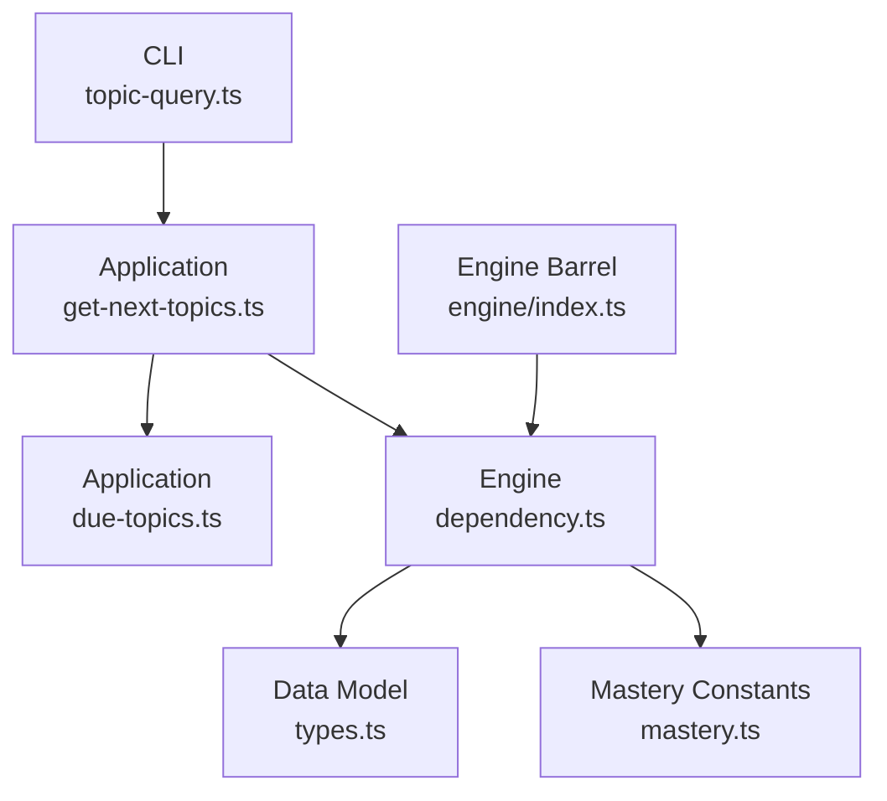
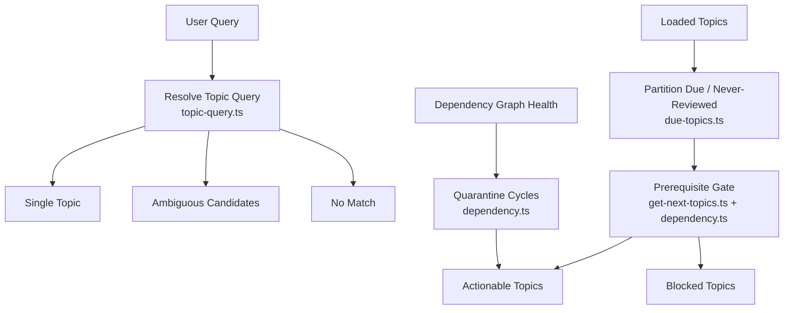
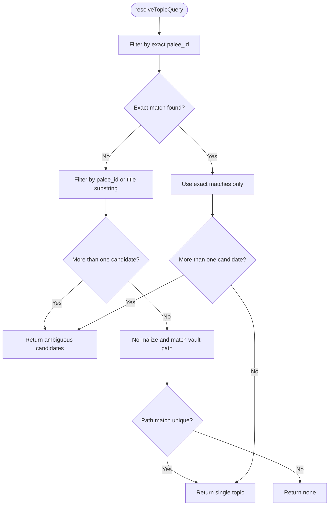
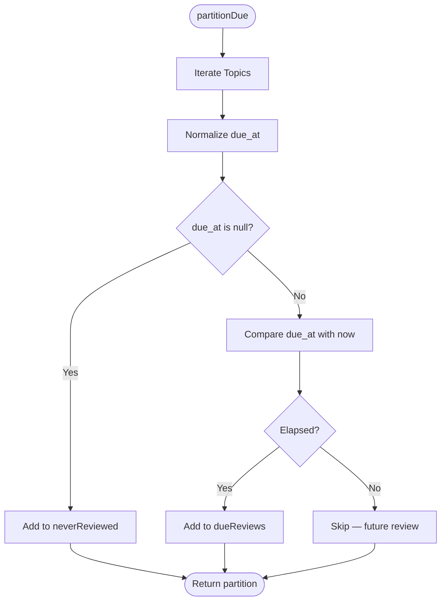
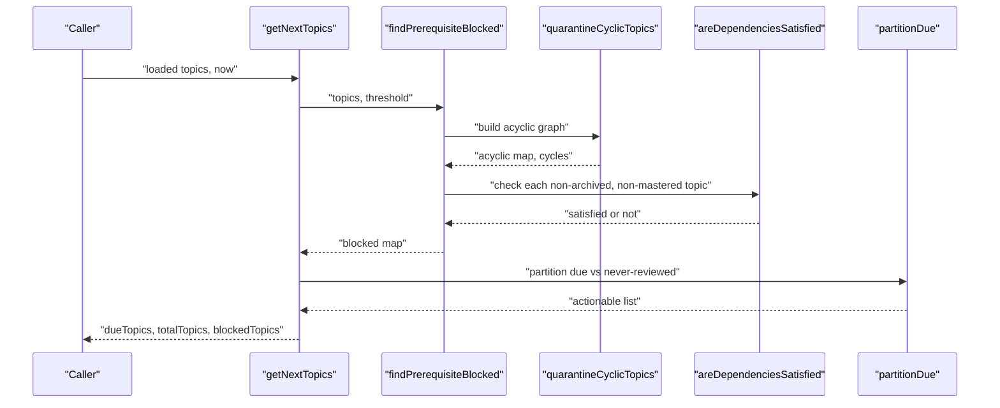
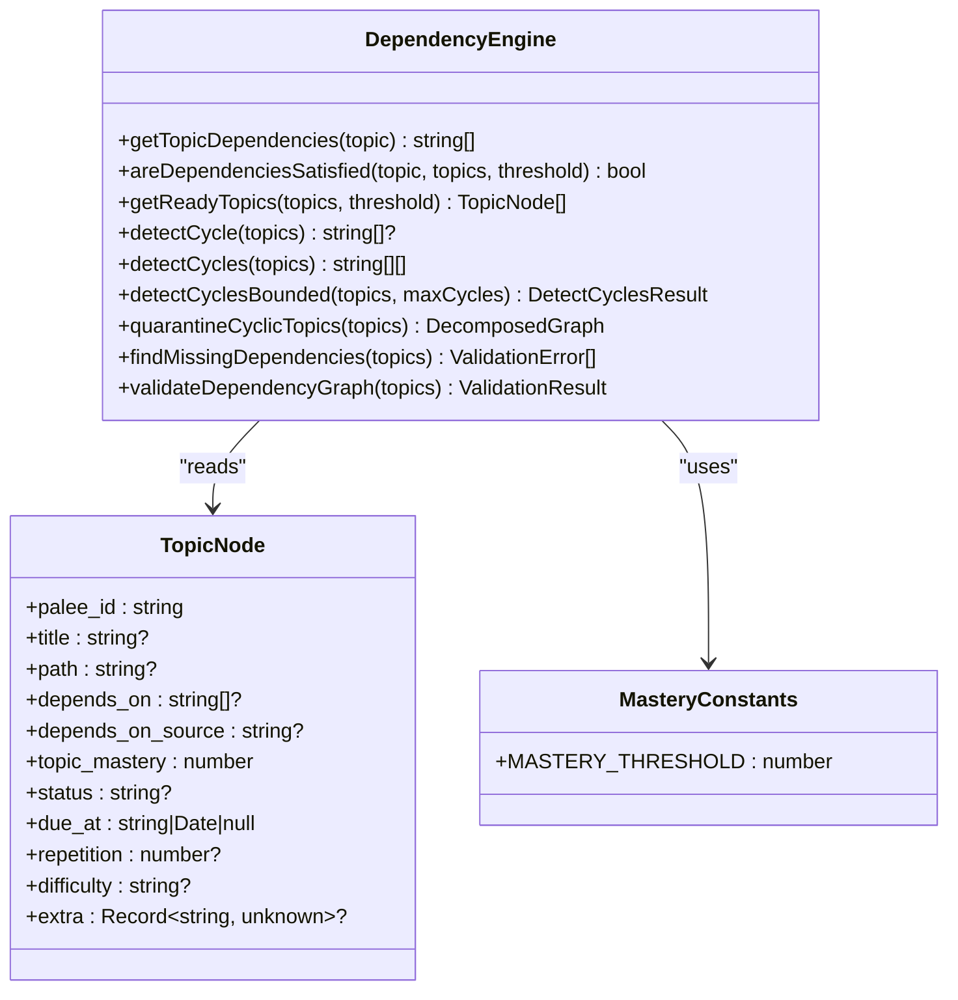
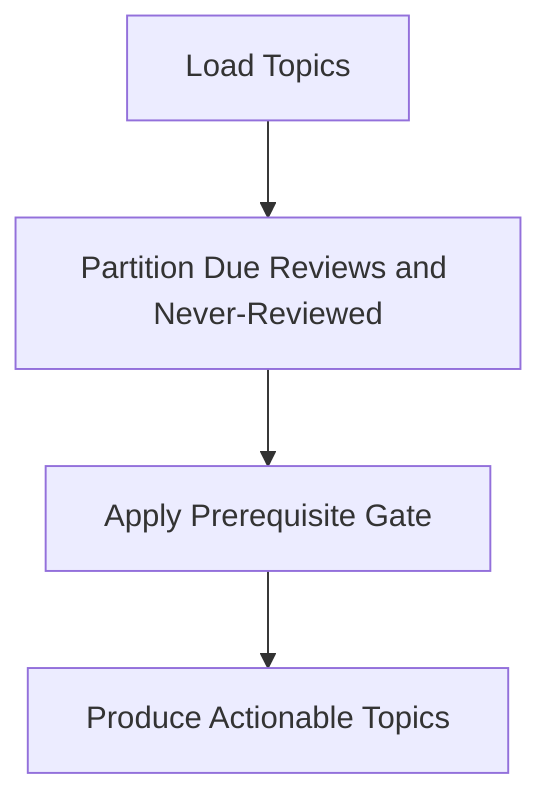
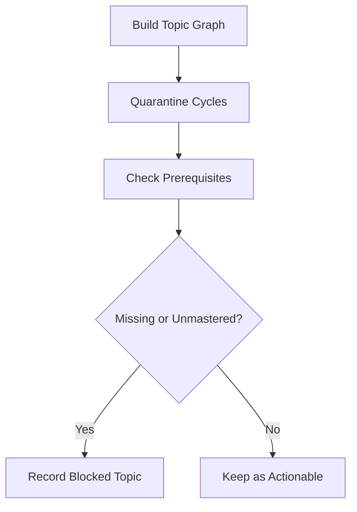
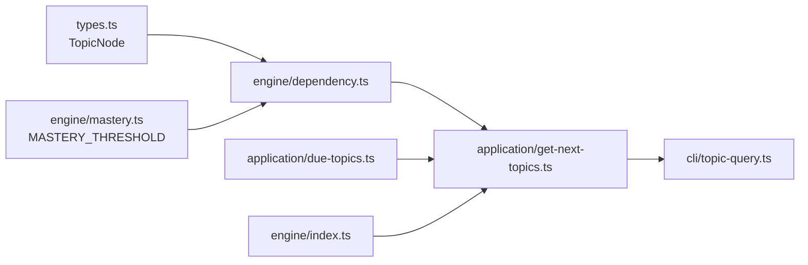

# Topic Discovery and Querying

::: details Referenced Files in This Document

- [topic-query.ts](https://github.com/Kuldeep2822k/cli/blob/main/src/cli/topic-query.ts)
- [due-topics.ts](https://github.com/Kuldeep2822k/cli/blob/main/src/application/due-topics.ts)
- [get-next-topics.ts](https://github.com/Kuldeep2822k/cli/blob/main/src/application/get-next-topics.ts)
- [dependency.ts](https://github.com/Kuldeep2822k/cli/blob/main/src/engine/dependency.ts)
- [index.ts](https://github.com/Kuldeep2822k/cli/blob/main/src/engine/index.ts)
- [mastery.ts](https://github.com/Kuldeep2822k/cli/blob/main/src/engine/mastery.ts)
- [types.ts](https://github.com/Kuldeep2822k/cli/blob/main/src/types.ts)

:::

## Table of Contents
1. [Introduction](#introduction)
2. [Project Structure](#project-structure)
3. [Core Components](#core-components)
4. [Architecture Overview](#architecture-overview)
5. [Detailed Component Analysis](#detailed-component-analysis)
6. [Dependency Analysis](#dependency-analysis)
7. [Performance Considerations](#performance-considerations)
8. [Troubleshooting Guide](#troubleshooting-guide)
9. [Conclusion](#conclusion)

## Introduction
This document explains how PALEE discovers, filters, and queries topics for study planning, review scheduling, progress reporting, and vault health analysis. It focuses on:

- Finding due or actionable topics using mastery level, status, and SM-2 scheduling state.
- Filtering by prerequisite relationships through the dependency graph engine.
- Resolving user-supplied topic queries to a specific note.
- Planning study sessions by combining due-topic logic with prerequisite gating.
- Generating reports and analyzing vault health by inspecting missing dependencies, cycles, readiness, and mastery distribution.

The implementation is intentionally layered: CLI argument parsing and output formatting live at the command layer, pure discovery logic lives in application use cases, and graph traversal plus mastery checks live in the engine. This separation makes query behavior predictable, testable, and reusable across commands such as `next`, `plan`, `dashboard`, `assess`, `review`, and `progress`.

## Project Structure
Topic discovery spans four layers:

| Layer | Responsibility | Key Files |
|---|---|---|
| CLI resolution | Resolves a learner’s topic query (ID, title substring, or vault path) into one topic or an ambiguity error. | [topic-query.ts](https://github.com/Kuldeep2822k/cli/blob/main/src/cli/topic-query.ts) |
| Application use cases | Computes due partitions, actionable sets, blocked topics, and next-topic ordering. | [due-topics.ts](https://github.com/Kuldeep2822k/cli/blob/main/src/application/due-topics.ts), [get-next-topics.ts](https://github.com/Kuldeep2822k/cli/blob/main/src/application/get-next-topics.ts) |
| Engine | Implements dependency graphs, cycle detection, readiness, prerequisite satisfaction, and missing-dependency detection. | [dependency.ts](https://github.com/Kuldeep2822k/cli/blob/main/src/engine/dependency.ts), [index.ts](https://github.com/Kuldeep2822k/cli/blob/main/src/engine/index.ts), [mastery.ts](https://github.com/Kuldeep2822k/cli/blob/main/src/engine/mastery.ts) |
| Data model | Defines `TopicNode` fields used by every discovery operation: ID, title, path, mastery, status, prerequisites, and SM-2 review state. | [types.ts](https://github.com/Kuldeep2822k/cli/blob/main/src/types.ts) |

## Core Components
This section summarizes the core types and primitives that power topic discovery.

### Topic Node Fields Relevant to Discovery
| Field | Meaning for Discovery | Typical Filter Use |
|---|---|---|
| `palee_id` | Stable topic identifier. | Exact query match; deterministic sorting. |
| `title` | Human-readable topic name. | Substring search during query resolution. |
| `path` | Vault-relative file path. | Exact path matching after normalization. |
| `depends_on` | Prerequisite topic IDs. | Prerequisite gating and dependency traversal. |
| `depends_on_source` | Origin of dependency edges. | Advisory edges (`toc`, `tie`) do not gate readiness. |
| `topic_mastery` | Computed mastery score from 0.0 to 1.0. | Readiness threshold, progress reports, and mastery-level filtering. |
| `status` | Learning lifecycle state. | Exclude archived topics; group new, learning, paused, mastered states. |
| `due_at` | Next review timestamp. | Compute due vs. never-reviewed vs. upcoming reviews. |
| `repetition` | SM-2 repetition count. | Prioritize newer learners or analyze review history. |
| `difficulty` | Optional difficulty classification. | Secondary sort or session planning hints. |
| `extra` | Arbitrary frontmatter keys. | Metadata-based discovery when callers read this field. |

### Readiness Threshold
The default mastery threshold used to decide whether a prerequisite is considered satisfied is defined centrally.

| Constant | Value | Purpose |
|---|---:|---|
| `MASTERY_THRESHOLD` | `0.7` | Minimum prerequisite mastery for gating and readiness. |

## Architecture Overview
Topic discovery follows a layered pipeline:

1. **Query Resolution**: A user query is resolved to a single `LoadedTopic` when possible. The resolver prefers exact `palee_id` matches, then title or ID substring matches, then normalized vault path matches. Ambiguity returns all candidates.
2. **Due Partitioning**: Topics are split into never-reviewed topics and elapsed due reviews. Future-due topics are excluded from actionable sets.
3. **Prerequisite Gating**: The dependency engine determines whether prerequisites are satisfied. Advisory edges do not block study; missing or unmastered gated prerequisites do.
4. **Result Construction**: Actionable topics are ordered never-reviewed first, then by oldest due date. Blocked topics are reported separately with human-readable waiting-on phrases.
5. **Graph Health**: Cycle detection, missing dependency detection, and quarantine identify structural problems affecting discovery.

## Detailed Component Analysis

### Topic Query Resolution
The query resolver supports three matching strategies:

1. Exact `palee_id` match.
2. Substring match against `palee_id` or lowercase `title`.
3. Normalized exact vault path match.

Path normalization folds backslashes to forward slashes, drops a leading `./`, and lowercases on Windows. On POSIX systems, path casing remains significant because filesystem lookup is case-sensitive.

The result type distinguishes three outcomes:

| Outcome | Meaning |
|---|---|
| `single` | Exactly one topic matched. |
| `ambiguous` | Multiple candidates matched; caller should present options. |
| `none` | No topic matched. |

### Due-Topic Partitioning
The due-topic partitioner separates topics into two buckets:

- `dueReviews`: topics whose scheduled due date has elapsed.
- `neverReviewed`: topics without a valid due date.

Future-due topics belong to neither bucket. Callers can combine both buckets to define “actionable” work, as `next` and `plan` do.

### Next-Topic Selection and Prerequisite Gating
The next-topic use case combines due-topic selection with prerequisite gating. Its main responsibilities are:

- Build a graph view over all loaded topics.
- Quarantine nodes on or downstream of dependency cycles.
- Identify topics blocked by unmet prerequisites.
- Construct the actionable set as never-reviewed topics followed by due reviews.
- Sort actionable topics by due date, with never-scheduled topics first.
- Separate blocked topics with human-readable blocker descriptions.

Key concepts:

| Concept | Behavior |
|---|---|
| Actionable topics | Union of never-reviewed and due reviews. |
| Blocked topics | Due topics withheld because a prerequisite is missing, unmastered, or otherwise unsatisfied. |
| Advisory edges | Edges from `toc` or `tie` do not gate readiness. |
| Missing dependencies | Reported as missing rather than merely unmastered. |
| Archived topics | Skipped by readiness but included in graph construction so their absence does not become a false missing dependency. |
| Cycle involvement | Topics on or downstream of cycles are quarantined; they are not reported as simply “blocked.” |

### Dependency Graph Engine
The dependency engine provides the foundational operations used by discovery and reporting:

| Operation | Purpose | Complexity Notes |
|---|---|---|
| `getTopicDependencies` | Reads canonical prerequisite IDs from a topic node. | O(1). |
| `areDependenciesSatisfied` | Checks existence and mastery of gated prerequisites. | Linear in number of prerequisites. |
| `getReadyTopics` | Finds unmastered, non-archived topics with satisfied prerequisites. | Linear scan plus sorting by ID. |
| `detectCycle` | Returns the lexicographically smallest cycle path. | Bounded; avoids enumerating all cycles. |
| `detectCycles` | Enumerates distinct elementary cycles. | Uses SCC decomposition plus Johnson-style enumeration; may be exponential in cycle count. |
| `detectCyclesBounded` | Same enumeration capped at a configurable maximum. | Guarantees bounded output via truncation flag. |
| `quarantineCyclicTopics` | Removes cyclic and downstream nodes from working graph. | One graph decomposition plus reverse reachability. |
| `findMissingDependencies` | Reports dangling prerequisite references. | Linear in total dependency edges. |
| `validateDependencyGraph` | Combines missing-dependency and cycle validation. | Depends on underlying engine functions. |

### Data Flow for Common Discovery Scenarios

#### Scenario 1: Find Topics Ready for Review
1. Load topics.
2. Partition by due date.
3. Apply prerequisite gate.
4. Exclude archived and already-mastered topics.
5. Sort actionable results.

#### Scenario 2: Identify Topics Missing Prerequisites
1. Build full topic graph.
2. Quarantine cyclic components.
3. For each non-archived, non-mastered topic, check prerequisites.
4. Collect topics where prerequisites are missing or below mastery threshold.
5. Produce human-readable waiting-on phrases.

#### Scenario 3: Locate Topics at Specific Mastery Levels
Discovery operates on `topic_mastery`, which is compared against `MASTERY_THRESHOLD` for readiness. To find topics at a particular mastery range, callers should filter loaded `TopicNode` objects by that numeric field. Mastery itself is computed elsewhere; discovery consumes it as a numeric value between 0.0 and 1.0.

## Dependency Analysis
The discovery pipeline depends on well-defined contracts between layers.

## Performance Considerations
Large vaults require careful attention to graph complexity and repeated scans.

### Complexity Summary
| Operation | Time Complexity | Practical Implication |
|---|---:|---|
| Query resolution by ID/title/path | Linear in loaded topics | Fast for typical vault sizes; becomes O(N) per query. |
| Due partitioning | O(N) | Cheap; dominates only when combined with heavy graph work. |
| Prerequisite satisfaction | O(D) per topic, where D is dependency count | Heavy graphs increase per-topic cost. |
| Cycle detection | O(V + E) plus Johnson-style enumeration | Enumeration can be exponential in number of cycles; use bounded form. |
| Quarantine | O(V + E) | Safe for large graphs because membership uses SCC structure, not cycle enumeration. |
| Missing dependency scan | O(E) | Scales with total dependency edges. |

### Optimization Strategies
- **Reuse loaded topics**: Avoid reloading the vault for multiple discovery queries within the same session.
- **Precompute the graph**: Build the topic map once before running multiple readiness or blocking queries.
- **Use bounded cycle enumeration**: Commands that display cycles should prefer `detectCyclesBounded` to avoid pathological waits.
- **Limit scope**: When investigating a subset of topics, pass only relevant nodes to discovery functions instead of scanning the entire vault.
- **Avoid redundant filtering**: Perform status, mastery, and path filters after graph-based decisions when possible, so expensive graph work is not wasted on excluded topics.
- **Cache advisory-only edges**: Advisory dependencies (`toc`, `tie`) do not gate readiness; keep them for ordering and visualization but skip them during prerequisite checks.
- **Index by stable identifiers**: Since `palee_id` is the canonical key, index topics by ID for O(1) lookups during dependency traversal.
- **Separate report generation**: Generate progress reports by iterating over precomputed partitions rather than recomputing readiness repeatedly.

## Troubleshooting Guide

### A Topic Query Resolves to Ambiguous Candidates
**Symptoms**: A query matches multiple topics by ID substring, title substring, or path.  
**Likely Causes**:
- Two topics share part of their `palee_id`.
- Two topics have similar titles.
- Path normalization produces unexpected equality on Windows or with different separators.

**Resolution**:
- Prefer exact `palee_id`.
- Use the full vault path printed by PALEE commands.
- Disambiguate by narrowing the substring or switching to exact path matching.

### A Topic Is Not Showing Up as Due
**Symptoms**: A topic appears actionable even though its review is upcoming, or vice versa.  
**Likely Causes**:
- `due_at` is absent, empty, or malformed, causing it to be treated as never reviewed.
- The due date is still in the future.
- The topic is archived or already mastered, so readiness logic excludes it.

**Resolution**:
- Inspect `due_at` and confirm it parses to a valid date.
- Confirm the current time comparison.
- Check `status` and `topic_mastery`.

### A Topic Is Blocked by Prerequisites
**Symptoms**: A topic is due but hidden from actionable results.  
**Likely Causes**:
- A required prerequisite is missing from the vault.
- A required prerequisite has mastery below `MASTERY_THRESHOLD`.
- The topic is not archived and not yet mastered.
- The dependency edge is a gated source rather than an advisory `toc` or `tie` edge.

**Resolution**:
- Review the blocked topic’s waiting-on details.
- Study the prerequisite first.
- Verify `depends_on_source` if the edge was auto-generated.
- Run vault validation to detect missing or circular dependencies.

### A Topic Appears Ready But Should Be Blocked
**Symptoms**: An expected prerequisite did not gate the topic.  
**Likely Causes**:
- The dependency came from a listing document (`toc`) or filename collation (`tie`).
- These edges are advisory and do not gate readiness.
- The prerequisite mastery is already at or above the threshold.

**Resolution**:
- Inspect `depends_on_source`.
- Treat advisory edges as ordering guidance, not hard gates.
- Raise the prerequisite mastery above the threshold if it is below.

### Vault Has Circular Dependencies
**Symptoms**: Discovery shows quarantine behavior, missing ordering, or truncated cycle reports.  
**Likely Causes**:
- A direct self-loop.
- A multi-node cycle.
- Dense SCCs producing many elementary cycles.

**Resolution**:
- Use bounded cycle enumeration to inspect representative cycles.
- Quarantine removes cyclic and downstream nodes from the working graph.
- Fix the dependency declarations so prerequisites flow in one direction.
- Re-run validation after repair.

## Conclusion
PALEE’s topic discovery system separates user-facing query resolution, pure scheduling logic, and graph analysis. This design makes it straightforward to:

- Find due topics by combining SM-2 scheduling with prerequisite gating.
- Plan study sessions by prioritizing never-reviewed and overdue material while respecting learned dependencies.
- Analyze vault health by detecting missing dependencies, cycles, and quarantine effects.
- Generate progress reports by inspecting mastery, status, due dates, and prerequisite satisfaction.

For large vaults, the most important optimization principle is to reuse precomputed topic graphs, avoid redundant scans, and prefer bounded algorithms where cycle enumeration could otherwise grow exponentially. Proper indexing by `palee_id`, careful use of advisory edges, and clear distinction between due-date actionability and prerequisite readiness together produce reliable, predictable discovery behavior.

## References

- [topic-query.ts:1-97](https://github.com/Kuldeep2822k/cli/blob/main/src/cli/topic-query.ts#L1-L97)
- [get-next-topics.ts:1-199](https://github.com/Kuldeep2822k/cli/blob/main/src/application/get-next-topics.ts#L1-L199)
- [due-topics.ts:1-58](https://github.com/Kuldeep2822k/cli/blob/main/src/application/due-topics.ts#L1-L58)
- [dependency.ts:1-200](https://github.com/Kuldeep2822k/cli/blob/main/src/engine/dependency.ts#L1-L200)
- [index.ts:41-50](https://github.com/Kuldeep2822k/cli/blob/main/src/engine/index.ts#L41-L50)
- [mastery.ts:19-19](https://github.com/Kuldeep2822k/cli/blob/main/src/engine/mastery.ts#L19-L19)
- [types.ts:624-684](https://github.com/Kuldeep2822k/cli/blob/main/src/types.ts#L624-L684)
- [topic-query.ts:28-97](https://github.com/Kuldeep2822k/cli/blob/main/src/cli/topic-query.ts#L28-L97)
- [due-topics.ts:13-58](https://github.com/Kuldeep2822k/cli/blob/main/src/application/due-topics.ts#L13-L58)
- [get-next-topics.ts:20-199](https://github.com/Kuldeep2822k/cli/blob/main/src/application/get-next-topics.ts#L20-L199)
- [dependency.ts:930-1015](https://github.com/Kuldeep2822k/cli/blob/main/src/engine/dependency.ts#L930-L1015)
- [due-topics.ts:35-58](https://github.com/Kuldeep2822k/cli/blob/main/src/application/due-topics.ts#L35-L58)
- [dependency.ts:601-1015](https://github.com/Kuldeep2822k/cli/blob/main/src/engine/dependency.ts#L601-L1015)
- [get-next-topics.ts:150-199](https://github.com/Kuldeep2822k/cli/blob/main/src/application/get-next-topics.ts#L150-L199)
- [get-next-topics.ts:60-149](https://github.com/Kuldeep2822k/cli/blob/main/src/application/get-next-topics.ts#L60-L149)
- [types.ts:657-657](https://github.com/Kuldeep2822k/cli/blob/main/src/types.ts#L657-L657)
- [get-next-topics.ts:1-30](https://github.com/Kuldeep2822k/cli/blob/main/src/application/get-next-topics.ts#L1-L30)
- [due-topics.ts:1-20](https://github.com/Kuldeep2822k/cli/blob/main/src/application/due-topics.ts#L1-L20)
- [topic-query.ts:1-15](https://github.com/Kuldeep2822k/cli/blob/main/src/cli/topic-query.ts#L1-L15)
- [dependency.ts:201-588](https://github.com/Kuldeep2822k/cli/blob/main/src/engine/dependency.ts#L201-L588)
- [get-next-topics.ts:60-199](https://github.com/Kuldeep2822k/cli/blob/main/src/application/get-next-topics.ts#L60-L199)
- [types.ts:684-684](https://github.com/Kuldeep2822k/cli/blob/main/src/types.ts#L684-L684)
- [types.ts:644-655](https://github.com/Kuldeep2822k/cli/blob/main/src/types.ts#L644-L655)
