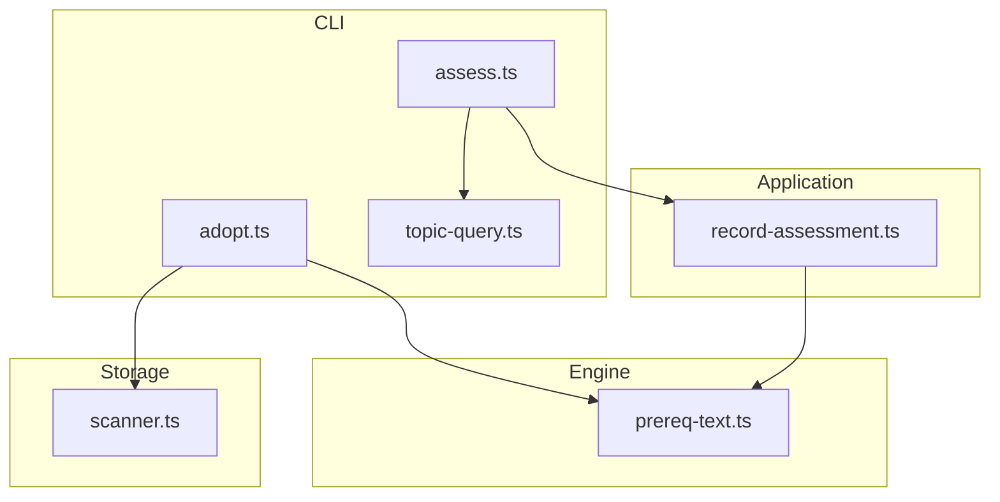
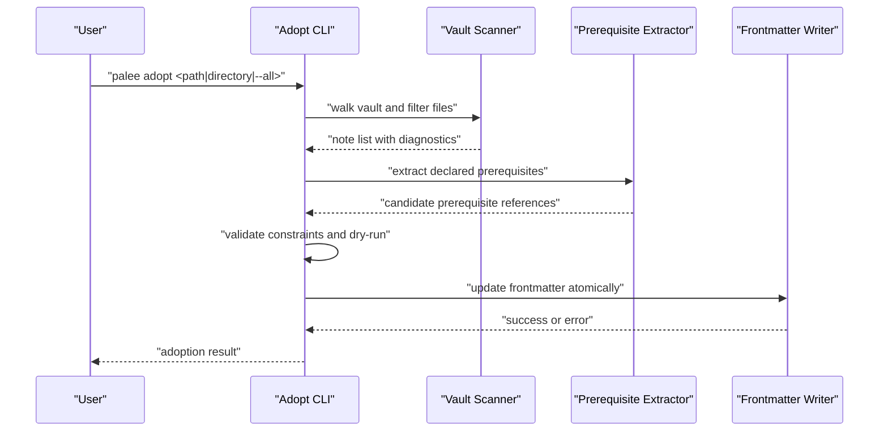
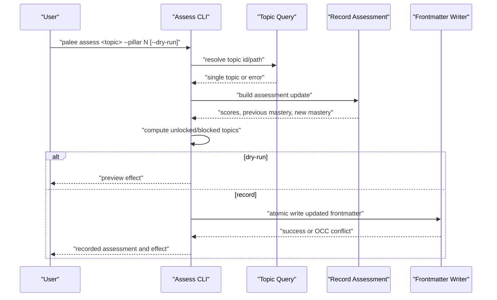
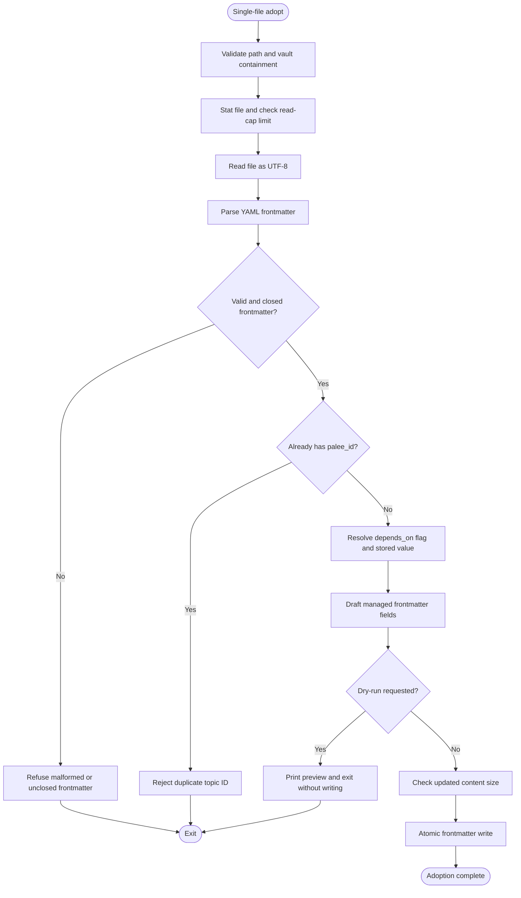
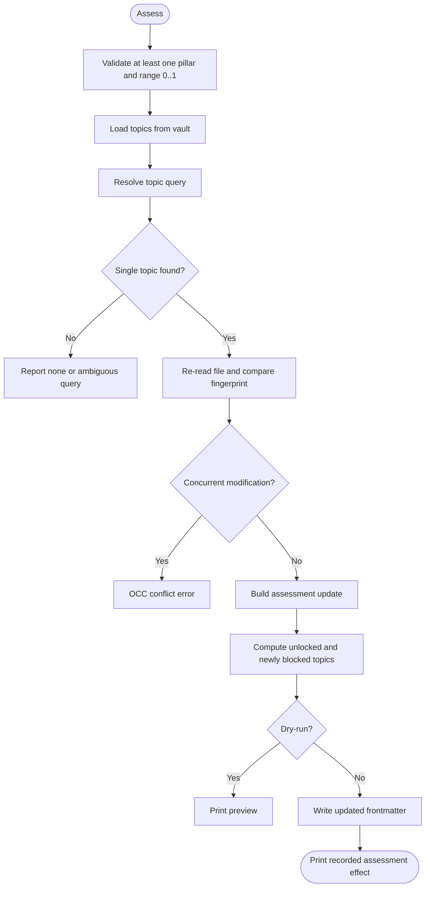
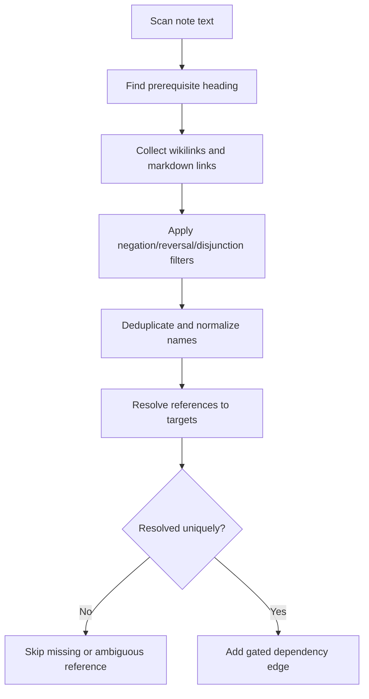
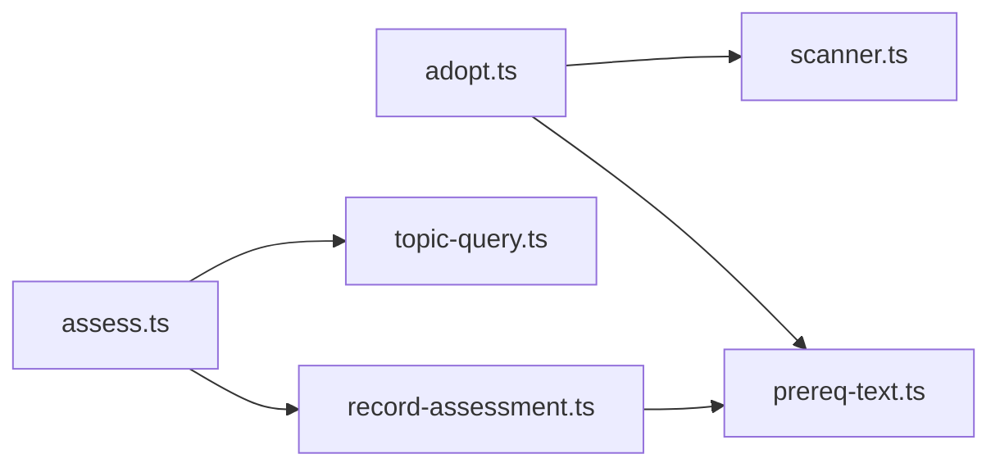

# Topic Management

::: details Referenced Files in This Document

- [adopt.ts](https://github.com/Kuldeep2822k/cli/blob/main/src/cli/adopt.ts)
- [assess.ts](https://github.com/Kuldeep2822k/cli/blob/main/src/cli/assess.ts)
- [topic-query.ts](https://github.com/Kuldeep2822k/cli/blob/main/src/cli/topic-query.ts)
- [record-assessment.ts](https://github.com/Kuldeep2822k/cli/blob/main/src/application/record-assessment.ts)
- [prereq-text.ts](https://github.com/Kuldeep2822k/cli/blob/main/src/engine/prereq-text.ts)
- [scanner.ts](https://github.com/Kuldeep2822k/cli/blob/main/src/storage/scanner.ts)
- [cli-adopt-batch.test.ts](https://github.com/Kuldeep2822k/cli/blob/main/test/cli-adopt-batch.test.ts)
- [cli-adopt-prereq-text.test.ts](https://github.com/Kuldeep2822k/cli/blob/main/test/cli-adopt-prereq-text.test.ts)

:::

## Table of Contents
1. [Introduction](#introduction)
2. [Project Structure](#project-structure)
3. [Core Components](#core-components)
4. [Architecture Overview](#architecture-overview)
5. [Detailed Component Analysis](#detailed-component-analysis)
6. [Dependency Analysis](#dependency-analysis)
7. [Performance Considerations](#performance-considerations)
8. [Troubleshooting Guide](#troubleshooting-guide)
9. [Conclusion](#conclusion)

## Introduction
This document explains how PALEE manages topics: turning existing Markdown notes into tracked learning units, recording pillar-based assessments, and querying or planning around topic dependencies. It focuses on the `adopt` and `assess` commands, prerequisite extraction from note text, topic discovery and resolution, vault organization best practices, common workflows, and troubleshooting for large vaults.

## Project Structure
Topic management spans four layers:
- CLI handlers parse user input and call application logic.
- Application use cases compute mastery changes and availability effects.
- Engine modules extract prerequisites and model dependency relationships.
- Storage utilities scan vault files, read frontmatter, and perform atomic writes.

## Core Components

### Adopt Command
The adopt command converts existing Markdown notes into managed topics. It supports:
- Single-file adoption by explicit path.
- Batch adoption over a directory or the entire vault with `--all`.
- Filtering through `--include`, `--exclude`, and `--tag`.
- Prerequisite extraction from a note’s own `## Prerequisites` section.
- Dependency declarations via `--depends-on`.
- Difficulty assignment from flags or existing frontmatter.
- Dry-run preview without modifying files.
- Automatic chain planning with `--auto-chain` and optional `--chain-tier`.

Key behaviors include:
- Vault containment checks reject paths outside the configured vault.
- Size limits prevent adopting oversized notes before reading or writing them.
- Malformed or unclosed YAML frontmatter blocks are refused to avoid identity loss.
- Existing `palee_id` values are rejected to prevent duplicate adoption.
- The command preserves hand-written `depends_on` unless overridden explicitly.
- Batch mode uses optimistic concurrency control and rollback journals for safety.

### Assess Command
The assess command records pillar scores for an existing topic and recomputes mastery. Pillars are:
- Conceptual
- Practical
- Debug
- Feynman

It integrates with spaced repetition by updating fields such as `topic_mastery`, `assessed_at`, and related scheduling metadata during frontmatter updates. Mastery determines whether a topic gates dependents in the planning system.

Important properties:
- At least one pillar score is required.
- Scores must be numbers between 0 and 1.
- `--dry-run` previews assessment effects without writing.
- `--force` suppresses warnings when a recorded assessment lowers mastery.
- Concurrent modifications are detected using file fingerprints.
- The report names topics newly offered or blocked by `palee plan`.

### Topic Query Resolution
Topic queries support three forms:
1. Exact `palee_id`.
2. Substring match against `palee_id` or title.
3. Exact vault-relative path.

Resolution order:
- Exact ID first, avoiding substring ambiguity.
- Title and ID substring matches grouped as candidates.
- Path fallback only when no ID/title match exists.

Ambiguity is surfaced to the caller rather than silently picking the first candidate.

### Prerequisite Text Extraction
PALEE reads a note’s own declared prerequisites from sections whose headings match conventional patterns such as “Prerequisites”, “Requirements”, or similar phrases. Within those sections:
- Wikilinks and markdown links become prerequisite references.
- Task items are ignored because they represent unfinished intentions.
- Negated, reversed, or disjunctive statements are excluded from gating edges.
- Code blocks, HTML comments, and inline code are ignored.
- References are deduplicated case-insensitively and normalized.

Extracted references are later resolved against an index; missing or ambiguous targets are skipped rather than failing the whole adoption run.

### Vault Scanning and Frontmatter Diagnostics
The scanner walks vault content and reports per-file frontmatter outcomes. It:
- Uses stat-first size checks to avoid reading oversized documents.
- Reads UTF-8 content.
- Parses YAML frontmatter and captures parser errors without aborting the scan.
- Detects body content accidentally parsed as frontmatter.
- Detects opening `---` fences with no closing fence.
- Sorts results deterministically by relative path.

## Architecture Overview

## Detailed Component Analysis

### Adopt Workflow
Adoption follows different paths depending on whether a single file or batch processing is requested.

#### Single-File Adoption Flow

#### Batch Adoption Flow
Batch adoption scans a target directory or the entire vault, applies filters, prints a preview, optionally asks for confirmation, and then adopts eligible notes. Important details:
- `--include`, `--exclude`, and `--tag` are validated early.
- Filters are measured and reported so users know whether a pattern matched anything.
- Tier-0 hygiene can skip template-like or navigation-only notes.
- `--auto-chain` synthesizes dependency edges from numbering or TOC structure.
- Rollback journals restore partially adopted notes if later steps fail.

### Assess Workflow
Assessment computes mastery from pillar scores and updates the note only after validation and concurrency checks.

### Prerequisite Chain Logic
Declared prerequisites are intentionally strict:
- Only explicit links under recognized heading sections count.
- Hedged language is not treated as a reliable gate.
- Ambiguous references are skipped.
- Declared edges replace inferred ordering edges when present.

## Dependency Analysis

## Performance Considerations
For large vaults:
- Prefer targeted adoption directories instead of `--all` when possible.
- Use `--include` and `--exclude` patterns to reduce scanned scope.
- Run `--dry-run` first to validate filters and preview counts.
- Avoid unnecessary re-writes by confirming that a note already has `palee_id` before attempting adoption.
- Keep notes under the source read cap so the scanner does not repeatedly reject oversized files.
- Batch operations benefit from deterministic scanning order and size prechecks.

## Troubleshooting Guide

### Duplicate Topic IDs
Symptoms:
- Adopt refuses a note that already contains `palee_id`.

Resolution:
- Confirm whether the note was previously adopted.
- If it was imported incorrectly, repair the frontmatter using validation tools before retrying.
- Do not manually edit `palee_id` without understanding identity preservation.

### Missing Dependencies
Symptoms:
- Warnings about `--depends-on` IDs matching no adopted topic.
- Edges remaining dangling until referenced topics exist.
- Validation may warn about missing dependencies rather than refusing adoption.

Resolution:
- Correct malformed dependency IDs so they follow the expected format.
- Adopt dependent topics before or alongside their prerequisites.
- Use `palee validate` to inspect graph integrity.

### Malformed Frontmatter
Symptoms:
- Errors mentioning malformed frontmatter.
- Messages about an opening `---` block with no closing delimiter.
- Body content accidentally parsed as YAML.

Resolution:
- Ensure every YAML frontmatter block opens and closes with `---`.
- Use a thematic break like `***` if you need a horizontal rule at the top of a note.
- Remove body content that leaks into the frontmatter region.
- Use scanner diagnostics to identify problematic files before bulk adoption.

### Ambiguous Topic Queries
Symptoms:
- Assess or other commands report multiple matching topics.

Resolution:
- Use an exact `palee_id`.
- Use a more specific title substring.
- Use the exact vault-relative path printed by PALEE output.

### Dry-Run Behavior
Expected behavior:
- `palee adopt --dry-run` prints what would change without modifying files.
- `palee assess --dry-run` prints mastery and availability effects without writing.

Common mistake:
- Expecting dry-run to commit changes. It does not.

## Best Practices

### Organizing Vault Content
- Group related study notes under meaningful directories.
- Separate templates, rubrics, and navigation notes from lesson content.
- Keep prerequisite chains aligned with module order when using automatic chaining.
- Reserve `.palee` and other internal directories for tool state.

### Naming Conventions for Topic IDs
- Use stable, human-readable identifiers rather than relying solely on filenames.
- Follow the expected identifier style documented by dependency warnings.
- Avoid special characters that could complicate shell quoting or path normalization.

### Structuring Prerequisite Chains
- Put explicit prerequisites under a dedicated section such as “Prerequisites” or “Requirements”.
- Link predecessors with wikilinks or markdown links.
- Avoid hedging phrasing if the link should gate the note.
- Use `--depends-on` sparingly and prefer author-stated prerequisites for clarity.

### Common Workflows

#### Adopt an Entire Directory of Study Notes
1. Configure the vault path.
2. Inspect with `palee adopt --dry-run --all` or a directory path.
3. Apply `--include` and `--exclude` to select relevant folders.
4. Review tier-0 hygiene skips for templates or navigation pages.
5. Run adoption with `-y` or interactive confirmation.
6. Verify results with planning and validation commands.

#### Set Up Learning Paths with Prerequisites
1. Author clear “Prerequisites” sections linking earlier lessons.
2. Adopt notes so each becomes a managed topic.
3. Confirm that dependent notes remain off the ready list until prerequisites are mastered.
4. Use `palee plan` to verify available next steps.

#### Bulk Update Topic Metadata
1. Use `palee assess` to record pillar scores across topics.
2. Use `--dry-run` to preview mastery changes and affected dependents.
3. Record assessments with `--force` only when intentionally lowering mastery.
4. Re-run planning to confirm unlocked or newly blocked topics.

## Conclusion
Topic management in PALEE combines careful file scanning, robust frontmatter handling, explicit prerequisite modeling, and mastery-driven planning. The adopt command turns existing notes into managed topics while preserving author intent, and the assess command ties pedagogical mastery to scheduling and readiness. For large vaults, disciplined filtering, safe dry-runs, and clear prerequisite documentation produce predictable, maintainable learning graphs.

## References

- [adopt.ts:201-531](https://github.com/Kuldeep2822k/cli/blob/main/src/cli/adopt.ts#L201-L531)
- [assess.ts:1-279](https://github.com/Kuldeep2822k/cli/blob/main/src/cli/assess.ts#L1-L279)
- [topic-query.ts:1-97](https://github.com/Kuldeep2822k/cli/blob/main/src/cli/topic-query.ts#L1-L97)
- [record-assessment.ts:1-134](https://github.com/Kuldeep2822k/cli/blob/main/src/application/record-assessment.ts#L1-L134)
- [prereq-text.ts:1-317](https://github.com/Kuldeep2822k/cli/blob/main/src/engine/prereq-text.ts#L1-L317)
- [scanner.ts:1-327](https://github.com/Kuldeep2822k/cli/blob/main/src/storage/scanner.ts#L1-L327)
- [cli-adopt-batch.test.ts:1-200](https://github.com/Kuldeep2822k/cli/blob/main/test/cli-adopt-batch.test.ts#L1-L200)
- [cli-adopt-prereq-text.test.ts:1-200](https://github.com/Kuldeep2822k/cli/blob/main/test/cli-adopt-prereq-text.test.ts#L1-L200)
