# User Guide

::: details Referenced Files in This Document

- [README.md](https://github.com/Kuldeep2822k/cli/blob/main/README.md)
- [program-name.ts](https://github.com/Kuldeep2822k/cli/blob/main/src/cli/program-name.ts)
- [types.ts](https://github.com/Kuldeep2822k/cli/blob/main/src/types.ts)
- [sm2.ts](https://github.com/Kuldeep2822k/cli/blob/main/src/engine/sm2.ts)
- [get-next-topics.ts](https://github.com/Kuldeep2822k/cli/blob/main/src/application/get-next-topics.ts)
- [due-topics.ts](https://github.com/Kuldeep2822k/cli/blob/main/src/application/due-topics.ts)
- [mastery-summary.ts](https://github.com/Kuldeep2822k/cli/blob/main/src/application/mastery-summary.ts)
- [next.ts](https://github.com/Kuldeep2822k/cli/blob/main/src/cli/next.ts)
- [plan.ts](https://github.com/Kuldeep2822k/cli/blob/main/src/cli/plan.ts)
- [review.ts](https://github.com/Kuldeep2822k/cli/blob/main/src/cli/review.ts)
- [assess.ts](https://github.com/Kuldeep2822k/cli/blob/main/src/cli/assess.ts)
- [session.ts](https://github.com/Kuldeep2822k/cli/blob/main/src/cli/session.ts)
- [adopt.ts](https://github.com/Kuldeep2822k/cli/blob/main/src/cli/adopt.ts)
- [roadmap.ts](https://github.com/Kuldeep2822k/cli/blob/main/src/cli/roadmap.ts)
- [progress.ts](https://github.com/Kuldeep2822k/cli/blob/main/src/cli/progress.ts)
- [validate.ts](https://github.com/Kuldeep2822k/cli/blob/main/src/cli/validate.ts)
- [0004-four-pillar-pedagogical-mastery.md](https://github.com/Kuldeep2822k/cli/blob/main/docs/adr/0004-four-pillar-pedagogical-mastery.md)
- [0012-declared-prerequisites.md](https://github.com/Kuldeep2822k/cli/blob/main/docs/adr/0012-declared-prerequisites.md)
- [Docker Fundamentals.md](https://github.com/Kuldeep2822k/cli/blob/main/examples/Docker%20Fundamentals.md)
- [Docker Volumes.md](https://github.com/Kuldeep2822k/cli/blob/main/examples/Docker%20Volumes.md)
- [Docker Networking.md](https://github.com/Kuldeep2822k/cli/blob/main/examples/Docker%20Networking.md)

:::

## Table of Contents
1. [Introduction](#introduction)
2. [Core Concepts](#core-concepts)
3. [Topic Lifecycle](#topic-lifecycle)
4. [Daily Study Workflow](#daily-study-workflow)
5. [Advanced Workflows](#advanced-workflows)
6. [Practical Examples](#practical-examples)
7. [Performance and Large Vault Guidance](#performance-and-large-vault-guidance)
8. [Troubleshooting and Recovery](#troubleshooting-and-recovery)
9. [Conclusion](#conclusion)

## Introduction
PALEE is a deterministic, spaced-repetition study engine for Obsidian vaults. It treats your notes as the data store, adds structured metadata through YAML frontmatter, schedules reviews using SM-2, and gates new learning behind prerequisite mastery. The CLI exposes commands to adopt notes, discover what to study next, record reviews and assessments, plan sessions, track progress, manage durable session context, validate vault integrity, and import roadmaps.

Key capabilities from a user perspective:
- Topic notes live in your vault alongside normal Markdown content.
- Spaced repetition determines when a topic is due.
- Prerequisite relationships prevent you from studying topics before their dependencies are ready.
- Four-pillar assessment tracks conceptual, practical, debug, and Feynman dimensions.
- Sessions preserve continuity between work intervals through hot memory and full session logs.

## Core Concepts

### Topics as Structured Markdown Notes
A PALEE topic is a Markdown note with a YAML frontmatter block containing metadata such as schema version, unique identifier, title, difficulty, dependencies, mastery scores, and spaced-repetition state. The vault itself is the source of truth; PALEE reads and writes these frontmatter fields rather than duplicating content into a separate database.

Important frontmatter fields include:
- `palee_schema`: Schema version used by PALEE.
- `palee_id`: Stable topic identifier.
- `title`, `difficulty`, `status`: Human-readable and lifecycle metadata.
- `depends_on` or `dependencies`: IDs of prerequisite topics.
- `topic_mastery`: Derived composite score across four pillars.
- `conceptual`, `practical`, `debug`, `feynman`: Pillar scores.
- `assessed_at`: When pillar assessment was last recorded.
- SM-2 review fields: `ease_factor`, `interval_days`, `repetition`, `lapses`, `last_quality`, `last_reviewed_at`, `due_at`.

The example Docker notes demonstrate this structure: fundamentals has no prerequisites, while volumes and networking depend on fundamentals.

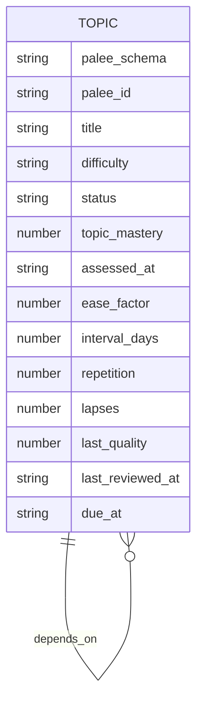

### The SM-2 Spaced Repetition Algorithm
SM-2 controls *when* you should review a topic, not whether you have mastered it conceptually. Each review updates:
- Ease factor: how quickly intervals grow.
- Interval days: the spacing between future reviews.
- Repetition count: successful review steps.
- Lapses: failed attempts after prior repetitions.
- Due date: next scheduled review time.

Quality ratings are integers from 0 to 5:
- 0–2: failure; repetition resets, interval becomes one day, lapse counter may increase.
- 3–5: success; repetition increases and interval expands based on ease factor.

The algorithm caps intervals at 36,500 days to avoid corrupt calendar dates over long histories. Invalid stored values are rejected defensively so bad frontmatter cannot silently produce invalid scheduling numbers.

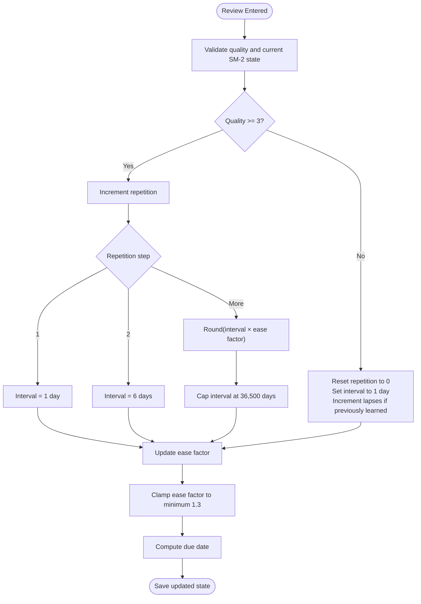

### Four-Pillar Mastery Model
Mastery measures *what you know*, while SM-2 measures *when to review*. They are complementary:
- Conceptual understanding.
- Practical application.
- Debugging ability.
- Feynman articulation (double-weighted).

The composite mastery formula weights Feynman more heavily because explaining something simply is treated as strong evidence of real understanding. A topic reaches the standard mastery gate at 0.70. Because Feynman is double-weighted, scoring only the other three pillars can reach 0.60 but never 0.70, so a non-zero Feynman score is required to pass the gate.

This model matters most during assessment. A review adjusts scheduling; an assessment adjusts mastery and can unlock or rehide dependent topics.

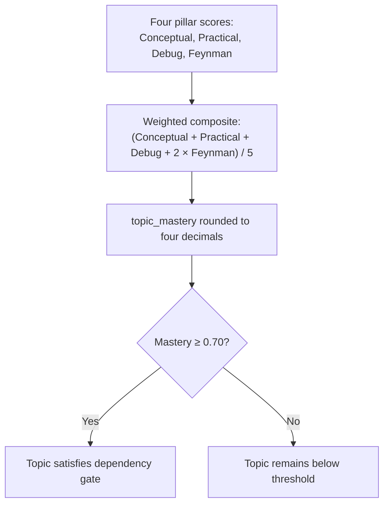

### Prerequisite Relationships and Gating
Prerequisites define which topics must be studied before others become available. They can come from:
- Explicit frontmatter `depends_on` or `dependencies`.
- Numbered or ordered curriculum trees.
- Declared prerequisites inside a note’s text.

PALEE does not recommend or offer gated topics in `next` or `plan`. If a prerequisite is missing, ambiguous, or below the mastery threshold, the dependent topic is withheld and explained.

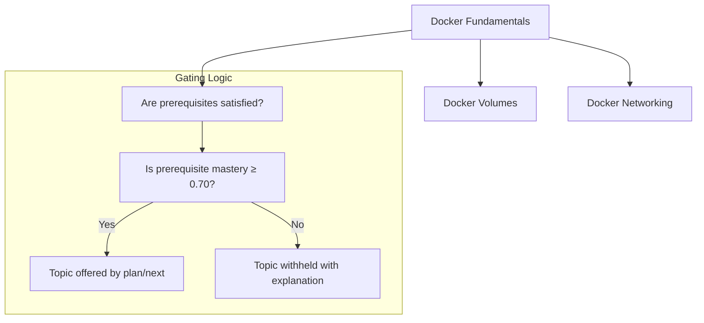

## Topic Lifecycle
A topic moves through several states as you adopt it, study it, assess it, and review it.

| Stage | What Happens | Typical Command | Result |
|---|---|---|---|
| Unadopted | Ordinary Markdown note without PALEE metadata. | None yet. | No scheduling or gating. |
| Adopted | Frontmatter is added; topic ID, title, difficulty, dependencies, and initial review state are created. | `palee adopt <path>` | Topic enters the vault graph. |
| Not Started | First adopted state; no review history. | `palee next` | Treated as actionable now. |
| Learning | Reviewed at least once; SM-2 scheduling begins. | `palee review <id> <quality>` | Future due dates are computed. |
| Assessed | Four-pillar scores are recorded. | `palee assess <id> --conceptual ... --practical ... --debug ... --feynman ...` | `topic_mastery` recomputed; gates may open or close. |
| Mastered | Composite mastery reaches or exceeds 0.70. | Assessment-driven. | Depends on this topic can become available. |
| Archived | Topic removed from active study flow. | Status management in frontmatter. | Excluded from `next`, `plan`, and progress summaries. |
| Paused | Intentionally suspended. | Status management in frontmatter. | Behavior depends on command-specific filtering. |

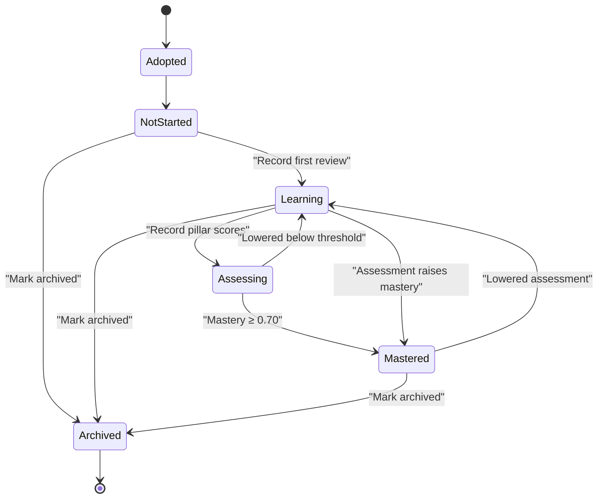

## Daily Study Workflow

### Discover What to Study Next
Use `palee next` to find the next actionable topic. Actionable topics are:
- Never-reviewed topics.
- Reviews whose due date has passed.
- Topics whose prerequisites are satisfied.
- Active topics that are not archived.

If everything is blocked, `next` explains which prerequisites are preventing progress. If nothing is actionable, it reports either a blocked state or that no topic is due.

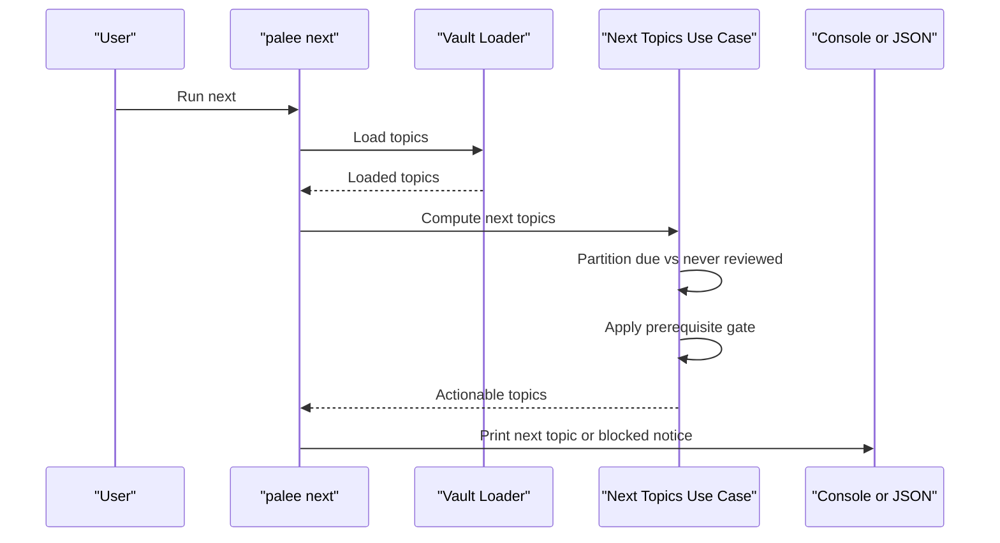

### Build a Study Session Plan
Use `palee plan` for a fuller daily view. It shows:
- Reviews due.
- Topics ready to learn.
- Dependency cycles quarantined for ordering purposes.
- Topics blocked by unmet prerequisites.
- Mastery buckets: mastered, learning, new.

`plan` excludes archived topics from derived lists while keeping them in the graph where necessary for correct prerequisite evaluation.

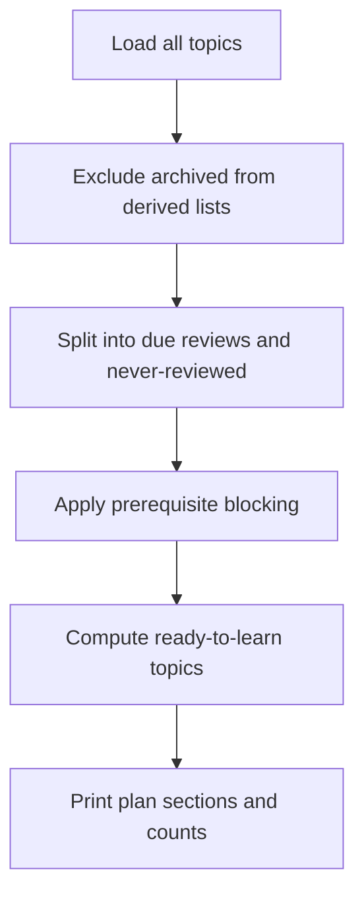

### Conduct a Review
After studying a topic, record its recall quality:

```bash
palee review <topic-id-or-title-substring> <quality>
```

Where `<quality>` is an integer from 0 to 5. The command:
- Validates the quality value.
- Resolves the topic uniquely.
- Recomputes SM-2 state.
- Writes updated frontmatter atomically.
- Reports new ease factor, interval, due date, and repetition count.

An early review still records the result even if the note is not due yet, but warns unless you explicitly pass `--force`. This prevents accidental schedule compounding without blocking useful off-schedule practice.

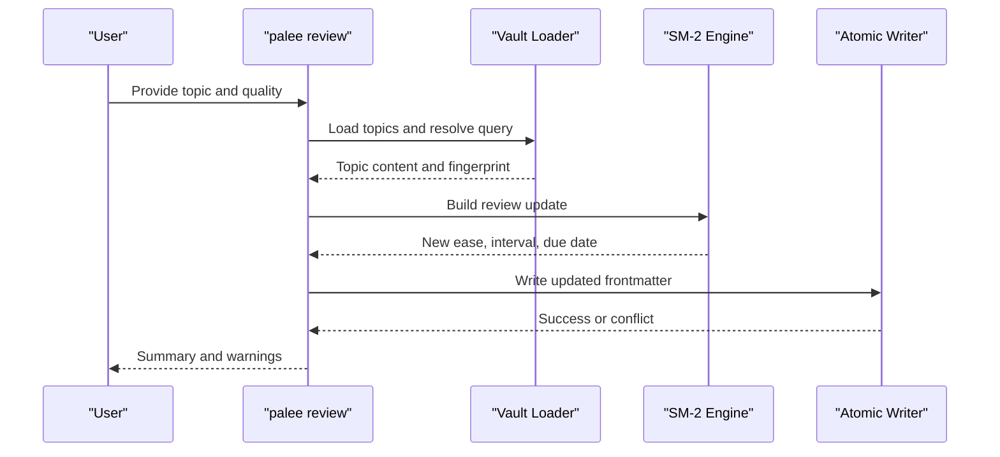

### Record a Four-Pillar Assessment
Use assessment to evaluate mastery across the four pedagogical dimensions:

```bash
palee assess <topic-id-or-title-substring> \
  --conceptual 0.8 \
  --practical 0.7 \
  --debug 0.6 \
  --feynman 0.9
```

Each pillar expects a number from 0 to 1. You do not need to provide every pillar; omitted pillars keep their existing values. The command:
- Parses and validates pillar inputs.
- Recomputes `topic_mastery`.
- Updates pillar scores and assessment timestamp.
- Shows how mastery changed.
- Names topics newly unlocked or newly hidden behind the mastery gate.
- Supports `--dry-run` to preview changes without writing.
- Supports `--force` to suppress lowering warnings when recording.

Because mastery is derived from pillar scores, assessment is the primary way to raise a topic above the 0.70 gate.

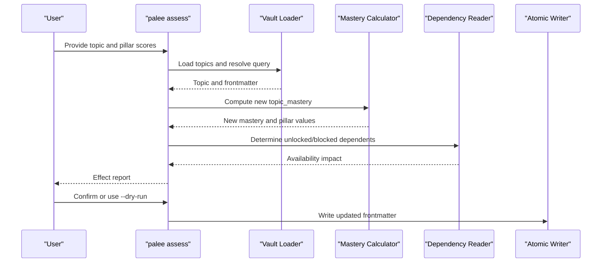

### Track Progress
Use `palee progress` to view aggregate mastery statistics or inspect a single topic’s progress. Aggregate output includes:
- Active and archived topic counts.
- Global mastery percentage.
- Mastery health status.
- Mastery buckets.
- Difficulty breakdowns.
- Per-topic details when requested.

Per-topic progress shows mastery, difficulty, repetition, lapses, last assessment date, and last review date. Date-only values are displayed in local calendar form rather than UTC midnight.

## Advanced Workflows

### Batch Adoption of Existing Notes
Adoption turns ordinary notes into PALEE-managed topics. Common patterns include:
- Single-file adoption.
- Pattern-based batch adoption.
- Auto-chaining dependencies from numbered or ordered curriculum structures.
- Reading declared prerequisites from note text.
- Dry-run previews.
- Undoing an adoption while preserving unrelated frontmatter.

Auto-chain behavior respects hygiene rules and chain tiers. In strict mode, only numbered items are consumed; in full mode, listing order also participates in chaining. Chain decisions can synthesize `depends_on` edges, but they do not override explicit author-written dependencies.

When adopting, PALEE avoids identity loss by minting stable topic IDs and preserving existing content. Batch operations include rollback support: if part of a batch fails, PALEE attempts to restore previously written notes to their original content.

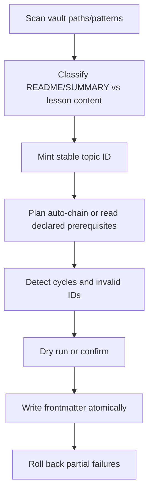

### Roadmap Planning and Import
Roadmaps let you import a planned set of topics deterministically without running AI or network calls. The `palee roadmap --from <file>` command:
- Parses roadmap input.
- Resolves wikilinks safely within the vault boundary.
- Applies optional auto-chaining by ascending `order` field.
- Skips edges that would close cycles.
- Validates topic IDs and dependency integrity.
- Writes or updates topic frontmatter atomically.

This is especially useful for curriculum authors who want to generate a reproducible dependency graph from a structured plan.

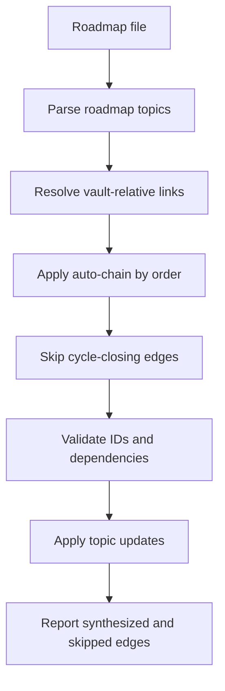

### Session Management
Sessions capture your active learning context between terminal invocations. Key concepts:
- Hot memory: a compact summary under `.palee/hot.md`.
- Full session notes: durable logs under `.palee/sessions/`.
- Draft checkpoints: recoverable intermediate state.
- Active session pointer: tells PALEE which session is currently in progress.

Common session commands:
- `palee session start`: Begin or resume a session; uses hot memory when available.
- `palee session draft`: Save a recoverable checkpoint.
- `palee session end`: Finalize the session and refresh hot memory.
- `palee session list`: Inspect completed sessions and pending drafts.

Session topic resolution supports an explicit `--topic` argument or falls back to the active topic stored in hot memory.

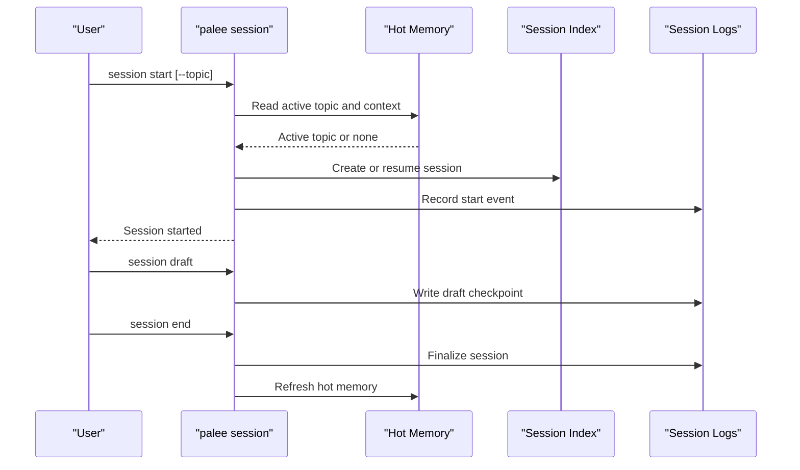

### Configuration and Provider Setup
Provider configuration is optional. Required setup for general operation is setting your vault path. Optional provider setup enables AI-powered features in later phases.

Important safety properties:
- API keys are accepted from stdin, environment variables, or interactive prompts—not command arguments.
- The key is stored securely on POSIX systems with restricted file permissions.
- `palee config show` masks the key.
- `test-connection` is the only command that directly contacts a network endpoint.
- Non-interactive or JSON runs refuse risky key operations without explicit flags.

## Practical Examples

### Example 1: Adopt Multiple Files with Prerequisite Chains
Suppose you have three Docker-related notes:
- `Docker Fundamentals.md`
- `Docker Volumes.md`
- `Docker Networking.md`

Steps:
1. Connect your vault: `palee config set-vault /path/to/vault`.
2. Adopt the base note first, or adopt all three in a batch pattern.
3. If the notes declare prerequisites or follow a numbered curriculum, enable auto-chaining.
4. Verify dependencies with `palee validate`.
5. Check readiness with `palee next` and `palee plan`.

Expected outcome:
- Fundamentals becomes available immediately.
- Volumes and networking remain gated until fundamentals is mastered.

### Example 2: Set Up a Prerequisite Chain Manually
If your notes already contain clear dependencies, you can write `depends_on` directly in frontmatter:

- `Docker Volumes.md` depends on `T-docker-fundamentals`.
- `Docker Networking.md` depends on `T-docker-fundamentals`.
- `Docker Fundamentals.md` has no dependencies.

After adoption, `palee plan` will show fundamentals as ready to learn and volumes/networking as blocked until fundamentals reaches mastery.

### Example 3: Manage a Study Session Across Terminal Invocations
1. Start a session: `palee session start`.
2. Study the recommended topic.
3. Record a review: `palee review <topic-id> <quality>`.
4. Optionally save a draft: `palee session draft`.
5. End the session: `palee session end`.
6. Later, resume: `palee session start`.

Hot memory ensures the next session starts near your previous position without loading the entire study log.

### Example 4: Interpret Progress Reports
Run `palee progress` to see:
- How many topics are active or archived.
- Overall mastery percentage.
- Whether your vault is in `no_data`, `learning`, or `mastered` health.
- Breakdowns by beginner, intermediate, and advanced difficulty.
- Per-topic mastery, repetition, lapses, and timestamps.

For machine-readable automation, add `--json` and parse fields like `global_mastery`, `counts`, and per-topic metrics.

### Example 5: Fix Corrupted Scheduling State
If SM-2 fields become invalid, `palee review` hints at repair. You can run:

```bash
palee validate --fix
```

This repairs:
- Derived views such as hot memory and session index.
- Recalculated topic mastery.
- Invalid SM-2 review fields.

Some repairs are safe and automatic; others require human judgment and are labeled accordingly.

## Performance and Large Vault Guidance

### Scanning and Caching
PALEE walks your vault to load topics. For large vaults:
- Avoid unnecessary glob patterns that match irrelevant directories.
- Prefer specific file paths or well-scoped patterns when adopting.
- Keep managed notes grouped where practical so scanners can operate efficiently.
- Use dry-run adoption to preview matches before writing.

### Atomic Writes and Concurrency
Every write uses atomic operations with optimistic concurrency checks. If another process modifies a topic concurrently, PALEE refuses the write and returns a lock conflict rather than silently overwriting your work. This protects correctness at the cost of occasional retries.

### Read Caps and Source Size Limits
Very large notes are bounded by source-cap limits. Overly large content can be reported diagnostically, and write paths respect note-read caps for adoption, roadmap imports, and related flows. This prevents extremely large files from dominating memory or I/O.

### Memory Budget Considerations
Hot memory is intentionally capped to keep session context compact. Full session logs preserve complete history, while hot memory summarizes the current learning position. This separation avoids forcing every future operation to load the entire history.

### Optimization Tips
- Keep prerequisites minimal and accurate.
- Avoid circular dependencies; PALEE quarantines cyclic components for ordering.
- Archive topics you no longer study instead of deleting them prematurely.
- Run `palee validate` regularly to detect structural issues early.
- Use `--dry-run` for adoption and roadmap imports before committing changes.
- Prefer stable topic IDs and explicit dependencies for predictable scheduling.

## Troubleshooting and Recovery

### Common Exit Codes
| Code | Meaning | Typical Cause |
|---|---|---|
| 0 | Success | Command completed normally. |
| 1 | Partial failure | Batch operations where some topics failed. |
| 2 | Usage or configuration refusal | Missing arguments, unconfigured vault, or refused unsafe operation. |
| 3 | Validation error | Malformed roadmap, invalid dependency, or similar data contract violation. |
| 4 | Optimistic concurrency conflict | Another process modified the same file. |
| 5 | Unexpected error | Internal exception or runtime failure. |

### Topic Not Found or Ambiguous Query
Commands that accept a topic argument resolve queries against vault-loaded topics. If no topic matches, the command names the query. If multiple topics match, it lists candidates and asks for a more specific identifier.

Recommended remedies:
- Use the exact `palee_id`.
- Narrow the substring.
- Check whether the topic is archived.
- Run `palee progress --topic "<query>"` to inspect matching behavior.

### Early Review Warning
Recording a review before the due date is allowed, but PALEE warns that the interval compounds off-schedule. Pass `--force` if you intentionally want to record the review without the warning. The record is still saved.

### Assessment Lowers Mastery
If an assessment lowers mastery below the gate, dependent topics may stop being offered by `palee plan`. The command names affected topics and offers `--dry-run` to preview the change and `--force` to suppress the lowering warning when recording.

### Invalid SM-2 State
Invalid stored SM-2 values cause defensive errors. The review command suggests running `palee validate --fix`. Validation can reset invalid fields to adopt defaults and rebuild derived projections.

### Network and Provider Safety
Only `palee config test-connection` directly contacts a configured provider endpoint. Other commands such as `next`, `plan`, `review`, `validate`, `adopt`, and `roadmap --from` do not perform that network call. Connection testing reports the URL, key source, latency, and token cost.

## Conclusion
PALEE combines structured Markdown topics, SM-2 scheduling, prerequisite gating, four-pillar mastery assessment, and durable session management into a repeatable daily study workflow. Beginners can start by adopting notes, reviewing due topics, and tracking progress. Experienced users can build prerequisite chains, automate roadmap imports, manage sessions across interruptions, and rely on validation and atomic writes for vault integrity.

For best results:
- Treat topics as living documents with clear prerequisites.
- Review consistently so SM-2 can space repetitions effectively.
- Assess periodically so mastery reflects real competence, not just recall timing.
- Use sessions to preserve context between study intervals.
- Validate regularly and repair only what you understand.

## References

- [README.md:13-26](https://github.com/Kuldeep2822k/cli/blob/main/README.md#L13-L26)
- [README.md:37-88](https://github.com/Kuldeep2822k/cli/blob/main/README.md#L37-L88)
- [types.ts:113-165](https://github.com/Kuldeep2822k/cli/blob/main/src/types.ts#L113-L165)
- [Docker Fundamentals.md:1-26](https://github.com/Kuldeep2822k/cli/blob/main/examples/Docker%20Fundamentals.md#L1-L26)
- [Docker Volumes.md:1-27](https://github.com/Kuldeep2822k/cli/blob/main/examples/Docker%20Volumes.md#L1-L27)
- [Docker Networking.md:1-30](https://github.com/Kuldeep2822k/cli/blob/main/examples/Docker%20Networking.md#L1-L30)
- [README.md:207-251](https://github.com/Kuldeep2822k/cli/blob/main/README.md#L207-L251)
- [sm2.ts:1-200](https://github.com/Kuldeep2822k/cli/blob/main/src/engine/sm2.ts#L1-L200)
- [0004-four-pillar-pedagogical-mastery.md:15-35](https://github.com/Kuldeep2822k/cli/blob/main/docs/adr/0004-four-pillar-pedagogical-mastery.md#L15-L35)
- [assess.ts:70-130](https://github.com/Kuldeep2822k/cli/blob/main/src/cli/assess.ts#L70-L130)
- [types.ts:15-52](https://github.com/Kuldeep2822k/cli/blob/main/src/types.ts#L15-L52)
- [get-next-topics.ts:1-199](https://github.com/Kuldeep2822k/cli/blob/main/src/application/get-next-topics.ts#L1-L199)
- [0012-declared-prerequisites.md:1-82](https://github.com/Kuldeep2822k/cli/blob/main/docs/adr/0012-declared-prerequisites.md#L1-L82)
- [plan.ts:1-200](https://github.com/Kuldeep2822k/cli/blob/main/src/cli/plan.ts#L1-L200)
- [progress.ts:1-200](https://github.com/Kuldeep2822k/cli/blob/main/src/cli/progress.ts#L1-L200)
- [next.ts:1-200](https://github.com/Kuldeep2822k/cli/blob/main/src/cli/next.ts#L1-L200)
- [due-topics.ts:1-58](https://github.com/Kuldeep2822k/cli/blob/main/src/application/due-topics.ts#L1-L58)
- [review.ts:1-141](https://github.com/Kuldeep2822k/cli/blob/main/src/cli/review.ts#L1-L141)
- [assess.ts:1-200](https://github.com/Kuldeep2822k/cli/blob/main/src/cli/assess.ts#L1-L200)
- [mastery-summary.ts:1-36](https://github.com/Kuldeep2822k/cli/blob/main/src/application/mastery-summary.ts#L1-L36)
- [adopt.ts:1-200](https://github.com/Kuldeep2822k/cli/blob/main/src/cli/adopt.ts#L1-L200)
- [README.md:124-168](https://github.com/Kuldeep2822k/cli/blob/main/README.md#L124-L168)
- [roadmap.ts:1-200](https://github.com/Kuldeep2822k/cli/blob/main/src/cli/roadmap.ts#L1-L200)
- [session.ts:1-200](https://github.com/Kuldeep2822k/cli/blob/main/src/cli/session.ts#L1-L200)
- [README.md:239-251](https://github.com/Kuldeep2822k/cli/blob/main/README.md#L239-L251)
- [README.md:41-122](https://github.com/Kuldeep2822k/cli/blob/main/README.md#L41-L122)
- [program-name.ts:1-91](https://github.com/Kuldeep2822k/cli/blob/main/src/cli/program-name.ts#L1-L91)
- [README.md:41-88](https://github.com/Kuldeep2822k/cli/blob/main/README.md#L41-L88)
- [types.ts:167-188](https://github.com/Kuldeep2822k/cli/blob/main/src/types.ts#L167-L188)
- [review.ts:100-141](https://github.com/Kuldeep2822k/cli/blob/main/src/cli/review.ts#L100-L141)
- [validate.ts:1-200](https://github.com/Kuldeep2822k/cli/blob/main/src/cli/validate.ts#L1-L200)
- [README.md:253-286](https://github.com/Kuldeep2822k/cli/blob/main/README.md#L253-L286)
- [review.ts:30-80](https://github.com/Kuldeep2822k/cli/blob/main/src/cli/review.ts#L30-L80)
- [assess.ts:130-200](https://github.com/Kuldeep2822k/cli/blob/main/src/cli/assess.ts#L130-L200)
- [progress.ts:100-200](https://github.com/Kuldeep2822k/cli/blob/main/src/cli/progress.ts#L100-L200)
- [review.ts:80-141](https://github.com/Kuldeep2822k/cli/blob/main/src/cli/review.ts#L80-L141)
- [sm2.ts:100-200](https://github.com/Kuldeep2822k/cli/blob/main/src/engine/sm2.ts#L100-L200)
