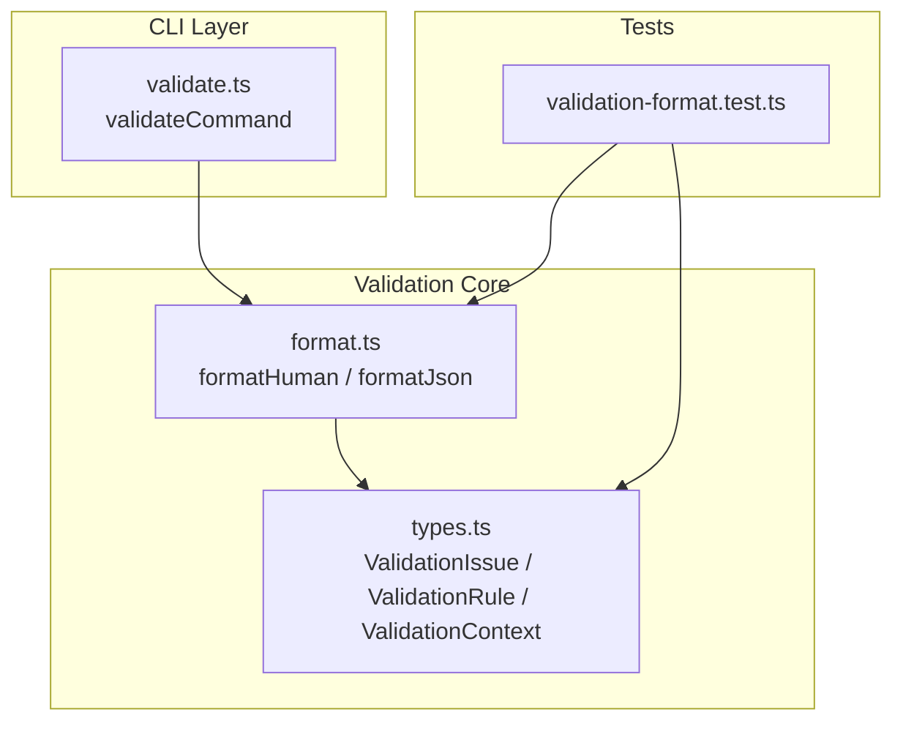
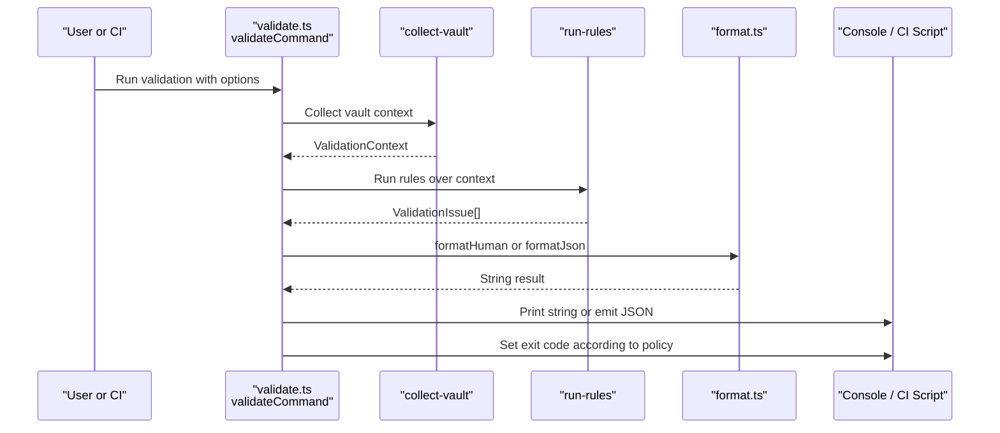
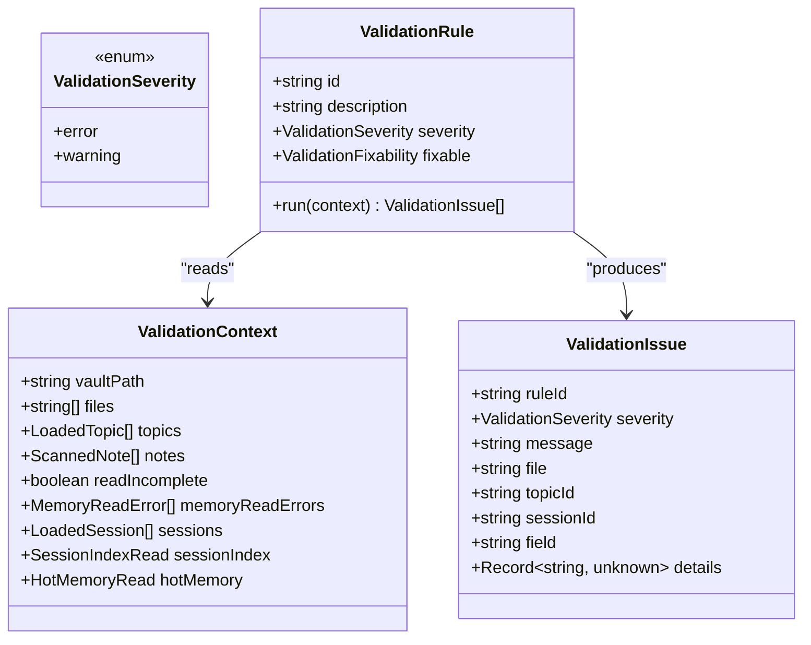
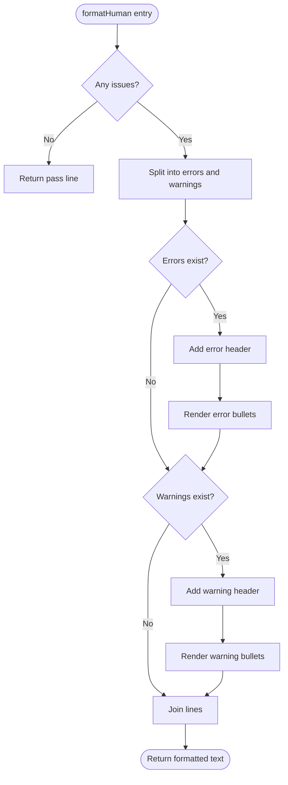
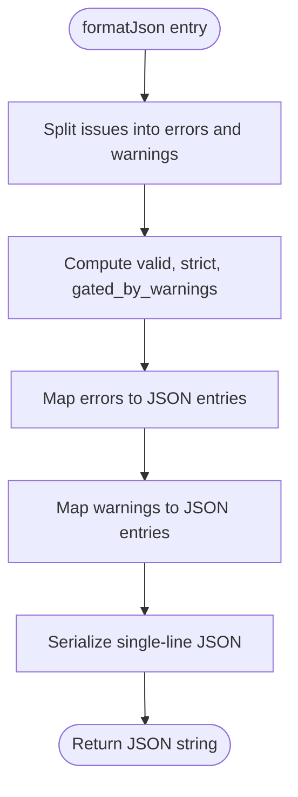
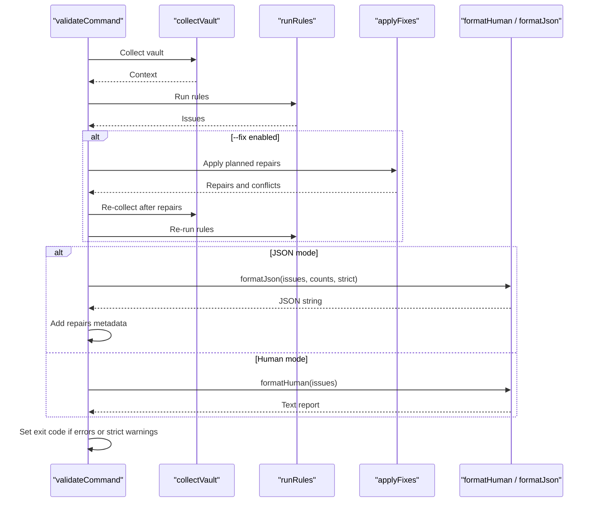
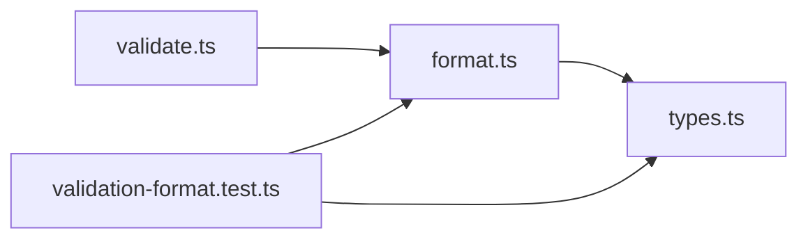

# Output Formatting System

::: details Referenced Files in This Document

- [format.ts](https://github.com/Kuldeep2822k/cli/blob/main/src/validation/format.ts)
- [types.ts](https://github.com/Kuldeep2822k/cli/blob/main/src/validation/types.ts)
- [validate.ts](https://github.com/Kuldeep2822k/cli/blob/main/src/cli/validate.ts)
- [validation-format.test.ts](https://github.com/Kuldeep2822k/cli/blob/main/test/validation-format.test.ts)

:::

## Table of Contents
1. [Introduction](#introduction)
2. [Project Structure](#project-structure)
3. [Core Components](#core-components)
4. [Architecture Overview](#architecture-overview)
5. [Detailed Component Analysis](#detailed-component-analysis)
6. [Dependency Analysis](#dependency-analysis)
7. [Performance Considerations](#performance-considerations)
8. [Troubleshooting Guide](#troubleshooting-guide)
9. [Conclusion](#conclusion)

## Introduction
This document explains the validation output formatting system that converts structured `ValidationIssue` objects into two consumer-facing formats:

- A console-friendly human report produced by `formatHuman`.
- A single-line JSON payload suitable for programmatic processing and CI/CD pipelines, produced by `formatJson`.

The formatters are intentionally pure: they receive validated issues and return strings without printing to the console or changing process state. The CLI handler owns printing, exit-code decisions, and integration with repair flows.

## Project Structure
The output formatting system is located under the validation module and is consumed by the CLI validate command.

**Diagram sources**
- [validate.ts:1-50](https://github.com/Kuldeep2822k/cli/blob/main/src/cli/validate.ts#L1-L50)
- [format.ts:1-25](https://github.com/Kuldeep2822k/cli/blob/main/src/validation/format.ts#L1-L25)
- [types.ts:1-25](https://github.com/Kuldeep2822k/cli/blob/main/src/validation/types.ts#L1-L25)
- [validation-format.test.ts:1-25](https://github.com/Kuldeep2822k/cli/blob/main/test/validation-format.test.ts#L1-L25)

**Section sources**
- [format.ts:1-25](https://github.com/Kuldeep2822k/cli/blob/main/src/validation/format.ts#L1-L25)
- [validate.ts:1-50](https://github.com/Kuldeep2822k/cli/blob/main/src/cli/validate.ts#L1-L50)

## Core Components
This section summarizes the primary types and formatter responsibilities.

| Component | Responsibility | Key Behavior |
|---|---|---|
| `ValidationIssue` | Structured finding from a validation rule | Contains rule identifier, severity, message, optional locator fields, and rule-specific details. |
| `ValidationSeverity` | Issue classification | Either `error`, which gates success, or `warning`, which does not gate success by default. |
| `ValidationRule` | Contract implemented by each validation rule | Provides an identifier, description, default severity, optional fixability metadata, and a deterministic `run` function. |
| `ValidationContext` | Read-only snapshot passed to rules | Includes vault paths, files, topics, notes, sessions, session index, hot memory, read-incomplete signals, and component-level memory errors. |
| `FormatCounts` | Shared formatter options | Tracks topic count, file count, and strict mode so both formatters can produce consistent summaries. |
| `formatHuman` | Console report generator | Produces plain text with severity blocks, bullet points, file locations, and rule identifiers; no ANSI colors. |
| `formatJson` | Machine-readable serializer | Produces one-line JSON preserving documented contract keys, legacy locator compatibility, error/warning counts, and strict gating flags. |

**Section sources**
- [types.ts:26-161](https://github.com/Kuldeep2822k/cli/blob/main/src/validation/types.ts#L26-L161)
- [format.ts:26-180](https://github.com/Kuldeep2822k/cli/blob/main/src/validation/format.ts#L26-L180)

## Architecture Overview
The validation pipeline separates discovery, rule execution, formatting, and presentation.

**Diagram sources**
- [validate.ts:420-535](https://github.com/Kuldeep2822k/cli/blob/main/src/cli/validate.ts#L420-L535)
- [format.ts:40-180](https://github.com/Kuldeep2822k/cli/blob/main/src/validation/format.ts#L40-L180)
- [types.ts:86-161](https://github.com/Kuldeep2822k/cli/blob/main/src/validation/types.ts#L86-L161)

## Detailed Component Analysis

### Validation Issue Model
`ValidationIssue` is the central data shape flowing from rules into formatters and consumers. It encodes what went wrong, how severe it is, where it happened, and any extra diagnostic information.

**Diagram sources**
- [types.ts:26-161](https://github.com/Kuldeep2822k/cli/blob/main/src/validation/types.ts#L26-L161)

Key design points:

- `ruleId` identifies the rule, while `severity` determines whether the issue gates failure.
- Locator fields (`file`, `topicId`, `sessionId`, `field`) make findings actionable.
- `details` is intentionally open-ended so individual rules can attach structured diagnostics such as duplicate files, missing dependencies, or parse messages.
- Rules must be pure functions of `ValidationContext`; they must not perform filesystem access, configuration reads, prompts, network calls, or console output.

**Section sources**
- [types.ts:26-120](https://github.com/Kuldeep2822k/cli/blob/main/src/validation/types.ts#L26-L120)

### Human Formatter: `formatHuman`
`formatHuman` turns a list of `ValidationIssue` objects into a plain-text console report.

Behavior summary:

- If there are no issues, it returns a pass line indicating successful vault validation.
- Issues are split into error and warning groups.
- Errors are printed before warnings.
- Each group has a header showing its count.
- Each issue is rendered as a bullet point with:
  - Message.
  - Optional files list from `details.files`.
  - Rule identifier.
  - Blank separator line.
- Output contains no ANSI color codes, making it safe for piping and log capture.

**Diagram sources**
- [format.ts:40-99](https://github.com/Kuldeep2822k/cli/blob/main/src/validation/format.ts#L40-L99)

Important implementation characteristics:

- Severity filtering preserves runner order within each block.
- File lists come from `issue.details.files` when present.
- Every issue includes its `ruleId`.
- The formatter is synchronous and returns a string.

**Section sources**
- [format.ts:40-99](https://github.com/Kuldeep2822k/cli/blob/main/src/validation/format.ts#L40-L99)

#### Example Human Reports
The test suite validates several scenarios:

| Scenario | Expected Human Output Characteristics |
|---|---|
| Clean vault | Pass line indicating no errors were found. |
| Duplicate topic ID | Error header with count, bullet containing message, related topic ID, and affected files. |
| Malformed frontmatter | Warning header with count, bullet containing message, affected file, and rule identifier. |
| Mixed input | Errors appear before warnings in the same report. |
| Piped output | No ANSI escape sequences. |

These behaviors are verified by assertions matching pass headers, severity headers, rule IDs, file lists, locator values, ordering, and absence of ANSI escapes.

**Section sources**
- [validation-format.test.ts:36-122](https://github.com/Kuldeep2822k/cli/blob/main/test/validation-format.test.ts#L36-L122)
- [format.ts:40-99](https://github.com/Kuldeep2822k/cli/blob/main/src/validation/format.ts#L40-L99)

### JSON Formatter: `formatJson`
`formatJson` serializes issues into the documented JSON contract used by machine consumers and CI systems.

Output structure overview:

| Field | Meaning |
|---|---|
| `valid` | Whether there are zero errors. Warnings do not flip this field false. |
| `strict` | Whether `--strict` was enabled. |
| `gated_by_warnings` | True only when strict mode is enabled, there are no errors, but there are warnings. |
| `topic_count` | Number of unique PALEE topics collected. |
| `file_count` | Number of scanned vault files. |
| `error_count` | Number of error-severity issues. |
| `warning_count` | Number of warning-severity issues. |
| `errors[]` | Serialized error issues. |
| `warnings[]` | Serialized warning issues. |

**Diagram sources**
- [format.ts:100-180](https://github.com/Kuldeep2822k/cli/blob/main/src/validation/format.ts#L100-L180)

Contract guarantees:

- `valid` is based on errors only.
- Warnings are additive and never change `valid`.
- `gated_by_warnings` distinguishes a strict-mode warnings-only failure from an errors failure.
- Legacy locator fields are preserved for backward compatibility.
- Output is a single-line JSON string.

Legacy mapping behavior:

- A small set of historical rule IDs map to legacy `type` values.
- Rule-specific locator fields such as `id`, `topic`, `files`, and `path` are copied from `details` when present.
- Newer fields like `rule_id`, `severity`, and `message` are always included.

**Section sources**
- [format.ts:100-180](https://github.com/Kuldeep2822k/cli/blob/main/src/validation/format.ts#L100-L180)

#### Example JSON Scenarios
The tests assert these contracts:

| Scenario | Expected JSON Behavior |
|---|---|
| Clean vault | `valid` is true, empty `errors` and `warnings`, zero counts, `gated_by_warnings` false. |
| Single error | `valid` is false, `error_count` is one, error entry includes `rule_id`, `severity`, and locator fields. |
| Single warning | `valid` remains true, `warning_count` is one, warning lands in `warnings[]`. |
| Strict with warnings only | `valid` remains true, `strict` is true, `gated_by_warnings` is true. |
| Strict with errors and warnings | `valid` is false, `gated_by_warnings` is false because errors already gate the run. |
| Round-trip locators | Cycle path arrays, file names, and detail fields survive serialization. |
| Single-line guarantee | Output contains no newline characters and parses as JSON. |

**Section sources**
- [validation-format.test.ts:124-198](https://github.com/Kuldeep2822k/cli/blob/main/test/validation-format.test.ts#L124-L198)
- [format.ts:100-180](https://github.com/Kuldeep2822k/cli/blob/main/src/validation/format.ts#L100-L180)

### CLI Integration and Exit Code Policy
The CLI validate command orchestrates collection, rule execution, formatting, repairs, and exit-code decisions.

**Diagram sources**
- [validate.ts:420-535](https://github.com/Kuldeep2822k/cli/blob/main/src/cli/validate.ts#L420-L535)

Exit code behavior:

- Errors always cause a validation exit code.
- Warnings alone do not fail the run unless `--strict` is enabled.
- In JSON mode, the handler still sets the same exit code policy, even though the payload itself keeps `valid` errors-only.
- When `--fix` runs, the handler re-collects and re-rules after repairs so the final report reflects remaining issues.

Repair reporting:

- Human mode prints repair summaries and skipped-repair conflict messages.
- JSON mode adds `repairs` and `repair_conflicts` to the serialized payload when `--fix` is used.

**Section sources**
- [validate.ts:420-535](https://github.com/Kuldeep2822k/cli/blob/main/src/cli/validate.ts#L420-L535)

### Custom Formatter Development Patterns
The current public API exposes two formatter functions:

| Function | Input | Output | Typical Use |
|---|---|---|---|
| `formatHuman` | `ValidationIssue[]` | Multi-line string | Console reports and terminal logs. |
| `formatJson` | `ValidationIssue[]` plus `FormatCounts` | Single-line JSON string | Programmatic tools, dashboards, CI checks, and artifact storage. |

Recommended patterns for extending the formatting layer:

1. **Keep formatters pure.** Return strings; let the caller decide where to print them.
2. **Preserve machine contracts.** Do not rename existing JSON keys without a migration strategy.
3. **Separate severity concerns.** Errors gate success; warnings inform but should not silently break existing contracts.
4. **Use `FormatCounts` for summary statistics.** Avoid recomputing topic or file counts inside formatters.
5. **Handle optional locator fields defensively.** Not every issue has `file`, `topicId`, `sessionId`, `field`, or structured `details`.
6. **Avoid ANSI styling in human output.** Terminal consumers may pipe output to logs or other tools.
7. **Validate output determinism.** Runner order should be stable so diffs and CI comparisons are predictable.

Template extension points:

- The repository currently uses direct string construction rather than a template engine.
- To support custom templates, wrap or extend `formatHuman` and `formatJson` with higher-order formatters that accept a rendering strategy for headers, bullets, rows, and summaries.
- For JSON, expose typed builder functions around the internal entry mapper so external tooling can transform results without parsing raw strings.

External reporting integration:

- CI systems can consume `formatJson` directly through shell parsing or language-specific JSON libraries.
- Dashboard integrations should treat `valid` as the primary gate, then inspect `error_count`, `warning_count`, and `gated_by_warnings` for nuanced policies.
- Human reports are best suited for interactive terminals and log viewers; machine parsers should prefer JSON.

**Section sources**
- [format.ts:1-180](https://github.com/Kuldeep2822k/cli/blob/main/src/validation/format.ts#L1-L180)
- [validation-format.test.ts:1-198](https://github.com/Kuldeep2822k/cli/blob/main/test/validation-format.test.ts#L1-L198)

## Dependency Analysis
The formatter module depends only on the shared validation type definitions. The CLI depends on both the formatter and the rule framework.

**Diagram sources**
- [format.ts:1-10](https://github.com/Kuldeep2822k/cli/blob/main/src/validation/format.ts#L1-L10)
- [types.ts:1-25](https://github.com/Kuldeep2822k/cli/blob/main/src/validation/types.ts#L1-L25)
- [validate.ts:1-20](https://github.com/Kuldeep2822k/cli/blob/main/src/cli/validate.ts#L1-L20)
- [validation-format.test.ts:1-20](https://github.com/Kuldeep2822k/cli/blob/main/test/validation-format.test.ts#L1-L20)

Coupling analysis:

- `format.ts` has low coupling: it imports only `ValidationIssue` from `types.ts`.
- `validate.ts` has higher coupling because it coordinates collection, rules, repairs, formatting, and exit codes.
- Tests depend on the public formatter exports and the `ValidationIssue` type, keeping behavioral verification close to the contract.

Potential circular dependencies:

- None are introduced by the formatter layer because it does not import CLI logic.
- CLI imports the formatter, which is a one-directional dependency.

**Section sources**
- [format.ts:1-10](https://github.com/Kuldeep2822k/cli/blob/main/src/validation/format.ts#L1-L10)
- [validate.ts:1-20](https://github.com/Kuldeep2822k/cli/blob/main/src/cli/validate.ts#L1-L20)
- [validation-format.test.ts:1-20](https://github.com/Kuldeep2822k/cli/blob/main/test/validation-format.test.ts#L1-L20)

## Performance Considerations
For large validation result sets, the current formatter design is efficient and appropriate:

- Filtering by severity is linear in the number of issues.
- Mapping issues to JSON entries is linear.
- Human output builds an array of lines and joins them once.
- JSON output uses a single `JSON.stringify` call.
- No per-issue filesystem access occurs in the formatter.

Complexity summary:

| Operation | Time Complexity | Space Complexity |
|---|---:|---:|
| Splitting issues by severity | O(n) | O(n) |
| Building human report lines | O(n) | O(n) |
| Mapping issues to JSON entries | O(n) | O(n) |
| Serializing JSON | O(n) | O(n) |

Optimization recommendations:

- Stream very large outputs instead of building full strings when integrating with long-running CI jobs.
- Avoid adding heavy per-issue computation inside formatters; keep expensive work in the rule execution phase.
- If downstream tools need aggregated views, compute them once and reuse the result rather than scanning issues repeatedly.
- Keep `details` payloads compact because JSON serialization cost grows with payload size.
- Prefer early filtering in callers when only a subset of issues is needed for a specific report.

[No sources needed since this section provides general guidance]

## Troubleshooting Guide

### Human Report Problems
Symptom: Unexpected severity grouping.

- Check whether the issue’s `severity` field is `error` or `warning`.
- Remember that errors are always printed before warnings.
- Verify that rule implementations classify mixed findings correctly.

Symptom: Missing file or locator information.

- Confirm the rule attached locator fields such as `file`, `topicId`, `sessionId`, or `field`.
- Confirm structured file lists are placed in `details.files`.
- Human output renders `details.files` only when it is an array.

Symptom: ANSI codes appear in logs.

- The formatter intentionally avoids ANSI codes.
- If colors appear, inspect the surrounding CLI code or terminal wrapper.

**Section sources**
- [format.ts:40-99](https://github.com/Kuldeep2822k/cli/blob/main/src/validation/format.ts#L40-L99)

### JSON Report Problems
Symptom: `valid` flips false because of warnings.

- This is expected only if the caller interprets `valid` as including warnings.
- By contract, `valid` is errors-only; use `gated_by_warnings` for strict-mode failures.

Symptom: Legacy scripts cannot find old locator fields.

- Ensure the consumer reads the legacy-compatible fields added by the JSON mapper.
- For duplicate topic IDs, check `id`.
- For missing dependencies, check `topic`.
- For cycle paths, check `path`.
- For file lists, check `details.files`.

Symptom: JSON output is multiline or unparseable.

- The formatter returns a single-line JSON string.
- Inspect the caller for additional wrapping or logging that might alter the payload.

Symptom: CI fails despite a clean payload.

- Inspect `error_count`, `warning_count`, `strict`, and `gated_by_warnings`.
- Remember that the CLI exit code can fail on strict warnings even when `valid` is true.

**Section sources**
- [format.ts:100-180](https://github.com/Kuldeep2822k/cli/blob/main/src/validation/format.ts#L100-L180)
- [validate.ts:420-535](https://github.com/Kuldeep2822k/cli/blob/main/src/cli/validate.ts#L420-L535)

### Custom Formatter Problems
Symptom: New formatter breaks existing consumers.

- Preserve existing JSON keys and semantics.
- Introduce new fields additively rather than renaming existing ones.
- Update tests to cover backward compatibility.

Symptom: Formatter produces inconsistent output.

- Ensure runner order is preserved.
- Avoid non-deterministic sorting inside the formatter unless explicitly required.
- Handle optional fields safely.

Symptom: Formatter performs side effects.

- Remove console logging, file writes, and network calls.
- Return strings or structured values so the caller controls I/O.

**Section sources**
- [format.ts:1-25](https://github.com/Kuldeep2822k/cli/blob/main/src/validation/format.ts#L1-L25)
- [validation-format.test.ts:1-25](https://github.com/Kuldeep2822k/cli/blob/main/test/validation-format.test.ts#L1-L25)

## Conclusion
The validation output formatting system cleanly separates structured findings from their presentation. `formatHuman` delivers readable console reports with clear severity grouping and contextual details, while `formatJson` provides a stable, backward-compatible JSON contract for automated consumers. The `FormatCounts` type captures summary statistics without duplicating collection logic.

For maintainers, the most important design boundaries are:

- Formatters are pure and return strings.
- Errors gate success; warnings do not, except under strict mode.
- JSON consumers should rely on documented keys and avoid brittle string parsing.
- External reporters should integrate through the public formatter functions and preserve the existing contract.