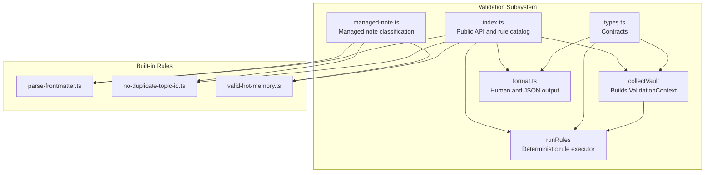
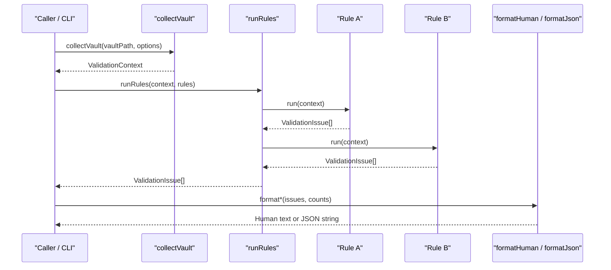
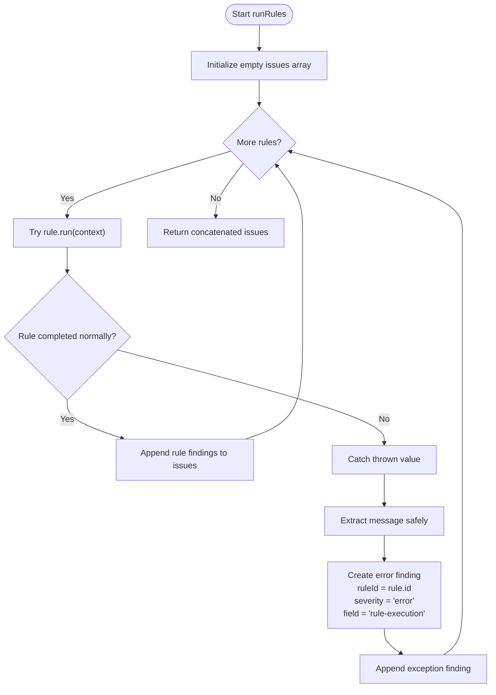
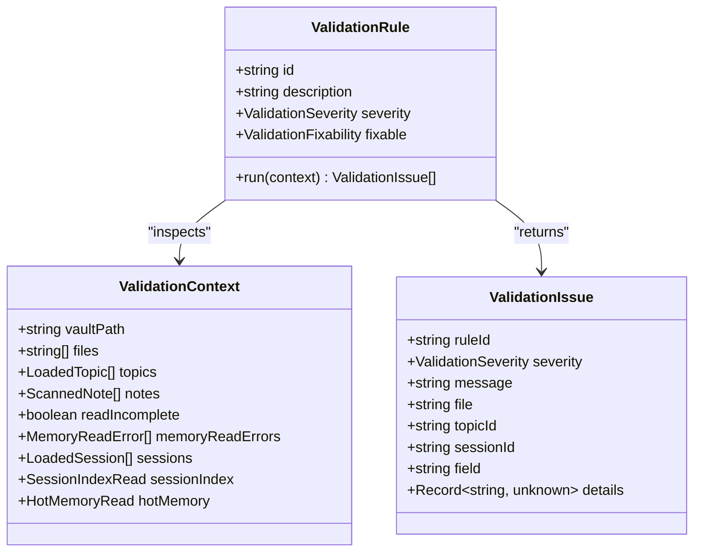
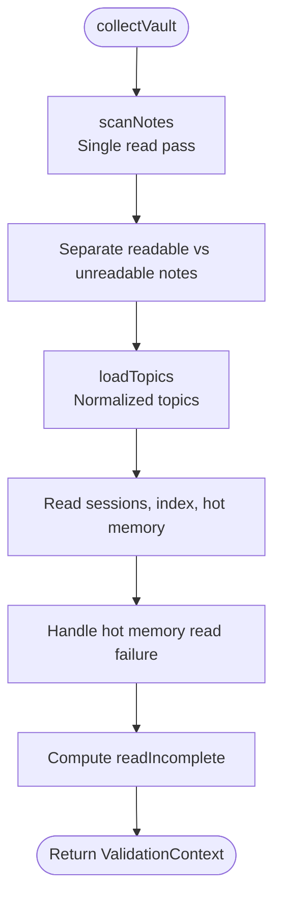
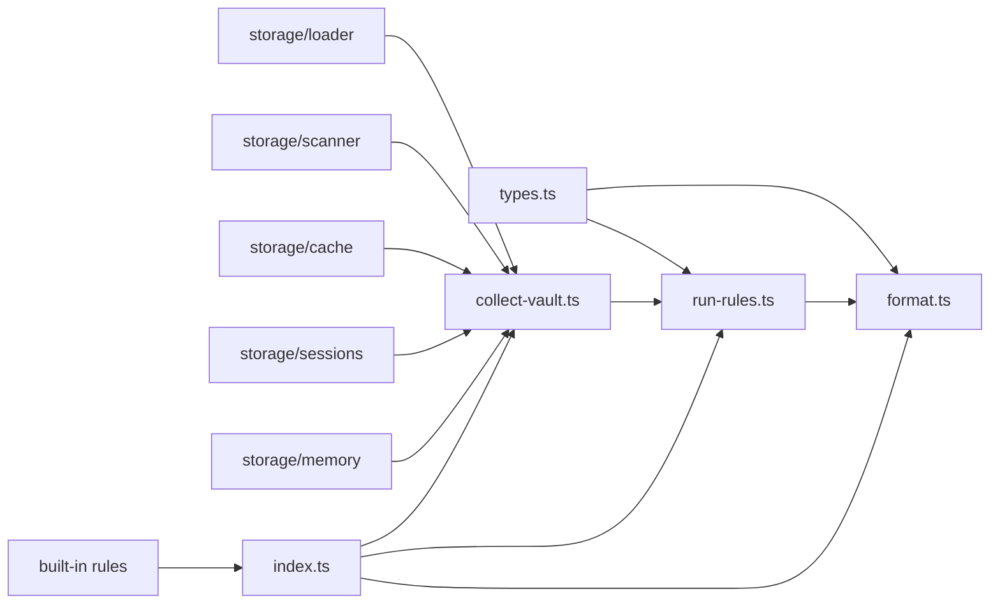

# Rule Execution Engine

::: details Referenced Files in This Document

- [run-rules.ts](https://github.com/Kuldeep2822k/cli/blob/main/src/validation/run-rules.ts)
- [types.ts](https://github.com/Kuldeep2822k/cli/blob/main/src/validation/types.ts)
- [collect-vault.ts](https://github.com/Kuldeep2822k/cli/blob/main/src/validation/collect-vault.ts)
- [format.ts](https://github.com/Kuldeep2822k/cli/blob/main/src/validation/format.ts)
- [index.ts](https://github.com/Kuldeep2822k/cli/blob/main/src/validation/index.ts)
- [managed-note.ts](https://github.com/Kuldeep2822k/cli/blob/main/src/validation/managed-note.ts)
- [parse-frontmatter.ts](https://github.com/Kuldeep2822k/cli/blob/main/src/validation/rules/parse-frontmatter.ts)
- [no-duplicate-topic-id.ts](https://github.com/Kuldeep2822k/cli/blob/main/src/validation/rules/no-duplicate-topic-id.ts)
- [valid-hot-memory.ts](https://github.com/Kuldeep2822k/cli/blob/main/src/validation/rules/valid-hot-memory.ts)
- [validation-framework.test.ts](https://github.com/Kuldeep2822k/cli/blob/main/test/validation-framework.test.ts)

:::

## Table of Contents
1. [Introduction](#introduction)
2. [Project Structure](#project-structure)
3. [Core Components](#core-components)
4. [Architecture Overview](#architecture-overview)
5. [Detailed Component Analysis](#detailed-component-analysis)
6. [Dependency Analysis](#dependency-analysis)
7. [Performance Considerations](#performance-considerations)
8. [Troubleshooting Guide](#troubleshooting-guide)
9. [Conclusion](#conclusion)

## Introduction
This document explains the PALEE validation rule execution engine: how vault state is collected, how rules are executed deterministically, and how findings are produced without allowing rules to perform I/O or side effects. The engine is intentionally minimal — it does not filter, rank, or format issues itself. Instead, it provides a stable contract for pure validation rules and leaves presentation, exit-code decisions, and fix dispatch to callers.

The key guarantees are:
- Rules run in registration order.
- Findings are concatenated; one rule never short-circuits later rules.
- Unexpected rule exceptions are converted into structured error findings.
- Rules receive a read-only snapshot of vault state.
- Rules must be pure functions with no filesystem, network, config, prompt, or console access.

## Project Structure
The validation subsystem lives under `src/validation` and exposes a small public surface:

## Core Components
The engine is built around three core concepts:

| Concept | Responsibility | Key Contract Details |
|---|---|---|
| `ValidationRule` | Declares what is checked and produces findings | Fields: `id`, `description`, `severity`, optional `fixable`; method: `run(context)` returns an array of `ValidationIssue`. |
| `ValidationContext` | Read-only snapshot of vault state passed to every rule | Includes vault path, scanned files, topics, raw notes, sessions, session index, hot memory, component read errors, and a provisional-read flag. |
| `ValidationIssue` | Structured finding returned by rules | Required fields: `ruleId`, `severity`, `message`; optional locator fields: `file`, `topicId`, `sessionId`, `field`; optional structured payload: `details`. |

The runner executes every registered rule against the same context and concatenates all returned findings. It adds no severity filtering, no ranking policy, and no formatting. Formatters separate human-readable text from machine-readable JSON output.

## Architecture Overview
The validation workflow is a pipeline:

1. **Collect**: Build a single-snapshot `ValidationContext` by scanning notes, loading topics, reading sessions, reading the derived session index, and tolerantly reading hot memory.
2. **Run**: Execute every rule in registration order. Each rule receives the same context and returns its own list of findings.
3. **Format**: Convert findings into human-readable output or machine-readable JSON. Callers decide exit codes and fix behavior.

## Detailed Component Analysis

### Deterministic Rule Runner
The runner iterates through the rule array exactly once. For each rule:
- It calls `rule.run(context)`.
- It spreads the returned issues into a single result array.
- If the call throws, it catches the exception, formats a safe message, and pushes one error finding identified by the rule’s `id`.

Important properties:
- **No short-circuiting**: Every rule runs regardless of earlier findings.
- **Registration-order stability**: Issues from earlier rules precede issues from later rules.
- **Per-rule order preservation**: A rule’s internal issue order is preserved in the final array.
- **Exception safety**: Unexpected exceptions become structured error findings rather than aborting the scan.

### ValidationRule Interface Contract
Every validation rule implements the `ValidationRule` interface:

| Member | Type | Meaning |
|---|---|---|
| `id` | `string` | Stable kebab-case identifier used in messages, tests, formatters, and fix dispatch. |
| `description` | `string` | One-line description of the check. |
| `severity` | `'error' \| 'warning'` | Default severity classification for the rule. Per-issue severity is authoritative when mixed. |
| `fixable?` | `false \| 'safe' \| 'manual'` | Fixability hint consumed by the `--fix` engine. |
| `run(context)` | `(context: ValidationContext) => ValidationIssue[]` | Pure function that inspects the context and returns findings. |

Best practices derived from the contract:
- Treat `severity` as metadata; actual per-issue severity drives exit-code and reporting behavior.
- Use `ruleId` consistently so formatters and fix engines can identify the source.
- Keep `run` deterministic: given the same `ValidationContext`, it must return the same issues in the same order.
- Do not mutate `context`; do not perform filesystem reads, writes, prompts, network requests, or console logging inside a rule.

### ValidationContext Structure
`ValidationContext` is a read-only snapshot built once before rule execution. Its main responsibilities are:

| Field | Purpose | Notes |
|---|---|---|
| `vaultPath` | Absolute vault root | Used by rules needing vault-root context. |
| `files` | Sorted absolute paths of scanned Markdown files | Includes unreadable files so file counts stay accurate. |
| `topics` | Normalized PALEE topics | Consumers of the engine use this normalized shape. |
| `notes` | Raw per-file parse outcomes | Includes parse errors and read failures for non-PALEE and malformed notes. |
| `readIncomplete` | Provisional-scan flag | True when any note, session, or memory subsystem read failed. |
| `memoryReadErrors` | Component-level memory subsystem read failures | Captures enumeration or read failures for `.palee/sessions`, `.palee/index.md`, or `.palee/hot.md`. |
| `sessions` | Loaded session notes | Malformed entries carry `frontmatter: null`; unreadable entries carry `readError`. |
| `sessionIndex` | Derived session index classification | Absence is valid; corruption is captured for the index rule. |
| `hotMemory` | Tolerant hot-memory classification | Reserved for hot-memory cluster validation. |

Rules should inspect these fields but must not assume every field is complete when `readIncomplete` is true. Graph and reference checks should treat such snapshots as provisional unless the rule explicitly owns the partial data.

### Vault Collection and Isolation from I/O
`collectVault` builds the context in a single read pass:

1. `scanNotes` captures raw content for each scanned file.
2. Only readable notes feed `loadTopics`; unreadable notes are excluded from normalization but retained in `files` and `notes`.
3. Sessions, session index, and hot memory are read together so concurrent edits cannot make rules observe mismatched halves of the memory subsystem.
4. Hot memory read failures are caught and recorded as component read errors instead of aborting the scan.
5. `readIncomplete` is set when any note, session, or memory subsystem read failure is detected.

This design isolates rules from I/O:
- Rules receive already-collected data.
- Rules do not open files themselves.
- Rules do not touch the vault while other components may be writing.
- Parse and read failures are represented as structured data, not thrown exceptions.

### Output Formatting
Formatters convert findings into two representations:

- **Human formatter**: Prints a pass line when there are no issues, then groups errors and warnings separately. Errors appear before warnings. Within each group, runner order is preserved.
- **JSON formatter**: Produces a documented machine-readable object containing validity, strict mode, warning gating, counts, errors, and additive warnings. Legacy keys are preserved for backward compatibility.

Key policies:
- Severity determines exit-code semantics: errors gate; warnings do not.
- Warnings are additive in JSON and never affect `valid`.
- Strict mode can mark a warnings-only run as gated without changing the meaning of `valid`.

### Built-in Rule Examples

#### Parse-Frontmatter and Read-Failure Rules
These rules demonstrate two common patterns:
- Inspect raw per-file parse outcomes to report malformed frontmatter.
- Report collection-time read failures across notes, sessions, and memory subsystem components.

Both are warnings and do not gate the exit code. They also illustrate deterministic sorting by file path.

#### Duplicate Topic ID Rule
This rule groups normalized topics by their `palee_id`, reports one error per duplicated ID, includes all affected file paths, and sorts results by topic ID for deterministic output.

It shows how graph-like aggregation should remain pure and stable.

#### Valid Hot Memory Rule
This rule validates a rebuildable derived view:
- Missing hot memory is valid.
- Unsupported schema versions are reported as warnings.
- Identity, word-cap, and reference checks validate derived state.
- Reference checks are skipped on incomplete snapshots to avoid speculative warnings.

It demonstrates careful handling of provisional state and derived-view semantics.

### Rule Catalog and Registration Order
The barrel exports both individual rules and the canonical ordered catalog `VALIDATION_RULES`. The order is intentional:
- Parse and read findings come first.
- Managed-note classification comes before schema validation.
- Identity and schema checks precede dependency and graph rules.
- Assessment and mastery consistency checks precede SM-2 date checks.
- Memory subsystem checks follow schema-first, cross-reference, then derived views.
- Path boundary audit runs last.

Callers must use this catalog when they want the standard deterministic validation sequence.

### Managed Note Classification
The managed-note helper centralizes identity-key logic used by multiple rules:
- Identity keys mark PALEE-managed records.
- Presence of a key matters more than its value type.
- Topic-note classification is narrower than general managed-note classification.
- A note marked only by schema is not treated as a clean topic note.

This prevents different rules from disagreeing about whether a note is managed or a topic.

## Dependency Analysis

### Coupling and Cohesion
- `types.ts` is the shared contract layer and has no runtime dependencies on collectors, runners, or formatters.
- `run-rules.ts` depends only on types and is the most isolated execution component.
- `collect-vault.ts` depends on storage abstractions and builds the context consumed by rules.
- `format.ts` depends only on types and is independent of collection and execution.
- `index.ts` couples the public API to both collection and execution and centralizes the rule catalog.

### Potential Risks
- Adding I/O inside a rule breaks purity and determinism.
- Mutating `ValidationContext` inside a rule makes subsequent rules observe inconsistent state.
- Sorting findings inconsistently breaks deterministic output.
- Changing `VALIDATION_RULES` order changes diagnostic ordering and may break expectations downstream.

## Performance Considerations
- Rule execution is linear in the number of rules and total findings: `O(rules × average_issues_per_rule)`.
- Context construction dominates I/O cost because it performs one scan pass and loads topics from in-memory contents where possible.
- Rules should avoid unnecessary repeated scans of `context.topics`, `context.sessions`, or `context.notes`; cache intermediate maps locally if needed.
- Sorting should be limited to deterministic output requirements rather than broad full-array sorts.
- Exception handling adds negligible overhead compared to rule computation but ensures one crashing rule does not prevent later rules from running.

[No sources needed since this section provides general guidance]

## Troubleshooting Guide

### A Rule Throws an Unexpected Exception
When a rule throws, the runner converts it into one error finding:
- `ruleId` is the throwing rule’s identifier.
- `severity` is always `error`.
- `message` names the rule and includes a safely extracted message.
- `file`, `topicId`, and `sessionId` are left empty.
- `field` is set to `rule-execution`.

This prevents a broken rule from hiding other findings.

### A Rule Reports Too Many or Too Few Findings
Check:
- Whether the rule filters on the correct context field.
- Whether it handles provisional snapshots (`readIncomplete`).
- Whether it sorts findings deterministically.
- Whether it distinguishes between parse failures and read failures.
- Whether it uses the rule’s own `ruleId` consistently.

### JSON Output Shows Unexpected Gating Behavior
Remember:
- `valid` reflects whether there are zero errors.
- Warnings do not make `valid` false.
- In strict mode, a warnings-only run can still be marked as gated by warnings.
- Legacy keys are preserved alongside new rule metadata.

### Best Practices for Writing Robust Validation Rules
1. Treat the rule as a pure function of `ValidationContext`.
2. Never read files, write files, read configuration, prompt the user, call external services, or print to the console.
3. Preserve deterministic ordering within your findings.
4. Respect `readIncomplete`: treat reference checks as provisional when the snapshot may be missing entities.
5. Use the rule’s declared `severity` as default metadata, but assign per-issue severity where mixed classes exist.
6. Use `ruleId` consistently so formatters and fix engines can identify findings.
7. Put structured diagnostics in `details` instead of embedding them only in `message`.
8. Keep locator fields precise: `file`, `topicId`, `sessionId`, and `field` help consumers locate problems.
9. Prefer failing fast on invalid input to producing confusing findings.
10. Add tests covering normal findings, edge cases, provisional snapshots, and exception safety.

[No sources needed since this section summarizes established practices]

## Conclusion
The PALEE validation rule execution engine is deliberately lean. It collects a single, consistent snapshot of vault state, executes pure rules in registration order, concatenates findings without short-circuiting, and converts unexpected exceptions into structured error findings. The `ValidationRule` and `ValidationContext` contracts define a clear boundary: rules inspect read-only data and return structured findings, while the runner, collector, and formatter handle orchestration, isolation, and presentation. Following the best practices above keeps rules deterministic, testable, and compatible with the broader PALEE validation and fix workflows.

## References

- [index.ts:1-130](https://github.com/Kuldeep2822k/cli/blob/main/src/validation/index.ts#L1-L130)
- [collect-vault.ts:1-147](https://github.com/Kuldeep2822k/cli/blob/main/src/validation/collect-vault.ts#L1-L147)
- [run-rules.ts:1-60](https://github.com/Kuldeep2822k/cli/blob/main/src/validation/run-rules.ts#L1-L60)
- [format.ts:1-180](https://github.com/Kuldeep2822k/cli/blob/main/src/validation/format.ts#L1-L180)
- [managed-note.ts:1-87](https://github.com/Kuldeep2822k/cli/blob/main/src/validation/managed-note.ts#L1-L87)
- [parse-frontmatter.ts:1-78](https://github.com/Kuldeep2822k/cli/blob/main/src/validation/rules/parse-frontmatter.ts#L1-L78)
- [no-duplicate-topic-id.ts:1-48](https://github.com/Kuldeep2822k/cli/blob/main/src/validation/rules/no-duplicate-topic-id.ts#L1-L48)
- [valid-hot-memory.ts:1-150](https://github.com/Kuldeep2822k/cli/blob/main/src/validation/rules/valid-hot-memory.ts#L1-L150)
- [types.ts:1-161](https://github.com/Kuldeep2822k/cli/blob/main/src/validation/types.ts#L1-L161)
- [collect-vault.ts:37-147](https://github.com/Kuldeep2822k/cli/blob/main/src/validation/collect-vault.ts#L37-L147)
- [run-rules.ts:20-56](https://github.com/Kuldeep2822k/cli/blob/main/src/validation/run-rules.ts#L20-L56)
- [format.ts:40-180](https://github.com/Kuldeep2822k/cli/blob/main/src/validation/format.ts#L40-L180)
- [validation-framework.test.ts:1-200](https://github.com/Kuldeep2822k/cli/blob/main/test/validation-framework.test.ts#L1-L200)
- [types.ts:107-161](https://github.com/Kuldeep2822k/cli/blob/main/src/validation/types.ts#L107-L161)
- [types.ts:43-161](https://github.com/Kuldeep2822k/cli/blob/main/src/validation/types.ts#L43-L161)
- [collect-vault.ts:14-23](https://github.com/Kuldeep2822k/cli/blob/main/src/validation/collect-vault.ts#L14-L23)
- [run-rules.ts:12-15](https://github.com/Kuldeep2822k/cli/blob/main/src/validation/run-rules.ts#L12-L15)
- [format.ts:11-12](https://github.com/Kuldeep2822k/cli/blob/main/src/validation/format.ts#L11-L12)
- [index.ts:20-130](https://github.com/Kuldeep2822k/cli/blob/main/src/validation/index.ts#L20-L130)
- [run-rules.ts:28-56](https://github.com/Kuldeep2822k/cli/blob/main/src/validation/run-rules.ts#L28-L56)
- [validation-framework.test.ts:130-200](https://github.com/Kuldeep2822k/cli/blob/main/test/validation-framework.test.ts#L130-L200)
- [parse-frontmatter.ts:10-78](https://github.com/Kuldeep2822k/cli/blob/main/src/validation/rules/parse-frontmatter.ts#L10-L78)
- [no-duplicate-topic-id.ts:10-48](https://github.com/Kuldeep2822k/cli/blob/main/src/validation/rules/no-duplicate-topic-id.ts#L10-L48)
- [valid-hot-memory.ts:10-150](https://github.com/Kuldeep2822k/cli/blob/main/src/validation/rules/valid-hot-memory.ts#L10-L150)
- [format.ts:11-180](https://github.com/Kuldeep2822k/cli/blob/main/src/validation/format.ts#L11-L180)
