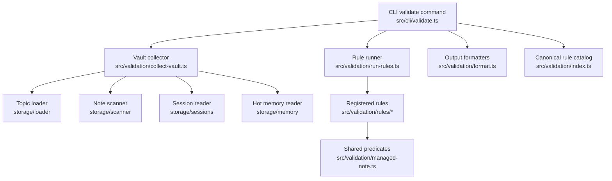
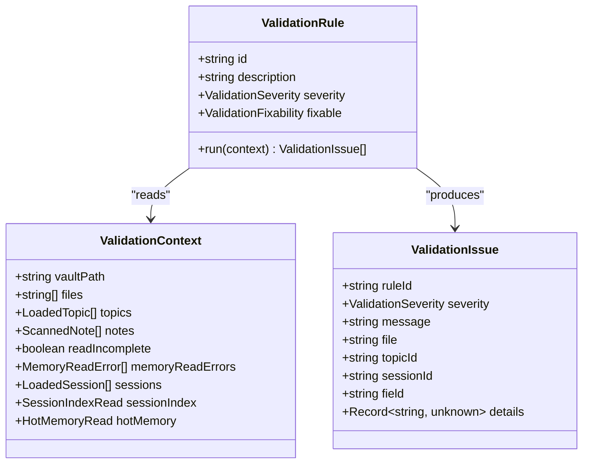
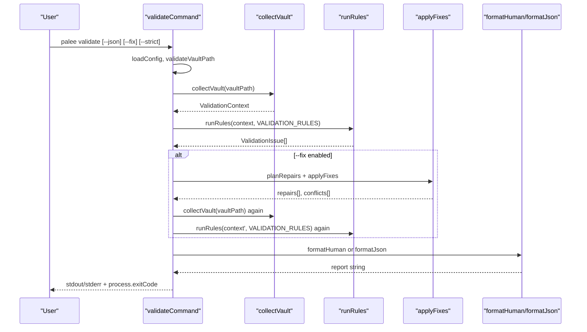
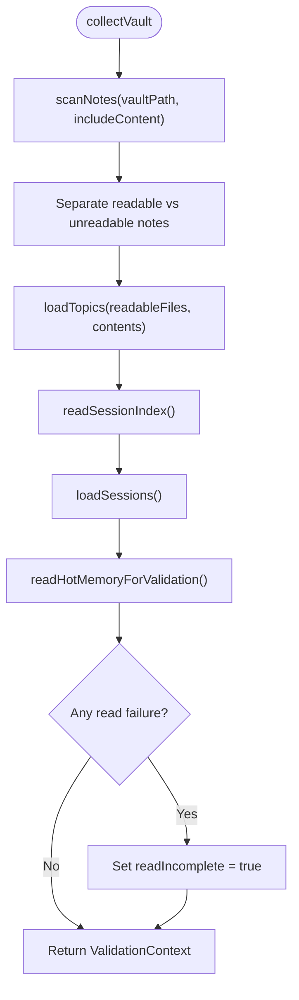
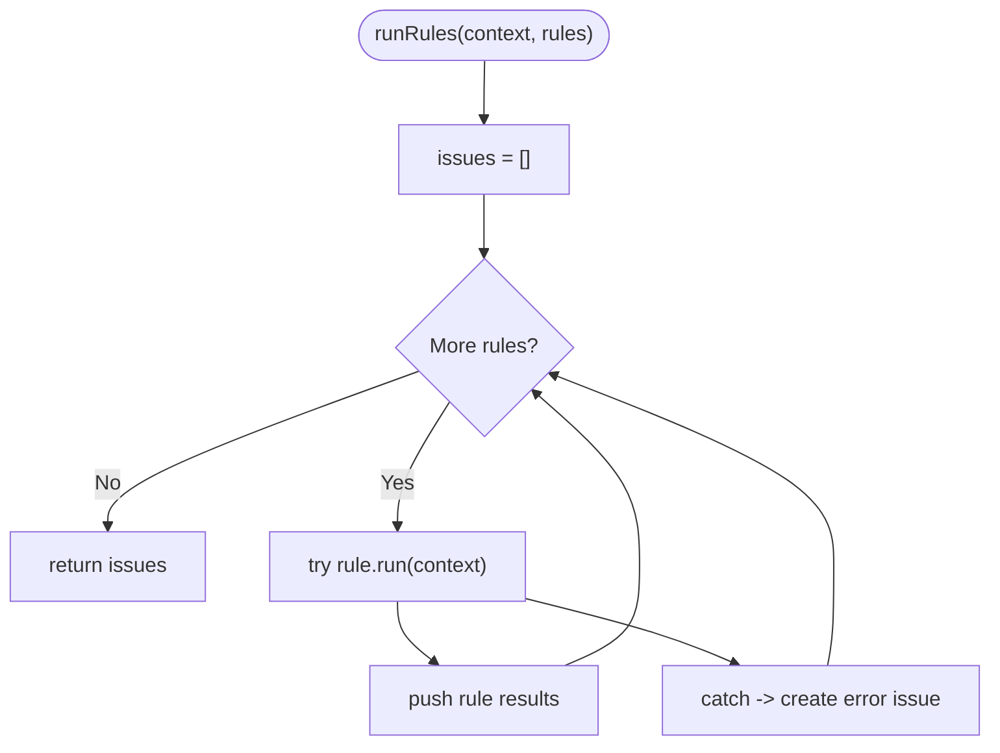
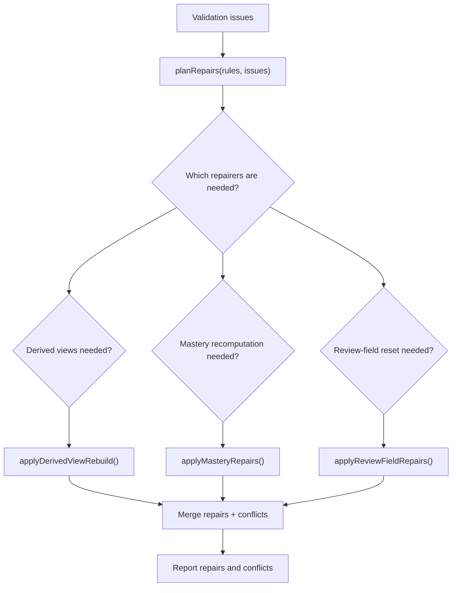
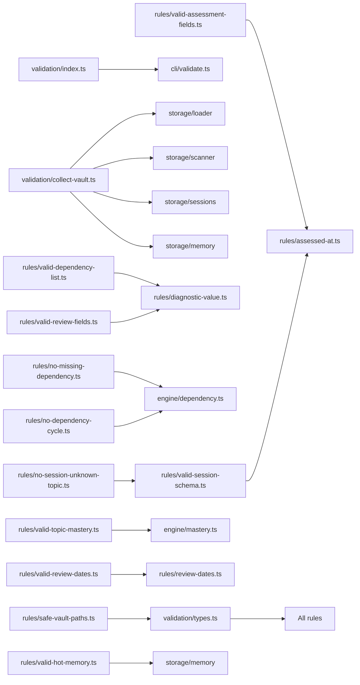

# Validation Framework

::: details Referenced Files in This Document

- [index.ts](https://github.com/Kuldeep2822k/cli/blob/main/src/validation/index.ts)
- [types.ts](https://github.com/Kuldeep2822k/cli/blob/main/src/validation/types.ts)
- [collect-vault.ts](https://github.com/Kuldeep2822k/cli/blob/main/src/validation/collect-vault.ts)
- [run-rules.ts](https://github.com/Kuldeep2822k/cli/blob/main/src/validation/run-rules.ts)
- [format.ts](https://github.com/Kuldeep2822k/cli/blob/main/src/validation/format.ts)
- [managed-note.ts](https://github.com/Kuldeep2822k/cli/blob/main/src/validation/managed-note.ts)
- [validate.ts](https://github.com/Kuldeep2822k/cli/blob/main/src/cli/validate.ts)
- [0008-validation-framework-decisions.md](https://github.com/Kuldeep2822k/cli/blob/main/docs/adr/0008-validation-framework-decisions.md)
- [parse-frontmatter.ts](https://github.com/Kuldeep2822k/cli/blob/main/src/validation/rules/parse-frontmatter.ts)
- [valid-palee-schema.ts](https://github.com/Kuldeep2822k/cli/blob/main/src/validation/rules/valid-palee-schema.ts)
- [valid-managed-note-kind.ts](https://github.com/Kuldeep2822k/cli/blob/main/src/validation/rules/valid-managed-note-kind.ts)
- [valid-topic-id-format.ts](https://github.com/Kuldeep2822k/cli/blob/main/src/validation/rules/valid-topic-id-format.ts)
- [valid-topic-status.ts](https://github.com/Kuldeep2822k/cli/blob/main/src/validation/rules/valid-topic-status.ts)
- [no-duplicate-topic-id.ts](https://github.com/Kuldeep2822k/cli/blob/main/src/validation/rules/no-duplicate-topic-id.ts)
- [valid-dependency-list.ts](https://github.com/Kuldeep2822k/cli/blob/main/src/validation/rules/valid-dependency-list.ts)
- [no-missing-dependency.ts](https://github.com/Kuldeep2822k/cli/blob/main/src/validation/rules/no-missing-dependency.ts)
- [no-dependency-cycle.ts](https://github.com/Kuldeep2822k/cli/blob/main/src/validation/rules/no-dependency-cycle.ts)
- [valid-assessment-fields.ts](https://github.com/Kuldeep2822k/cli/blob/main/src/validation/rules/valid-assessment-fields.ts)
- [valid-topic-mastery.ts](https://github.com/Kuldeep2822k/cli/blob/main/src/validation/rules/valid-topic-mastery.ts)
- [valid-review-fields.ts](https://github.com/Kuldeep2822k/cli/blob/main/src/validation/rules/valid-review-fields.ts)
- [valid-review-dates.ts](https://github.com/Kuldeep2822k/cli/blob/main/src/validation/rules/valid-review-dates.ts)
- [valid-session-schema.ts](https://github.com/Kuldeep2822k/cli/blob/main/src/validation/rules/valid-session-schema.ts)
- [no-session-unknown-topic.ts](https://github.com/Kuldeep2822k/cli/blob/main/src/validation/rules/no-session-unknown-topic.ts)
- [valid-session-index.ts](https://github.com/Kuldeep2822k/cli/blob/main/src/validation/rules/valid-session-index.ts)
- [valid-hot-memory.ts](https://github.com/Kuldeep2822k/cli/blob/main/src/validation/rules/valid-hot-memory.ts)
- [safe-vault-paths.ts](https://github.com/Kuldeep2822k/cli/blob/main/src/validation/rules/safe-vault-paths.ts)

:::

## Table of Contents
1. [Introduction](#introduction)
2. [Project Structure](#project-structure)
3. [Core Components](#core-components)
4. [Architecture Overview](#architecture-overview)
5. [Detailed Component Analysis](#detailed-component-analysis)
6. [Dependency Analysis](#dependency-analysis)
7. [Performance Considerations](#performance-considerations)
8. [Troubleshooting Guide](#troubleshooting-guide)
9. [Conclusion](#conclusion)
10. [Appendices](#appendices)

## Introduction
The PALEE validation framework is a rule-based integrity and consistency checker for Obsidian vaults managed by PALEE. It validates topic notes, session records, derived memory projections, dependency graphs, and vault path boundaries, then reports findings as structured issues with human-readable and JSON output.

Key design decisions:
- Rules are pure functions over a fully collected snapshot; they never touch the filesystem, config, or network during execution.
- Vault collection performs one read pass so parse outcomes, normalized topics, sessions, index, and hot memory come from a consistent snapshot.
- Output order is deterministic: rules execute in registration order, and each rule preserves its own stable issue ordering.
- Severity policy distinguishes errors (gating failures) from warnings (data-quality or self-healing projection issues).
- A repair planning system maps selected findings to safe or manual fixes, including rebuildable derived views, mastery recomputation, and SM-2 review field resets.

This document explains the architecture, catalog of built-in rules, automated repair planning, CLI integration, custom rule development, performance characteristics, and common scenarios.

## Project Structure
The validation subsystem is organized around a small public API surface and a focused set of modules:

| Area | Responsibility |
|---|---|
| Public barrel (`src/validation/index.ts`) | Exports the collector, runner, formatters, shared types, and the canonical ordered rule catalog used by `palee validate`. |
| Types (`src/validation/types.ts`) | Defines the validation contract: severity, fixability, issue shape, collected context, and rule interface. |
| Collection (`src/validation/collect-vault.ts`) | Builds `ValidationContext` in one pass using scanner, topic loader, sessions, session index, and hot memory reads. |
| Runner (`src/validation/run-rules.ts`) | Executes every registered rule against the context and concatenates findings deterministically. |
| Formatting (`src/validation/format.ts`) | Renders plain console output and machine-readable JSON without printing itself. |
| Managed-note predicate (`src/validation/managed-note.ts`) | Centralizes what makes a note PALEE-managed and what makes it a topic note, preventing contradictory classification across rules. |
| CLI handler (`src/cli/validate.ts`) | Orchestrates collection, validation, optional `--fix`, reporting, exit codes, and repair dispatch. |
| Rule implementations (`src/validation/rules/*`) | One rule per concern: parse/read, schema, identity, lifecycle, dependencies, assessment, SM-2 review state, session schema, derived views, and path safety. |

## Core Components
The framework exposes four primary capabilities:

1. **Vault collection**: `collectVault(vaultPath, options)` builds a `ValidationContext` containing absolute file paths, raw scanned notes, normalized topics, session records, session index, hot memory, component-level memory read errors, and a `readIncomplete` flag.
2. **Rule execution**: `runRules(context, rules)` runs each rule in registration order, catches unexpected exceptions per rule, and returns concatenated `ValidationIssue[]`.
3. **Formatting**: `formatHuman(issues)` produces console text; `formatJson(issues, counts)` produces a documented JSON payload that preserves legacy keys while adding rule metadata and additive warnings.
4. **Rule catalog**: `VALIDATION_RULES` is the single source of truth for both the public barrel and the CLI runner, defining deterministic execution order.

### Validation Contract
The core interface contracts are:

| Contract | Purpose |
|---|---|
| `ValidationRule` | Declares `id`, `description`, default `severity`, optional `fixable`, and `run(context)` returning `ValidationIssue[]`. |
| `ValidationIssue` | Structured finding with `ruleId`, `severity`, `message`, optional locators (`file`, `topicId`, `sessionId`, `field`), and optional structured `details`. |
| `ValidationSeverity` | Only `'error'` or `'warning'` — there is no `'mixed'` value. `'error'` gates exit code; `'warning'` does not unless `--strict` is active. A rule declares one default severity, but the per-issue severity is authoritative when a rule reports both classes (see `valid-dependency-list`). |
| `ValidationFixability` | `false`, `'safe'`, or `'manual'`; drives whether `--fix` can repair a finding. |
| `ValidationContext` | Read-only snapshot of vault state passed to every rule. |

## Architecture Overview
The validation pipeline has three phases:

1. **Collection phase**: The CLI resolves the vault path, loads configuration, calls `collectVault`, and captures the full snapshot.
2. **Validation phase**: `runRules` executes every rule in `VALIDATION_RULES` against the snapshot. Findings are accumulated in deterministic order.
3. **Repair and reporting phase**: If `--fix` is enabled, the CLI plans repairs based on rule metadata, applies them, re-collects from fresh disk state, re-validates, formats output, and sets the exit code according to error count and strict mode.

## Detailed Component Analysis

### Vault Collection
`collectVault` performs a single-read snapshot:

- Scans Markdown notes with content captured per file.
- Separates readable notes from unreadable ones and threads only readable bytes into topic loading.
- Loads sessions, reads the session index first, then sessions, then hot memory — closing the concurrent `session end` interleaving window.
- Captures component-level memory read failures instead of aborting.
- Sets `readIncomplete` when any walked note, session note, or memory component failed to read.

Important behaviors:
- Malformed notes never abort scanning.
- Unreadable files remain in the file list so `file_count` reflects the whole vault.
- Missing derived views are valid initial states.
- Concurrent edits cannot make different rules observe different versions of the same topic bytes.

### Rule Execution Pipeline
The runner iterates through the provided rule array in registration order. For each rule:

- Calls `rule.run(context)`.
- Catches unexpected exceptions.
- Converts an exception into an error-level issue with the rule’s identifier and a fallback message.
- Preserves intra-rule issue order and inter-rule order.

There is no filtering, severity policy, short-circuiting, or parallelism inside the runner. Callers control presentation and exit-code behavior.

### Output Formatting
Formatters separate concerns from CLI policy:

- `formatHuman`:
  - Prints a passing line when there are no issues.
  - Groups errors before warnings.
  - Includes bullet points, rule identifiers, and structured file lists when present.
  - Does not use ANSI colors.
- `formatJson`:
  - Produces a single-line JSON object.
  - Keeps legacy keys such as `type`, `id`, `files`, `topic`, `missing`, `path`.
  - Adds `rule_id`, `severity`, `message`, and additive `warnings[]`.
  - Marks `valid` based on errors only.
  - Adds `strict` and `gated_by_warnings` for warnings-only strict failures.

### Managed Note Classification
Before validating managed data, the framework needs to know whether a note belongs to PALEE and which kind it represents. `managed-note.ts` centralizes this logic:

- Identity keys: `palee_id`, `session_id`, `memory_id`.
- Session index marker: `type: "session_index"`.
- `isManagedNote`: true if any identity key is present or the session index marker exists.
- `isTopicNote`: true only when exactly one identity key is present, that key is `palee_id`, and the note is not the session index.

This prevents contradictory classification between schema, kind, and topic-ID rules.

### Automated Repair Planning
The CLI implements a staged repair system driven by rule metadata rather than ad-hoc special cases.

#### Repair Planning Model
Each rule declares `fixable`:

- `false`: never repaired.
- `'safe'`: loss-free repair; must have an implemented repairer or the engine reports it as unservable.
- `'manual'`: requires human decision; some are explicitly allowed through `EXPLICIT_MANUAL_REPAIRS`.

The planner:

- Inspects which rule IDs appear in the reported issues.
- Maps each reported rule ID to a repairer implementation.
- Buckets findings by repair type.
- Tracks declared-safe rules with no implementation as unservable.

#### Implemented Repairs
| Repairer | Triggering rules | Behavior |
|---|---|---|
| `rebuild_derived_views` | `valid-session-index`, `valid-hot-memory` | Rebuilds `.palee/hot.md` and `.palee/index.md` from canonical sessions via storage-layer entry point. Skipped if the snapshot is incomplete or if an OCC conflict occurs. |
| `recompute_topic_mastery` | `valid-topic-mastery` | Recomputes `topic_mastery` using the canonical formula and writes it atomically. Updates the in-memory topic snapshot so later repair passes do not reconstruct stale content. |
| `reset_review_fields` | `valid-review-fields` | Resets invalid SM-2 fields to adopt defaults without rewriting unchanged fields. Uses frontmatter update plus atomic write with OCC fingerprinting. |

#### Repair Execution Order
Derived-view rebuild → mastery recomputation → review-field reset. Conflicts within one step do not abort other steps. After successful repairs, the CLI re-collects and re-validates so the final report reflects actual remaining issues.

### Built-In Rule Catalog
The canonical catalog is ordered intentionally:

1. Parse and read diagnostics.
2. Managed-note classification.
3. Schema version policy.
4. Topic identity and lifecycle checks.
5. Dependency list shape gate.
6. Graph integrity checks.
7. Assessment field validity.
8. Mastery derivation consistency.
9. SM-2 review field and date validity.
10. Session schema and cross-reference integrity.
11. Derived view health.
12. Path boundary audit.

#### Schema and Identity Rules

| Rule | Scope | Severity | Fixability | Summary |
|---|---|---|---|---|
| `parse-frontmatter` | Walked notes with malformed YAML frontmatter | Warning | Manual | Reports one warning per malformed note; scanning continues. |
| `read-failure` | Walked notes, session notes, and memory components that could not be read | Warning | False | Reports provisional snapshots caused by locked, deleted, or otherwise unreadable files. Defined as `readFailureRule` in `rules/parse-frontmatter.ts` — there is no separate `read-failure.ts`. |
| `valid-managed-note-kind` | Notes declaring `palee_schema` or session-index marker | Warning | Manual | Classifies managed notes by identity; warns when kind is ambiguous or conflicting. |
| `valid-palee-schema` | Managed notes missing or having unsupported `palee_schema` | Error | Manual | Enforces supported schema version on managed data. |
| `valid-topic-id-format` | Notes classified as topic notes | Error | False | Enforces centralized topic ID policy: `T-` prefix with kebab-case segments. |
| `valid-topic-status` | Loaded topic notes with present but invalid status | Error | Manual | Enforces lifecycle values and rejects pseudo-statuses. |
| `no-duplicate-topic-id` | Collected topics grouped by `palee_id` | Error | False | Reports duplicate IDs with all affected files. |

#### Dependency Integrity Rules

| Rule | Scope | Severity | Fixability | Summary |
|---|---|---|---|---|
| `valid-dependency-list` | Raw `depends_on`, legacy `dependencies`, and `depends_on_source` on topic notes | Error (default); Warning for duplicates and the legacy alias | Manual | Validates array shape, item types, self-references, and `depends_on_source` as errors; duplicates and legacy `dependencies` migration guidance as warnings. |
| `no-missing-dependency` | Topic graph prerequisites | Warning | False | Warns when a dependency references a non-existent topic; mirrors engine semantics. |
| `no-dependency-cycle` | Full topic dependency graph | Error | False | Enumerates cycles with bounded enumeration and reports truncation. |

#### Assessment and SM-2 Rules

| Rule | Scope | Severity | Fixability | Summary |
|---|---|---|---|---|
| `valid-assessment-fields` | Raw assessment scores and `assessed_at` | Error | Manual | Requires finite numbers in `[0.0, 1.0]` and null or real calendar dates. |
| `valid-topic-mastery` | Stored `topic_mastery` vs computed formula | Warning | Safe | Detects drift when all four pillars are present and shaped. |
| `valid-review-fields` | Raw SM-2 numeric and quality fields | Error | Manual | Enforces SM-2 bounds; offers best-effort reset to adopt defaults. |
| `valid-review-dates` | Raw `last_reviewed_at`, `due_at` | Error | Manual | Requires zero-padded `YYYY-MM-DD` calendar dates and chronological ordering. |

#### Session and Memory Rules

| Rule | Scope | Severity | Fixability | Summary |
|---|---|---|---|---|
| `valid-session-schema` | Canonical session notes under `.palee/sessions/` | Error | Manual | Validates required fields, filename coherence, status, and ISO timestamps. |
| `no-session-unknown-topic` | Session notes referencing non-existent topics | Warning | Manual | Warns about dangling session links without gating by default. |
| `valid-session-index` | `.palee/index.md` derived index | Warning | Safe | Warns about corrupt or stale index entries; never errors. |
| `valid-hot-memory` | `.palee/hot.md` derived hot memory | Warning | Safe | Checks identity, word cap, and references; never errors. |
| `safe-vault-paths` | Topics, scanned notes, and session notes | Error | Manual | Audits vault-relative paths for traversal or absolute escapes. |

## Dependency Analysis
Rules are intentionally decoupled from the filesystem and CLI, but they depend on shared domain data and utilities:

Key observations:
- Rules consume pre-normalized shapes where possible, but deliberately inspect raw frontmatter to expose corruption before loader coercion hides it.
- Graph rules delegate cycle detection and missing-prerequisite computation to the engine layer rather than reimplementing graph algorithms.
- Shared helpers avoid duplication between assessment, review, and session date validation.
- The CLI owns filesystem mutation; rules themselves remain pure.

## Performance Considerations
The current implementation prioritizes correctness, determinism, and isolation over aggressive concurrency:

- **Single-read collection**: Each Markdown file is read once; raw bytes are reused for parse outcomes and topic normalization. This avoids inconsistent snapshots under concurrent edits.
- **Sequential rule execution**: Rules run in registration order without internal parallelism. There is no explicit parallel execution strategy in the runner.
- **Bounded graph analysis**: Cycle detection uses a bounded enumeration capped at 1000 cycles to prevent dense graphs from stalling validation.
- **Incremental validation is not automatic**: The CLI collects the entire vault for every validation invocation. However, callers can reuse a `FileCache<LoadedTopic>` through `CollectVaultOptions.cache` to avoid repeated topic loading when injecting snapshot data.
- **Derived views are warnings**: Because derived-view findings never gate validation, large vaults can still pass locally even when `.palee/hot.md` or `.palee/index.md` are stale.
- **Avoid unnecessary re-collection**: When `--fix` repairs occur, the CLI re-collects once to produce a post-repair report; additional repeated scans should be avoided by application code.

Optimization opportunities observed in the codebase:
- Parallel rule execution would require careful handling of rule exceptions, deterministic ordering guarantees, and potentially shared read-only context access.
- Incremental validation could track file hashes and only rerun rules whose inputs changed, but this is not currently implemented.
- Some rules perform repeated Set or Map construction per topic; these are generally low-cost compared to I/O, but very large vaults could benefit from profiling.

## Troubleshooting Guide

### Exit Codes and Severity Policy
- Errors always gate the exit code.
- Warnings do not gate by default.
- `--strict` escalates warnings-only runs to a validation failure.
- JSON output keeps `valid` errors-only and adds `gated_by_warnings` to distinguish warnings-only strict failures.

Common causes:
- Malformed YAML frontmatter: check `parse-frontmatter`.
- Locked or deleted files during scan: check `read-failure` and re-run.
- Invalid topic ID format: check `valid-topic-id-format`.
- Duplicate topic IDs: check `no-duplicate-topic-id`.
- Self-referencing or malformed dependency lists: check `valid-dependency-list`.
- Missing prerequisites: check `no-missing-dependency`.
- Dependency cycles: check `no-dependency-cycle`.
- Corrupted assessment or SM-2 fields: check `valid-assessment-fields`, `valid-review-fields`, `valid-review-dates`.
- Drifted mastery value: check `valid-topic-mastery`.
- Malformed session records: check `valid-session-schema`.
- Dangling session references: check `no-session-unknown-topic`.
- Stale derived views: check `valid-session-index` and `valid-hot-memory`.
- Paths escaping the vault: check `safe-vault-paths`.

### Common Repair Scenarios
| Scenario | Recommended action |
|---|---|
| `.palee/hot.md` or `.palee/index.md` is stale or corrupt | Run `palee validate --fix` to rebuild derived views from canonical sessions. |
| `topic_mastery` does not match computed assessment formula | Run `palee validate --fix` to recompute mastery from pillar scores. |
| SM-2 review fields contain out-of-range values | Run `palee validate --fix` to reset invalid fields to adopt defaults. |
| Vault contains malformed user-authored notes | Manually correct YAML or remove invalid identity keys; then re-validate. |
| Dependency graph has cycles or missing targets | Correct prerequisite relationships; missing dependencies are warnings in vault scans but may block planning depending on command context. |
| Paths resolve outside the configured vault root | Move or rename notes so their relative paths stay inside the vault. |

### JSON Contract Tips
When consuming `palee validate --json`:

- Check `valid` for hard failures.
- Check `error_count` and `errors[]` for errors.
- Check `warning_count` and `warnings[]` for advisory findings.
- Use `gated_by_warnings` when strict mode is active to detect warnings-only CI failures.
- Legacy consumers can continue reading `type`, `id`, `files`, `topic`, `missing`, and `path` where applicable.
- New consumers should prefer `rule_id`, `severity`, and `message`.

## Conclusion
The PALEE validation framework replaces ad-hoc CLI checks with a structured, deterministic, and extensible rule system. Its strength lies in separating concerns:

- Collection builds a consistent snapshot.
- Rules express domain-specific invariants without touching the filesystem.
- The runner preserves deterministic order and isolates rule exceptions.
- Formatters provide both human-readable and machine-readable output.
- Repair planning ties rule metadata to conservative, auditable fixes.
- The CLI owns workflow, reporting, and exit codes.

Extending the framework means implementing a pure rule, registering it in the canonical catalog, exporting it through the barrel, and optionally providing a repair implementation when the rule declares a fixable finding.

## Appendices

### Custom Rule Development Guide

#### Step 1: Implement the Rule Interface
A custom rule should:

- Have a unique kebab-case `id`.
- Provide a concise `description`.
- Declare an appropriate default `severity`.
- Declare `fixable` only if a repair is available or explicitly intended.
- Accept `ValidationContext` and return `ValidationIssue[]`.
- Be pure: no filesystem access, no config reads, no prompts, no network calls.
- Sort its output deterministically by file, topic ID, or another stable field.

#### Step 2: Choose the Right Scope
Use existing context surfaces:

- `context.notes` for raw per-file parse outcomes.
- `context.topics` for normalized topic data.
- `context.sessions` for canonical session records.
- `context.sessionIndex` for derived session index state.
- `context.hotMemory` for derived hot memory state.
- `context.readIncomplete` to treat reference findings as provisional when the snapshot is partial.
- `context.memoryReadErrors` to understand component-level gaps.

#### Step 3: Avoid Double Reporting
Follow established jurisdiction patterns:

- Do not re-report parse failures already reported by `parse-frontmatter`.
- Do not re-report session schema defects already reported by `valid-session-schema`.
- Do not report mastered-driven issues when assessment fields themselves are malformed.
- Use shared predicates from `managed-note.ts` to agree on what is a managed note and what is a topic note.

#### Step 4: Register the Rule
Register the rule in the canonical catalog exported from the validation module. The catalog is the single source of truth for both the public API and the CLI runner.

#### Step 5: Add Tests
Tests should cover:

- Normal passing inputs.
- Boundary values and malformed inputs.
- Deterministic ordering.
- Interaction with provisional snapshots when relevant.
- Whether the rule correctly skips unrelated findings.

#### Best Practices
- Prefer raw frontmatter inspection when exposing corruption before normalization.
- Keep messages actionable and include structured `details` for machine consumers.
- Avoid mutating global state.
- Use shared validators for dates, display formatting, and diagnostic serialization.
- Treat missing data according to the adopt-default policy rather than assuming absence is corruption.
- Reserve `error` severity for canonical-data corruption or write-boundary risks.
- Use `warning` for provisional snapshots, self-healing projections, and data-quality gaps.

## References

- [0008-validation-framework-decisions.md:1-93](https://github.com/Kuldeep2822k/cli/blob/main/docs/adr/0008-validation-framework-decisions.md#L1-L93)
- [index.ts:1-130](https://github.com/Kuldeep2822k/cli/blob/main/src/validation/index.ts#L1-L130)
- [validate.ts:1-535](https://github.com/Kuldeep2822k/cli/blob/main/src/cli/validate.ts#L1-L535)
- [collect-vault.ts:1-147](https://github.com/Kuldeep2822k/cli/blob/main/src/validation/collect-vault.ts#L1-L147)
- [run-rules.ts:1-60](https://github.com/Kuldeep2822k/cli/blob/main/src/validation/run-rules.ts#L1-L60)
- [format.ts:1-180](https://github.com/Kuldeep2822k/cli/blob/main/src/validation/format.ts#L1-L180)
- [managed-note.ts:1-87](https://github.com/Kuldeep2822k/cli/blob/main/src/validation/managed-note.ts#L1-L87)
- [types.ts:1-161](https://github.com/Kuldeep2822k/cli/blob/main/src/validation/types.ts#L1-L161)
- [parse-frontmatter.ts:1-78](https://github.com/Kuldeep2822k/cli/blob/main/src/validation/rules/parse-frontmatter.ts#L1-L78)
- [valid-palee-schema.ts:1-79](https://github.com/Kuldeep2822k/cli/blob/main/src/validation/rules/valid-palee-schema.ts#L1-L79)
- [valid-managed-note-kind.ts:1-189](https://github.com/Kuldeep2822k/cli/blob/main/src/validation/rules/valid-managed-note-kind.ts#L1-L189)
- [valid-topic-id-format.ts:1-75](https://github.com/Kuldeep2822k/cli/blob/main/src/validation/rules/valid-topic-id-format.ts#L1-L75)
- [valid-topic-status.ts:1-62](https://github.com/Kuldeep2822k/cli/blob/main/src/validation/rules/valid-topic-status.ts#L1-L62)
- [no-duplicate-topic-id.ts:1-48](https://github.com/Kuldeep2822k/cli/blob/main/src/validation/rules/no-duplicate-topic-id.ts#L1-L48)
- [valid-dependency-list.ts:1-200](https://github.com/Kuldeep2822k/cli/blob/main/src/validation/rules/valid-dependency-list.ts#L1-L200)
- [no-missing-dependency.ts:1-77](https://github.com/Kuldeep2822k/cli/blob/main/src/validation/rules/no-missing-dependency.ts#L1-L77)
- [no-dependency-cycle.ts:1-74](https://github.com/Kuldeep2822k/cli/blob/main/src/validation/rules/no-dependency-cycle.ts#L1-L74)
- [valid-assessment-fields.ts:1-79](https://github.com/Kuldeep2822k/cli/blob/main/src/validation/rules/valid-assessment-fields.ts#L1-L79)
- [valid-topic-mastery.ts:1-183](https://github.com/Kuldeep2822k/cli/blob/main/src/validation/rules/valid-topic-mastery.ts#L1-L183)
- [valid-review-fields.ts:1-166](https://github.com/Kuldeep2822k/cli/blob/main/src/validation/rules/valid-review-fields.ts#L1-L166)
- [valid-review-dates.ts:1-115](https://github.com/Kuldeep2822k/cli/blob/main/src/validation/rules/valid-review-dates.ts#L1-L115)
- [valid-session-schema.ts:1-200](https://github.com/Kuldeep2822k/cli/blob/main/src/validation/rules/valid-session-schema.ts#L1-L200)
- [no-session-unknown-topic.ts:1-85](https://github.com/Kuldeep2822k/cli/blob/main/src/validation/rules/no-session-unknown-topic.ts#L1-L85)
- [valid-session-index.ts:1-87](https://github.com/Kuldeep2822k/cli/blob/main/src/validation/rules/valid-session-index.ts#L1-L87)
- [valid-hot-memory.ts:1-150](https://github.com/Kuldeep2822k/cli/blob/main/src/validation/rules/valid-hot-memory.ts#L1-L150)
- [safe-vault-paths.ts:1-134](https://github.com/Kuldeep2822k/cli/blob/main/src/validation/rules/safe-vault-paths.ts#L1-L134)
