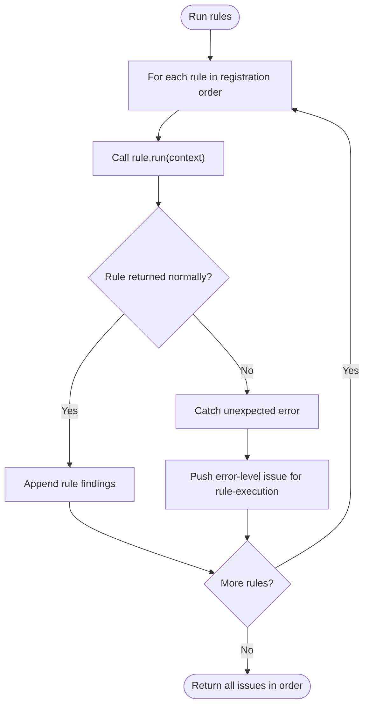
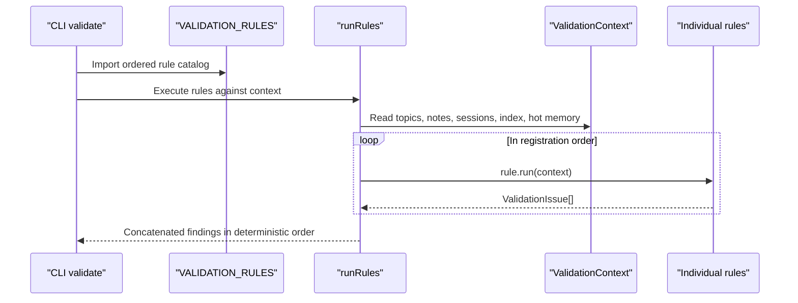

# Validation Rule Catalog

::: details Referenced Files in This Document

- [index.ts](https://github.com/Kuldeep2822k/cli/blob/main/src/validation/index.ts)
- [run-rules.ts](https://github.com/Kuldeep2822k/cli/blob/main/src/validation/run-rules.ts)
- [types.ts](https://github.com/Kuldeep2822k/cli/blob/main/src/validation/types.ts)
- [collect-vault.ts](https://github.com/Kuldeep2822k/cli/blob/main/src/validation/collect-vault.ts)
- [managed-note.ts](https://github.com/Kuldeep2822k/cli/blob/main/src/validation/managed-note.ts)
- [parse-frontmatter.ts](https://github.com/Kuldeep2822k/cli/blob/main/src/validation/rules/parse-frontmatter.ts)
- [valid-managed-note-kind.ts](https://github.com/Kuldeep2822k/cli/blob/main/src/validation/rules/valid-managed-note-kind.ts)
- [valid-palee-schema.ts](https://github.com/Kuldeep2822k/cli/blob/main/src/validation/rules/valid-palee-schema.ts)
- [valid-topic-id-format.ts](https://github.com/Kuldeep2822k/cli/blob/main/src/validation/rules/valid-topic-id-format.ts)
- [valid-topic-status.ts](https://github.com/Kuldeep2822k/cli/blob/main/src/validation/rules/valid-topic-status.ts)
- [no-duplicate-topic-id.ts](https://github.com/Kuldeep2822k/cli/blob/main/src/validation/rules/no-duplicate-topic-id.ts)
- [valid-dependency-list.ts](https://github.com/Kuldeep2822k/cli/blob/main/src/validation/rules/valid-dependency-list.ts)
- [no-missing-dependency.ts](https://github.com/Kuldeep2822k/cli/blob/main/src/validation/rules/no-missing-dependency.ts)
- [no-dependency-cycle.ts](https://github.com/Kuldeep2822k/cli/blob/main/src/validation/rules/no-dependency-cycle.ts)
- [valid-assessment-fields.ts](https://github.com/Kuldeep2822k/cli/blob/main/src/validation/rules/valid-assessment-fields.ts)
- [valid-topic-mastery.ts](https://github.com/Kuldeep2822k/cli/blob/main/src/validation/rules/valid-topic-mastery.ts)
- [valid-review-fields.ts](https://github.com/Kuldeep2822k/cli/blob/main/src/validation/rules/valid-review-fields.ts)
- [valid-review-dates.ts](https://github.com/Kuldeep2822k/cli/blob/main/src/validation/rules/valid-review-dates.ts)
- [valid-session-schema.ts](https://github.com/Kuldeep2822k/cli/blob/main/src/validation/rules/valid-session-schema.ts)
- [no-session-unknown-topic.ts](https://github.com/Kuldeep2822k/cli/blob/main/src/validation/rules/no-session-unknown-topic.ts)
- [valid-session-index.ts](https://github.com/Kuldeep2822k/cli/blob/main/src/validation/rules/valid-session-index.ts)
- [valid-hot-memory.ts](https://github.com/Kuldeep2822k/cli/blob/main/src/validation/rules/valid-hot-memory.ts)
- [safe-vault-paths.ts](https://github.com/Kuldeep2822k/cli/blob/main/src/validation/rules/safe-vault-paths.ts)

:::

## Table of Contents
1. [Introduction](#introduction)
2. [Project Structure](#project-structure)
3. [Core Components](#core-components)
4. [Architecture Overview](#architecture-overview)
5. [Detailed Component Analysis](#detailed-component-analysis)
6. [Dependency Analysis](#dependency-analysis)
7. [Performance Considerations](#performance-considerations)
8. [Troubleshooting Guide](#troubleshooting-guide)
9. [Conclusion](#conclusion)

## Introduction
This document catalogs every built-in validation rule in PALEE and explains how the framework executes them. A validation rule is a pure function that receives a fully collected vault snapshot and returns structured findings. The catalog covers:

- Parsing and schema validation
- Topic identity and lifecycle integrity
- Dependency graph correctness
- Assessment and review consistency
- Session management and derived memory state
- System health and path boundaries

The canonical execution order is defined once in the validation barrel and consumed by both the public API and the CLI runner. That order determines deterministic output, diagnostic clarity, and which rules can safely depend on earlier findings.

## Project Structure
The validation subsystem is organized as:

- **Framework contract**: shared types for issues, contexts, and rules.
- **Collector**: builds one consistent snapshot of topics, notes, sessions, session index, and hot memory.
- **Runner**: iterates registered rules in order and collects findings without filtering or short-circuiting.
- **Rule implementations**: one file per rule, each with an identifier, severity, optional fixability, and `run(context)` implementation.
- **Shared predicates**: managed-note eligibility used consistently across several rules.

```mermaid
graph TB
  subgraph "Validation Framework"
    Types["types.ts<br/>ValidationIssue, ValidationContext, ValidationRule"]
    Runner["run-rules.ts<br/>runRules()"]
    Collector["collect-vault.ts<br/>collectVault()"]
    ManagedNote["managed-note.ts<br/>isManagedNote(), isTopicNote()"]
  end

  subgraph "Rule Catalog"
    Parse["parse-frontmatter.ts"]
    Kind["valid-managed-note-kind.ts"]
    Schema["valid-palee-schema.ts"]
    TopicId["valid-topic-id-format.ts"]
    Status["valid-topic-status.ts"]
    DupId["no-duplicate-topic-id.ts"]
    DepList["valid-dependency-list.ts"]
    MissingDep["no-missing-dependency.ts"]
    Cycle["no-dependency-cycle.ts"]
    Assess["valid-assessment-fields.ts"]
    Mastery["valid-topic-mastery.ts"]
    ReviewFields["valid-review-fields.ts"]
    ReviewDates["valid-review-dates.ts"]
    SessionSchema["valid-session-schema.ts"]
    UnknownSession["no-session-unknown-topic.ts"]
    Index["valid-session-index.ts"]
    Hot["valid-hot-memory.ts"]
    Paths["safe-vault-paths.ts"]
  end

  Collector --> Runner
  Runner --> Types
  Runner --> Parse
  Runner --> Kind
  Runner --> Schema
  Runner --> TopicId
  Runner --> Status
  Runner --> DupId
  Runner --> DepList
  Runner --> MissingDep
  Runner --> Cycle
  Runner --> Assess
  Runner --> Mastery
  Runner --> ReviewFields
  Runner --> ReviewDates
  Runner --> SessionSchema
  Runner --> UnknownSession
  Runner --> Index
  Runner --> Hot
  Runner --> Paths
  Kind --> ManagedNote
  Schema --> ManagedNote
  TopicId --> ManagedNote
```

**Diagram sources**
- [types.ts:1-161](https://github.com/Kuldeep2822k/cli/blob/main/src/validation/types.ts#L1-L161)
- [run-rules.ts:1-60](https://github.com/Kuldeep2822k/cli/blob/main/src/validation/run-rules.ts#L1-L60)
- [collect-vault.ts:1-147](https://github.com/Kuldeep2822k/cli/blob/main/src/validation/collect-vault.ts#L1-L147)
- [managed-note.ts:1-87](https://github.com/Kuldeep2822k/cli/blob/main/src/validation/managed-note.ts#L1-L87)
- [index.ts:1-130](https://github.com/Kuldeep2822k/cli/blob/main/src/validation/index.ts#L1-L130)

**Section sources**
- [index.ts:1-130](https://github.com/Kuldeep2822k/cli/blob/main/src/validation/index.ts#L1-L130)
- [run-rules.ts:1-60](https://github.com/Kuldeep2822k/cli/blob/main/src/validation/run-rules.ts#L1-L60)
- [collect-vault.ts:1-147](https://github.com/Kuldeep2822k/cli/blob/main/src/validation/collect-vault.ts#L1-L147)
- [managed-note.ts:1-87](https://github.com/Kuldeep2822k/cli/blob/main/src/validation/managed-note.ts#L1-L87)

## Core Components
Before examining individual rules, it helps to understand the three shared components they all consume.

### Shared Issue Contract
Every finding is a `ValidationIssue` with:

| Field | Purpose |
|---|---|
| `ruleId` | Identifies the rule that reported the issue |
| `severity` | `error` gates exit codes; `warning` does not |
| `message` | Human-readable explanation |
| `file` | Relative vault path when applicable |
| `topicId` | Topic ID when the finding relates to a topic |
| `sessionId` | Session ID when the finding relates to a session |
| `field` | Frontmatter field when applicable |
| `details` | Rule-specific structured payload for JSON reporting and repair dispatch |

**Section sources**
- [types.ts:38-110](https://github.com/Kuldeep2822k/cli/blob/main/src/validation/types.ts#L38-L110)

### Shared Context Snapshot
`ValidationContext` is built once by `collectVault`. It contains:

| Field | Meaning |
|---|---|
| `vaultPath` | Absolute vault root |
| `files` | All scanned absolute paths, sorted by relative path |
| `topics` | Normalized PALEE topics loaded from readable files |
| `notes` | Raw per-file parse outcomes, including malformed or unreadable notes |
| `readIncomplete` | True if any note, session, or memory component could not be read |
| `memoryReadErrors` | Component-level failures reading `.palee/sessions`, `.palee/index.md`, or `.palee/hot.md` |
| `sessions` | Canonical session notes with parse/read outcomes |
| `sessionIndex` | Derived session index state: missing, corrupt, or ok |
| `hotMemory` | Tolerant read of `.palee/hot.md` |

Rules must never touch the filesystem directly. They inspect this read-only snapshot.

**Section sources**
- [types.ts:76-154](https://github.com/Kuldeep2822k/cli/blob/main/src/validation/types.ts#L76-L154)
- [collect-vault.ts:1-147](https://github.com/Kuldeep2822k/cli/blob/main/src/validation/collect-vault.ts#L1-L147)

### Managed Note Eligibility
Three rules need to agree on what counts as a PALEE-managed record. The shared predicate uses identity keys rather than guessing from schema markers:

| Identity key | Managed kind |
|---|---|
| `palee_id` | Topic |
| `session_id` | Session |
| `memory_id` | Hot memory |
| `type: "session_index"` | Derived session index |

A bare `palee_schema` marker alone is not enough to classify a note as a topic. This avoids false positives where schema-only notes were previously treated as malformed topic records.

**Section sources**
- [managed-note.ts:1-87](https://github.com/Kuldeep2822k/cli/blob/main/src/validation/managed-note.ts#L1-L87)

### Rule Runner
The runner executes every rule against the context in registration order. Findings are concatenated deterministically. A rule exception becomes an error-level issue attached to that rule’s identifier; it does not stop later rules.

**Diagram sources**
- [run-rules.ts:1-60](https://github.com/Kuldeep2822k/cli/blob/main/src/validation/run-rules.ts#L1-L60)

**Section sources**
- [run-rules.ts:1-60](https://github.com/Kuldeep2822k/cli/blob/main/src/validation/run-rules.ts#L1-L60)

## Architecture Overview
The canonical rule catalog is exported from the validation barrel and imported by the CLI. Its ordering is intentional:

1. Parse and read surface first.
2. Classify managed note kinds before schema checks.
3. Validate schema, identity, status, duplicates, and dependency shape.
4. Run graph semantics: missing references and cycles.
5. Validate assessment fields, then mastery consistency.
6. Validate SM-2 review fields, then review dates.
7. Validate session schema, unknown session references, and derived index.
8. Validate hot memory.
9. Audit vault path boundaries last.

```mermaid
flowchart LR
  P["Parse & Read"] --> K["Managed Note Kind"]
  K --> S["Schema Version"]
  S --> I["Topic ID Format"]
  I --> ST["Topic Status"]
  ST --> D["Duplicate Topic ID"]
  D --> DL["Dependency List Shape"]
  DL --> M["Missing Dependency"]
  M --> C["Dependency Cycle"]
  C --> A["Assessment Fields"]
  A --> MA["Topic Mastery Consistency"]
  MA --> RF["Review Fields"]
  RF --> RD["Review Dates"]
  RD --> SS["Session Schema"]
  SS --> SU["Unknown Session Topic"]
  SU --> SI["Session Index"]
  SI --> HM["Hot Memory"]
  HM --> VP["Safe Vault Paths"]
```

**Diagram sources**
- [index.ts:63-120](https://github.com/Kuldeep2822k/cli/blob/main/src/validation/index.ts#L63-L120)

**Section sources**
- [index.ts:63-120](https://github.com/Kuldeep2822k/cli/blob/main/src/validation/index.ts#L63-L120)

## Detailed Component Analysis

### Parsing and Schema Validation

#### parse-frontmatter
- **Purpose:** Detect malformed YAML frontmatter without aborting the vault scan.
- **Detection logic:** Scans the raw `context.notes` collection for entries whose parser recorded a parse error.
- **Severity:** Warning.
- **Repair capability:** Manual. The rule only reports the malformed file and parser message; it does not rewrite YAML.
- **Issue payload:**
  - `ruleId`: `parse-frontmatter`
  - `file`: relative vault path
  - `message`: includes the relative path and parser message
  - `details.parserMessage`: the original parse error
- **Ordering rationale:** Runs first so other rules can skip unparseable notes and avoid double-reporting.

**Section sources**
- [parse-frontmatter.ts:1-78](https://github.com/Kuldeep2822k/cli/blob/main/src/validation/rules/parse-frontmatter.ts#L1-L78)
- [index.ts:100-120](https://github.com/Kuldeep2822k/cli/blob/main/src/validation/index.ts#L100-L120)

#### read-failure
- **Purpose:** Report files that could not be read during collection, including vault notes, session notes, and memory subsystem components.
- **Severity:** Warning.
- **Repair capability:** None.
- **Issue payload:**
  - `ruleId`: `read-failure`
  - `file`: affected path
  - `message`: includes the path, error, and provisional-snapshot notice
  - `details.readError`: underlying read error
- **Ordering rationale:** Also runs early because later rules may observe an incomplete snapshot; its warning signals provisional results.

**Section sources**
- [parse-frontmatter.ts:29-78](https://github.com/Kuldeep2822k/cli/blob/main/src/validation/rules/parse-frontmatter.ts#L29-L78)
- [collect-vault.ts:84-147](https://github.com/Kuldeep2822k/cli/blob/main/src/validation/collect-vault.ts#L84-L147)

#### valid-managed-note-kind
- **Purpose:** Classify every PALEE-managed note by its identity fields and warn when the kind cannot be determined.
- **Detection logic:**
  - Walks scanned notes with `palee_schema`.
  - Accepts exactly one identity key or the session-index marker.
  - Warns on no identity key, conflicting identities, or internal notes (sessions, index, hot memory) claiming more than their location-based kind.
- **Severity:** Warning.
- **Repair capability:** Manual.
- **Issue payload:**
  - `ruleId`: `valid-managed-note-kind`
  - `file`: affected note path
  - `field`: `palee_schema`
  - `details.identities`: declared identity keys
  - `details.indexMarker`: whether the note also declares `type: "session_index"`
- **Ordering rationale:** Must run before schema and topic-ID rules so those rules know which notes are managed and which are user data.

**Section sources**
- [valid-managed-note-kind.ts:1-189](https://github.com/Kuldeep2822k/cli/blob/main/src/validation/rules/valid-managed-note-kind.ts#L1-L189)
- [managed-note.ts:1-87](https://github.com/Kuldeep2822k/cli/blob/main/src/validation/managed-note.ts#L1-L87)

#### valid-palee-schema
- **Purpose:** Require a supported integer `palee_schema` version on every managed note. Phase 1 supports version 1.
- **Detection logic:**
  - Applies only to notes classified as managed by the shared predicate.
  - Rejects missing, null, non-integer, and unsupported versions.
  - Ignores non-managed notes.
- **Severity:** Error.
- **Repair capability:** Manual.
- **Issue payload:**
  - `ruleId`: `valid-palee-schema`
  - `file`: affected note path
  - `field`: `palee_schema`
  - `details.actual`: the stored value
- **Ordering rationale:** Runs after kind classification but before topic identity checks.

**Section sources**
- [valid-palee-schema.ts:1-79](https://github.com/Kuldeep2822k/cli/blob/main/src/validation/rules/valid-palee-schema.ts#L1-L79)
- [managed-note.ts:1-87](https://github.com/Kuldeep2822k/cli/blob/main/src/validation/managed-note.ts#L1-L87)

### Topic Integrity

#### valid-topic-id-format
- **Purpose:** Enforce the centralized topic ID policy: IDs must start with `T-` and use lowercase kebab-case slug segments.
- **Detection logic:**
  - Applies only to notes classified as topic notes by the shared predicate.
  - Skips parse errors.
  - Validates the raw `palee_id` value exactly as stored.
- **Severity:** Error.
- **Repair capability:** None. The rule is read-only and does not mutate legacy snake-case IDs.
- **Issue payload:**
  - `ruleId`: `valid-topic-id-format`
  - `file`: affected note path
  - `topicId`: only present when the raw value is a string
  - `field`: `palee_id`
  - `details.expected`: required format description
  - `details.actual`: raw stored value
- **Ordering rationale:** Runs after schema validation so managed notes are known, but before duplicate and dependency checks so malformed IDs are visible at source.

**Section sources**
- [valid-topic-id-format.ts:1-75](https://github.com/Kuldeep2822k/cli/blob/main/src/validation/rules/valid-topic-id-format.ts#L1-L75)
- [managed-note.ts:33-87](https://github.com/Kuldeep2822k/cli/blob/main/src/validation/managed-note.ts#L33-L87)

#### valid-topic-status
- **Purpose:** Ensure the stored status on topic notes is one of the four lifecycle values: `not_started`, `learning`, `paused`, `archived`.
- **Detection logic:**
  - Iterates normalized topics.
  - Skips absent `status`; adopt defaults are not defects.
  - Rejects explicit `null` and every non-string type.
- **Severity:** Error.
- **Repair capability:** Manual.
- **Issue payload:**
  - `ruleId`: `valid-topic-status`
  - `file`: affected topic path
  - `topicId`: normalized topic ID
  - `field`: `status`
  - `details.actual`: stored value
  - `details.allowed`: allowed lifecycle values
- **Ordering rationale:** Runs after topic identity checks because it operates on normalized topics.

**Section sources**
- [valid-topic-status.ts:1-62](https://github.com/Kuldeep2822k/cli/blob/main/src/validation/rules/valid-topic-status.ts#L1-L62)

#### no-duplicate-topic-id
- **Purpose:** Prevent two topic notes from sharing the same `palee_id`.
- **Detection logic:** Groups normalized topics by ID and reports one finding per duplicated ID, listing all involved files.
- **Severity:** Error.
- **Repair capability:** None. Resolving duplication requires manual authorship decisions.
- **Issue payload:**
  - `ruleId`: `no-duplicate-topic-id`
  - `topicId`: duplicated ID
  - `message`: count of notes using the ID
  - `details.files`: sorted list of affected paths
- **Ordering rationale:** Runs after identity and status checks so the topic set is stable.

**Section sources**
- [no-duplicate-topic-id.ts:1-48](https://github.com/Kuldeep2822k/cli/blob/main/src/validation/rules/no-duplicate-topic-id.ts#L1-L48)

### Dependency Graph Validation

#### valid-dependency-list
- **Purpose:** Validate the raw shape of `depends_on` and the legacy `dependencies` alias before normalization.
- **Detection logic:**
  - Treats missing or null as an empty list.
  - Rejects non-array values.
  - Rejects non-string, null, or empty-string array items.
  - Rejects self-references.
  - Reports duplicate entries as warnings because normalization already deduplicates them.
  - Emits an advisory warning when the legacy `dependencies` key is present.
  - Protects against circular YAML structures in diagnostic serialization.
- **Severity:** Mixed. Shape and self-reference errors are errors; duplicate entries are warnings.
- **Repair capability:** Manual. Only duplicate entries are structurally safe to remove; shape errors and self-references require human judgment.
- **Issue payload:**
  - `ruleId`: `valid-dependency-list`
  - `file`: affected topic path
  - `topicId`: normalized topic ID
  - `field`: `depends_on` or `dependencies`
  - `details.actual`: display-safe representation of the offending value
- **Ordering rationale:** Must run before missing-dependency and cycle rules so graph consumers receive clean, pre-normalized diagnostics.

**Section sources**
- [valid-dependency-list.ts:1-200](https://github.com/Kuldeep2822k/cli/blob/main/src/validation/rules/valid-dependency-list.ts#L1-L200)

#### no-missing-dependency
- **Purpose:** Detect dependencies that reference topic IDs not present in the vault.
- **Detection logic:** Builds a topic map from `context.topics` and delegates missing-edge detection to the engine.
- **Severity:** Warning. Missing prerequisites quarantine dependent topics but do not gate incremental scans.
- **Repair capability:** None.
- **Issue payload:**
  - `ruleId`: `no-missing-dependency`
  - `topicId`: dependent topic
  - `details.missing`: referenced but missing topic ID
- **Ordering rationale:** Runs after dependency-shape validation so malformed lists are diagnosed separately from dangling references.

**Section sources**
- [no-missing-dependency.ts:1-77](https://github.com/Kuldeep2822k/cli/blob/main/src/validation/rules/no-missing-dependency.ts#L1-L77)

#### no-dependency-cycle
- **Purpose:** Report every distinct dependency cycle in the topic graph.
- **Detection logic:** Builds a topic map and enumerates cycles through the bounded engine routine, capped at 1000.
- **Severity:** Error.
- **Repair capability:** None.
- **Issue payload:**
  - `ruleId`: `no-dependency-cycle`
  - `topicId`: leading node ID when available
  - `details.path`: canonical cycle path
  - When enumeration is truncated, an additional finding indicates additional cycles may exist.
- **Ordering rationale:** Runs after missing-dependency checks so cycle diagnostics follow structural dependency diagnostics.

**Section sources**
- [no-dependency-cycle.ts:1-74](https://github.com/Kuldeep2822k/cli/blob/main/src/validation/rules/no-dependency-cycle.ts#L1-L74)

### Assessment and Review Consistency

#### valid-assessment-fields
- **Purpose:** Validate raw assessment scores and `assessed_at` on topic notes.
- **Detection logic:**
  - Checks `conceptual`, `practical`, `debug`, `feynman`.
  - Missing values pass under the documented default policy.
  - Present values must be finite numbers in `[0.0, 1.0]`.
  - `assessed_at` must be null or a valid calendar date.
- **Severity:** Error.
- **Repair capability:** Manual.
- **Issue payload:**
  - `ruleId`: `valid-assessment-fields`
  - `file`: affected topic path
  - `topicId`: normalized topic ID
  - `field`: assessed score field or `assessed_at`
  - `details.actual`: display-safe value
- **Ordering rationale:** Runs before mastery consistency so malformed assessment data is diagnosed before comparing derived mastery.

**Section sources**
- [valid-assessment-fields.ts:1-79](https://github.com/Kuldeep2822k/cli/blob/main/src/validation/rules/valid-assessment-fields.ts#L1-L79)

#### valid-topic-mastery
- **Purpose:** Detect drift between stored `topic_mastery` and the computed weighted assessment formula.
- **Detection logic:**
  - Requires all four pillars to be present and shaped as finite numbers in `[0, 1]`.
  - Skips topics with absent or malformed pillar data.
  - Skips topics with invalid `assessed_at`.
  - Compares raw stored mastery against the computed value using a small epsilon for serialized-float drift.
- **Severity:** Warning.
- **Repair capability:** Safe. The rule recomputes mastery from validated assessment data.
- **Issue payload:**
  - `ruleId`: `valid-topic-mastery`
  - `file`: affected topic path
  - `topicId`: normalized topic ID
  - `field`: `topic_mastery`
  - `details.actual`: stored value
  - `details.expected`: computed value
- **Ordering rationale:** Runs after assessment-field validation so malformed assessments do not produce spurious mastery warnings.

**Section sources**
- [valid-topic-mastery.ts:1-183](https://github.com/Kuldeep2822k/cli/blob/main/src/validation/rules/valid-topic-mastery.ts#L1-L183)

#### valid-review-fields
- **Purpose:** Validate raw SM-2 review state against the engine’s numeric and enum contracts.
- **Detection logic:**
  - `ease_factor`: finite number ≥ 1.3.
  - `interval_days`: finite integer ≥ 1.
  - `repetition`: finite integer ≥ 0.
  - `lapses`: finite integer ≥ 0.
  - `last_quality`: null or integer 0–5.
  - Missing fields pass under adopt-default policy; explicit nulls on numeric counters are errors.
- **Severity:** Error.
- **Repair capability:** Manual per metadata, but the implementation exposes a best-effort field reset to adopt defaults.
- **Issue payload:**
  - `ruleId`: `valid-review-fields`
  - `file`: affected topic path
  - `topicId`: normalized topic ID
  - `field`: failing review field
  - `details.actual`: JSON-safe representation
- **Ordering rationale:** Runs before review-date validation so numeric/state defects are separated from temporal defects.

**Section sources**
- [valid-review-fields.ts:1-166](https://github.com/Kuldeep2822k/cli/blob/main/src/validation/rules/valid-review-fields.ts#L1-L166)

#### valid-review-dates
- **Purpose:** Validate raw review date fields and their chronological relationship.
- **Detection logic:**
  - `last_reviewed_at` and `due_at` must be null or strict zero-padded `YYYY-MM-DD` strings.
  - Full timestamps fail the date-only contract.
  - When both are valid dates, `due_at` must not precede `last_reviewed_at`.
- **Severity:** Error.
- **Repair capability:** Manual.
- **Issue payload:**
  - `ruleId`: `valid-review-dates`
  - `file`: affected topic path
  - `topicId`: normalized topic ID
  - `field`: `last_reviewed_at`, `due_at`, or the inversion pair
  - `details.actual` or `details.due_at` / `details.last_reviewed_at`
- **Ordering rationale:** Runs after review-field validation so date-only defects are isolated from numeric/state defects.

**Section sources**
- [valid-review-dates.ts:1-115](https://github.com/Kuldeep2822k/cli/blob/main/src/validation/rules/valid-review-dates.ts#L1-L115)

### Session Management

#### valid-session-schema
- **Purpose:** Validate canonical session notes under `.palee/sessions/`.
- **Detection logic:**
  - Requires parseable frontmatter.
  - Requires `palee_schema`, `session_id`, `topic_id`, and `started_at`.
  - Requires completed sessions to have `ended_at` and `status: "completed"`.
  - Requires draft sessions to have `status: "draft"` and `ended_at: null`.
  - Requires `session_id` to match the filename stem.
  - Requires ISO 8601 timestamps with explicit timezone designators and real calendar dates.
  - Requires `ended_at` not to precede `started_at`.
- **Severity:** Error.
- **Repair capability:** Manual.
- **Issue payload:**
  - `ruleId`: `valid-session-schema`
  - `file`: session note path
  - `sessionId`: parsed session ID
  - `details.actual`: parse error or relevant schema value
- **Ordering rationale:** Runs before cross-reference and index rules so malformed sessions are diagnosed before being interpreted.

**Section sources**
- [valid-session-schema.ts:1-200](https://github.com/Kuldeep2822k/cli/blob/main/src/validation/rules/valid-session-schema.ts#L1-L200)

#### no-session-unknown-topic
- **Purpose:** Report session records referencing topic IDs not present in the vault.
- **Detection logic:**
  - Skips sessions that failed parsing, lack a usable `topic_id`, or fail schema cleanliness checks.
  - Compares session `topic_id` against the set of collected topic IDs.
  - Does not exempt `T-general`; the warning identifies phantom-session behavior.
- **Severity:** Warning.
- **Repair capability:** Manual.
- **Issue payload:**
  - `ruleId`: `no-session-unknown-topic`
  - `file`: session note path
  - `sessionId`: session ID
  - `topicId`: missing topic ID
  - `details.topicId`: missing topic ID
- **Ordering rationale:** Runs after session schema validation so dangling references are only checked on well-shaped sessions.

**Section sources**
- [no-session-unknown-topic.ts:1-85](https://github.com/Kuldeep2822k/cli/blob/main/src/validation/rules/no-session-unknown-topic.ts#L1-L85)

#### valid-session-index
- **Purpose:** Validate `.palee/index.md` as a rebuildable derived view of confirmed sessions.
- **Detection logic:**
  - Missing index is valid.
  - Corrupt index is a warning with the parse error.
  - Wikilinks referencing confirmed sessions that do not exist are warnings.
  - Links to draft sessions are filtered out.
  - An empty index with confirmed sessions is not automatically reported.
- **Severity:** Warning.
- **Repair capability:** Safe. The index is fully rebuildable from canonical sessions.
- **Issue payload:**
  - `ruleId`: `valid-session-index`
  - `file`: `.palee/index.md`
  - `details.parseError` or `details.missingSession`
- **Ordering rationale:** Runs after session schema and unknown-topic checks so it validates the derived projection against established sessions.

**Section sources**
- [valid-session-index.ts:1-87](https://github.com/Kuldeep2822k/cli/blob/main/src/validation/rules/valid-session-index.ts#L1-L87)

### System Health

#### valid-hot-memory
- **Purpose:** Validate `.palee/hot.md` as a rebuildable derived view of learning context.
- **Detection logic:**
  - Missing hot memory is valid.
  - Unsupported schema version is a warning.
  - Requires `memory_id` to be `H-active`.
  - Rejects body content exceeding the writer’s word cap.
  - Skips reference checks when the overall vault snapshot is incomplete.
  - Warns when `last_session` or `active_topic` point to missing sessions or topics.
- **Severity:** Warning.
- **Repair capability:** Safe. Hot memory is rebuildable from canonical sessions.
- **Issue payload:**
  - `ruleId`: `valid-hot-memory`
  - `file`: `.palee/hot.md`
  - `field`: `palee_schema`, `memory_id`, `body`, `last_session`, or `active_topic`
  - `details.actual`, `details.expected`, `details.wordCount`, `details.maxWords`, `details.missingSession`, or `details.missingTopic`
- **Ordering rationale:** Runs after session and topic rules so reference checks can safely compare against complete sets.

**Section sources**
- [valid-hot-memory.ts:1-150](https://github.com/Kuldeep2822k/cli/blob/main/src/validation/rules/valid-hot-memory.ts#L1-L150)

#### safe-vault-paths
- **Purpose:** Audit that every managed path resolves inside the configured vault.
- **Detection logic:**
  - Normalizes backslashes to forward slashes.
  - Rejects `..` traversal, absolute paths, drive-letter prefixes, and intermediate `..` segments.
  - Checks topic loader paths, scanned note paths, and session note paths.
- **Severity:** Error.
- **Repair capability:** Manual. Deciding where a foreign note belongs is a human decision.
- **Issue payload:**
  - `ruleId`: `safe-vault-paths`
  - `file`: escaped path
  - `topicId` or `sessionId`: when applicable
  - `field`: `path`
  - `details.path`: escaped path
- **Ordering rationale:** Runs last because it audits the entire collected snapshot’s path surface after all semantic rules have had a chance to report.

**Section sources**
- [safe-vault-paths.ts:1-134](https://github.com/Kuldeep2822k/cli/blob/main/src/validation/rules/safe-vault-paths.ts#L1-L134)

## Dependency Analysis

### Rule Execution Order
The canonical order is:

1. `parse-frontmatter`
2. `read-failure`
3. `valid-managed-note-kind`
4. `valid-palee-schema`
5. `valid-topic-id-format`
6. `valid-topic-status`
7. `no-duplicate-topic-id`
8. `valid-dependency-list`
9. `no-missing-dependency`
10. `no-dependency-cycle`
11. `valid-assessment-fields`
12. `valid-topic-mastery`
13. `valid-review-fields`
14. `valid-review-dates`
15. `valid-session-schema`
16. `no-session-unknown-topic`
17. `valid-session-index`
18. `valid-hot-memory`
19. `safe-vault-paths`

**Diagram sources**
- [index.ts:63-120](https://github.com/Kuldeep2822k/cli/blob/main/src/validation/index.ts#L63-L120)
- [run-rules.ts:15-60](https://github.com/Kuldeep2822k/cli/blob/main/src/validation/run-rules.ts#L15-L60)

**Section sources**
- [index.ts:63-120](https://github.com/Kuldeep2822k/cli/blob/main/src/validation/index.ts#L63-L120)
- [run-rules.ts:15-60](https://github.com/Kuldeep2822k/cli/blob/main/src/validation/run-rules.ts#L15-L60)

### Why Ordering Matters
- **Determinism:** The runner preserves rule order and sorts outputs within each rule by file, topic ID, or details.
- **Diagnostic clarity:** Early rules explain why later data may be missing or malformed. For example, a malformed frontmatter finding explains why a schema or dependency check may not apply.
- **Scope safety:** Kind classification runs before schema and topic-ID rules so they operate on the same definition of “managed.”
- **Graph stability:** Raw dependency shape is validated before missing-reference and cycle detection.
- **Provisional snapshots:** Read failures and `readIncomplete` signal let downstream rules downgrade speculative findings.
- **Derived views last:** Session index and hot memory are derived projections; their warnings should not gate the command and should run after canonical sessions and topics are validated.

## Performance Considerations
- **Single-read snapshot:** `collectVault` reads each file once and threads raw content into both parse outcomes and topic loading. This avoids inconsistent snapshots under concurrent edits.
- **Pure rules:** Rules do not perform filesystem I/O, configuration reads, prompts, network calls, or console output.
- **Bounded graph work:** Cycle enumeration is capped to prevent dense graphs from stalling validation.
- **Sorted outputs:** Rules sort findings deterministically, which keeps large vault scans predictable even though sorting adds overhead.
- **Provisional optimization:** Many rules skip work when parse errors, read errors, or schema-clean checks fail, reducing redundant diagnostics.

## Troubleshooting Guide

### Common Diagnostic Patterns

| Symptom | Likely rule | What to inspect | Fix approach |
|---|---|---|---|
| Malformed YAML blocks appear repeatedly | `parse-frontmatter` | `details.parserMessage` and `file` | Repair YAML manually |
| Validation ran on incomplete data | `read-failure` | `details.readError` | Re-run after locks resolve or deleted files return |
| Managed note has no recognized identity | `valid-managed-note-kind` | `details.identities` | Add correct identity key or migrate the note |
| Managed note lacks supported schema version | `valid-palee-schema` | `details.actual` | Migrate or reject future-versioned data |
| Topic ID is not `T-` kebab-case | `valid-topic-id-format` | `details.actual` | Rename to valid topic ID |
| Two notes share one topic ID | `no-duplicate-topic-id` | `details.files` | Resolve ownership manually |
| Dependency field is not a clean string array | `valid-dependency-list` | `details.actual` | Correct shape; remove duplicates or self-references |
| Dependency points to a missing topic | `no-missing-dependency` | `details.missing` | Create the target or remove the reference |
| Graph contains a cycle | `no-dependency-cycle` | `details.path` | Break the prerequisite loop |
| Assessment score is out of range | `valid-assessment-fields` | `details.actual` | Correct score or clear invalid data |
| Stored mastery does not match formula | `valid-topic-mastery` | `details.actual`, `details.expected` | Let repair recompute or correct assessment data |
| SM-2 counter is out of bounds | `valid-review-fields` | `details.actual` | Reset corrupted fields manually or via best-effort repair |
| Review dates are malformed or inverted | `valid-review-dates` | `details.actual` or date pair | Correct date-only format and order |
| Session note is malformed | `valid-session-schema` | `details.actual` | Repair required fields and timestamp contract |
| Session references unknown topic | `no-session-unknown-topic` | `details.topicId` | Create the topic or update the session |
| Session index is corrupt or stale | `valid-session-index` | `details.parseError` or `details.missingSession` | Rebuild the index |
| Hot memory is malformed or oversized | `valid-hot-memory` | Relevant `details.*` | Rebuild hot memory |
| Path escapes vault boundary | `safe-vault-paths` | `details.path` | Move the note inside the vault |

**Section sources**
- [parse-frontmatter.ts:10-78](https://github.com/Kuldeep2822k/cli/blob/main/src/validation/rules/parse-frontmatter.ts#L10-L78)
- [valid-managed-note-kind.ts:30-189](https://github.com/Kuldeep2822k/cli/blob/main/src/validation/rules/valid-managed-note-kind.ts#L30-L189)
- [valid-palee-schema.ts:20-79](https://github.com/Kuldeep2822k/cli/blob/main/src/validation/rules/valid-palee-schema.ts#L20-L79)
- [valid-topic-id-format.ts:10-75](https://github.com/Kuldeep2822k/cli/blob/main/src/validation/rules/valid-topic-id-format.ts#L10-L75)
- [no-duplicate-topic-id.ts:10-48](https://github.com/Kuldeep2822k/cli/blob/main/src/validation/rules/no-duplicate-topic-id.ts#L10-L48)
- [valid-dependency-list.ts:10-200](https://github.com/Kuldeep2822k/cli/blob/main/src/validation/rules/valid-dependency-list.ts#L10-L200)
- [no-missing-dependency.ts:10-77](https://github.com/Kuldeep2822k/cli/blob/main/src/validation/rules/no-missing-dependency.ts#L10-L77)
- [no-dependency-cycle.ts:10-74](https://github.com/Kuldeep2822k/cli/blob/main/src/validation/rules/no-dependency-cycle.ts#L10-L74)
- [valid-assessment-fields.ts:10-79](https://github.com/Kuldeep2822k/cli/blob/main/src/validation/rules/valid-assessment-fields.ts#L10-L79)
- [valid-topic-mastery.ts:10-183](https://github.com/Kuldeep2822k/cli/blob/main/src/validation/rules/valid-topic-mastery.ts#L10-L183)
- [valid-review-fields.ts:10-166](https://github.com/Kuldeep2822k/cli/blob/main/src/validation/rules/valid-review-fields.ts#L10-L166)
- [valid-review-dates.ts:10-115](https://github.com/Kuldeep2822k/cli/blob/main/src/validation/rules/valid-review-dates.ts#L10-L115)
- [valid-session-schema.ts:10-200](https://github.com/Kuldeep2822k/cli/blob/main/src/validation/rules/valid-session-schema.ts#L10-L200)
- [no-session-unknown-topic.ts:10-85](https://github.com/Kuldeep2822k/cli/blob/main/src/validation/rules/no-session-unknown-topic.ts#L10-L85)
- [valid-session-index.ts:10-87](https://github.com/Kuldeep2822k/cli/blob/main/src/validation/rules/valid-session-index.ts#L10-L87)
- [valid-hot-memory.ts:10-150](https://github.com/Kuldeep2822k/cli/blob/main/src/validation/rules/valid-hot-memory.ts#L10-L150)
- [safe-vault-paths.ts:10-134](https://github.com/Kuldeep2822k/cli/blob/main/src/validation/rules/safe-vault-paths.ts#L10-L134)

## Conclusion
PALEE’s validation system separates concerns cleanly: one collector builds a single consistent snapshot, one runner executes rules in a fixed order, and each rule owns one aspect of vault integrity. The catalog balances strictness and resilience:

- Errors gate commands for structural, identity, schema, cycle, and path-boundary problems.
- Warnings protect operational quality without punishing transient read failures or derived-view staleness.
- Safe repairs are limited to clearly reversible operations such as rebuilding derived views or correcting mastered values.
- Manual repairs are required when authorship, ownership, or migration decisions are necessary.
- Deterministic ordering ensures that repeated runs produce predictable diagnostics, helping users prioritize the most foundational problems first.
