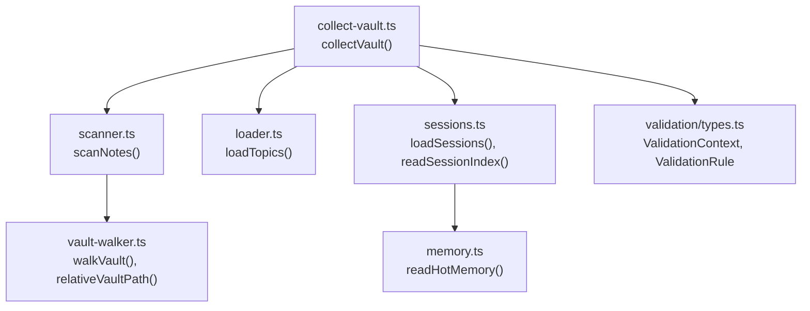
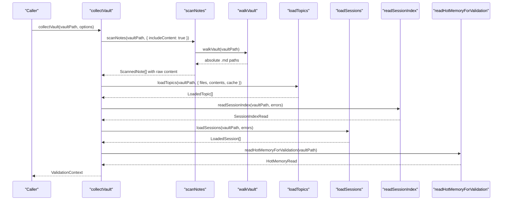
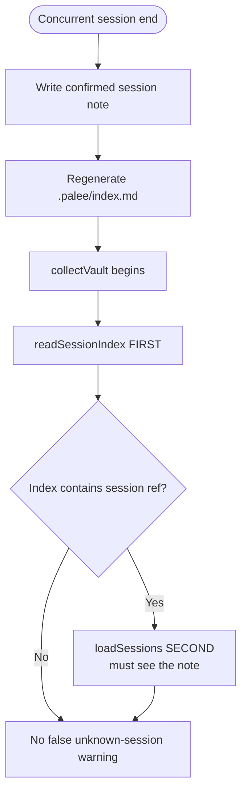
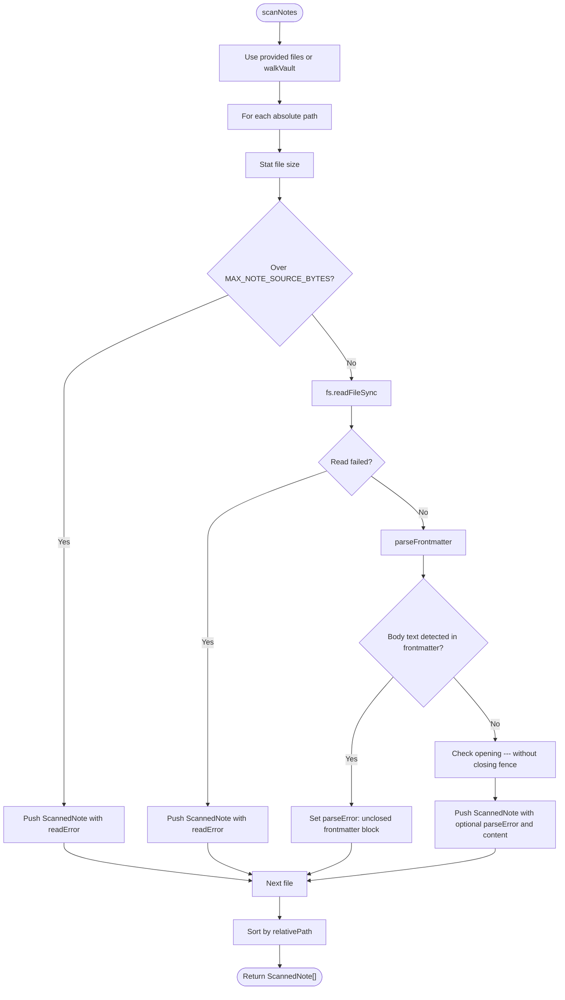
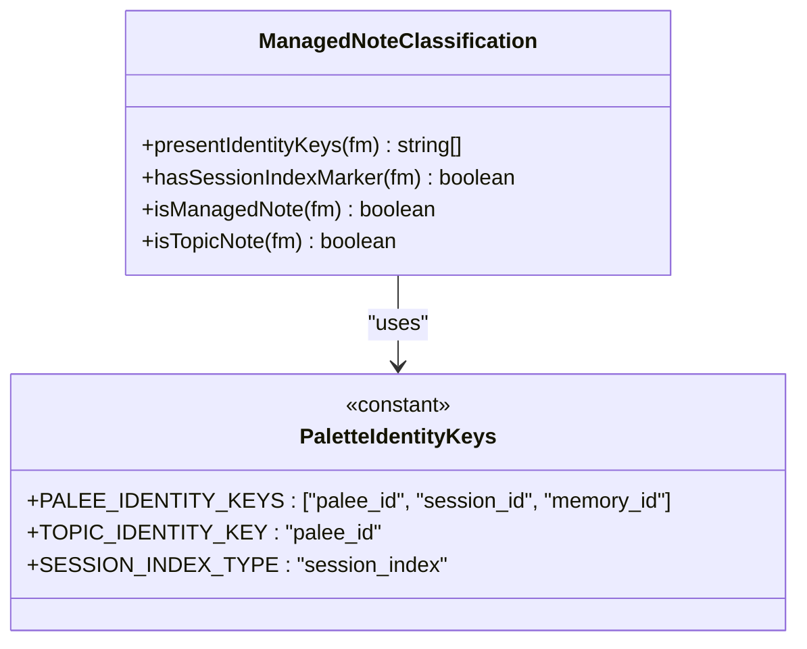
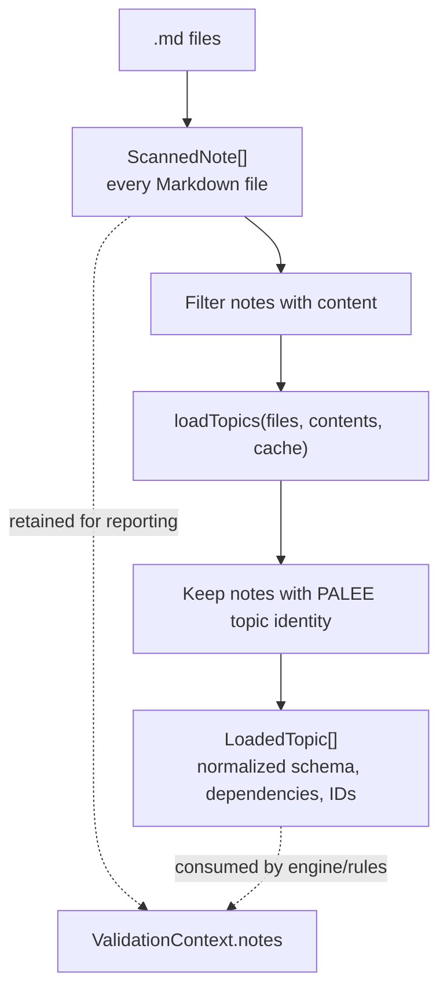
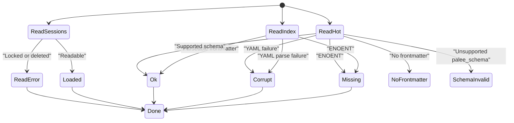
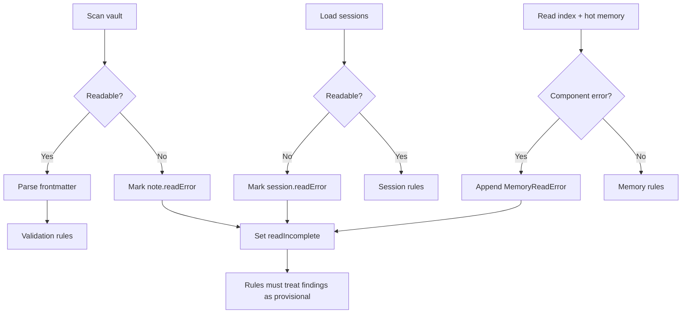
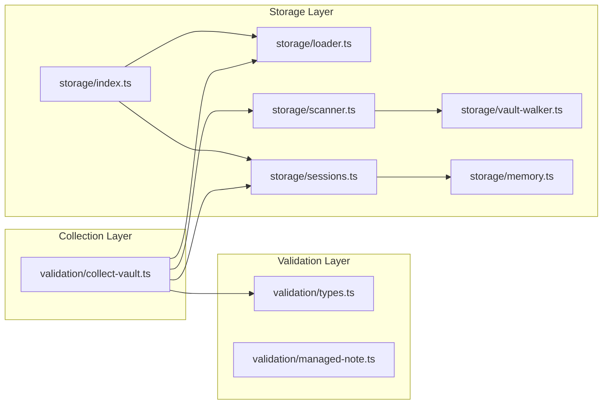
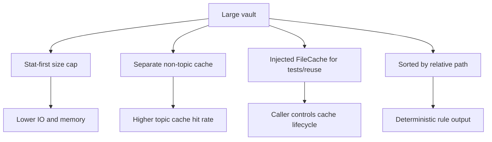

# Vault Collection System

::: details Referenced Files in This Document

- [collect-vault.ts](https://github.com/Kuldeep2822k/cli/blob/main/src/validation/collect-vault.ts)
- [types.ts (validation)](https://github.com/Kuldeep2822k/cli/blob/main/src/validation/types.ts)
- [managed-note.ts](https://github.com/Kuldeep2822k/cli/blob/main/src/validation/managed-note.ts)
- [scanner.ts](https://github.com/Kuldeep2822k/cli/blob/main/src/storage/scanner.ts)
- [vault-walker.ts](https://github.com/Kuldeep2822k/cli/blob/main/src/storage/vault-walker.ts)
- [sessions.ts](https://github.com/Kuldeep2822k/cli/blob/main/src/storage/sessions.ts)
- [memory.ts](https://github.com/Kuldeep2822k/cli/blob/main/src/storage/memory.ts)
- [loader.ts](https://github.com/Kuldeep2822k/cli/blob/main/src/storage/loader.ts)
- [index.ts (storage)](https://github.com/Kuldeep2822k/cli/blob/main/src/storage/index.ts)

:::

## Table of Contents
1. [Introduction](#introduction)
2. [Project Structure](#project-structure)
3. [Core Components](#core-components)
4. [Architecture Overview](#architecture-overview)
5. [Detailed Component Analysis](#detailed-component-analysis)
6. [Dependency Analysis](#dependency-analysis)
7. [Performance Considerations](#performance-considerations)
8. [Troubleshooting Guide](#troubleshooting-guide)
9. [Conclusion](#conclusion)

## Introduction
The vault collection system is the single entry point that builds the `ValidationContext` used by every PALEE validation rule. Its job is to take a vault root path and return one consistent, read-only snapshot containing:

- Every scanned Markdown file.
- Per-file frontmatter parse outcomes.
- Normalized `LoadedTopic` instances for PALEE topic notes.
- Canonical session notes from `.palee/sessions`.
- The derived session index from `.palee/index.md`.
- A tolerant hot-memory read from `.palee/hot.md`.
- Flags and structured errors describing incomplete or partial reads.

Its most important invariant is resilience: a malformed note, a locked file, a concurrently deleted note, or an unreadable memory subsystem component must never abort the entire validation run. Instead, it preserves partial results and lets rules report warnings while still validating the rest of the vault.

## Project Structure
The vault collection system lives at the boundary between storage readers and the validation framework. It does not implement filesystem traversal itself; it composes existing storage modules into one validated snapshot.

**Diagram sources**
- [collect-vault.ts:1-147](https://github.com/Kuldeep2822k/cli/blob/main/src/validation/collect-vault.ts#L1-L147)
- [scanner.ts:1-327](https://github.com/Kuldeep2822k/cli/blob/main/src/storage/scanner.ts#L1-L327)
- [vault-walker.ts:1-368](https://github.com/Kuldeep2822k/cli/blob/main/src/storage/vault-walker.ts#L1-L368)
- [loader.ts:1-150](https://github.com/Kuldeep2822k/cli/blob/main/src/storage/loader.ts#L1-L150)
- [sessions.ts:1-279](https://github.com/Kuldeep2822k/cli/blob/main/src/storage/sessions.ts#L1-L279)
- [memory.ts:1-400](https://github.com/Kuldeep2822k/cli/blob/main/src/storage/memory.ts#L1-L400)
- [types.ts (validation):1-161](https://github.com/Kuldeep2822k/cli/blob/main/src/validation/types.ts#L1-L161)

**Section sources**
- [collect-vault.ts:1-147](https://github.com/Kuldeep2822k/cli/blob/main/src/validation/collect-vault.ts#L1-L147)
- [index.ts (storage):1-142](https://github.com/Kuldeep2822k/cli/blob/main/src/storage/index.ts#L1-L142)

## Core Components
The collector composes six core responsibilities:

| Component | Responsibility | Failure Behavior |
|---|---|---|
| `collectVault` | Builds `ValidationContext` in one pass | Never throws on individual file problems |
| `scanNotes` | Reads every Markdown file and parses frontmatter | Returns per-file parse/read diagnostics |
| `walkVault` | Discovers `.md` files while ignoring hidden/dot directories and `node_modules` | Skips unreadable directories; validates symlink containment |
| `loadTopics` | Converts eligible topic notes into normalized `LoadedTopic` objects | Uses injected contents when provided; otherwise uses cache/disk |
| `loadSessions` | Reads canonical session notes from `.palee/sessions` | Includes unreadable notes with `readError` |
| `readSessionIndex` | Parses `.palee/index.md` as a rebuildable projection | Classifies as missing, corrupt, or ok |
| `readHotMemoryForValidation` | Reads `.palee/hot.md` under its state contract | Treats ENOENT as missing; other errors become component read failures |

**Section sources**
- [collect-vault.ts:1-147](https://github.com/Kuldeep2822k/cli/blob/main/src/validation/collect-vault.ts#L1-L147)
- [scanner.ts:1-327](https://github.com/Kuldeep2822k/cli/blob/main/src/storage/scanner.ts#L1-L327)
- [vault-walker.ts:1-368](https://github.com/Kuldeep2822k/cli/blob/main/src/storage/vault-walker.ts#L1-L368)
- [sessions.ts:1-279](https://github.com/Kuldeep2822k/cli/blob/main/src/storage/sessions.ts#L1-L279)
- [memory.ts:1-400](https://github.com/Kuldeep2822k/cli/blob/main/src/storage/memory.ts#L1-L400)
- [loader.ts:1-150](https://github.com/Kuldeep2822k/cli/blob/main/src/storage/loader.ts#L1-L150)
- [types.ts (validation):1-161](https://github.com/Kuldeep2822k/cli/blob/main/src/validation/types.ts#L1-L161)

## Architecture Overview
The collector follows a strict single-pass design so that concurrent edits cannot make different parts of validation observe inconsistent vault snapshots.

**Diagram sources**
- [collect-vault.ts:40-147](https://github.com/Kuldeep2822k/cli/blob/main/src/validation/collect-vault.ts#L40-L147)
- [scanner.ts:150-327](https://github.com/Kuldeep2822k/cli/blob/main/src/storage/scanner.ts#L150-L327)
- [vault-walker.ts:100-200](https://github.com/Kuldeep2822k/cli/blob/main/src/storage/vault-walker.ts#L100-L200)
- [loader.ts:1-150](https://github.com/Kuldeep2822k/cli/blob/main/src/storage/loader.ts#L1-L150)
- [sessions.ts:120-279](https://github.com/Kuldeep2822k/cli/blob/main/src/storage/sessions.ts#L120-L279)
- [memory.ts:60-120](https://github.com/Kuldeep2822k/cli/blob/main/src/storage/memory.ts#L60-L120)

### Why Order Matters Under Concurrent Session End
The collector reads the session index before loading sessions. This ordering closes a race window during a concurrent session completion:

1. The writer writes the confirmed session note.
2. The writer regenerates the index.
3. If the index is read first, any index reference implies the session note already exists.
4. If sessions were read first, a regenerated index could refer to a session note the earlier read missed, producing a false unknown-session warning.

This is why the collector deliberately calls `readSessionIndex` before `loadSessions`.

**Diagram sources**
- [collect-vault.ts:90-120](https://github.com/Kuldeep2822k/cli/blob/main/src/validation/collect-vault.ts#L90-L120)
- [sessions.ts:201-279](https://github.com/Kuldeep2822k/cli/blob/main/src/storage/sessions.ts#L201-L279)

## Detailed Component Analysis

### Single-Pass Vault Scanning
`scanNotes` is the foundation of the single-pass guarantee. When called with `includeContent: true`, it captures each readable file's raw bytes once. Those bytes are then threaded into `loadTopics` through the `contents` map.

Key behaviors:

- Uses a pre-scanned file list when provided, avoiding duplicate vault walks.
- Applies a stat-first size guard before reading, rejecting oversized documents with a bounded diagnostic instead of loading them fully.
- Retains entries for unreadable files with `readError` set rather than dropping them.
- Parses YAML frontmatter and preserves parse errors per file.
- Detects unclosed frontmatter blocks where body text was accidentally parsed as YAML.
- Sorts results by relative path for deterministic output.

**Diagram sources**
- [scanner.ts:150-327](https://github.com/Kuldeep2822k/cli/blob/main/src/storage/scanner.ts#L150-L327)
- [vault-walker.ts:100-200](https://github.com/Kuldeep2822k/cli/blob/main/src/storage/vault-walker.ts#L100-L200)

**Section sources**
- [scanner.ts:1-327](https://github.com/Kuldeep2822k/cli/blob/main/src/storage/scanner.ts#L1-L327)
- [vault-walker.ts:1-368](https://github.com/Kuldeep2822k/cli/blob/main/src/storage/vault-walker.ts#L1-L368)

### Managed Note Classification
The managed-note classification system answers the shared question: “Is this note PALEE-controlled?” It is used by multiple validation rules so they can agree on identity, topics, and schema ownership.

Managed kinds include:

| Kind | Identity Signal | Purpose |
|---|---|---|
| Topic | `palee_id` present | Subject note owned by PALEE identity policy |
| Session | `session_id` present | Canonical session record |
| Hot memory | `memory_id` present | Working memory record |
| Derived index | `type: "session_index"` | Rebuildable session catalog |

Important rules:

- Eligibility is based on key presence, not value type. Malformed identity data is still treated as PALEE-owned.
- A note with only `palee_schema` is marked as touched but is NOT a topic note.
- Conflicting identities (for example, both `palee_id` and `session_id`) are not clean topic notes; they are handled by the kind rule rather than silently bypassed.
- `isTopicNote` requires exactly one identity key, that key must be `palee_id`, and the note must not be the session index marker.

**Diagram sources**
- [managed-note.ts:1-87](https://github.com/Kuldeep2822k/cli/blob/main/src/validation/managed-note.ts#L1-L87)

**Section sources**
- [managed-note.ts:1-87](https://github.com/Kuldeep2822k/cli/blob/main/src/validation/managed-note.ts#L1-L87)

### Raw Notes Versus Normalized Topics
Not every scanned note becomes a `LoadedTopic`. The relationship is intentionally layered:

1. **Scanned notes**: Every discovered Markdown file produces a `ScannedNote`, including non-topic files, malformed files, and unreadable files.
2. **Readable subset**: Only notes whose raw content was captured are passed to `loadTopics`.
3. **Normalized topics**: `loadTopics` filters eligible topic notes and converts them into `LoadedTopic` instances with normalized fields.

**Diagram sources**
- [collect-vault.ts:56-95](https://github.com/Kuldeep2822k/cli/blob/main/src/validation/collect-vault.ts#L56-L95)
- [loader.ts:1-150](https://github.com/Kuldeep2822k/cli/blob/main/src/storage/loader.ts#L1-L150)
- [types.ts (validation):60-161](https://github.com/Kuldeep2822k/cli/blob/main/src/validation/types.ts#L60-L161)

**Section sources**
- [collect-vault.ts:56-95](https://github.com/Kuldeep2822k/cli/blob/main/src/validation/collect-vault.ts#L56-L95)
- [loader.ts:1-150](https://github.com/Kuldeep2822k/cli/blob/main/src/storage/loader.ts#L1-L150)
- [types.ts (validation):60-161](https://github.com/Kuldeep2822k/cli/blob/main/src/validation/types.ts#L60-L161)

### Memory Subsystem Integration
The memory subsystem has three related pieces that the collector reads together:

| Piece | Path | State Model | Error Handling |
|---|---|---|---|
| Session index | `.palee/index.md` | `ok`, `missing`, `corrupt` | Missing is valid; unreadable is recorded as a component error |
| Session notes | `.palee/sessions/S-*.md`, `DRAFT-S-*.md` | One `LoadedSession` per matched filename | Unreadable notes keep `readError`; malformed notes keep `parseError` |
| Hot memory | `.palee/hot.md` | `ok`, `missing`, `no-frontmatter`, `corrupt`, `schema-invalid` | ENOENT maps to missing; other filesystem errors become component read errors |

#### Session Discovery
`loadSessions`:

- Enumerates `.palee/sessions`.
- Ignores non-Markdown files.
- Accepts only filenames starting with `S-` or `DRAFT-S-`.
- Derives session ID and draft status from the filename, not frontmatter.
- Returns sorted results for determinism.
- Includes unreadable notes with `readError` instead of dropping them.

#### Index Parsing
`readSessionIndex`:

- Treats absent index as `missing`, which is legal.
- Treats unparseable frontmatter as `corrupt`.
- Extracts session-shaped wikilinks (`[[S-...]]`, `[[DRAFT-S-...]]`).
- Deduplicates references.
- Ignores non-session links such as topic references.

#### Hot Memory Reading
`readHotMemoryForValidation` delegates to `readHotMemory`, which applies the documented state contract:

- ENOENT → `missing`.
- Present but no parsable frontmatter → `no-frontmatter`.
- Present but YAML fails → `corrupt`.
- Frontmatter present but unsupported schema version → `schema-invalid`.
- Supported schema version → `ok`.

**Diagram sources**
- [sessions.ts:120-279](https://github.com/Kuldeep2822k/cli/blob/main/src/storage/sessions.ts#L120-L279)
- [memory.ts:60-120](https://github.com/Kuldeep2822k/cli/blob/main/src/storage/memory.ts#L60-L120)

**Section sources**
- [sessions.ts:1-279](https://github.com/Kuldeep2822k/cli/blob/main/src/storage/sessions.ts#L1-L279)
- [memory.ts:1-400](https://github.com/Kuldeep2822k/cli/blob/main/src/storage/memory.ts#L1-L400)

### Concurrency, Locked Files, and Deleted Notes
The collector treats concurrency as expected, not exceptional. Three categories of transient filesystem state are handled differently:

| Scenario | Observed By | Behavior |
|---|---|---|
| File deleted mid-scan | Scanner, session loader | Entry retained with `readError`; `readIncomplete` becomes true |
| File locked by another process | Scanner, session loader | Entry retained with `readError`; graph rules treat findings provisionally |
| Directory replaced by a file | Session enumeration | Recorded as a component-level `MemoryReadError` |
| Index or hot memory exist but are unreadable | Memory reader | Recorded as a component-level `MemoryReadError` |
| Session note missing from disk after index update | Unknown-session and index rules | Prevented by reading index before sessions |

The collector sets `readIncomplete` when:

- Any scanned note has a `readError`.
- Any session note has a `readError`.
- Any memory-subsystem component-level read error occurred.

Rules must treat findings as provisional when `readIncomplete` is true because the underlying snapshot was incomplete.

**Diagram sources**
- [collect-vault.ts:108-147](https://github.com/Kuldeep2822k/cli/blob/main/src/validation/collect-vault.ts#L108-L147)
- [scanner.ts:230-327](https://github.com/Kuldeep2822k/cli/blob/main/src/storage/scanner.ts#L230-L327)
- [sessions.ts:120-200](https://github.com/Kuldeep2822k/cli/blob/main/src/storage/sessions.ts#L120-L200)

**Section sources**
- [collect-vault.ts:108-147](https://github.com/Kuldeep2822k/cli/blob/main/src/validation/collect-vault.ts#L108-L147)
- [scanner.ts:230-327](https://github.com/Kuldeep2822k/cli/blob/main/src/storage/scanner.ts#L230-L327)
- [sessions.ts:120-200](https://github.com/Kuldeep2822k/cli/blob/main/src/storage/sessions.ts#L120-L200)

### Error Collection Strategy
The collector prefers partial results over total failure. Errors are collected in two layers:

1. **Per-entity errors**: Stored on `ScannedNote.parseError`, `ScannedNote.readError`, `LoadedSession.parseError`, and `LoadedSession.readError`.
2. **Component-level errors**: Stored in `ValidationContext.memoryReadErrors` as `MemoryReadError` objects carrying a relative path and error message.

This separation matters because:

- Per-entity errors identify specific files.
- Component-level errors identify infrastructure gaps such as an unreadable sessions directory, unreadable index, or unreadable hot memory.
- The `read-failure` rule reports provisional snapshot conditions.
- Other rules skip unreadable entities while still running against the rest of the vault.

**Section sources**
- [types.ts (validation):60-161](https://github.com/Kuldeep2822k/cli/blob/main/src/validation/types.ts#L60-L161)
- [sessions.ts:30-120](https://github.com/Kuldeep2822k/cli/blob/main/src/storage/sessions.ts#L30-L120)
- [collect-vault.ts:100-147](https://github.com/Kuldeep2822k/cli/blob/main/src/validation/collect-vault.ts#L100-L147)

## Dependency Analysis
The collector sits above storage and below the validation framework. It imports concrete storage functions and typed contracts rather than importing filesystem APIs directly.

**Diagram sources**
- [collect-vault.ts:1-39](https://github.com/Kuldeep2822k/cli/blob/main/src/validation/collect-vault.ts#L1-L39)
- [index.ts (storage):1-142](https://github.com/Kuldeep2822k/cli/blob/main/src/storage/index.ts#L1-L142)

### Coupling and Cohesion
- `collect-vault.ts` is cohesive around snapshot assembly. It owns read order, error aggregation, and the `readIncomplete` flag.
- `scanner.ts` is cohesive around per-file scanning and frontmatter parsing.
- `sessions.ts` is cohesive around memory subsystem reads.
- `memory.ts` owns the hot-memory state contract.
- `loader.ts` owns topic normalization and caching.
- `vault-walker.ts` owns vault traversal and path containment helpers.

There is no circular dependency among these modules. The collector depends downward on storage; storage modules do not depend back on validation.

**Section sources**
- [collect-vault.ts:1-39](https://github.com/Kuldeep2822k/cli/blob/main/src/validation/collect-vault.ts#L1-L39)
- [index.ts (storage):1-142](https://github.com/Kuldeep2822k/cli/blob/main/src/storage/index.ts#L1-L142)

## Performance Considerations
The collector is designed for large vaults and repeated scans.

### Single-Pass Reading
Raw bytes are captured once by `scanNotes` and reused by `loadTopics`. This avoids:

- Double filesystem reads.
- Cache revalidation that could observe a different vault snapshot.
- Divergent parse outcomes across rules.

### Caching Mechanisms
- `loadTopics` supports an injected `FileCache<LoadedTopic>` and falls back to a module-level shared cache when none is provided.
- Negative caching for non-topic notes is isolated in a separate cache with its own cap to avoid evicting real topics.
- Snapshot-injected content bypasses disk reads and caches entirely, preserving snapshot isolation.

### Memory Usage Optimization
- Oversized notes are rejected early via stat checks instead of being fully loaded.
- Non-topic negative cache entries store only lightweight metadata (path, mtime, size, fingerprint), keeping resident memory low even in large vaults.
- Session and index reads are bounded to their respective components and tolerate absence.
- Hot memory reading is tolerant and classified rather than throwing on common states like missing or no frontmatter.

### Large-Vault Characteristics
| Concern | Approach |
|---|---|
| Many ordinary Markdown files | Separate non-topic cache prevents topic lookup eviction pressure |
| Very large notes | Stat-first cap prevents full file load |
| Thousands of topics | Optional injected cache allows test isolation and reuse |
| Partial vault scans | Pre-scanned file list avoids redundant `walkVault` calls |
| Deterministic output | Results are sorted by relative path |

**Diagram sources**
- [scanner.ts:230-260](https://github.com/Kuldeep2822k/cli/blob/main/src/storage/scanner.ts#L230-L260)
- [loader.ts:20-120](https://github.com/Kuldeep2822k/cli/blob/main/src/storage/loader.ts#L20-L120)
- [collect-vault.ts:56-75](https://github.com/Kuldeep2822k/cli/blob/main/src/validation/collect-vault.ts#L56-L75)

**Section sources**
- [scanner.ts:230-327](https://github.com/Kuldeep2822k/cli/blob/main/src/storage/scanner.ts#L230-L327)
- [loader.ts:20-120](https://github.com/Kuldeep2822k/cli/blob/main/src/storage/loader.ts#L20-L120)
- [collect-vault.ts:56-75](https://github.com/Kuldeep2822k/cli/blob/main/src/validation/collect-vault.ts#L56-L75)

## Troubleshooting Guide

### Symptom: Validation runs on an incomplete snapshot
**Likely cause:** At least one file was locked, deleted, oversized, or part of a memory subsystem component that could not be enumerated or read.

**What to inspect:**
- `ValidationContext.readIncomplete`
- `ScannedNote.readError`
- `LoadedSession.readError`
- `ValidationContext.memoryReadErrors`

**Expected behavior:** Validation continues with partial results. Rules should treat findings as provisional when `readIncomplete` is true.

**Section sources**
- [types.ts (validation):80-161](https://github.com/Kuldeep2822k/cli/blob/main/src/validation/types.ts#L80-L161)
- [collect-vault.ts:108-147](https://github.com/Kuldeep2822k/cli/blob/main/src/validation/collect-vault.ts#L108-L147)

### Symptom: Unknown-session or missing-dependency warnings appear intermittently
**Likely cause:** Concurrent write activity during scanning.

**Mitigations built into the collector:**
- Index is read before sessions to reduce false unknown-session reports.
- Unreadable session notes are retained with `readError` so the snapshot is visible.
- Graph rules must treat findings as provisional when `readIncomplete` is true.

**Recommended action:** Rerun validation after writes settle, or investigate locking behavior in the writer path.

**Section sources**
- [collect-vault.ts:90-120](https://github.com/Kuldeep2822k/cli/blob/main/src/validation/collect-vault.ts#L90-L120)
- [sessions.ts:120-200](https://github.com/Kuldeep2822k/cli/blob/main/src/storage/sessions.ts#L120-L200)

### Symptom: Unclosed frontmatter warnings
**Likely cause:** A Markdown heading or body content was parsed as YAML because the closing `---` fence is missing.

**Where it is detected:**
- Body-text detection inside parsed frontmatter.
- Opening fence detection when no frontmatter is found but the document starts with `---`.

**Recommended action:** Close the frontmatter block explicitly or replace a thematic-break `---` with `***`.

**Section sources**
- [scanner.ts:200-327](https://github.com/Kuldeep2822k/cli/blob/main/src/storage/scanner.ts#L200-L327)

### Symptom: Managed-note classification seems inconsistent
**Likely cause:** Multiple rules previously defined their own identity-key sets.

**Resolution:** Use the shared managed-note predicates in `managed-note.ts`. They centralize eligibility, topic identification, and index-marker handling so all rules agree.

**Section sources**
- [managed-note.ts:1-87](https://github.com/Kuldeep2822k/cli/blob/main/src/validation/managed-note.ts#L1-L87)

### Symptom: Hot memory appears missing or invalid
**Likely cause:** `.palee/hot.md` is absent, malformed, or uses an unsupported schema version.

**How to interpret the result:**
- `missing`: Valid fresh state.
- `no-frontmatter`: File exists but has no usable frontmatter.
- `corrupt`: YAML parsing failed.
- `schema-invalid`: Unsupported `palee_schema`.
- `ok`: Supported and ready.

**Section sources**
- [memory.ts:60-120](https://github.com/Kuldeep2822k/cli/blob/main/src/storage/memory.ts#L60-L120)
- [sessions.ts:250-279](https://github.com/Kuldeep2822k/cli/blob/main/src/storage/sessions.ts#L250-L279)

## Conclusion
The vault collection system is a deliberate composition layer that turns a mutable filesystem into one immutable-looking `ValidationContext`. Its design emphasizes consistency over perfection:

- Every Markdown file is represented.
- Every error is preserved.
- Every subsystem is read in a controlled order.
- Every rule receives the same instant in time.
- Partial vaults produce partial, diagnosable results.

For users extending PALEE, the right extension points are:

- New validation rules consume `ValidationContext` and return pure issues.
- New managed-note logic should extend or consult `managed-note.ts`.
- New memory subsystem consumers should follow the tolerant-read pattern in `sessions.ts` and `memory.ts`.
- New topic loaders should respect the injected-cache seam and snapshot-injection contract in `loader.ts`.
